# Async scheduling and execution

Under SGLang's overlap schedule the scheduler launches step N+1 before it processes step N's result. The host's work
for one step (processing the previous result, choosing the next batch, building and uploading its inputs) then runs
while the NeuronCores run another step. This page describes how the plugin runs that schedule on Trainium: what each
SGLang loop does per step, how a decode's input ids stay on the device, how inputs and outputs move between the host
and the device without stalling the graphs, where the flow has to wait for the device and why it stays correct, and
how to observe it.

How a step's graphs are bucketed, compiled and fenced is in [The runtime](runtime.md). How the prefill and decode
servers move the KV is in [Disaggregated inference](disaggregated-inference.md), and how a decode server's DP ranks stay
in lockstep is in [Parallelism](parallelism.md).

## Overview

Without the overlap schedule a step is strictly sequential: the host builds the batch, launches its graph, waits for
it, reads its outputs, processes them, and only then builds the next batch. The device idles while the host works, and
the host idles while the device runs. The overlap schedule removes both idle phases by keeping the host one step ahead
of the device. Three mechanisms make that work on Trainium:

1. **One step ahead.** SGLang's overlap loops launch step N+1 first and process step N's result after. A launch
   returns as soon as the graph's execution is queued, so step N+1 waits on the device behind step N.
2. **Tokens stay on the device.** A decode's input ids are the tokens the previous decode sampled. The graph of step
   N+1 takes step N's token vector as a device input and assembles its own ids from it, so a decode never waits for
   the host to read the previous decode's tokens. Only an aggregated request's first decode reads a token on the
   host, the one its prefill sampled ([The token relay](#the-token-relay), [Fixed-width decode token
   I/O](#fixed-width-decode-token-io)).
3. **One read per step, off the critical path.** Each step's outputs reach the host, normally in one read, once its
   graph has finished. An aggregated or prefill server reads on a copy thread; a decode server reads on the scheduler
   thread when it processes the result. The scheduler waits for a step's outputs only when it processes that step's
   result, by which time the next step is already queued. The exceptions are an aggregated request's first decode,
   the drains and a DP-attention prefill's idle dummy ([When the async flow
   breaks](#when-the-async-flow-breaks-and-how-it-stays-safe)).

Async execution is on for every launch unless the launch passes `--disable-overlap-schedule` ([Turning it on and
off](#turning-it-on-and-off)).

### Terms

| Term | Meaning |
| --- | --- |
| Step | One `Scheduler.run_batch` that launches a compiled graph: one request's prefill, a decode batch, or an idle DP rank's dummy. A decode server admits requests whose KV has landed inside `get_next_disagg_decode_batch_to_run`, by merging their PREBUILT batch into the running batch, so that batch never reaches `run_batch`. |
| Launch | The submission of a step's graph to torch-neuronx. It returns once the execution is queued, before the graph runs. |
| Launch event | The event `device_io.after_launch` records on the current stream right after a launch (`sglang_neuron/backend/device_io.py`). Every read of the step's outputs waits for it. |
| Pending sample | `PendingSample`, the device outputs of a launched step that have not reached the host yet (`sglang_neuron/model_executor/async_execution.py`). |
| Token relay | `TokenRelay`, the per-process record of each running request's latest sampled token on the device, keyed by the request's pool slot and that slot's generation. |
| Slot generation | SGLang's `ReqToTokenPool.req_generation[slot]`, a counter that SGLang increments each time it allocates the slot and never resets, so a value read earlier tells a slot's current request from a previous one. |
| Token width W | The width of every asynchronous decode graph's token input and output: the largest decode batch bucket, which is always the runtime's per-scheduler batch (`decode_batch_buckets` adds it; [Buckets](runtime.md#buckets)). |
| Token control | `token_control`, the `[2, W]` int32 input that every asynchronous decode graph takes beside the previous decode's token vector. Row 0 holds host token ids; row 1 holds, for each row r, the row of that vector that holds r's token, or -1 to take row 0's id. The identity control `[zeros(W); arange(W)]` passes the vector through unchanged ([Fixed-width decode token I/O](#fixed-width-decode-token-io)). |
| Role | An aggregated server, or a prefill or decode server of a disaggregated deployment (`sglang_neuron/serving_policy.py`). Below, "prefill server" and "decode server" mean the disaggregated ones. |
| DP-attention decode | A decode server with attention DP above 1. Its ranks run the DP identity ([A DP-attention decode: the DP identity](parallelism.md#a-dp-attention-decode-the-dp-identity)): every rank launches every iteration while any rank has work, an idle dummy when it has none. |

## The synchronous baseline

Under `--disable-overlap-schedule` SGLang's `event_loop_normal` runs each iteration in order: receive requests and
broadcast them over the TP group, choose the next batch, `run_batch`, then `process_batch_result` (or `on_idle` when
there is no batch), and remember the batch. The host never builds step N+1 while step N runs.

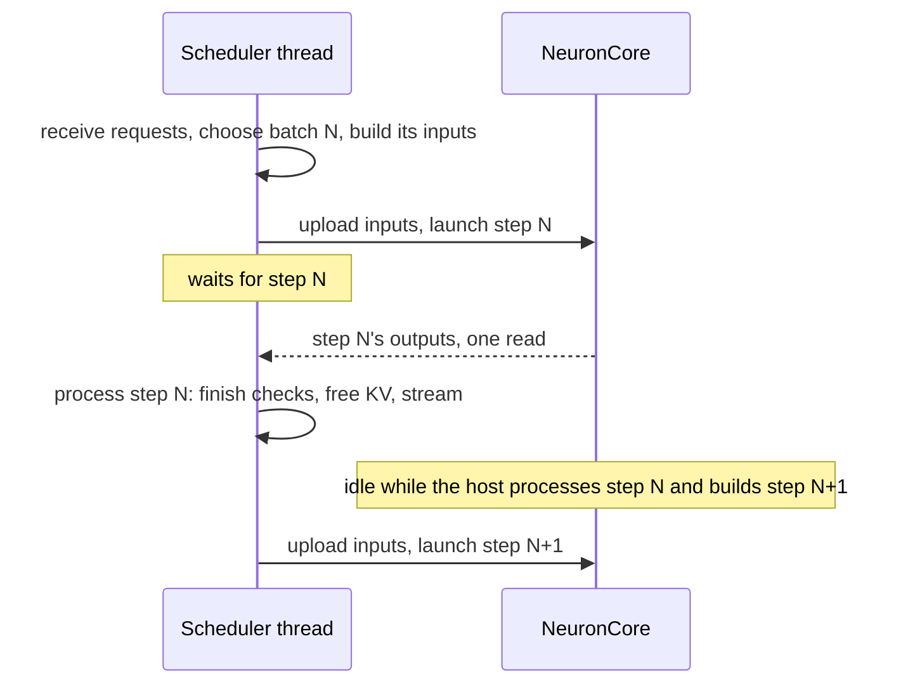

In this mode the plugin runs none of the async hooks. SGLang's `FutureMap` relays a decode's ids through its
`output_tokens_buf`, a host tensor, because the platform puts SGLang's tensors on its `cpu` device. A decode's input
ids are padded to the bucket and uploaded with the step's other inputs, and the graph has no fixed token width. `_run`
waits for the graph, reads every output in one `readback_many`, and refuses an id outside the vocabulary at once. The
side-stream uploads, the reuse of unchanged decode inputs and the program-switch fence ([The program-switch
fence](runtime.md#the-program-switch-fence)) work as under async execution. In the host trace a synchronous step's
`launch` row includes the wait for the device and carries no `+a`.

## The overlap flow

### An aggregated server, step by step

`event_loop_overlap` (SGLang's `sglang.srt.managers.scheduler`) runs every phase below on the scheduler thread. Only
the read of a step's outputs runs on the copy thread, `neuron-output_0` ([Who reads, and when](#who-reads-and-when)).
One iteration at the platform's defaults, with the plugin's work inside the launch:

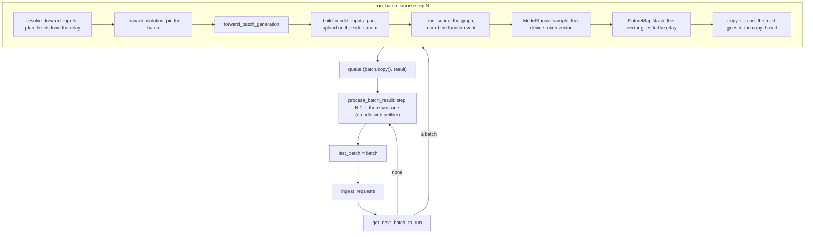

1. **Receive** requests (`ingest_requests`).
2. **Choose** the next batch (`get_next_batch_to_run`). The overlap loop merges the last prefill's request into the
   running batch before that prefill's result is processed. It leaves out of the next decode each request whose step
   in flight commits its last output by length (`_reqs_finishing_inflight`).
3. **Decide whether to overlap.** `is_disable_overlap_for_batch` makes the loop process the previous result first in
   two cases, and neither occurs here: two consecutive prefills under `SGLANG_DISABLE_CONSECUTIVE_PREFILL_OVERLAP`,
   which is off by default and which the platform does not set, and speculative decoding with a grammar, which the
   platform refuses.
4. **Launch** step N (`run_batch`, overlap branch):
   1. `resolve_forward_inputs`: for a decode batch the plugin's hook plans the ids from the token relay and sets a
      placeholder of the batch's size as `input_ids`. The plan does not read the device, except for a request's first
      decode after its prefill, whose token it takes from the prefill's own readback ([Planning a decode
      batch](#planning-a-decode-batch)). A prefill keeps SGLang's host ids.
   2. `_forward_isolation` pins the batch and a copy of its fields in a two-slot ring, so tensors a later step rebinds
      outlive the forward that reads them (`sglang_neuron/sglang_patches/batch_record_light.py` makes that copy one
      dictionary copy).
   3. `forward_batch_generation` builds the `ForwardBatch`, whose hook carries the plan over. A decode reaches the
      runtime through SGLang's graph-runner slot (`NeuronGraphRunner.execute`) and a prefill through the model's
      forward (`sglang_neuron/models/base.py`); both route by the step plan to `run_decode`, `run_prefill` or
      `run_idle`.
   4. `build_model_inputs` pads the exact metadata to the bucket and uploads the step's inputs on the side stream:
      every input for a prefill, and for a decode the positions and slot mapping and only those other inputs that
      changed ([Streams, uploads and events](#streams-uploads-and-events)).
   5. `_run` waits at the in-flight bound, calls the compiled graph and records the launch event. The graph submit
      runs the program-switch fence's hook and makes the default stream wait for the step's uploads.
   6. The outputs stay on the device. A `PendingSample` holds them and the step's device inputs, and `mark_pending`
      marks the result asynchronous (`neuron_async`).
   7. `ModelRunner.sample`, hooked by `_sample_on_device`, records the batch's top-logprob counts on the pending sample
      and returns the device token vector as the batch's `next_token_ids`. SGLang's host sampler never runs.
   8. SGLang publishes the new sequence lengths on the host, creates the result's `copy_done` event, and stashes the
      token vector in its `FutureMap`, whose hook hands it to the relay. `copy_to_cpu`, hooked by `_copy_result`,
      replaces `copy_done` with a fresh `CompletionEvent` ([Reading a step's outputs](#reading-a-steps-outputs)) and
      submits the step's read to the copy thread, which takes it up behind the previous step's read and waits for the
      launch event.
5. **Queue** `(batch.copy(), result)` on the result queue.
6. **Process step N-1's result** (`process_batch_result`). `copy_done.synchronize()` waits for the copy thread's read
   of step N-1, which completes as soon as that step finishes on the device. Then come SGLang's finish checks, the KV
   release of finished requests and the streaming of their outputs. With neither a batch nor a previous one,
   `on_idle` runs instead.
7. **Delayed sampling** (`launch_batch_sample_if_needed`) does nothing at the defaults: the grammar backend is `none`,
   and `SGLANG_ENABLE_DELAY_SAMPLE` is off by default (the platform neither sets nor refuses it).
8. **Remember** the batch as `last_batch`.

SGLang's own stream ordering does nothing here. Its write-after-read barrier runs only on CUDA or under
`SGLANG_ENABLE_WAR_BARRIER`, which the platform does not set, and on SGLang's `cpu` device its forward, schedule and
copy streams are torch's CPU stubs. The plugin orders the device work with torch-neuronx's streams instead.

### Where the overlap happens

Step N is launched before step N-1's result is processed, so it queues on the device behind step N-1. The host then
waits for step N-1, processes its result, and builds and launches step N+1 while step N runs. The device runs the steps
back to back as long as the host's work for one step, from processing a result to the next launch, is shorter than a
step on the device. At most two launches are outstanding: the running one and the queued one.

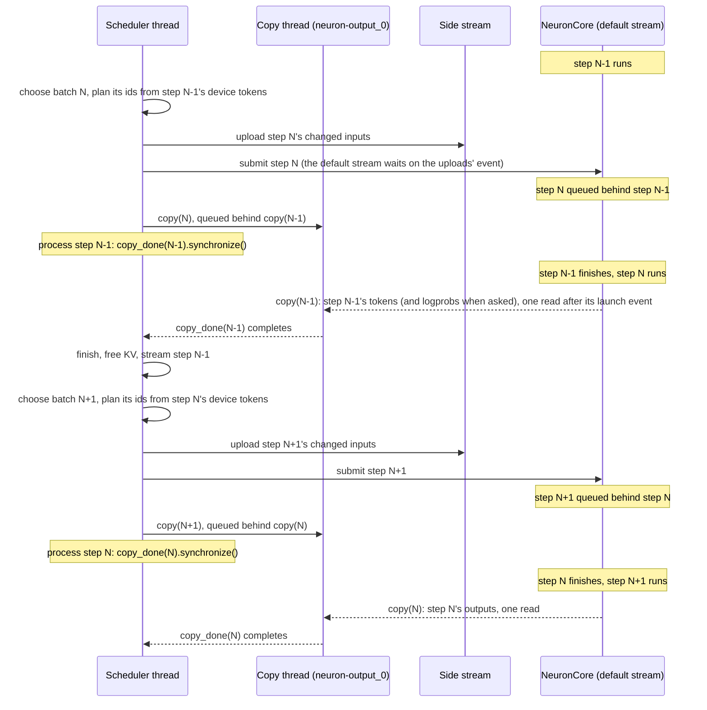

A decode server reads inline instead. Its `copy_to_cpu` hook stores the read on the step's completion event, and the
scheduler thread runs it when it processes the result. The order of launches and results is the same; only the
hand-off to the copy thread is gone:

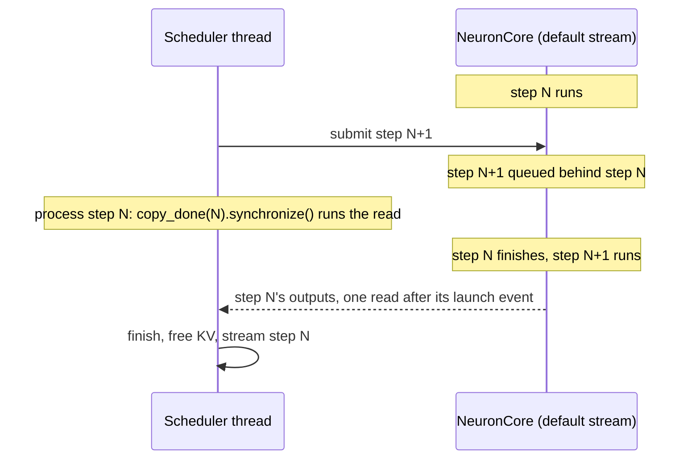

### A decode server

`event_loop_overlap_disagg_decode` keeps the same order: it prefetches the prefill DP ranks' queries, receives
requests, advances its preallocation and transfer queues (`process_decode_queue`), chooses the batch
(`get_next_disagg_decode_batch_to_run`), launches it, queues the result and processes the previous one.

- **Prebuilt requests.** A request whose KV has landed joins inside `get_next_disagg_decode_batch_to_run`:
  `get_new_prebuilt_batch` builds a PREBUILT batch of such requests, and its `process_prebuilt` stashes each request's
  last output id, the first token its prefill sampled, as a host tensor, which the relay records as a host row. The
  batch is then merged into the running batch before the decode batch is chosen, so it never reaches `run_batch`.
- **Every rank launches.** Under DP attention the DP identity gives a rank with no work an IDLE batch, so every rank
  launches a graph every iteration (`sglang_neuron/managers/dp_identity.py`). When no rank has work, every rank stops
  launching at the same iteration ([The control fence](parallelism.md#the-control-fence)).
- **One redundant forward.** SGLang resets `enable_skip_finishing_decode` when it enters a loop, and only the aggregated
  loop sets it. A request that finishes therefore still has one forward in flight (the in-flight bound's worth on the
  giga-kernel decode, [The giga-kernel decode's result lag](#the-giga-kernel-decodes-result-lag)), launched before its
  last result was processed. SGLang's result processing skips a finished request's row, and its KV release frees the
  extra token's slot, which that forward still writes ([Lifetimes while launches
  overlap](#lifetimes-while-launches-overlap)).
- **Inline read.** `configure(W, inline_results=True)` makes a decode server read each step's outputs on the scheduler
  thread, inside the result's `copy_done.synchronize()`. A decode server waits for a result only through that event,
  so a copy thread would add a thread hop and a wake-up to every step on every rank without taking any wait off the
  scheduler thread.

### The giga-kernel decode's result lag

On the giga-kernel decode every one of the 128 ranks meets the others at the kernel's barrier inside each step, so a
rank whose host runs late for one step holds all of them. There the loop is rebuilt to process each step's result only
after it has launched L more steps, L being the in-flight bound ([The in-flight bound](#the-in-flight-bound)), 2 by
default (`sglang_neuron/sglang_patches/pd_decode_result_lag.py`). A rank that falls behind for a step then takes from
the device queue instead of holding the barrier.

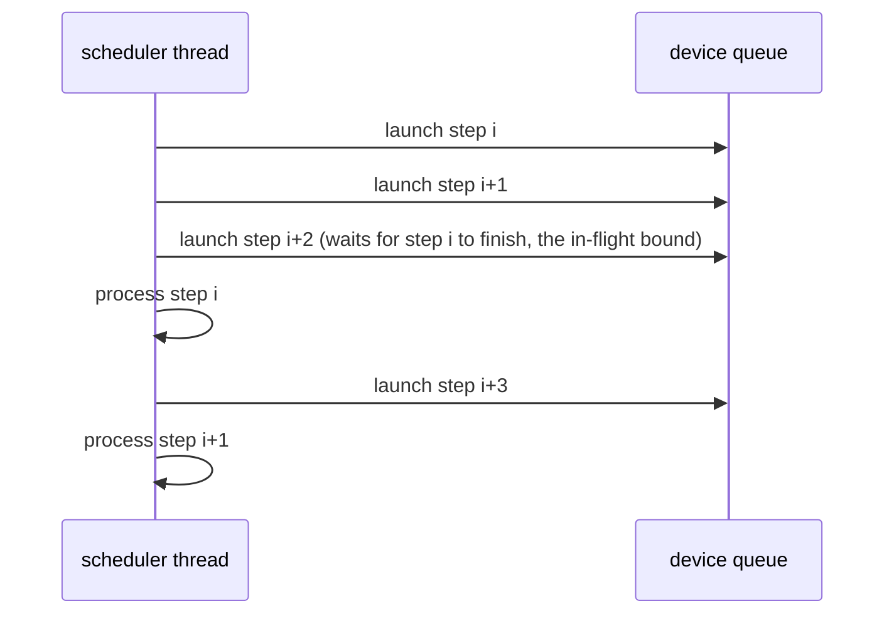

The rest is upstream's loop. Three things process every queued result at once: an iteration that launches nothing, a
batch that runs without overlap, and a planning that retracts a request a queued result still holds (processed while the
request is still marked retracted; with this platform's retraction backup of `none` SGLang aborts a retracted request,
so on that rare step the drain only empties the queue). A pause in `retract` mode drains the queue the same way. A
request that finished at step i is skipped by the steps launched after it, as in upstream's loop, but those queued steps
still read and write its pages. On a disaggregated decode SGLang stages every freed page until an allocation runs short,
and the decode's allocator hands a staged page out only once every launch that may touch it has finished
(`NeuronPagedTokenToKVPoolAllocator.merge_and_sort_free`, [The allocator](runtime.md#the-allocator)), so no page a
queued step touches is reused before that step has run. Every decision follows the scheduler's queue lengths and request
states, which every rank of a DP group shares. The per-layer decodes keep upstream's loop.

### A megakernel's host-ids mode

A whole-model megakernel whose kernel takes the embedded rows of a step's ids, looked up on the host, cannot take its
next decode's ids from the device (`NeuronModelRuntime.host_input_ids`). Its model declares that its programs serve
async steps (`catalog.MegakernelServing.async_steps`), and the launch runs the overlap schedule in the host-ids mode
(`async_execution.configure(host_ids=True)`, no token width):

1. **A step is launched, not read.** A step of one kernel call returns its call's pending result. A step of several
   kernel calls (for example prefill chunks, then decode calls) launches them back to back with nothing read in between
   (`NeuronModelRuntime._submit`) and returns one pending result (`step_output`): a `PendingSample` whose
   `StepAssembly` reads every call's tokens in one readback and picks each request's token from them. The result goes
   through SGLang's queue like any other; the copy thread (aggregated, prefill) or the scheduler thread (decode, inline)
   reads it when SGLang processes the result.
2. **The next decode takes its ids on the host.** `resolve_forward_inputs` resolves each row on the host
   (`TokenRelay.host_ids`): from the readback of the step that holds the row's token (`_TokenGroup.cpu`: the step's own
   read, run there if nothing read it yet, so the step is read once), or from SGLang's buffer for a row a host stash
   wrote (a decode server's newly landed request). The row's slot generation must match, as in the relay.
3. **What overlaps.** The step's launch returns before the device runs it, so SGLang's processing of the previous
   step's result and the scheduling of the next batch (the DP-attention exchange included) run while the device runs
   the step. The next decode still waits for the step's ids before its calls are built (the host embeds them), so the
   device idles for the readback, the embedding and the upload of the next step's inputs, not for the scheduler's
   loop. Taking the ids on the device would remove that wait too, and needs the kernel graph to embed the ids itself
   (a recompile).
4. **Idle steps.** An idle replica's padding calls are launched and never read (`retain_unread` keeps their buffers
   referenced until the in-flight bound has retired them).

A launch of such a model with a speculative worker (NEXTN/MTP) runs synchronously, and one asking for the overlap
schedule is refused (`serving_policy.megakernel_async_blockers`), as is one of a model whose programs do not declare
async steps.

### A prefill server

`event_loop_overlap_disagg_prefill` builds a new batch only while fewer than two results are queued, so at most two
forwards are in flight. The loop while a forward is in flight:

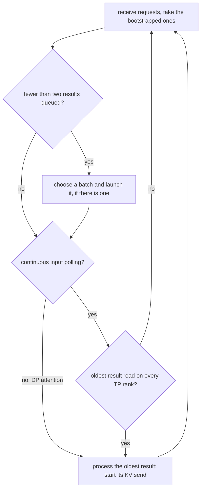

- **Continuous input polling.** On a prefill server with async execution, without DP attention and without PP, the
  platform sets `SGLANG_ENABLE_DISAGG_PREFILL_CONTINUOUS_INPUT_POLLING=1` for the launch and refuses another value
  (`sglang_neuron/disaggregation/__init__.py`). SGLang's polling also needs a CP size of 1, which every launch has,
  since the platform refuses `--attn-cp-size` above 1. A pipelined prefill runs without it, since its stages take each
  iteration's requests at one loop point ([Pipeline parallelism](pipeline-parallelism.md)). While the oldest result is
  not ready, the loop goes back to receiving and bootstrapping requests instead of waiting, and may launch the second
  forward meanwhile, so a request that arrives during a forward is ready for the next one. Readiness is the copy
  thread's future (`copy_done.query()`). With a TP size above 1 the ranks take the minimum over the TP group's gloo
  group, so every rank decides alike; at TP size 1 the loop sleeps 0.1 ms between polls
  (`PREFILL_INPUT_POLL_INTERVAL_S`), long enough for the bootstrap and transfer threads to take the GIL.
- **Without polling** (a prefill server with DP attention), the loop processes the oldest result as the aggregated loop
  does, waiting for it.
- **Processing a result** waits on `copy_done.synchronize()`, turns the token ids into a list and starts the KV send.
  Under the overlap schedule SGLang starts a forward's KV send, a middle chunk's too, only once it has processed that
  forward's result (`process_prefill_chunk` defers a chunk's send there). `copy_done` completes only after the copy
  thread's read, which waited for the forward's launch event, so NIXL never reads pages the forward is still writing.
  The one send SGLang would start earlier, the early send of a cached prefix, is off: the platform fixes
  `SGLANG_DISAGG_PREFILL_EARLY_SEND_CACHED_PREFIX=0`, since that send records a CUDA event.

### By role

What async execution sets up differs by role:

| | Aggregated | Prefill server | Decode server |
| --- | --- | --- | --- |
| Steps it launches | one-request prefills and decode batches | one-request prefills, and idle dummies under DP attention | decode batches, and idle dummies under DP attention |
| Decode token width | W, on its decode-phase runtime | none (it runs no decode) | W |
| Who reads a step's outputs | the copy thread | the copy thread; the loop polls it without DP attention | the scheduler thread, inline when it processes the result |
| An idle dummy's result | none: an aggregated server with DP attention is refused, except a whole-model megakernel's ([A megakernel's host-ids mode](#a-megakernels-host-ids-mode)) | read synchronously ([Idle DP ranks](#idle-dp-ranks)) | under DP attention, pending through SGLang's result queue ([Idle DP ranks](#idle-dp-ranks)) |
| Settings | none (the in-flight bound is the plugin's `SGLANG_NEURON_MAX_INFLIGHT_LAUNCHES`) | `SGLANG_ENABLE_DISAGG_PREFILL_CONTINUOUS_INPUT_POLLING=1` without DP attention or PP | none |

## The token relay

### Why the tokens stay on the device

A request's next decode input is the token the previous decode sampled for it. If the host read those tokens to build
the next step, it would wait for the previous step to finish before every launch, and the overlap would be gone. On a
DP-attention decode one rank waiting would also hold every other rank at the next collective. The relay therefore
keeps each decode's token vector on the device and tells the next graph where each row's token is; the graph
assembles its own ids (`sglang_neuron/model_executor/token_io.py`).

SGLang's `FutureMap` cannot do this here. Its `stash` scatters each step's tokens into `output_tokens_buf`, a host
tensor on SGLang's `cpu` device, so the scatter of a device vector would copy it to the host and wait for the step.
The plugin's stash hook keeps device vectors in the relay and skips SGLang's write. Only host tokens, a decode server's
prebuilt requests, reach `output_tokens_buf`.

### The hooks

`async_execution.register_hooks` installs these around SGLang's functions:

| SGLang function | Hook | What it adds |
| --- | --- | --- |
| `FutureMap.__init__` | `_future_map_init` | the process's `TokenRelay`, and the request pool whose generations key it |
| `FutureMap.stash` | `_stash` | a device token vector goes to the relay and SGLang's write is skipped; a host one marks its slots as host rows, then SGLang writes it |
| `resolve_forward_inputs` | `_resolve_inputs` | a decode batch gets a `TokenPlan` and a shape-only `input_ids` placeholder; any other batch runs SGLang's resolve |
| `ForwardBatch.init_new` | `_forward_batch_init` | the plan travels to the forward batch the runtime reads |
| `Scheduler.init_overlap` | `_scheduler_init_overlap` | the scheduler's `device_module.Event` becomes a `CompletionEvent` |
| `GenerationBatchResult.copy_to_cpu` | `_copy_result` | the step's one read, on the copy thread or inline |

The three SGLang functions these hooks skip or replace for a device-resident batch (`FutureMap.stash`,
`resolve_forward_inputs` and `GenerationBatchResult.copy_to_cpu`) are md5-pinned to SGLang 43881a7, so a changed
upstream source stops the registration instead of running under a stale hook.

### Stashing a step's tokens

`TokenRelay.stash` maps each row of a launched step from its slot to (generation, group, row), where the group is the
step's token vector. The generations are read at the stash, and the stash clears each slot's host mark.

- **Which vector becomes `latest`.** The relay remembers the newest qualifying group as `latest`, the only device
  vector the next graph can index. With a token width configured, a vector becomes `latest` only when it is exactly W
  wide, so on an aggregated server a decode's vector does and its one-token prefill vector does not (unless W is 1).
  In a process without a width, a prefill server, every non-empty stash becomes `latest`, and no decode plans from it.
- **An idle step changes nothing.** A stash without rows, an idle dummy's, returns at once and keeps `latest`.
- **Host tokens.** A host stash (`mark_host`) drops any device row of its slots and records the slot's generation in
  `host_fresh`: the next plan may take that slot's token from `output_tokens_buf`, once.
- **No speculative decoding.** A device stash under a speculative algorithm raises `Neuron device token relay does not
  support speculative decoding`; the launch refuses `--speculative-algorithm` first.

### Planning a decode batch

`TokenRelay.plan` runs in `_resolve_inputs` for every decode batch of at least one request, that is a batch with
neither prefill staging nor input ids, and without speculative decoding. It never waits on a device future on the
steady path. A decode batch resolved in a process whose runtime configured no token width is refused (`A decode batch
resolved its tokens without a fixed decode token width`), and so is a batch of more than W rows (`Decode batch exceeds
the fixed decode token width`). Otherwise the plan decides as follows:

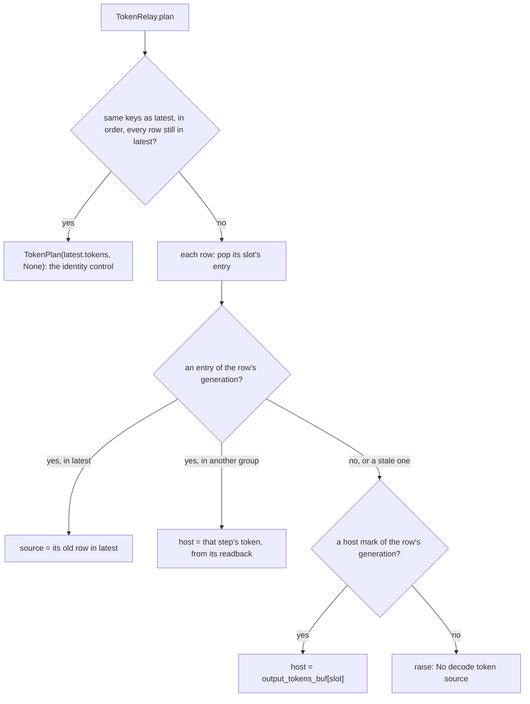

Each row's token comes from one of four sources:

| Row's request | Where its token comes from | Host work |
| --- | --- | --- |
| In the newest decode, and the batch is the same rows in the same order | `latest` as it is, with the identity control | none: no token tensor is built or uploaded |
| In the newest decode, the batch changed | a gather from `latest` at the request's old row | a fresh `[2, W]` control |
| Joined from the host: a decode server's prebuilt request | `output_tokens_buf[slot]`, a host tensor | an index into a host tensor |
| Joined from another forward: an aggregated server's request after its prefill | that prefill's own readback | a wait for that prefill if it has not been read yet |

- **The same rows.** When the batch's keys equal `latest`'s in the same order and every row still belongs to `latest`,
  the plan is `TokenPlan(latest.tokens, None)`. The runtime passes `latest`'s vector and a cached identity control,
  uploaded once per runtime, so a steady decode uploads no token tensor at all.
- **A changed batch.** The plan builds `host = [0] * W` and `source = [-1] * W` and fills one entry per row. A row
  whose request was in `latest` gets its old row as `source`. A row whose matching entry is in another group gets its
  token on the host (below). A row with no device entry of its own generation (none, or a stale one from the slot's
  previous request, which the plan drops) must have a host mark of the same generation, or the plan raises `No decode
  token source for request slot <slot> generation <generation>`. The control is a fresh int32 tensor, never written
  after it is built. When no row reads `latest`, the runtime passes a placeholder vector uploaded once, a tensor of
  its own so that dynamo never aliases it with another input.
- **Consume once.** A plan pops every row it uses. A second plan for the same slot without a new stash finds no
  source and raises, so a token is never fed twice.
- **The cross-group read.** On an aggregated server a request's first decode follows its prefill, whose one-token
  vector is not `latest`. The plan reads that token through the prefill's own readback (`_TokenGroup.cpu`), which
  calls `PendingSample.materialize` on the prefill's live sample. If the copy thread has already read the prefill,
  that returns its tokens; otherwise the scheduler thread waits for the prefill on the device and reads it here.
  Either way the step is read once. A step with a negative id is refused before the decode takes its token, whichever
  thread read it, because the sample stores its refusal and raises it on every read. Only a step whose sample was
  already garbage-collected is read from its host copy, which only a step that passed has, or straight from its
  device tensor. On a decode server a joining request always enters through a host stash, so this path is not
  expected there; the `cross-group rows` count below would show it.

The relay logs its counts at the first plan and every 1000th: `[neuron] decode token plans=%d (identity=%d,
reorder=%d, host rows=%d, cross-group rows=%d)`. A decode whose batch does not change makes identity plans only.

### Generations and the flush

A slot's generation, not its index, identifies a request. SGLang increments `req_generation` each time it allocates a
pool row and never resets it: its `clear()` keeps the counters, because "readers detect row reuse by equality with a
generation they stored". A finished request's row in the relay therefore never reaches the request that reuses its
slot: the generation differs, and the plan finds no source for the new request until its own stash. The relay holds
at most one entry per slot, so it is bounded by the pool size.

After a successful `flush_cache` the relay forgets every row, every host mark and `latest` (`TokenRelay.reset`): the
flush retired every request, and the relay drops their rows with the pool. The generations would reject a stale row on
their own ([A cache flush](#a-cache-flush)).

## Fixed-width decode token I/O

Every asynchronous decode runtime, a decode server's or an aggregated server's decode phase, wraps its graph in
`FixedDecodeTokenIO(model, W)` (`NeuronModelRuntime._init_decode_token_io`). Every decode then returns a W-wide token
vector whatever its bucket. The next decode can index that vector whether its batch shrank, moved to another bucket or
changed rows, so it launches before the previous step's tokens reach the host.

The wrapped graph takes the previous decode's `[W]` int32 token vector as `input_ids` and a `[2, W]` int32
`token_control`:

| `token_control` row | Value for row r |
| --- | --- |
| 0 | the host token id of row r, used where row 1 is -1 |
| 1 | the row of `input_ids` that holds row r's token, or -1 to take row 0 |

Inside the graph, `ids = where(source >= 0, index_select(input_ids, source.clamp(min=0)), control[0])`, and the model
runs on `ids[:B]`, where B is the bucket the step's metadata is padded to. The sampled `token_ids` are zero-padded to W;
logprobs and top logprobs keep the bucket's B rows. The pending sample reads the whole tensors and keeps only the
step's first `n_real` rows of each. An output already W wide is returned as it is.

- **One NEFF on every rank.** Every decode dispatch, a real step, an idle dummy or a warm-up, passes the same two inputs
  with the same shapes, so every DP rank keeps launching the identical program (`_decode_token_inputs`). A warm-up, an
  idle dummy or a step without a plan passes an all-host control (row 1 all -1) and the placeholder vector.
- **Metadata keeps the bucket.** Positions, slot mapping, block table and sampling inputs stay at B rows; only the token
  transport is W wide.
- **A bucket change is still a program switch.** The tokens need no host read when the batch moves to another bucket,
  but the new bucket is another NEFF. Where a runtime has more than one compiled shape, the program-switch fence waits
  for the device to drain at that step ([The program-switch fence](runtime.md#the-program-switch-fence)). A
  DP-attention decode compiles one bucket and never switches.

The wrapper refuses what would break the transport. A width below 1 is refused when the wrapper is built. Its other
checks are on shapes and dtypes, so they run when dynamo traces a bucket's graph, at its warm-up compile: on the inputs
before the model, and on its sampled output after it. While serving, a call of other shapes fails dynamo's guards and
raises under `fail_on_recompile` instead. The last row is the runtime's own check, made on the host at every decode
step that does not pass the identity control (`_decode_token_sources`):

| Error | Cause |
| --- | --- |
| `Decode token width must be positive` | W below 1 |
| `Decode token input does not match the fixed width` | `input_ids` not one-dimensional of W |
| `Decode metadata exceeds the token capacity` | a bucket of 0 rows or above W |
| `Reordered decode requires int32 token_control of shape [2, width]` | the control, or the token vector, not int32 of the right shape |
| `Fixed decode token I/O requires sampled dictionary outputs` | a model output without `token_ids` |
| `Sampled token output does not match the decode batch` | sampled ids that are not one int32 per bucket row |
| `Device token future does not match the decode token width` | the runtime's token vector not `[W]` int32 (`sglang_neuron/model_executor/graph_runner.py`) |

## Streams, uploads and events

### Two streams

Within one stream, torch-neuronx starts an operation on a different execution unit from the previous operation only
after the previous one has retired, and it enforces this from the host. A graph runs on the compute unit and a copy on
the tensor-op unit, so a copy between two graphs on one stream makes the second graph wait for the copy, and the copy
wait for the first graph: the device would idle between every two steps. torch-neuronx has one stream besides the
default stream, and `sglang_neuron/backend/device_io.py` gives the two streams fixed roles:

- **The default stream runs the graphs.**
- **The side stream runs the host copies.** A step's uploads are queued on it before the step's graph launches, and
  run while the graph before it is still on the device. A read of a graph's outputs is queued on it only once that
  graph has finished, so a read never holds the side stream waiting for a running graph, with the next step's uploads
  queued behind it.

The side stream needs `TORCH_NEURONX_ENABLE_STREAMS=1`, which torch-neuronx reads when torch is imported; without it
every stream is the default stream. The platform sets it to 1 for the schedulers whatever the launch says, logging the
change from torch-neuronx's `0` (`platform.enable_streams`), and each rank refuses to start without it
(`device_io.check_streams`): `TORCH_NEURONX_ENABLE_STREAMS is not 1 in the launch environment: torch-neuronx then runs
every copy on the graphs' stream, between two graphs; set TORCH_NEURONX_ENABLE_STREAMS=1 (read when torch is imported)`.

### The graph submit

`device_io.install`, called once per process at backend init after the executor binding cache is installed
(`sglang_neuron/backend/init.py`), wraps torch-neuronx's graph submit, `torch_neuronx._C.execute_compiled_graph`. Every
submit then:

1. runs the pre-execute hooks, when the call is inside `pre_execute_scope` (the program-switch fence's hook);
2. makes the default stream wait for the uploads this thread queued since the last submit, by one event recorded on
   the side stream (at a program switch the fence has done so already, between its sync and its meeting);
3. submits the graph.

Because the wait is part of the submit itself, every graph, a warm-up or profiling launch too, runs after the uploads
its thread queued before it, whichever call site launches it. The wrapper relies on torch-neuronx's `Executor.__call__`
calling the submit by module attribute, so it checks that method against the pinned source first and refuses another
(`executor_cache.check_call_protocol`). An upload before the wrapper is installed is refused, since no submit would
wait for it: `device_io.upload before device_io.install(): no graph submit would wait for the upload, so a graph could
read it before it lands`.

### Uploads

A step's per-step host inputs go up in one `upload_many`, which switches to the side stream once: the slot mapping and
positions, the ids when they come from the host (a prefill's, or a synchronous decode's), and for a prefill its block
table, cached prefix length and sampling position. A decode's fresh token control, every staged decode input that
changed ([Unchanged inputs](#unchanged-inputs)) and, in the sampled modes, a prefill's sampling inputs are uploaded one
by one, each with its own switch to the side stream. Every copy is `non_blocking=True` and is recorded on the default
stream (`record_stream`), so its memory is not reused before the graph that reads it has run. The pending-upload state
and the in-flight launches are per thread (`threading.local`). In CPU mode (`SGLANG_NEURON_CPU_MODE=1`) copies are
plain `.to()` calls and no events are recorded.

What a step uploads (`build_model_inputs`):

| Input | Prefill | Decode |
| --- | --- | --- |
| Slot mapping, positions | every step | every step |
| Input ids | every step | under async, none: the device token vector; synchronous, every step |
| `token_control` | none | under async, the cached identity for an unchanged batch, a fresh one for a changed batch, an idle dummy or a warm-up; synchronous, none |
| Block table | every step | when it changes |
| Sliding-window table and offset | none: the prefill kernel masks the window over the whole table | when they change |
| Cached prefix length | every step | a zero, uploaded once per runtime |
| Sampling positions | every step | one `arange` per bucket, uploaded once per runtime |
| Temperatures, seeds and filters of the sampled modes | every step | when they change |

### Unchanged inputs

A decode's block table changes only when a row crosses a page or the batch changes, so most steps would upload the
same bytes again. `_staged(key, host, dev)` keeps the device copy of a decode input whose host value is unchanged (the
same shape, dtype and values) and uploads a fresh device tensor otherwise. It keys the block table (`bt`), each window's
trimmed table and offset (`swa_bt`, `swa_off`), and in the sampled modes the temperatures, seeds and filters. A
model's runtime stages its own inputs the same way: GLM-5.2's MTP step stages its slot maps, its control and its
sampling parameters and seeds, so a step whose batch did not change uploads none of them. An uploaded tensor is
never written in place, because a queued graph may still read the old copy. The runtime logs the counts every 1000
uploads: `[neuron] staged decode inputs: %d reused, %d uploaded`.

### Lifetimes while launches overlap

A host-side reference must keep every device tensor alive until the graphs that read or write it have run.

- **A step's device inputs** stay referenced by its pending sample (`keep_alive`) until its first read, which waits
  for the graph.
- **Uploads** are recorded on the default stream, and side-stream reads on the side stream.
- **The batch** and a copy of its fields stay in SGLang's two-slot ring for two iterations.
- **Per-step inputs** stay alive one extra step in the executor binding cache, which keys on object identity
  (`sglang_neuron/backend/executor_cache.py`).
- **Padded decode rows** read position 0 over SGLang's reserved page 0 and write their KV to slot 0, so a padding row
  never touches a live request's pages.
- **Freed KV pages.** A request that finishes while a step holding its row is still on the device frees the page that
  step writes the request's extra token into.

What keeps that page's next owner from racing the step's write depends on the role:

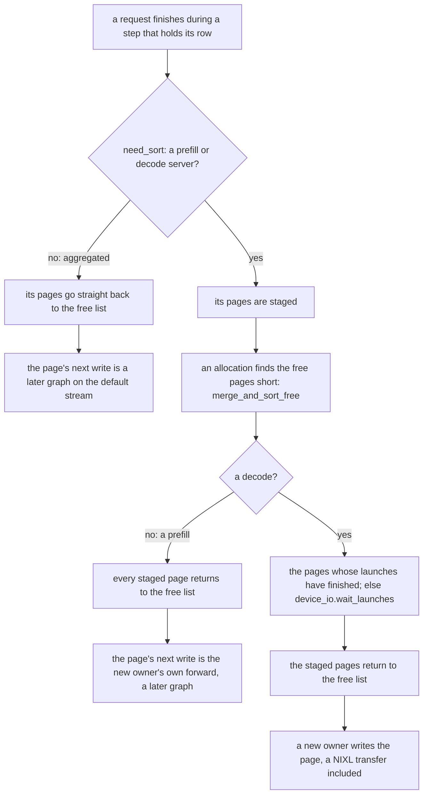

On an aggregated server every write to a KV page is a graph on the default stream, launched after that step, so the
next owner's write lands after the step's. A prefill or decode server stages freed pages (SGLang's `need_sort`) and
returns them to the free list only when an allocation finds it short (`sglang_neuron/mem_cache/allocator.py`). On a
decode server a page's next owner can be a request whose KV arrives over NIXL, which the default stream does not
order behind the step. So on a decode, `merge_and_sort_free`, which every allocation that runs short goes through
(SGLang's `alloc`, and the plugin's `alloc_extend` and `alloc_decode`), returns a staged page only once the launches
that may touch it have finished, and waits for this thread's launches when those pages fall short. On a prefill a
page's next owner writes its KV with its own forward, a later graph on the default stream, so the staged pages go back
as upstream's do, without a wait: a wait there would hold the next forward's launch until the newest one finished.

## The in-flight bound

`SGLANG_NEURON_MAX_INFLIGHT_LAUNCHES` is the plugin's in-flight bound, and the plugin keeps each launching thread
under it. Before a launch, `device_io.before_launch` waits for the thread's oldest launch
event while the thread already has that many in flight; `after_launch` adds the new one. `wait_launches` waits for the
newest launch alone, since the graphs run in launch order on the default stream, and empties the window; the
program-switch fence uses it.

The platform does not set the variable, and `device_io` takes 2 when it is unset. The value is read once per process,
and one that is not an integer of 1 or more refuses the runtime's start:
`SGLANG_NEURON_MAX_INFLIGHT_LAUNCHES=...: set it to an integer of 1 or more`.

The bound is not a runtime setting. torch-neuronx submits every graph through the runtime's explicit async API, and the
runtime's queue per execution unit is `NEURON_RT_XU_COMPUTE_MAX_QUEUED_REQUESTS`, which torch-neuronx also reads as the
number of operations it keeps queued in the runtime per execution unit.

Two is what the overlap loop needs. When step N+1 launches, the window holds steps N-1 and N, and the scheduler
already processed step N-1's result one iteration earlier, so the wait returns at once. The giga-kernel decode's result
lag waits at the bound on purpose, and takes 2 to 4. The DP identity also requires the runtime's execution queue
(`NEURON_RT_XU_COMPUTE_MAX_QUEUED_REQUESTS`, 63 on a decode server) to stay above the in-flight bound, the graphs a
rank keeps launched.

## Reading a step's outputs

### One read per step

`PendingSample.materialize` reads a step's outputs under the sample's own lock:

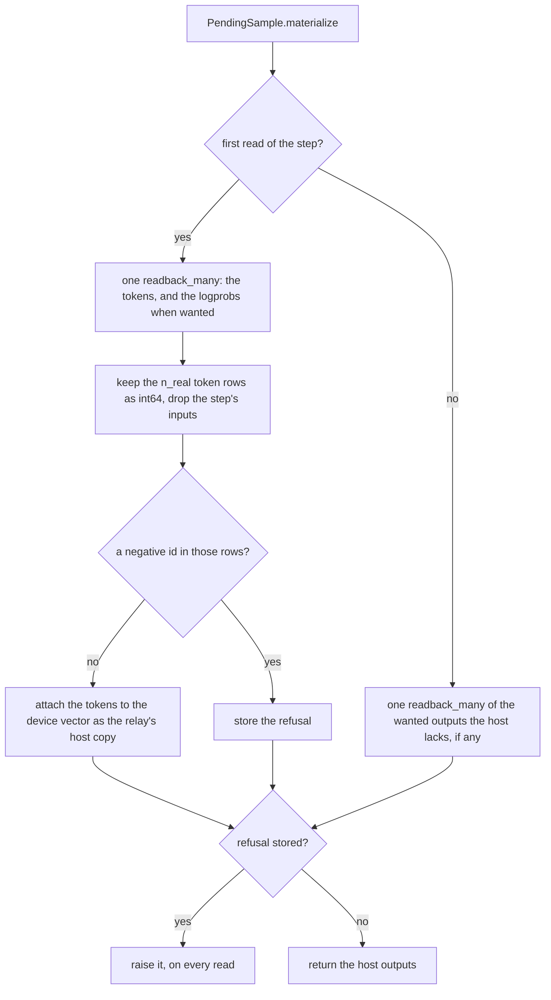

Each read takes, in one `device_io.readback_many`, the token ids if the host does not have them yet and every output its
caller wants that the host lacks: the copy of a batch that returns logprobs wants the logprobs and, when a request asked
for top logprobs, their values and ids. Every read keeps only the step's real rows (`n_real`, the rows that are not
padding), and only a step that passes the negative-id check gets its tokens attached to the device vector as the relay's
host copy. The relay and the drains ask for tokens only, so when one of them reads first, the copy reads the logprobs,
if the batch wants them, in a second read. A wanted output the model's graph does not return raises, naming the
admission check that should have refused the request.

`readback_many` waits for the launch event on the host, then reads in one of two ways:

- **Directly**, when every device tensor is contiguous and at most `DIRECT_READ_MAX_BYTES` (64 KiB): one
  `nrt_tensor_read` per tensor from its runtime tensor into host memory, through `libnrt.so.1`; a failure raises
  `nrt_tensor_read of a ... graph output failed: NRT status ...`. A copy on the side stream would be a second device
  operation, which torch-neuronx starts, and retires, only after the graph has completed. The tokens would then reach
  the host two completion latencies after the step ends, and that delay limits how far ahead of the device the host
  can submit the step after next.
- **On the side stream** otherwise, for all of them: the side stream waits for the finished launch event, every copy
  is queued with `non_blocking=True`, and the host waits for one event after them.

Tensors of more than one device in one read are refused.

### Who reads, and when

| Role | Thread | When the read runs | When the scheduler waits |
| --- | --- | --- | --- |
| Aggregated | `neuron-output_0` | submitted at launch; it reads as soon as the graph finishes | at `copy_done.synchronize()`, when it processes the result |
| Prefill server without DP attention | `neuron-output_0` | the same | only once `copy_done.query()` reports the read done on every TP rank |
| Prefill server with DP attention | `neuron-output_0` | the same | at `copy_done.synchronize()` |
| Decode server | the scheduler thread | at `copy_done.synchronize()`, after the next step was launched | in the read itself |
| Any role, synchronous | the scheduler thread | inside `run_batch` | in the read itself |

The copy thread is the only worker of a `ThreadPoolExecutor` with the thread-name prefix `neuron-output` (so the
thread is `neuron-output_0`), created on the first asynchronous result of a process that does not read inline. With
one worker, the copies complete in launch order. Each copy materializes the sample, sets the result's
`next_token_ids` and, when the batch asked for them, its logprobs and top logprobs (the first k of each row), clears
the result's pending sample, and runs SGLang's `copy_to_cpu`, which records the completion event. The result keeps
its `neuron_async` flag, so a decision every rank must make alike reads the flag, never the pending sample's lifetime,
which ends at a different time on each rank.

### Completion events and errors

A `CompletionEvent` stands in for SGLang's device event. `synchronize()` runs an inline read once on the calling
thread, or waits for the copy thread's future. `query()` is false while an inline read is still to run; otherwise it
reports whether the future is done or, without a future, whether the event was recorded. A failed inline read stores
its exception and raises it again on every later `synchronize()`, as a failed future does. A failed read of a step's
result on either path therefore reaches the scheduler at that result's `copy_done.synchronize()`
([Failures](#failures)).

### Drains

- `synchronize_pending()` reads the tokens of every pending sample of the process. The platform's `synchronize()`
  calls it once the runtime is up (`sglang_neuron/device.py`), and so does the launch-time device profile window at its
  start.
- `drain_launches()` runs `synchronize_pending()` and then reads the newest launch's tokens against its event. The
  process holds the newest launch's outputs strongly, so even a launch whose sample was dropped unread is waited for;
  once it has finished, so has every earlier launch of the thread. The cache flush and the DP control fence's
  fleet-idle point call it.

## When the async flow breaks, and how it stays safe

In a steady decode the scheduler thread never waits for the device before a launch. The events below either make it
wait, which lets the device run dry, or change the batch under steps already launched:

| Event | Host waits for the device before the next launch | What keeps it correct |
| --- | --- | --- |
| A batch change: a finish, a decode server's admission, a retraction, an abort | no: the graph gathers its ids | generation-keyed rows, read once, and a fresh control; on a prefill or decode server a finished request's freed page reaches a new owner, a KV transfer included, only after the allocator has waited for the launches that could still write it, and on an aggregated server the page's next write is a later graph on the same default stream ([Lifetimes while launches overlap](#lifetimes-while-launches-overlap)) |
| An aggregated request's first decode after its prefill | yes, for that prefill | the prefill's own readback, read once |
| A program switch: another decode bucket or context, another prefill tile, or prefill to decode | yes: the fence drains the device | every rank finishes the old program first |
| A cache flush | yes: every flush call drains every launch, including an untimed `/flush_cache` on a busy scheduler, which SGLang then refuses | every launch retires before the pools reset |
| No DP rank has work under the DP identity | yes; nothing is launching | the ranks drain at the same rendezvous |
| A DP-attention prefill's idle rank | yes: its dummy is read synchronously, so the next step waits for the idle rank's host work | the dummy runs the group's program on reserved page 0 |
| The launch-time device profile window | yes, at its two edges | a drain and barriers |
| A refused step or a failed read | the scheduler stops | the error, raised at the result's `copy_done.synchronize()` (inside `run_batch` for the cross-group read, a step read synchronously and the device profile window's drain; inside the flush or the DP fence for their drains); nothing is emitted |

### Requests that join

On a decode server a joining request's token comes from the host: its prebuilt stash records a host row, and the
plan writes the token into the control with no device read. On an aggregated server SGLang merges a prefill's request
into the running batch before the prefill's result is processed, so the request's first decode is planned while the
prefill may still be on the device. The plan's cross-group read waits for that prefill inside the decode's `run_batch`
([Planning a decode batch](#planning-a-decode-batch)). The switch from the prefill program to the decode program is a
program switch as well, so that decode would wait for the device at the fence regardless.

### A batch change

A finish, a decode server's admission, a retraction or an abort changes the batch. The changed-batch plan gathers the
rows that were in the newest decode from its vector on the device and takes new rows from the host; it never waits on
a pending step.

- **Finishing requests.** On an aggregated server SGLang leaves out of the next decode every request whose step in
  flight finishes it by length. A request that stops on a token, and on a decode server every finishing request, still
  has a row in the step launched before its result was processed. SGLang skips that row when it processes the result.
  Either way the slot's relay entry is rejected by its generation once the slot is reallocated.
- **Retraction.** On an aggregated server a retracted request releases its pool row and goes back to the queue. Its
  next prefill allocates a row again, with a new generation. A decode server runs with
  `--disaggregation-decode-retraction-backup none`, since the Neuron KV pool keeps no host copy: a retracted request is
  aborted for its client to retry.
- **Aborts.** The next result processing finishes an aborted request and the batch changes. Its relay entry stays until
  the slot's next stash, or the generation rejects it. An abort matches its own request id and that request's expanded
  `<rid>_<i>` copies, not every id that starts with it (`sglang_neuron/sglang_patches/abort_rid_match.py`).

### A cache flush

`_flush_cache_drained` wraps SGLang's `Scheduler.flush_cache` (`sglang_neuron/general_plugin.py`). A scheduler with
nothing left to run can still have its last launch's KV writes and outputs queued on the device, so the hook retires
every launch with `drain_launches()` before SGLang's flush can reset the pools:

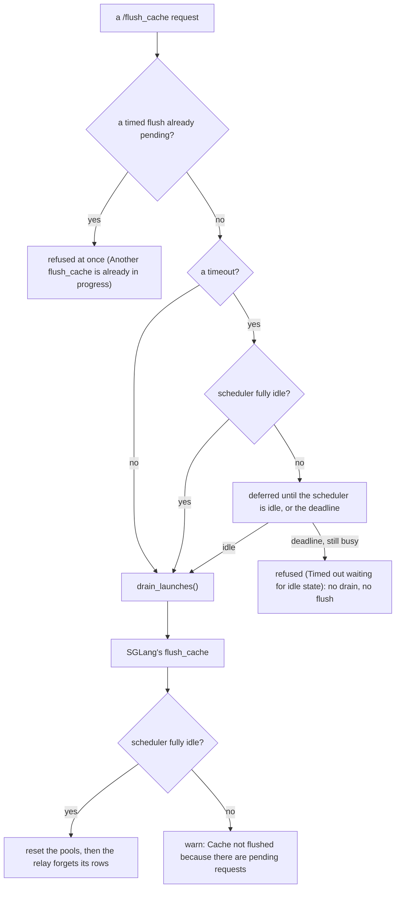

The hook drains on every call, so an untimed flush on a busy scheduler makes the next launch wait until the device has
run dry, and SGLang then refuses the flush. A timed flush still deferred at its deadline is refused without calling
`flush_cache`, so nothing drains and the pools stay. On a scheduler of several ranks the request leader's clock sets
that deadline: every rank expires the flush at the same iteration, flushing if it is idle and refusing it otherwise
(`sglang_neuron/sglang_patches/flush_deadline_markers.py`).

### Idle DP ranks

Under DP attention every rank must meet the same collectives, so a rank without requests runs a dummy step of the
group's phase and bucket that reads and writes only SGLang's reserved page 0 (`plan_step`, `run_idle`). Its inputs,
and why a decode dummy carries a 1,024-token context, are in [A DP-attention decode: the DP
identity](parallelism.md#a-dp-attention-decode-the-dp-identity). How the dummy completes depends on the role:

- **A DP-attention decode** (`async_idle_completion`) keeps the dummy's outputs pending like a real step's and sends
  its result through SGLang's result queue. The dummy therefore completes, reports a failure and releases its inputs at
  its result's `copy_done.synchronize()`, as a real step does. Its stash has no rows and keeps `latest`.
- **A DP-attention prefill** reads its dummy synchronously and returns an empty output. `_run` keeps a step pending
  only when its real rows fill its sampled rows, when a fixed decode width holds at least one real row, or for a
  DP-attention decode's dummy; a prefill dummy has no real row against its one sampled row. The idle rank's host
  therefore waits inside `run_batch` until the group's step has finished on the device, and every other rank waits for
  it in the next step's batch-metadata gather (SGLang's MLP sync, [A DP-attention
  prefill](parallelism.md#a-dp-attention-prefill)). While any rank is idle, the device runs dry between steps for the
  idle rank's host work.
- **When no rank of a DP-attention decode has work**, its DP control fence stops every rank's launches at the same
  rendezvous, and each rank first retires its queued launches with `drain_launches()` ([The control
  fence](parallelism.md#the-control-fence)).

### Program switches

On an aggregated server, and on any role whose runtime has more than one compiled shape, a step whose NEFF differs
from the rank's previous one waits inside its submit until every launch of the rank has finished and the TP ranks have
met ([The program-switch fence](runtime.md#the-program-switch-fence)). The scheduler thread waits there, polling for
up to 2 ms before it blocks, and the device runs dry from the end of the previous step until the ranks have met and
the new program is submitted. That happens at every switch between an aggregated server's prefill and decode, at each
change of prefill tile, and each time a decode's batch moves to another bucket or context. A prefill or decode server
whose runtime has one program never fences.

### Failures

A refused step or a failed read stops the scheduler. Where the error is raised depends on which read met it:

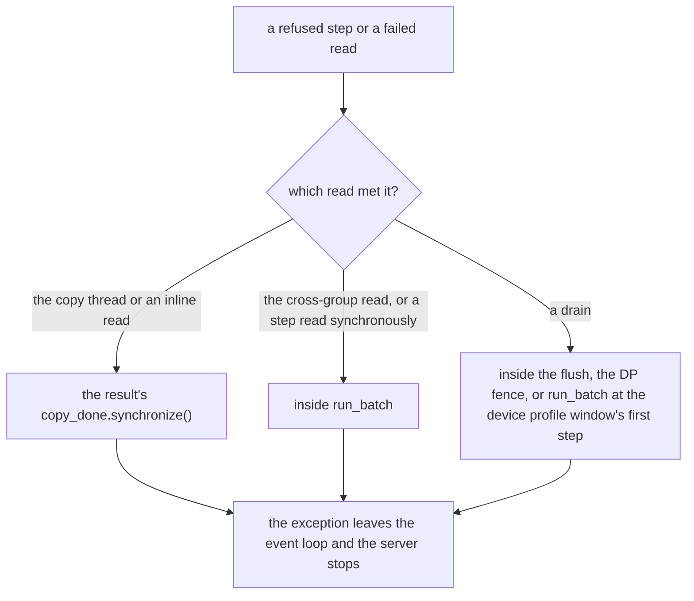

- **A refused step.** The device samplers always return a valid id (a row without a maximum takes the last id), so a
  negative id, or one at or above the checkpoint's vocabulary size, means the step's outputs are corrupt.
  `refuse_invalid_token_ids` checks a step's real rows, never its padding, and raises `%d sampled row(s) of a step
  hold a negative token id (rows %s); the step is refused`, or `... hold a token id at or above the vocabulary size
  %d ...`; a speculative step's rows are refused the same way (`refuse_bad_spec_rows`). On the
  async path the error is stored on the pending sample and raised by every `PendingSample.materialize`, whichever
  thread read the step first: the copy, a drain or the relay's cross-group read. Because the cross-group read goes
  through the live sample, it raises the refusal before the next decode takes the token ([Planning a decode
  batch](#planning-a-decode-batch)).
- **A failed read.** A failed direct read, an exception on the copy thread or a failed inline read reaches the
  scheduler where the diagram shows. A DP-attention decode's idle dummy fails at its result's
  `copy_done.synchronize()`, in SGLang's idle result processing, before anything is streamed; a DP-attention
  prefill's dummy, read synchronously, fails inside `run_batch`.
- **The scheduler stops.** The exception leaves the event loop. SGLang logs `Scheduler hit an exception: ...` and sends
  SIGQUIT to its parent process, whose SGLang SIGQUIT handler kills the server's process tree. A refused step is never
  emitted.

### The device profile window

The launch-time device profile of decode steps (`SGLANG_NEURON_PROFILE_SERVE_RANKS`, `_START`, `_STEPS`) drains the
pending samples and meets the TP ranks at its first step, and at its last step reads that step's tokens on the host and
meets them again (`ServingCapture` in `sglang_neuron/model_executor/profiling.py`). Both edges perturb the step they
fall on. Starting a `/start_profile` window pauses each scheduler for about a step, and `/stop_profile` pauses it
while the runtime writes what its last background export left and joins the session's export chunks
([Profiling](../guides/profiling.md)).

## The prefill side

A prefill forward runs one request's chunk, and on a role with a radix cache or chunked prefill every forward is exactly
one `--chunked-prefill-size` chunk unless it ends the prompt, since the chunk is the largest prefill bucket ([One
request per prefill forward](runtime.md#one-request-per-prefill-forward)). Under async execution:

- **Prefill launches are asynchronous.** A prefill samples one row for its one request, so `run_prefill`'s outputs stay
  pending like a decode's, and the copy thread reads them.
- **At most two forwards are in flight** on a prefill server, which, where it polls, keeps taking requests while its
  oldest forward runs ([A prefill server](#a-prefill-server)).
- **Nothing runs beside a chunked request.** SGLang adds one to a chunked request's in-flight middle chunks for every
  prefill batch it builds while the request is chunked, whether the batch carries the request or not, and finishes the
  request's prefill only once the count is back to zero at result processing. A batch built without the chunked
  request would leave the count one too high, so the request's last chunk would be processed as a middle one and the
  request would never finish. The prefill adder therefore admits nothing beside a chunked request
  (`_one_request_per_prefill` in `sglang_neuron/general_plugin.py`).
- **A final piece shorter than the chunk** runs a smaller tile, which is a program switch on a model with a prefill
  ladder ([Program switches](#program-switches)).
- **Joining the decode** on an aggregated server is the cross-group read ([Requests that join](#requests-that-join)).

## Dynamo guards and launch cost

Every launch runs the graph call's Python work on the scheduler thread before the submit: dynamo's guards, the AOT
wrapper, the executor's input preparation and its output allocation. That host time has to fit inside the previous step
for the overlap to hide it. How each family is compiled (`fullgraph=True`, `dynamic=False`, no eager fallback) is in
[Compiler arguments](runtime.md#compiler-arguments), and why serving runs under `fail_on_recompile` is in [Warm-up and
the SPMD check](runtime.md#warm-up-and-the-spmd-check). How the executor binding cache skips preparing unchanged inputs
is in [The executor binding cache](runtime.md#the-executor-binding-cache).

A decode server cuts the guard cost further. Each call carries a kwargs tree with one metadata dictionary per layer, and
dynamo re-evaluates its guards over that tree on every call. A decode server's calls differ between steps only in
tensors, so it keeps only dynamo's tensor guards (`guard_filter_fn=torch.compiler.keep_tensor_guards_unsafe`), which
drops no check that could fail, and caches the dictionary guards by tag instead of walking them
(`use_recursive_dict_tags_for_guards`, set in `build_compiled`). A megakernel's decode program that declares the direct
submit (`PhaseProgram.direct_submit`) does the same on any server, an aggregated one too (Qwen3.5's decode): the direct
submit takes tensor guards only. Every other graph keeps every guard.

The giga-kernel decode goes past the guards altogether. Its graph serves one shape under tensor guards only, so once two
calls have shown that the executor gets the same objects apart from the step's own tensors, and the shadow steps after
them on the full path have handed the executor the list it builds, its steps go straight to the bound executor ([The
executor binding cache](runtime.md#the-executor-binding-cache), the direct submit), and a step that differs from the
binding still takes the full call path.

## Configuration

### Turning it on and off

The launching process resolves the serving policy once, with `async_execution = not --disable-overlap-schedule`
(`serving_policy.resolve`), and exports it in `SGLANG_NEURON_SERVING_POLICY`, so every scheduler reads the same value.
There is no other switch. A process without the variable, such as an offline tool, runs synchronously.
SGLang reads the same flag (`Scheduler.enable_overlap`) and picks its loop by role:

| Role | Overlap schedule (default) | `--disable-overlap-schedule` |
| --- | --- | --- |
| Aggregated | `event_loop_overlap` | `event_loop_normal` |
| Prefill server | `event_loop_overlap_disagg_prefill` | `event_loop_normal_disagg_prefill` |
| Decode server | `event_loop_overlap_disagg_decode` | `event_loop_normal_disagg_decode`; refused with DP attention |

- **The hooks follow the policy.** The plugin registers the relay and readback hooks only when `async_execution` is set
  (`sglang_neuron/general_plugin.py`, `async_execution.register_hooks`). Without them SGLang's own relay and copy run
  unchanged.
- **The scheduler and the executor must agree.** SGLang's passes after the platform hook can still change the
  schedule, so each scheduler compares the schedule SGLang finally runs (`get_schedule().disable_overlap_schedule`)
  with the policy's `overlap_schedule` when its model runner initializes (`runtime_init.check_overlap_schedule`), which
  is async execution except on a pipelined PD prefill, where SGLang turns the overlap schedule off and the asynchronous
  last stage takes its place. A disagreement refuses the start: `disable_overlap_schedule=... with
  serving_policy.async_execution=... and pp_size=...: the scheduler's overlap schedule and the executor disagree`.
- **A DP-attention decode needs it.** Its DP identity requires the fixed token width, which only an asynchronous
  decode runtime has, so the launch is refused with `--disable-overlap-schedule`, naming `async execution (no
  --disable-overlap-schedule)` among the conditions it misses.

### What a launch refuses

The relay serves one sampled token per request per decode step, and a forward runs one compiled graph: one request's
prefill chunk or a decode batch. The platform refuses what would break either: `--speculative-algorithm` and
`--enable-mixed-chunk` (so the relay's resolve never meets a prefill that carries decode rows). Under PP an aggregated
server runs without async execution
([The pipelined aggregated server](pipeline-parallelism.md#the-pipelined-aggregated-server)), a PD prefill runs its
last stage asynchronously ([The asynchronous last stage](pipeline-parallelism.md#the-asynchronous-last-stage)), and a
PD decode's first stage takes its relay tokens from the last stage over the seam
([The pipelined decode](pipeline-parallelism.md#the-pipelined-decode)). The platform sets the grammar backend to
`none`, since the device sampler serves no grammar, so no grammar sync runs. Delayed sampling runs only under
`SGLANG_ENABLE_DELAY_SAMPLE`, which is off by default ([What a launch refuses](runtime.md#what-a-launch-refuses)).

### Settings

| Name | Default | Effect | Code |
| --- | --- | --- | --- |
| `--disable-overlap-schedule` | off | turns async execution off: SGLang's synchronous loops, no async hooks, no fixed token width; refused on a DP-attention decode | `sglang_neuron/serving_policy.py` |
| `SGLANG_NEURON_SERVING_POLICY` | set by the platform | the policy record every process reads; never set by a launch | `sglang_neuron/serving_policy.py` |
| `SGLANG_NEURON_MAX_INFLIGHT_LAUNCHES` | unset (`2` in `device_io`) | the plugin's in-flight bound per launching thread, and the giga-kernel decode's result lag (2 to 4); a value that is not an integer of 1 or more refuses the start | `sglang_neuron/backend/device_io.py` |
| `TORCH_NEURONX_ENABLE_STREAMS` | set to `1` | the side stream for host copies; each rank refuses to start without it | `sglang_neuron/platform.py` |
| `NEURON_RT_XU_COMPUTE_MAX_QUEUED_REQUESTS` | `63` on a decode server, `32` elsewhere | the runtime's queue of executions per core | `sglang_neuron/model_executor/runtime_init.py` |
| `NEURON_RT_XU_WORKER_ENABLE_LOW_LATENCY_COMPLETION` | `0` on a decode server | completes executions without the runtime's polling thread, which competes with the scheduler for the host | `sglang_neuron/model_executor/runtime_init.py` |
| `NEURON_RT_DISABLE_EXECUTION_BARRIER` | `1` | the runtime's per-execution barrier, which covers synchronous submission only, is off; the program-switch fence synchronizes the ranks | `sglang_neuron/model_executor/runtime_init.py` |
| `SGLANG_ENABLE_DISAGG_PREFILL_CONTINUOUS_INPUT_POLLING` (SGLang) | fixed to `1` on a prefill server with async execution, without DP attention and without PP; another value is refused | the prefill keeps taking requests while its oldest result is pending | `sglang_neuron/disaggregation/__init__.py` |
| `SGLANG_DISAGG_PREFILL_EARLY_SEND_CACHED_PREFIX` (SGLang) | fixed to `0` on a prefill server; another value is refused | a prefix hit's pages go with the first forward's KV send, not an early send, which records a CUDA event under the overlap schedule | `sglang_neuron/disaggregation/__init__.py` |
| `SGLANG_DISABLE_CONSECUTIVE_PREFILL_OVERLAP` (SGLang) | off; not set | would process a prefill's result before the next prefill launches | SGLang's scheduler |
| `--max-running-requests` | sized by SGLang when unset | W, the largest decode bucket: SGLang's per-scheduler running limit, `--max-running-requests` over the attention-DP size ([Buckets](runtime.md#buckets)) | `sglang_neuron/model_executor/graph_runner.py` |
| `--cuda-graph-bs-decode`, decode `bs` in `--cuda-graph-config` | with `--max-running-requests`: the powers of two below the per-scheduler batch and the batch, or the batch alone on a DP-attention decode; with only `--cuda-graph-max-bs-decode`: the powers of two below it and itself; with neither, SGLang's own decode sizes; the runtime adds the scheduler's request limit as the largest size | the decode buckets, and so the program switches between them | `sglang_neuron/platform.py` |
| `SGLANG_NEURON_HOST_TRACE`, `SGLANG_NEURON_HOST_TRACE_RANKS`, `SGLANG_NEURON_HOST_TRACE_SPANS` | off; every rank; none | the host trace below; a malformed rank list refuses the launch; each named function or method a row of its own | `sglang_neuron/model_executor/host_trace.py` |
| `SGLANG_NEURON_PROFILE_SERVE_RANKS`, `_START`, `_STEPS` | unset, 16, 4 | a device profile of decode steps, drained at its edges | `sglang_neuron/model_executor/profiling.py` |
| `SGLANG_NEURON_CPU_MODE` | `0` | `1`: no device, plain copies, no events | `sglang_neuron/backend/device_io.py` |

Every variable the runtime reads or sets is in the [Configuration reference](../guides/reference-configuration.md). The
DP identity's conditions, and why each holds, are in [A DP-attention decode: the DP
identity](parallelism.md#a-dp-attention-decode-the-dp-identity).

## Debugging

### The host trace

`SGLANG_NEURON_HOST_TRACE=<dir>` writes each traced TP rank's scheduler-loop phases to `<dir>/host_rank<r>.tsv`
(`host_rankdp<d>_tp<r>.tsv` for each replica of a plain `--dp-size` server), on the device profile's clock
(`sglang_neuron/model_executor/host_trace.py`, hooks in `sglang_neuron/managers/host_loop.py`). The file, its phases and
its batch notation (`P<requests>x<tokens>`, `D<rows>`, `I`) are in [The host
trace](../guides/profiling.md#the-host-trace). The trace buffers its rows and writes them right after an asynchronous
launch once 1,024 are buffered, when the loop goes idle with no work pending after serving some, at exit, and, in a
stretch without asynchronous launches, wherever 65,536 are. The rows that show the async flow:

| Row | What it shows here |
| --- | --- |
| `launch` | `run_batch`: resolving the ids, building and uploading the inputs, the graph call. `+a` marks a step whose outputs were deferred (`neuron_async`), so the launch returned without waiting for the graph. |
| `submit` | inside `launch`: from the in-flight wait to the launch event, which holds dynamo's guards, the executor's work, the fence's hook and the submit itself |
| `fence` | inside `submit`: the program-switch fence's sync, upload ordering and rank meeting; its argument is `<old>-><new>`, the NEFFs' first 16 characters |
| `result` | processing a step's result |
| `wait` | inside `result`: `CompletionEvent.synchronize()`. On a decode server it holds the wait for the device and the read itself. |
| `gc<g>` | a Python garbage collection of generation g, wherever it falls |

What a stall looks like:

- **A `launch` without `+a`** is a synchronous step: the host waited for the device inside it. Under async execution
  every graph launch is `+a` on every path but a DP-attention prefill's idle dummy.
- **Uneven completions.** Under the overlap, the `wait` that follows each launch ends when the host sees the previous
  step complete, so the spacing of those ends shows how steadily the device runs. A host late enough to idle the device
  shows as a long interval.
- **A long `submit`** is the in-flight wait, a program-switch fence, or the graph call's own Python work. The fence logs
  its first 16 waits one by one and every 100th after them, each line with the total time over all fences; its
  `fence` row places a switch on the device profile's clock.
- **A long `launch` outside its `submit`** is the host building the step. On an aggregated server, a request's first
  decode after its prefill holds the cross-group read there.
- **A long phase between launches** (`select` on an aggregated server, `input`, `recv`, `gc<g>`, `finish`, `stream`)
  names what the host was doing instead of launching. The disaggregated loops choose their batch outside
  `get_next_batch_to_run` and write no `select` row.

Two measures summarize these rows: the launch share is the median launch time over the median time between launches,
and the steadiness is the p99 over the median time between completions.

### The device trace

A device profile of a running server comes from SGLang's `/start_profile` with the `NEURON` activity, or from the
profiles set at launch ([Profiling](../guides/profiling.md)). On the device a stall is an idle gap before an
`nc_exec_running`, where the device waited for its host or the runtime, or a long `cc_exec_barrier`, where a rank waited
in a collective for a late peer.

### Log lines

| Line | Meaning |
| --- | --- |
| `[neuron] serving policy: {...}` | the launching process's policy, with `async_execution` |
| `[neuron] decode token plans=... (identity=..., reorder=..., host rows=..., cross-group rows=...)` | the relay's plans: identity plans for unchanged batches, reorders for changed ones; cross-group rows only on an aggregated server |
| `[neuron] staged decode inputs: ... reused, ... uploaded` | the reuse of unchanged decode inputs |
| `[neuron] program switch fence <n>: <old> -> <new>, ... ms (device sync ... ms, rank meeting ... ms); ... ms over <n> fences` | a switch that drained the device, logged for the first 16 fences and every 100th; frequent ones on a decode mean its batch moves between buckets or contexts. The rank meeting includes the step's upload ordering; the sync and the meeting poll for up to 2 ms before they block |
| `[neuron] DP control fence: fleet idle\|active at iteration ...` | every DP rank stopped launching, and drained, or resumed |

The errors the async path raises are listed with their causes in
[Fixed-width decode token I/O](#fixed-width-decode-token-io), [Planning a decode batch](#planning-a-decode-batch),
[Two streams](#two-streams), [The in-flight bound](#the-in-flight-bound), [Failures](#failures) and
[Turning it on and off](#turning-it-on-and-off).

## Code map

| Module | Owns |
| --- | --- |
| `sglang_neuron/model_executor/async_execution.py` | the token relay (`TokenRelay`, `TokenPlan`), `PendingSample` and its one read, `mark_pending`, `CompletionEvent` and the copy thread, `configure`, the drains, the relay reset, the SGLang hooks and their pins |
| `sglang_neuron/model_executor/token_io.py` | `FixedDecodeTokenIO`: the in-graph gather from the `[2, W]` control and the output padded to W |
| `sglang_neuron/model_executor/graph_runner.py` | the token width and the wrap, `configure`, `async_idle_completion`, the compile options, the input build and uploads, `_staged`, the token inputs, `_run` (bound, launch, pending or synchronous read), `run_prefill`, `run_decode`, `run_idle`, the idle dummy |
| `sglang_neuron/backend/device_io.py` | the side and default streams, uploads, the submit wrapper, the pre-execute hooks, the in-flight bound, launch events, reads and direct reads, `check_streams` |
| `sglang_neuron/backend/init.py`, `sglang_neuron/backend/executor_cache.py` | installing the submit wrapper; the executor binding cache |
| `sglang_neuron/serving_policy.py` | resolving and exporting `async_execution`; the DP identity's conditions |
| `sglang_neuron/general_plugin.py` | the async hooks under the policy, `_sample_on_device`, `_flush_cache_drained`, one request per prefill |
| `sglang_neuron/model_executor/runtime_init.py` | the runtime defaults, `check_overlap_schedule`, the streams check at runtime start |
| `sglang_neuron/platform.py` | the streams variable, SGLang's `cpu` device, the grammar backend, the decode batch ladder, the refusals |
| `sglang_neuron/disaggregation/__init__.py` | continuous input polling on a prefill server |
| `sglang_neuron/model_executor/program_fence.py` | the device drain and rank meeting at a program switch |
| `sglang_neuron/managers/dp_identity.py` | every DP rank launching every iteration, and the fleet-idle drain |
| `sglang_neuron/sglang_patches/batch_record_light.py` | the cheaper overlap batch record and `ScheduleBatch.copy` |
| `sglang_neuron/sglang_patches/prefill_chunk_grid.py` | whole-chunk prefill forwards (the refusal of anything beside a chunked request is `_one_request_per_prefill` in `sglang_neuron/general_plugin.py`) |
| `sglang_neuron/model_executor/host_trace.py`, `sglang_neuron/managers/host_loop.py` | the host trace and its scheduler-loop hooks |
| `sglang_neuron/model_executor/profiling.py`, `sglang_neuron/device.py` | the profile window's drains; the platform's `synchronize()` |
| `sglang_neuron/models/base.py` | routing a step to the prefill, decode or idle path |
| SGLang (`sglang.srt`) | the loops and `run_batch` (`managers.scheduler`, `disaggregation.prefill`, `disaggregation.decode`), `FutureMap` and `resolve_forward_inputs` (`managers.overlap_utils`), `GenerationBatchResult.copy_to_cpu` (`managers.utils`), the result processors (`managers.scheduler_components.batch_result_processor`), the slot generations (`mem_cache.memory_pool`) |
