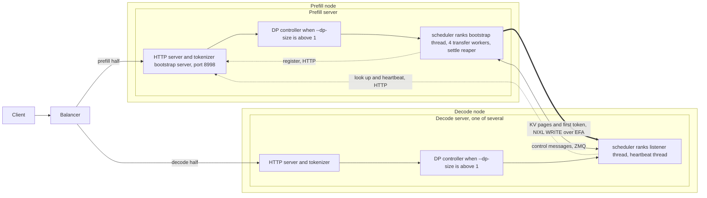
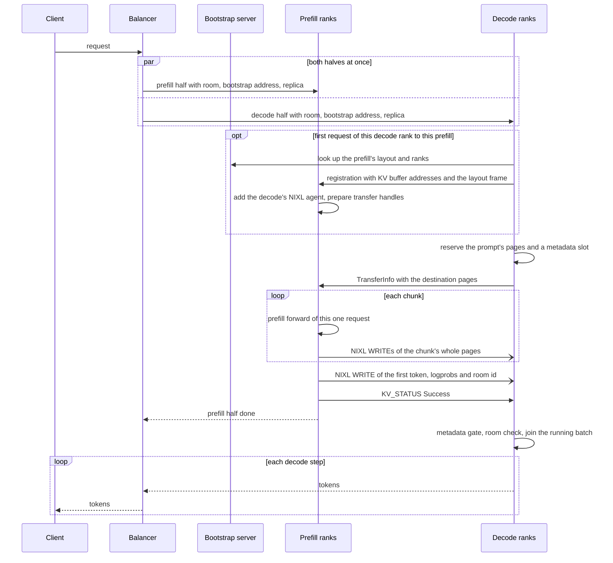
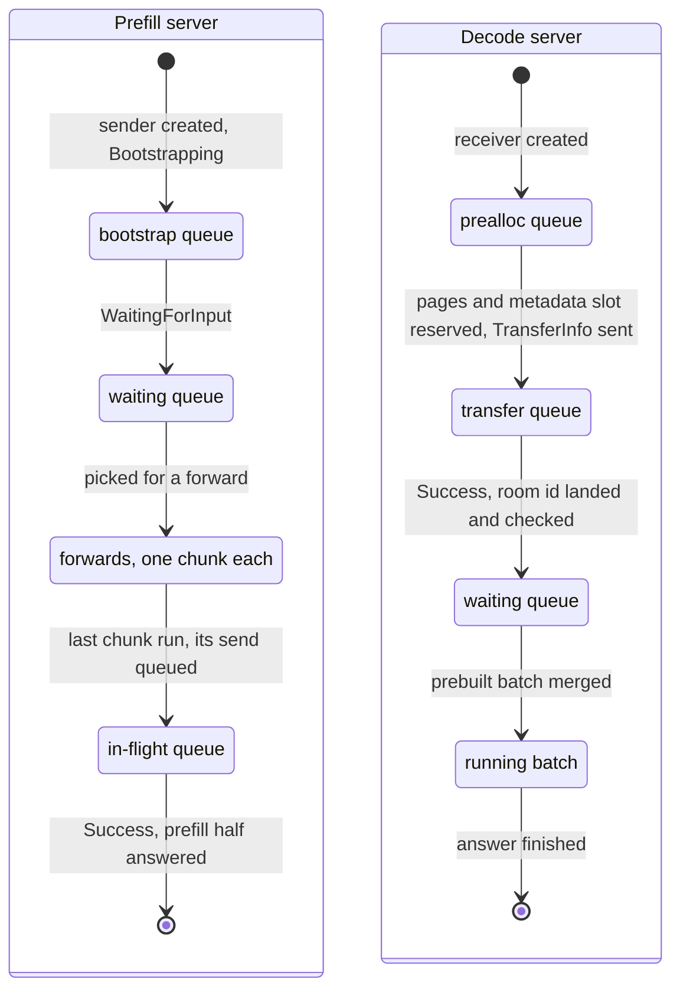
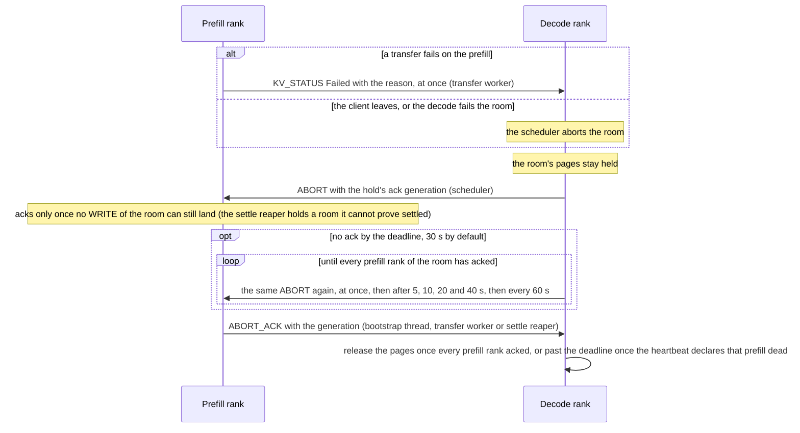
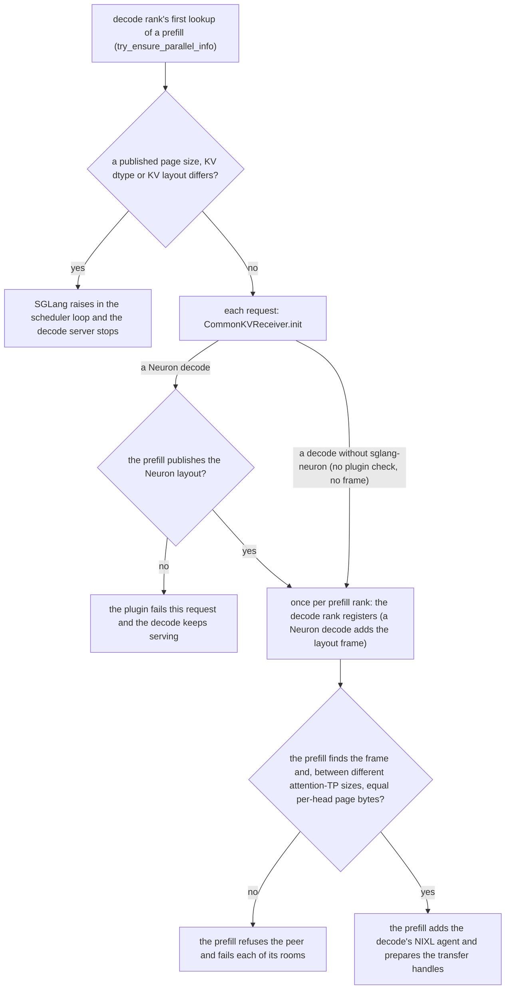
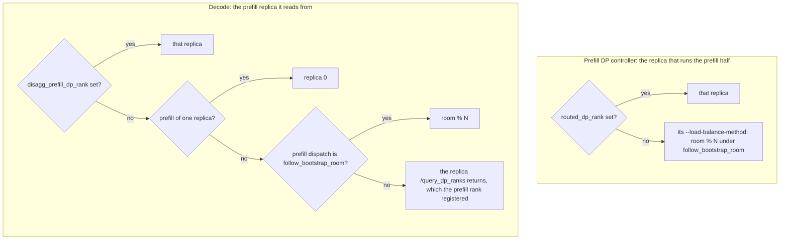

# Disaggregated inference

## Overview

Disaggregated serving, also called PD (prefill-decode) serving, splits a request between two SGLang servers. A prefill
server computes the prompt's KV cache and its first token, and writes the KV straight into a decode server's KV pool
with NIXL WRITEs over EFA. The decode server generates the rest of the answer. A deployment runs any number of prefill
and decode servers (xPyD: x prefill servers, y decode servers), each on one node with its own parallel layout (a Kimi-K3
decode spans two nodes, in the layout its model declares). A balancer in front sends every request to one prefill server
and one decode server at the same time.

On Trainium the split pays off in four ways:

- **Each server compiles and runs one phase.** A prefill or decode server builds and warms only its own phase's graphs,
  where an aggregated server builds both (`sglang_neuron/models/host.py`). It never switches between the prefill and
  decode programs, so it skips the fence an aggregated server runs at each switch, a wait that keeps a rank from
  starting one program while a peer still runs the other
  ([The program-switch fence](runtime.md#the-program-switch-fence)). A runtime that warms several shapes of its phase
  still fences when the shape changes, such as a dense model's prefill tiles or a decode's batch and context buckets.
  GPT-OSS's prefill and its DP-attention decode hold one program each and never fence.
- **Decode steps run back to back.** An aggregated server runs each prefill forward between two decode steps, and every
  running request's next token waits for it. A decode server runs only decode steps, so its time per output token
  (TPOT) is set by its decode steps alone, and a step that waits for a late rank shows in TPOT's tail
  ([Performance characteristics](#performance-characteristics)).
- **DP attention is served.** Under DP attention the ranks form replicas (DP groups), each attending over its own
  requests with its own KV pages. GPT-OSS's experts still span every rank, while a dense model's graphs stay inside
  each group ([The layout](parallelism.md#the-layout)). Every rank runs the same compiled graph at each step: a prefill
  picks it from the token counts SGLang gathers across the replicas, and a decode has a single graph, so it skips the
  gather ([DP attention in lockstep](#dp-attention-in-lockstep)). On an aggregated server one rank's prefill would meet
  another rank's decode in the same step, so the platform refuses DP attention there and serves it disaggregated
  (`sglang_neuron/serving_policy.py`); [Where it is served](parallelism.md#where-it-is-served) lists the models and
  roles. GPT-OSS-120B's decode runs eight DP-attention replicas.
- **Each phase is sized on its own.** A layout runs as many decode servers as one prefill server keeps busy
  ([Sizing a layout](#sizing-a-layout)), and each role takes its own TP, EP and DP layout and Neuron runtime defaults.

Upstream SGLang owns the protocol: the bootstrap server, the KV sender and receiver over NIXL, the poll states, the
scheduler queues of both roles, the heartbeat and the deferred release of a failed transfer's pages. The plugin adds:

- the transfer of head-major KV pages, and the refusal of peers that do not run it;
- a NIXL build that holds up under many senders writing into one decode;
- fixes to SGLang's failure paths, so that a failed or aborted transfer neither corrupts another request nor stops a
  server;
- a DP-attention decode that runs its ranks in lockstep without the per-step batch exchange;
- host-path changes that keep the disaggregation bookkeeping off the device's critical path.

[The runtime](runtime.md) covers how a launch starts and the serving policy, [Parallelism](parallelism.md) the
parallel layouts, process groups and DP attention, [Async scheduling and execution](async-scheduling-and-execution.md)
the overlap schedule, and [KV cache](runtime.md#kv-cache) the KV pool, its head-major MHA pages and packed FP8 K. Paths
on this page are relative to the repository root; SGLang's code is named by its Python module
(`sglang.srt.disaggregation.nixl.conn`).

## Key concepts

**Prefill and decode servers.** SGLang servers started with `--disaggregation-mode prefill` and
`--disaggregation-mode decode`. A prefill server can run several independent replicas (`--dp-size` without DP
attention), each its own TP world. A decode server can run DP-attention replicas (`--dp-size` with
`--enable-dp-attention`). Each prefill server also runs a bootstrap server, a small HTTP service where its ranks
publish their addresses and layout for decode ranks to look up.

**Attention-TP group.** The ranks that hold one replica's attention heads. A decode rank takes its KV from the prefill
ranks that hold the same heads, and the ranks of a group agree on every step of a request's transfer.

**Bootstrap room.** A random id below 2^63 that names one request on both servers. The balancer puts it into both halves
of the request, with the address of the prefill's bootstrap server, and every prefill and decode rank of the request
finds its peers under it.

**Poll state.** Each side tracks a room in one of SGLang's `KVPoll` states: Failed (0), Bootstrapping (1),
WaitingForInput (2), Transferring (3) or Success (4). Every scheduler iteration takes, for each pending room, the
minimum of its state over the attention-TP group. So no rank moves a request on before its peers, and one failed rank
fails the request on all of them.

**Metadata slot.** A row of SGLang's metadata buffers in host memory, one per request in flight on each server. The
prefill fills its row with the first token, its logprobs and the room id, and sends that row with the request's last
WRITE into the slot the decode reserved. The decode starts the request only once the room id has landed there (the
metadata gate).

**Head-major page.** A Neuron MHA KV pool stores a page as `[kv_heads, page_size, head_dim]` (an fp8 K page as
`[kv_heads, page_size / 2, head_dim, 2]`), the layout the attention kernels read, so each head's share of a page is one
contiguous run ([The MHA pool](runtime.md#the-mha-pool)). SGLang's own MHA pools are token-major.

**Deferred release and quarantine.** When a room fails or is aborted during its transfer, the decode holds the room's
pages and sends every prefill rank of the room an ABORT, which the prefill answers with an ABORT_ACK once none of the
room's WRITEs can still land. SGLang's deferred release frees the pages at a deadline even without the acks; the
plugin's quarantine keeps holding them past it.

**Ack generation.** A number the decode gives each hold of a room's pages. The hold's ABORTs carry it and the prefill's
ABORT_ACKs echo it. An ack counts only for the hold of its own generation, so a late ack from an earlier hold of the
same room cannot release a later one, and a resent ABORT keeps the acks already counted.

## Architecture



| Component | Runs in | What it does |
|---|---|---|
| Balancer | its own process, on the node the clients reach | Splits each request into a prefill half and a decode half and sends both at once ([Routing and balancing](#routing-and-balancing)). |
| Bootstrap server | the prefill server's HTTP process, on `--host` and `--disaggregation-bootstrap-port` (8998 by default) | Serves `/route` (a prefill rank registers with PUT, a decode rank looks up with GET), `/register_dp_rank`, `/query_dp_ranks` and `/health`. It publishes the prefill's parallel layout, page size, KV dtype and KV layout, keyed by replica (the system DP rank) when the server runs several, else by attention DP rank. `/register_dp_rank` and `/query_dp_ranks` map a room to its replica when the decode cannot work it out ([Other front ends](#other-front-ends)). |
| Prefill scheduler rank | each rank of each prefill replica | A `NixlKVManager`: a ZMQ socket for decode messages, one NIXL agent, `SGLANG_DISAGGREGATION_QUEUE_SIZE` (4) transfer queues with one transfer-worker thread each, and a bootstrap thread that reads the decode messages. The plugin adds a settle-reaper thread when a room needs one. |
| Decode scheduler rank | each rank of each decode server | A `NixlKVManager`: its ZMQ socket and NIXL agent, a listener thread for prefill messages, and a heartbeat thread that polls each prefill's bootstrap server. |
| DP controller | a server with `--dp-size` above 1 | SGLang's `DataParallelController` dispatches each request to a replica. The plugin makes it wait on its socket instead of spinning a core. |

| Channel | From, to | Carries |
|---|---|---|
| HTTP | prefill rank to bootstrap server | the rank's address, once at startup (PUT `/route`); a room's replica (POST `/register_dp_rank`) on a prefill of several replicas, when the request names no `disagg_prefill_dp_rank` and the dispatch is not `follow_bootstrap_room` |
| HTTP | decode rank to bootstrap server | the prefill's parallel info, layout and target ranks (GET `/route`), cached per prefill; a room's replica (POST `/query_dp_ranks`) when it cannot derive it; the heartbeat (`/health`) |
| ZMQ | decode rank to prefill rank | the registration (KV buffer addresses, once per prefill rank, with the plugin's layout frame), a `TransferInfo` per room (destination pages and metadata slot), `ABORT` |
| ZMQ | prefill rank to decode rank | `KV_STATUS` per room (status and reason), `ABORT_ACK` |
| NIXL WRITE over LIBFABRIC and EFA | prefill rank to decode rank | the KV pages, device to device; the first token, its logprobs and the room id, host to host |

Each rank registers its KV pool's device addresses with NIXL (`sglang_neuron/mem_cache/memory_pool.py`), so a KV WRITE
goes from prefill HBM to decode HBM. Every NIXL agent's progress thread pauses 250 µs between iterations
(`NIXL_PROGRESS_DELAY_US` in `sglang_neuron/disaggregation/__init__.py`), and 2 ms on the giga-kernel decode, whose 128
ranks already keep every host core busy; the longer pause delays a request's KV arrival by at most that much. NIXL's
Python wrapper creates agents without a pause, which would leave each rank's progress thread spinning on a host core
beside the threads that drive the device.
Each rank's `FI_EFA_IFACE` is set to its Neuron device's EFA interface unless the launch sets it. If the lookup fails,
the rank logs a warning and transfers without that affinity (`sglang_neuron/model_executor/runtime_init.py`).

## Request flow

### Launch

[Entry points](runtime.md#entry-points) shows which hooks each process installs. On a PD role:

1. The plugin's launch hooks go into every process (`sglang_neuron/general_plugin.py`). Among them is the request check
   that refuses `n` above 1 on a PD role.
2. The platform's defaults run in the launching process (`apply_server_args_defaults` in `sglang_neuron/platform.py`).
   They refuse what the runtime does not serve (a server over several nodes but a decode layout its model declares,
   the hierarchical cache on a decode server that its model does not opt in), give both roles the model's page (128
   tokens unless the model gives another) in a KV dtype of the model's, resolve the serving policy and set the default
   decode batch sizes. They then call `disaggregation.apply_launch_settings`, which fixes the transfer settings
   ([Configuration](#configuration)).
3. Every scheduler inherits that environment. `disaggregation.register_hooks` installs the PD patch modules, the
   shared-memory poll reduce, the DP identity where the policy runs it, and the NIXL progress delay. The modules that
   serve aggregated servers too are installed on every launch
   ([Upstream SGLang and the plugin](#upstream-sglang-and-the-plugin)).
4. Each prefill rank registers with the bootstrap server. A decode rank meets a prefill rank only when a request first
   names it.

### A request



1. **Admission.** On a prefill of several replicas, the DP controller dispatches the request to the replica its
   `routed_dp_rank` names (the balancer always sends one), else, under the default `follow_bootstrap_room`
   dispatch, to replica `room % N` of its N replicas. The replica creates the room's sender (Bootstrapping) and sets
   the request's `max_new_tokens` to 1. On a decode of several DP ranks, the DP controller dispatches round robin unless
   the request names a rank. The decode's prealloc queue creates the room's receiver. It starts at once if the decode
   has the prefill's parallel info cached and can work out the replica from it. Otherwise the request waits in the
   prealloc queue while the decode looks the prefill up (at most once a second; its requests are aborted after 15
   failed lookups) or asks `/query_dp_ranks` for the replica. How each side picks the replica is drawn in
   [Other front ends](#other-front-ends).
2. **Layout check and registration.** The receiver fails the room if the prefill publishes no KV layout
   ([The KV layout across the wire](#the-kv-layout-across-the-wire)). The first time a decode rank meets a prefill
   rank, it registers its KV buffers there. The prefill's bootstrap thread checks the layout frame, adds the decode's
   NIXL agent and prepares the transfer handles.
3. **Preallocation.** Each decode iteration takes the waiting requests that fit its admission budget and allocates for
   each a req-to-token row, the prompt's KV pages and a metadata slot. It sends a `TransferInfo` to every prefill rank
   the request reads from, and the request moves to the transfer queue.
4. **Prefill bootstrap.** Once a `TransferInfo` has arrived from every decode rank that reads from this prefill rank
   (two for GPT-OSS, one otherwise), the prefill's bootstrap thread marks the room WaitingForInput. The scheduler's
   next poll moves the request into the waiting queue.
5. **Prefill and transfer.** The prefill runs one request per forward, on the chunk grid
   ([The prefill server](#the-prefill-server)). Under the overlap schedule the scheduler queues a chunk's send only
   when it processes that forward's result, after `copy_done.synchronize()`
   ([A prefill server](async-scheduling-and-execution.md#a-prefill-server)). So a WRITE never reads a page the graph is
   still writing, and the chunk's transfer runs while the next forward does. Each chunk but the last sends only whole
   pages; a partial last page waits for the next chunk. A chunk goes to one of the four transfer queues, chosen by its
   destination ranks, so a room's chunks stay in order on one worker. The worker posts the chunk's NIXL WRITEs, and for
   the last chunk also the request's metadata slot. Once the handles complete, it sends `KV_STATUS` Success to every
   decode rank of the room. The prefill then finishes the request as SGLang finishes every prefill half, with 0 new
   tokens (`FINISH_LENGTH(length=0)`), or with the abort's finish state if an abort is pending
   (`sglang_neuron/managers/logprob_errors.py`). It frees its KV and answers the prefill half.
6. **Decode commit.** The listener counts Success from every prefill rank the room needs. The decode's poll counts a
   Success as Transferring until the room id has landed in the request's metadata slot (the metadata gate). The decode
   then reads the first token and checks the room id: a mismatch ("Context corruption detected") fails the request
   instead of starting it from another prompt's token. The next batch takes the request as already prefilled and merges
   it into the running batch, and the decode streams the answer through the balancer.

On each server the request moves through SGLang's scheduler queues as its poll state advances. A Failed poll in the
prefill's bootstrap, waiting or in-flight queue, or in the decode's prealloc or transfer queue, aborts the request on
that server ([A failed or aborted room](#a-failed-or-aborted-room)). The decode clears the request's receiver before
the request enters its waiting queue, so nothing polls the room after that.



### A failed or aborted room



The prefill acks from whichever thread sees the room drained: the bootstrap thread when the ABORT finds none of the
room's chunks outstanding, a transfer worker when the room's last outstanding chunk completes after the ABORT, and the
settle reaper for a room it held ([Failures and aborts](#failures-and-aborts)).

## The KV layout across the wire

The prefill writes into the decode's pool as that pool is laid out, so both sides must agree on the bytes of a page.
Every Neuron server pages its KV in 128 tokens unless its model gives another page ([Pages](runtime.md#pages);
`sglang_neuron/platform.py` sets and checks it). When a decode rank
first looks up a prefill, SGLang compares the prefill's page size, KV dtype and KV layout with its own
(`CommonKVManager.try_ensure_parallel_info`). On a difference it raises in the decode's scheduler loop ("Page size
mismatch", "KV cache dtype mismatch", "KV layout mismatch"), and that stops the decode server. A stock SGLang prefill
with another page size therefore takes the decode down at its first request, before the plugin's per-request check
below runs. Launch both roles with the same `--kv-cache-dtype`: `fp8_e4m3` for GPT-OSS, and none (SGLang's `auto`) for
the bf16 models.

| Pool | A page, per layer | Models | Transfer |
|---|---|---|---|
| Neuron MHA pool | K and V each `[kv_heads, page_size, head_dim]`; an fp8 K `[kv_heads, page_size / 2, head_dim, 2]` | GPT-OSS, Qwen3, Qwen3-MoE, GLM-4 | whole pages between equal attention-TP sizes; one slice per page and head group between different sizes |
| SGLang's MLA pool on the NeuronCore | one row of `kv_lora_rank + qk_rope_head_dim` per token, the same on every attention-TP rank | DeepSeek-V2 | whole pages |

**Equal attention-TP sizes.** SGLang's transfer copies whole pages: decode rank `r` of an attention-TP group takes the
pages of prefill rank `r`. A page is one run of bytes in either layout, so the copy is right whenever both sides are
head-major, which the layout checks below guarantee. Every tested layout but GPT-OSS's runs equal sizes, the MLA pool
included.

**Different attention-TP sizes.** GPT-OSS has eight KV heads. Its TP4 prefill holds two per rank, and its decode, at
attention TP8, holds one. SGLang maps decode rank `d` of a DP group to prefill rank `d // 2` and that rank's head
`d % 2`, so each prefill rank serves two decode ranks per DP group. SGLang's own slice transfer cuts each page per
token, which on a head-major page addresses the wrong bytes. `sglang_neuron/sglang_patches/nixl_head_major.py` rebuilds
`_init_hetero_tp_prep_handle` and `send_kvcache_slice` from SGLang's source with the slice unit set to one per page: a
head's share of a page is one contiguous run, so the transfer takes one slice per page and head group, for K and V of
every layer. With fp8 and a head dimension of 64 that run is 8,192 bytes on both sides. The prep refuses a decode whose
per-head page bytes differ from the prefill's ("Head-major KV slice transfer needs equal per-head page bytes on both
sides"), since a head's page is then not one run on both.

**The giga-kernel decode's paired pool.** The giga-kernel decode's pool holds each pair of layers as the two halves of
one K tensor and one V tensor ([The MHA pool](runtime.md#the-mha-pool)). Each layer's cache is still a contiguous view
of its half, and the pool registers every layer's half as its own region in SGLang's order, so the prefill's layer `i`
lands in the decode's layer `i` as it does in an unpaired pool, and the transfer needs nothing more. The decode runs at
attention TP8 with one KV head a rank, as the per-layer decode does, so the TP4 prefill serves it through the same
head-major slices.

SGLang builds one source descriptor list from the first decode of another TP size and sends to every later one through
it, with that first decode's head grouping. The module keeps one source list per head grouping instead, and each
decode's entry names its grouping, so decodes of two attention-TP sizes can share one prefill.

**A context-parallel decode.** A decode can also hold a share of each page's tokens. A `--dcp-size` decode takes whole
prefill pages, each DCP rank its own pages
([Decode context parallelism](decode-context-parallelism.md#how-it-works)). A token-CP decode holds one block of every
page in every KV head, and a whole-page prefill scatters each page's blocks to the decode ranks that hold them, at
equal attention TP, with a check of the geometry at registration
([A whole-page prefill into a CP decode](context-parallelism.md#a-whole-page-prefill-into-a-cp-decode)). Qwen3.5's
kv_cp decode is the one that runs it.

**Layout checks in both directions.** A whole-page copy between a head-major and a token-major pool corrupts as surely
as a per-token slice, and a server without the plugin also lacks the failure handling the other side relies on. So each
side checks the other before any transfer is built:



- **Prefill to decode.** Both roles report `sglang-neuron:kv-head-major` as their KV layout through SGLang's own
  `kv_layout` field, which SGLang fills only for DeepSeek-V4 pools; the plugin's wrap of `get_pd_kv_layout` names it
  for both Neuron pools. The prefill publishes it at its bootstrap server. A prefill that publishes a different layout
  never reaches the plugin's check, because SGLang's own lookup raises "KV layout mismatch" first. The plugin's check,
  in `CommonKVReceiver.init` before the decode registers with that prefill, covers a prefill that publishes no layout:
  a stock SGLang prefill of any model but DeepSeek-V4. It fails that one request ("a prefill without sglang-neuron
  writes token-major pages into this decode's head-major pool (pair a Neuron prefill)"). Such a prefill would also
  never ack the ABORT of a room it could not prove settled (a rejected post, or handles still running after a
  failure), and the decode's quarantine would hold that room's pages until the prefill restarts.
- **Decode to prefill.** Every Neuron decode, MLA included, appends the frame `sglang-neuron:kv-head-major` to its
  registration, which SGLang's parser ignores. A prefill refuses a decode without it ("its registration lacks
  sglang-neuron's KV layout frame ... (pair a Neuron decode)"). The check runs in the bootstrap thread at registration,
  where `nixl_peer_refusal` turns the raise into a refused peer ([Failures and aborts](#failures-and-aborts)).

**A prefill the decode cannot pair with.** `sglang_neuron/sglang_patches/decode_incompatible_prefill.py` runs the
decode's first lookup one prefill at a time, so refusing one prefill costs no other prefill's requests. A check that
refuses a prefill raises `PrefillIncompatibleError` from a hook on `CommonKVManager._resolve_rank_mapping`, which
SGLang's lookup calls: that prefill's queued requests fail with the reason ("Prefill ... cannot serve this decode:
..."), and the decode keeps serving the others. The prefill's info stays uncached, so its later requests are checked
again after SGLang's 1 s retry interval, and a relaunched prefill that pairs is served. The refusal comes before the
decode registers with that prefill, so no ABORT goes to it (`nixl_peer_refusal` is the prefill-side counterpart).
SGLang's own refusals at the lookup still stop the decode: the page size, KV dtype and KV layout checks above, its
MiniMax, DSpark, MXFP8 and DCP checks, and the rank mapping's assertions (equal prefill and decode attention TP for a
sharded MLA KV cache, CP and PP). The only check that refuses this way is the chunk-keyed decode radix cache's, for a
prefill whose chunk its tree cannot reuse ([The decode radix cache](#the-decode-radix-cache)), so the wrapper runs on
that decode only.

## The NIXL overlay

Both servers load NIXL 1.5.0 built from source with the patches in `patches/nixl`, all to its libfabric plugin
([NIXL patches](../../patches/nixl/README.md)). NIXL's PyPI wheels cannot be used as they are: their libnixl links
etcd's C++ client, which brings gRPC and a protobuf that collides with the one torch-neuronx links statically, so a
process that imports both crashes; and their libfabric plugin hangs transfers under a disaggregated load and grows a
table with every request.

`tools/build_nixl.sh` builds it: it takes NIXL's `release/1.5.0` at the commit the PyPI 1.5.0 wheels were built from and
applies the series. It checks the patched tree against a pinned one, builds one wheel with only the LIBFABRIC plugin and
without etcd, and installs it with the pinned `nixl` 1.5.0 meta wheel
([NIXL patches](../../patches/nixl/README.md#building) has the inputs, the steps and the checks). NIXL's meta package
imports the module `nixl_cu<N>`, where N is the CUDA major version the container's torch reports, so the script gives
the wheel that name although the wheel links no CUDA. The plugin's progress-delay hook imports the same module, so a PD
launch in an environment without it stops at hook registration. The processes the launch starts exit with
"sglang_neuron: runtime registration failed (ModuleNotFoundError: No module named 'nixl_cu<N>')".

```bash
NIXL_WHEELS=<dir> [NIXL_PACKAGECACHE=<dir>] [NIXL_REPO=<url or path>] bash tools/build_nixl.sh <out dir>
```

Serve with `<out dir>` first on `PYTHONPATH` of both servers and `NIXL_PLUGIN_DIR` unset. Both ends of a transfer must
run this build: 0005 and 0008 version the connection handshake (protocol 2, then 3), and a peer of another version is
refused at connection setup.

| Patch | Upstream | What it fixes |
|---|---|---|
| 0001 to 0003: AMD accelerator detection, notify the target of an unposted batch write, name `fi_writemsg` in messages | [#1750](https://github.com/ai-dynamo/nixl/pull/1750), [#2107](https://github.com/ai-dynamo/nixl/pull/2107), [#2159](https://github.com/ai-dynamo/nixl/pull/2159) | Context only: 0001 does nothing on a Neuron host, 0002 acts on notified transfers, which SGLang does not post, and 0003 changes log messages; 0005 does not apply without them. |
| 0004 serialize endpoint calls | [#2308](https://github.com/ai-dynamo/nixl/pull/2308) | The progress thread and the caller's thread used a rail's endpoint at once, which on EFA corrupts the provider's state and hangs transfers. |
| 0005 identify senders by source address | [#2294](https://github.com/ai-dynamo/nixl/pull/2294) | Lifts the limit of 255 peers per agent, which a prefill reaches when its decode servers have more ranks than that between them. |
| 0006 keep EFA unsolicited write receive on | not proposed | Built against the EFA headers, the plugin turns unsolicited write receive off, so each incoming write uses up a posted receive; a decode rank that takes many KV writes at once runs out ("Internal queue pair error") and the decode server stops. `NIXL_LIBFABRIC_EFA_UNSOLICITED_WRITE_RECV=1` keeps it on; unset, the plugin behaves as upstream. |
| 0007 fail the request of every CQ error entry | not proposed | One of the plugin's two completion readers dropped error entries, so a failed transfer never completed and the prefill's transfer worker waited on it forever, with every later transfer behind it. Both readers now fail the entry's request, so a "failed" status means that nothing of the transfer still writes. |
| 0008 unnotified writes are not counted | not proposed | The target kept an entry for every write of a transfer without a notification, which is every SGLang KV transfer, so the table grew with every request and slowed the decode's progress threads. |

Upstream turns unsolicited write receive off because remote write completions can then be lost under load, and the
notifications that ride on them. SGLang's transfers carry no notification: the prefill learns each transfer's outcome
from its own handles and reports it in `KV_STATUS` over ZMQ. Two ends that disagree on the setting fall back to slower
emulated writes without an error, which is why the platform fixes it on both roles.

## Routing and balancing

### The load balancer

`sglang_neuron/disaggregation/balancer.py` is the PD load balancer: the one to run in front of a deployment and the one
this repository validates. It listens on
`127.0.0.1:8000` by default and takes repeatable `--prefill` and `--decode` URLs, the prefill servers'
`--bootstrap-port` (8998), a per-request `--timeout-s` (3600), an optional `--trace-file` and `--no-retry`. It serves
`/generate`, `/v1/completions` and `/v1/chat/completions` for single-prompt requests (a batch of prompts gets 400), and
`/health` (the balancer's own), `/server_info` (every server's, and the balancer's `balancer_retries`) and
`/flush_cache` (every server), `/v1/models`, `/model_info` and its older name `/get_model_info`, which SGLang's GSM8K
client asks for first (from the first prefill server).

```bash
# add --host <address> for clients on other hosts
python -m sglang_neuron.disaggregation.balancer --prefill http://<prefill node>:30000 \
  --decode http://<decode node>:30000
```

At its first request it reads every server's DP size from `/server_info`. For each request it:

- picks the decode server with the fewest requests in flight, counted until the response ends (its body read, its
  stream exhausted or left, or either half failed). A client's `routed_dp_rank` instead names a server and rank,
  counting server 0's ranks, then server 1's, and so on; the determinism checks use it to reach every rank;
- picks the (prefill server, replica) with the fewest outstanding prefills, counted until the prefill half answers, or
  for a streamed request until the decode's first chunk;
- draws a room with `bootstrap_room % dp_size` equal to that replica, puts the bootstrap host, port and room and
  `disagg_prefill_dp_rank` into both halves and `routed_dp_rank` into the prefill half, and posts both. The bootstrap
  host is the `--prefill` URL's host, so that URL must name an address the decode servers reach: with
  `--prefill http://localhost:30000` a decode on another node bootstraps from its own localhost and fails at its
  bootstrap timeout (the balancer warns at its start).

Whichever half fails first is the request's answer, and the balancer cancels the other. Waiting for the decode instead
would leave a request the prefill refused hanging until the decode's bootstrap timeout, and the other way round. A
streamed prefill answers 200 at once and reports a failure inside its stream. So for a streamed request the balancer
reads the prefill's stream until the decode's first chunk, and ends the request with the prefill's error
(`"source": "prefill"`) if the prefill fails first.

A request that fails before the client got a byte is run again once, on a new prefill pick, room and decode pick (the
same decode rank when the client named one). That covers a 5xx from either half, a failed or broken connection, a
streamed prefill's failure, and a decode whose first event is an error, such as a failed KV transfer. A 4xx is final,
and so is anything after the first chunk. A request that names its own `rid` runs once, since a server refuses a rid
it still holds. The balancer closes the first run's connections before the retry, so both servers abort it, logs the
retry and counts it in `balancer_retries`. It holds the decode's bytes only until the first whole event, so a retry
costs nothing on success. A refused connection is posted again up to three times, 50 and 150 ms apart; a dropped one
is not, since the server may already hold that room. `--no-retry` shows every server failure, which a retry would
hide.

The client's `x-session-id`, `x-correlation-id` and `x-dynamo-session-id` headers reach both halves. Its `Authorization`
header reaches both halves too, and every server that `/server_info`, `/flush_cache`, `/v1/models` and `/model_info` (or
`/get_model_info`) ask, so servers started with SGLang's `--api-key` check the client's own key (a generation request
without it gets their 401). The balancer checks no key itself. `--trace-file` appends one JSON line per run of a
request, its milestones and picks (the `Trace` docstring in the module lists the fields).

### Other front ends

This repository validates this balancer only, not SGLang's own router. Another front end must put
`bootstrap_host`, `bootstrap_port` and `bootstrap_room` into both halves, with a room unique among the requests in
flight. It should also put the replica that serves the prefill half into both halves as `disagg_prefill_dp_rank`.
Two choices must agree: the prefill's DP controller picks the replica that runs the prefill half, and the decode picks
the prefill replica whose ranks it reads from. N is the prefill's replica count:



The prefill's DP controller never dispatches by `disagg_prefill_dp_rank`: it follows `routed_dp_rank` when the request
sends one, else its `--load-balance-method` (the room under the default `follow_bootstrap_room`). Its sender skips the
room check for a request that names `disagg_prefill_dp_rank`. So a `disagg_prefill_dp_rank` that names another replica
sends the decode to ranks that hold no sender for the room, and the request waits out its bootstrap timeout with no
error naming the cause. Without `disagg_prefill_dp_rank`, on a prefill of several replicas, the prefill's sender takes
the path that `prefill_dispatch_dp_rank` fixes (Replicas in [The prefill server](#the-prefill-server)), which only the
CPU suite runs.

### Sizing a layout

A layout runs as many decode servers as one prefill server keeps busy at the decode servers' full concurrency
([Onboarding a model](../model-dev/onboarding-models.md)). Two rates set it:

- `R_p`, the prefill's rate in requests per second of the benchmark's prompts, from its time for one prompt (the
  compiled prefill graph of the benchmark's prompt length);
- `R_d`, a decode server's rate: its running requests over the time to generate one answer, which is the decode step
  at that batch times the answer length.

`N_d` decode servers keep the prefill busy a share `N_d × R_d / R_p` of the time. A layout keeps that share below 1 and
leaves the prefill some headroom, since a prefill that is always busy makes requests queue for their first token. The
tested layouts are:

| Model | Prefill servers | Decode servers |
|---|---|---|
| Qwen3-0.6B | 1 | 5 |
| Qwen3-8B | 1 | 2 |
| GLM-4-9B | 1 | 2 |
| Qwen3-30B-A3B | 1 | 1 (a second would need more prefill than one server has) |
| DeepSeek-V2-Lite | 1 | 5 |
| GPT-OSS-120B | 1, of five replicas | 1, of eight DP-attention replicas |
| GPT-OSS-120B, giga-kernel decode | 1, of six replicas | 1, of sixteen DP-attention replicas |

GPT-OSS-120B balances inside its servers rather than across them: five prefill replicas is the balance at which, for
8K-token prompts and 1K-token answers, prefill keeps every decode slot filled, and six in front of the giga-kernel
decode, whose shorter steps finish its requests sooner.

## The prefill server

- **One request per forward.** `PrefillAdder.add_one_req` refuses a second request and anything beside a chunked one,
  and priority preemption runs only for a request the pass admits (`sglang_neuron/general_plugin.py`).
- **The chunk grid.** `sglang_neuron/sglang_patches/prefill_chunk_grid.py` keeps every forward on whole
  `--chunked-prefill-size` chunks unless it ends the prompt, so a cold prompt runs one compiled tile per chunk. A
  chunked request's next cut is rounded down to whole chunks; a cut of less than one chunk becomes one chunk if the KV
  pool can allocate it, else the request waits for the next pass. The truncation grid is the chunk; SGLang already
  refuses `--enable-deterministic-inference`, which sets its own grid, since `neuron` is not one of its deterministic
  attention backends, and the grid refuses it again. The graph runner requires the chunk to
  equal the largest prefill token bucket wherever the grid is kept (`sglang_neuron/model_executor/graph_runner.py`).
- **Asynchronous prefill.** With async execution, no attention DP, no context parallelism and no pipeline parallelism,
  the platform sets `SGLANG_ENABLE_DISAGG_PREFILL_CONTINUOUS_INPUT_POLLING=1` (a pipelined prefill's stages take each
  iteration's requests at one loop point: [Pipeline parallelism](pipeline-parallelism.md)). SGLang's prefill overlap
  loop then keeps taking and bootstrapping requests while the oldest forward's result is pending, with at most two
  batches in flight. A request that arrives during a forward is then ready for the next one.
- **Compute ahead.** On a pipelined prefill of a model that declares it (GLM-5.2), a request waiting for a decode seat
  is computed early and its KV pushed once the seat is granted
  ([Compute ahead](pipeline-parallelism.md#compute-ahead-on-a-pipelined-pd-prefill)).
- **Prefix cache.** SGLang's radix cache is on by default on a prefill server
  ([Prefix (radix) cache](runtime.md#prefix-radix-cache)). A hit skips its pages' compute, and the first forward starts
  on the chunk grid at the hit's page. The transfer sends the prompt's pages from the decode's prefix length, which is
  0, so every page, unless the decode runs its own radix cache ([The decode radix cache](#the-decode-radix-cache)).
  SGLang can send a hit's pages before the request's first forward (`SGLANG_DISAGG_PREFILL_EARLY_SEND_CACHED_PREFIX`,
  on by default). Under the overlap schedule that send records a `torch.cuda.Event` on the forward stream, so that its
  WRITEs wait for the previous forward's writes to those pages, and a Neuron host cannot record one. The platform
  therefore sets it to 0, and the hit's pages go with the first forward's send.
- **Replicas.** `--dp-size N` without DP attention runs N replicas under SGLang's DP controller, each its own TP world.
  The prefill's default dispatch is `follow_bootstrap_room` (replica `room % N`), and a request's `routed_dp_rank`
  overrides it. Without DP attention every replica's attention DP rank is 0. So for a request without
  `disagg_prefill_dp_rank`, SGLang's sender fails every request a replica other than 0 serves ("follow_bootstrap_room
  conflict"), or under another dispatch registers the room as replica 0's. `prefill_dispatch_dp_rank` rebuilds the
  sender's check and registration to read the replica the request was dispatched to. The balancer always sets
  `disagg_prefill_dp_rank`, and SGLang then skips both, so this path runs only behind other front ends.
- **No DP attention on a DeepSeek-V2 prefill.** Its prefill window also holds the request's cached prior (the tokens
  already in its KV cache), so each DP rank would size its graph by its own request's prior, which the token counts
  gathered across the replicas do not carry. GPT-OSS's prefill uses replicas instead.
- **Host path.** The prefill's poll reduces stay on SGLang's gloo all-reduce. The shared-memory form runs on a decode
  only (`node_local_poll_shm` in `serving_policy.resolve`), where gloo's staggered exit delays the next short decode
  step (the decode's [Host path](#host-path)). The DP controller waits on its socket for at most 100 ms per pass
  (`dp_controller_blocking_recv`) instead of spinning on a core for the server's lifetime.

## The decode server

### Admission, retraction and the pool

SGLang's preallocation decides which requests the decode can take: its budget counts the pages already reserved, a
reserve of `--num-reserved-decode-tokens` (512) tokens per active request and what a retraction could free, under the
default `early` allocation policy. The plugin leaves it as it is. A Neuron pool keeps no host copy of a request's KV, so
the retraction backup is `none`: when the running batch runs out of pages, SGLang retracts a request and aborts it with
503 ("Retracted under decode memory pressure without a KV backup. Retry later."), and the server keeps serving. A
quarantined room's pages stay allocated, so admission never hands them out, and the server does not report idle while it
holds any.

Under the `early` policy the decode reserves a request's seat, its request row, before the request's prefill starts: the
prefill holds the request until the decode publishes its destination. On the GLM-5.2 GK decode a row is one of the
kernel's 32 slots, so when more requests are in flight than slots, the order of the prealloc queue decides whose prefill
starts when a slot frees: SGLang's, arrival order.

A retract pause (`/pause_generation` with `mode` `retract`) retracts the decode's running and waiting transferred
requests and, on `/continue_generation`, sends each back to its prefill as a rebootstrap that recomputes the prompt and
the outputs so far. SGLang's commit of the recomputed KV would report the rebootstrap's prefix-cache hit as the
request's cached tokens (more than the prompt if the prefill cached the earlier outputs, 0 if it was flushed);
`pd_rebootstrap_cached_tokens` keeps the first attempt's counts, the ones its usage reports.

### The decode radix cache

Without SGLang's `--disaggregation-decode-enable-radix-cache` the decode runs no radix tree. With it, each DP rank of
the decode keeps SGLang's own tree (`UnifiedRadixCache`), as on GPU, with no plugin hook on the tree, its match or its
frees. The decode inserts a request's prompt at its handoff and its answer (the KV the decode wrote) when it finishes.
SGLang matches each new request against the tree when it preallocates it: the decode locks the matched pages,
allocates the rest, and sends the prefill the matched length (`decode_prefix_len`, whole pages, at most the prompt),
and the prefill sends only the pages after it. A prompt the tree holds whole that ends on a page takes no KV page, only
its first token and metadata. Behind a prefill without a hit of its own, a reply's cached tokens are the decode's hit.

- **Admission and retraction.** SGLang's preallocation counts the tree's evictable pages as free and evicts them when
  an allocation needs the room. A retraction frees only the pages past the tree's prefix, and the retracted request is
  still aborted with 503.
- **Freed pages.** The tree frees through SGLang's allocator (`free_segment`), so an evicted page, or a copy a
  duplicate insert drops, is staged with the launch count at its free like any freed page and still counts as
  available ([The allocator](runtime.md#the-allocator)); the allocator pins `free_segment` with the rest of the
  staging's source. The stamp is the launch count at the eviction, not at the page's last read, so once the tree fills
  the pool an evicting allocation usually finds the pages it just freed unsafe and waits for this rank's launches in
  flight: correct, at a host wait per evicting allocation, which the hardware gate's timing shows.
- **Numerics.** A replay of a prompt reuses the bytes its first prefill sent, so it answers exactly as the cold run. A
  later turn that reuses KV the decode wrote while answering is close to a cold run, not bit-identical, since a cold
  prefill computes those positions in another forward. A tree keyed on whole prefill chunks (below) reuses none of that
  KV.
- **Routing.** Each DP rank keeps its own tree and the balancer does not route by prefix, so a later request
  reuses a prefix only on the DP rank that served it (`routed_dp_rank` pins the rank). SGLang marks the decode radix
  cache experimental, and warns under DP attention that its hits need prefix-aware routing.
- **Refused** on a pipelined decode, whose stages would each match against their own tree
  ([What a launch refuses](pipeline-parallelism.md#what-a-launch-refuses)), and on a DCP decode, which no run covers
  with it ([Decode context parallelism](decode-context-parallelism.md#limitations)).

**Keyed on whole prefill chunks.** With `--radix-cache-backend neuron-chunk` as well, the decode's tree holds and
reuses only KV its prefills computed for whole chunks, and a request reuses only KV that a prefill of its own KV
fingerprint computed: the same chunk, tree (the chunk-keyed prefill graph has a narrower block table than one without
a tree) and parallel layout (TP, EP, attention TP and DP, PP). SGLang already refuses a prefill of another KV dtype or
page size, and a checkpoint fixes its weights' quantization. So behind prefills that share a fingerprint and serve the
same checkpoint at the same `--context-length` from the same image (which the fingerprint does not tell apart), a hit
decodes over the KV bits of its cold run ([Prefix (radix) cache](runtime.md#prefix-radix-cache)). The tree keys whole
chunks of the decode's per-rank `--chunked-prefill-size` (SGLang divides the flag over the attention-DP groups), and
every insert stops at the prompt's last whole chunk, so a later turn reuses none of the KV the decode wrote. A hit must
end on a boundary of the prefill's chunks, since a chunk's KV holds the bits of one forward over all its tokens.
SGLang's protocol does not tell the decode a prefill's fingerprint, so
`sglang_neuron/sglang_patches/decode_radix_prefill_chunks.py` relays it through the prefill's bootstrap server:

- Each prefill rank adds its fingerprint to its registration when every prompt it computes is on the chunk grid (on the
  chunk-keyed tree, or with `--disable-radix-cache`): `kv_chunk_grid` is its chunk and `kv_numerics` the rest. A
  prefill on SGLang's page-keyed tree, whose hits resume at a page, advertises none, and its bytes stay SGLang's.
- The bootstrap server keeps the first accepted rank's fingerprint and refuses a rank of another with HTTP 400 (so it
  never counts every rank and answers no decode). Its info answer carries the fingerprint.
- SGLang's `PrefillServerInfo` raises on unknown keys, so every Neuron decode reads the answer into a subclass with the
  two fields.
- At first contact with each prefill, the chunk-keyed decode refuses
  ([The KV layout across the wire](#the-kv-layout-across-the-wire)) a prefill that advertises no chunk, or one whose
  chunk does not divide the decode's. GPT-OSS's 8192-token prefill chunk behind its DP8 decode at
  `--chunked-prefill-size 8192` (1024 tokens a rank) is refused: that decode needs `--chunked-prefill-size 65536`.
  SGLang's Rust bootstrap registry (`SGLANG_RUST_SERVER`) drops the key, so every prefill behind it is refused.
- The decode serves every other prefill and keeps apart the KV of prefills that compute different bits for the same
  tokens: once a request's receiver has paired with its prefill's info (`DecodePreallocQueue._init_receiver`), the
  request's radix `extra_key` becomes its own joined with the prefill's fingerprint (`<own>|kv_chunk_grid=...`), as
  SGLang joins the elastic-EP namespace to it, so no tree node holds the KV of two fingerprints. A rebootstrap's
  recompute carries the request's own `extra_key`, so the namespace never reaches the prefill. The decode reads a
  prefill's fingerprint once, at first contact, and SGLang keeps that info while the prefill answers health checks: a
  prefill relaunched at the same address with another configuration (another EP, another tree) in that time is still
  taken for the first, so relaunch the decode with it.
- Each decision reads only the prefill's advertised info, which its bootstrap server answers every decode rank alike,
  and the decode's own configuration, never which prefill a rank reached first. So every rank refuses the same
  prefills, the ranks of a DP group key a request alike, and their trees stay the same.
- The launch refuses the backend on a decode without `--disaggregation-decode-enable-radix-cache` (no tree), with
  `--enable-streaming-session` (whose session keeps the KV the decode wrote for the next turn), and with a per-rank
  chunk that is not whole 128-token pages.

### Host path

- **Poll and flag reduces through shared memory.** Every iteration SGLang MIN-reduces the prealloc and transfer queues'
  poll states over the attention-TP group with a gloo all-reduce, and the decode agrees the same way on per-request
  flags (`all_reduce_flags`): the pending KV destinations to send the prefill (`publish_pending_destinations`,
  `publish_pending_metadata`), the failed transfers to hold, the deferred releases that are ready, and the requests a
  checksum mismatch drops. Gloo's ring lets the ranks out one after another, so the last ones reach the next step's
  first collective late. On a decode, `sglang_neuron/disaggregation/poll_reduce.py` runs these reduces through
  shared-memory segments of the node (one per group and operation) where the host supports it (x86-64, Python 3.13 or
  later, a writable `/dev/shm`). An empty list, which every rank passes while its queue is empty, keeps SGLang's
  reduce, which returns at once instead of holding each rank for the last; only a pipelined decode passes one (from
  `Scheduler.get_rids`).
- **Request broadcast.** A decode without DP attention hands its TP group the requests over SGLang's shared-memory
  message queue instead of a gloo broadcast (`sglang_neuron/distributed/request_broadcast.py`); under DP attention the
  control fence broadcasts.
- **Runtime defaults.** A decode rank queues up to 63 executions per core and completes them without the runtime's
  low-latency polling thread, which competes with the scheduler for the host
  ([Neuron runtime defaults](../guides/reference-configuration.md#neuron-runtime-defaults)).

### DP attention in lockstep

A DP-attention decode runs its ranks in lockstep without SGLang's per-step batch exchange. Every rank launches every
iteration, an idle step when it has no work, and a control request takes effect at the same iteration on every rank
through the control fence ([The DP identity](parallelism.md#a-dp-attention-decode-the-dp-identity),
[The control fence](parallelism.md#the-control-fence)). A launch that cannot hold the identity is refused
([A DP-attention decode](#a-dp-attention-decode)), and if the compiled runtime does not match it (one batch bucket, a
fixed token width, more than two queued executions per core), the first decode step raises on every rank (`proof_checks`
in `sglang_neuron/managers/dp_identity.py`).

Two of the identity's rules shape this path. A request still preallocating or receiving its KV is not work, so an idle
decode stays stopped while transfers land. A transferred request joins a batch only once the fleet resumes at the next
rendezvous (`hold_prebuilt`). The fence also carries the latest cache-flush deadline, so every rank flushes, or gives
the flush up, at the same iteration.

Under the identity, attention-TP rank 1 of each DP group pushes the group's outputs to the detokenizer instead of the DP
leader. The leader's stream would otherwise sit between its result and the next request broadcast
(`sglang_neuron/sglang_patches/detokenizer_sender.py`). This needs an attention-TP width of at least 2, and none of
`--enable-request-time-stats-logging`, `--enable-trace`, `--enable-metrics` without
`--enable-metrics-for-all-schedulers`, or `SGLANG_RUST_SERVER`. Where a condition is not met, the decode logs which,
and the DP leader streams. With `--detokenizer-worker-num N` above 1, rank 1 pushes straight to detokenizer worker
`attn_dp_rank % N`, past SGLang's router, whose one process re-pickles every group's outputs. The GPT-OSS decode also
runs four tokenizer workers (`--tokenizer-worker-num 4`).

## Failures and aborts

A WRITE that lands after its destination pages went to another request corrupts that request without any error, so
every path that frees pages has to know first that nothing of the room can still write. Upstream covers most of this
with its deferred release and acks; the modules below, under `sglang_neuron/sglang_patches/` unless the table names
another path, close the gaps that a disaggregated load with aborts reaches.

| Hazard | Module | What changes |
|---|---|---|
| The prefill's bootstrap thread ends at the first registration that raises, and every later request to that prefill rank waits out its 300 s bootstrap timeout | `nixl_peer_refusal` | A refused peer is dropped, its rooms fail with the reason on both servers at once, and the thread goes on |
| A transfer worker writes Transferring over an abort's Failed and posts the room's next chunk into pages the decode has freed | `pd_status_lock` | One lock per manager orders the status writes and the clears |
| A room whose transfers might still write is never acked, so a decode that waits for acks holds its pages until the prefill restarts | `nixl_settle_then_ack` | The room is held with its transfer handles and acked once every handle settles |
| The decode's listener thread ends at the first message that raises, and every later status and ack is lost | `nixl_decode_listener` | The listener logs the failure and goes on |
| The decode frees a failed room's pages at a deadline without the acks, and never sends a lost ABORT again | `pd_decode_kv_quarantine` | The pages stay held past the deadline, and the ABORT goes again, until every ack is in |
| A deferred cache flush times out by each rank's own clock, so some ranks flush and others do not | `flush_deadline_markers` | The request leader sends a deadline marker, and every rank expires the flush at the iteration that delivers it |
| Aborting `req_1` also ends `req_10` to `req_19` without an error | `abort_rid_match` | An abort reaches its own id and its `<id>_<digits>` copies only, in every queue a Neuron server fills |
| The `n` copies of a request and their common-prefix warmup share one bootstrap room, where their transfers collide | `sglang_neuron/sampling.py` | `n` above 1 is refused on both roles |
| A prefill request aborted during its transfer is finished as a success when the transfer reads Success | `sglang_neuron/managers/logprob_errors.py` | The pending abort is applied first |

**Bootstrap thread survival.** SGLang's prefill bootstrap thread registers each decode rank unguarded, so one raise
there (SGLang's own checks, NIXL's `add_remote_agent`, or the head-major refusal) ends the thread. With
`nixl_peer_refusal` a registration that raises drops the peer's table entry, NIXL agent and prepared transfers, keeps
the reason, and logs "prefill rank ... refused decode peer ... at registration, and fails each of its rooms". Each room
message from that peer fails the room with the reason and tells the decode rank at once in a `KV_STATUS` Failed, so the
decode fails the request instead of waiting; nothing was written to its pages. A refusal that arrives before the room's
sender exists is applied when the sender is created, under one lock with the sender's clear, so a room fails exactly
once. A refused room's entry lives until every decode rank's message for it has arrived, or 600 s
(`REFUSED_ROOM_TTL_S`). Any other message that raises is logged with its traceback, and the thread ends only once its
socket is closed.

**The status lock.** SGLang's `update_status` reads, compares and writes a room's status without a lock, from the
bootstrap thread and the transfer workers. A worker that read before an ABORT's Failed and writes after it overwrites
Failed; the decode frees the pages once the prefill acks the ABORT, and the room's next chunk writes into pages another
request now owns. A clear between an update's read and write re-creates the cleared room, so a later request on the
same room starts from a stale status. `pd_status_lock` runs `update_status`, and each clear's drop of the room's
status, under one lock per manager, the innermost lock of the PD modules.

**Settle, then ack.** SGLang's transfer worker poisons a room, marking it never to be acked, when it cannot show that
the room's WRITEs have stopped. That happens for a post NIXL rejected (NIXL may already have some of its WRITEs on the
wire), for a failed chunk whose handles still run 5 s after the failure (`NIXL_ERR_SETTLE_TIMEOUT_S`, the settle
window), and for a handle whose state cannot be read, which ends the wait at once. `nixl_settle_then_ack` turns each of
these into a settle hold. The hold keeps every handle of the chunk and of every post, accepted or rejected, and the
room's ack targets, including ABORTs that arrive during the hold. A reaper thread reads the held handles every 10 ms;
once each reads done or failed, it lifts the poison and acks through SGLang's own path. Holding the handles also keeps
them alive: dropping a handle's last reference releases its NIXL request, and LIBFABRIC deletes a request in progress
without cancelling its WRITEs. A handle whose state cannot be read counts as running for the longer of the settle
window and `SGLANG_DISAGGREGATION_DEFERRED_DECODE_KV_RELEASE_TIMEOUT` (30 s by default). A room with a rejected post is
not acked before then either, since NIXL never reads a rejected post's status again. The worker also tells the room's
decode ranks of the failure at once, where SGLang leaves them to their timeout. A failed status proves that nothing of
the transfer still writes only on LIBFABRIC with patch 0007, which is why the platform fixes the backend.

**Listener survival.** The decode takes every message from its prefills on one listener thread, and SGLang's thread
ends at the first message whose handling raises: every later ack is lost, so failed rooms keep their pages until their
prefill is declared dead, and later rooms wait out their timeout. `nixl_decode_listener` runs each message under a guard
that logs "decode_listener_thread: a ... message failed; the listener goes on"; a failed receive, as at shutdown, still
ends the thread.

**Decode KV quarantine.** `pd_decode_kv_quarantine` replaces SGLang's `DecodeTransferQueue.resolve_deferred_releases`.
A hold of device pages is released only when every prefill rank of the room has acked, or, past its deadline, when the
heartbeat has declared that prefill dead. SGLang's heartbeat polls `/health` on each prefill's bootstrap server (its
bootstrap host and port) every 5 s and, after two misses, drops the prefill's registration and fails its live rooms.
Past the deadline the hold stays, and its ABORT goes again to every prefill rank of the room: at once, then after waits
of 5, 10, 20 and 40 s, then every 60 s. A resend never blocks and carries the room's ack generation, so acks already
counted still count. The ranks of the attention-TP group release a hold at the same pass through SGLang's MIN
all-reduce. It runs every pass for the first 64 passes after a hold is added and then every 16th, so an idle decode
does not run a collective every pass for a quarantine. On a pipelined decode that agreement only marks the hold, and
every stage releases it at the same release consensus once each stage's group agreed (`pp_decode_held_release`,
[Failures and aborts](pipeline-parallelism.md#failures-and-aborts)). Holds of host pages keep SGLang's drain-only
release, which has no deadline, and holds on another backend keep SGLang's timed release. The quarantine logs
"Deferred KV release for room ...: ... stay held (quarantined)" when a hold passes its deadline, logs each release, and
every 60 s logs a summary ("KV quarantine: ... room(s) hold ... KV tokens (...% of the KV pool)").

**Flush deadlines.** A flush with a timeout can reach a decode that holds rooms, and a holding decode is not idle, so
its flush waits. SGLang times out a deferred `flush_cache` by each rank's clock, so a flush that races the
server going idle can flush some ranks and time out on others, leaving their prefix caches different. With
`flush_deadline_markers` the request leader puts a `FlushDeadlineReached` marker ahead of the requests once the
deadline passes by its clock; a single-rank scheduler keeps its own clock.

**Source pins.** Every module under `sglang_neuron/sglang_patches/`, and every other hook that replaces an SGLang
function or rebuilds one (all but the refusals of the weight-update calls), checks the md5 of the SGLang source it
stands in for before it registers. Another source is refused ("...: its source (md5 ...) is not the upstream SGLang
source ... wraps (md5 ...); re-validate ... against this SGLang before serving it",
`sglang_neuron/sglang_patches/source_guard.py`). `general_plugin`'s wraps that only add around SGLang's call
(`add_chunked_req`, `_validate_one_request`) are not pinned. A rebuild applies exact substitutions to SGLang's source,
each to text that occurs once (`source_guard.with_substitutions`). Among the modules on this page, five targets run the
plugin's own code instead of upstream's, pinned to the md5 of the upstream source they stand in for:
`resolve_deferred_releases`, `_start_decode_listener_thread`, `add_chunked_req` (a copy of upstream's method with the
grid cut), and dp_identity's `prepare_mlp_sync_batch_raw` and `_broadcast_reqs_across_ranks`, whose hooks never call
upstream's. `SchedulerFlushWrapper` and, on a decode, `PrefillServerInfo` are replaced by subclasses.

## Configuration

Start each server with the model's flags and its role's settings (in the container image as they are; in a development
environment also with `SGLANG_PLATFORM=neuron` and the NIXL overlay first on `PYTHONPATH`):

| Setting | Prefill | Decode |
|---|---|---|
| `--disaggregation-mode` | `prefill` | `decode` |
| `--disaggregation-transfer-backend` | `nixl`, the only backend the platform accepts (SGLang's default is `mooncake`) | `nixl`, or `fake` for a decode measured alone |
| `--disaggregation-bootstrap-port` | where its bootstrap server listens, 8998 by default | each request carries its prefill's port (`bootstrap_port`); pass the same flag to both roles |
| `--dp-size` | its replicas, each its own TP world | its DP-attention replicas, with `--enable-dp-attention` |
| `--host`, `--port` | an address the decode node reaches; the bootstrap server listens on the same host | the server's own |
| `NEURON_RT_VISIBLE_CORES` | the server's NeuronCores, when several servers share a node | decode server `i` of the five TP4 models' layouts takes cores `4i` to `4i + 3`; GPT-OSS-120B's one decode server takes the whole node |

Both servers take the same page size (128, which the platform sets) and KV dtype: `--kv-cache-dtype fp8_e4m3` for
GPT-OSS, the only one its graphs serve, and no `--kv-cache-dtype` (SGLang's `auto`) for the bf16 models
([The KV layout across the wire](#the-kv-layout-across-the-wire)). The
[disaggregated tutorial](../tutorials/disaggregated-1p1d.md) gives the full command lines of a Qwen3-8B pair, and each
model recipe its commands with ports and cores ([GPT-OSS](../model-recipes/gpt-oss.md),
[Qwen3](../model-recipes/qwen3.md), [Qwen3-MoE](../model-recipes/qwen3-moe.md), [GLM-4](../model-recipes/glm-4.md),
[DeepSeek-V2](../model-recipes/deepseek-v2.md)).

The tested layouts of the five models other than GPT-OSS-120B run every server with
`--disaggregation-transfer-backend nixl --disaggregation-bootstrap-port 8998 --host 0.0.0.0`; the prefill adds
`--dp-size 1 --port 30000`, and decode server `i` adds `--stream-interval 4 --port <30001 + i>` and runs on NeuronCores
`4i` to `4i + 3`:

| Model | Flags of both roles | Layout |
|---|---|---|
| Qwen3-0.6B | `--tp-size 4 --context-length 4096 --chunked-prefill-size 2048 --max-running-requests 64 --max-total-tokens 266240 --mem-fraction-static 0.4` | one prefill server, five decode servers |
| Qwen3-8B | the same with `--mem-fraction-static 0.6` | one prefill server, two decode servers |
| GLM-4-9B-0414 | the same with `--mem-fraction-static 0.4` | one prefill server, two decode servers |
| Qwen3-30B-A3B | `--tp-size 4 --ep-size 4 --context-length 4096 --chunked-prefill-size 2048 --max-running-requests 64 --max-total-tokens 266240 --mem-fraction-static 0.8` | one prefill server, one decode server |
| DeepSeek-V2-Lite | `--tp-size 4 --context-length 4096 --chunked-prefill-size 4096 --max-running-requests 64 --max-total-tokens 131072 --mem-fraction-static 0.6` | one prefill server, five decode servers |

GPT-OSS-120B's servers:

```
# both roles
--model-path openai/gpt-oss-120b --context-length 10240 --chunked-prefill-size 8192 --kv-cache-dtype fp8_e4m3
--disaggregation-transfer-backend nixl --disaggregation-bootstrap-port 8998 --host 0.0.0.0 --port 30000
# prefill: five replicas of TP4, MoE EP2
--disaggregation-mode prefill --tp-size 4 --ep-size 2 --max-running-requests 8 --max-total-tokens 65536
--mem-fraction-static 0.51 --dp-size 5
# decode: eight DP-attention replicas of attention TP8, MoE EP64
--disaggregation-mode decode --tp-size 64 --dp-size 8 --ep-size 64 --enable-dp-attention
--enable-dp-attention-local-control-broadcast --max-running-requests 128 --max-total-tokens 172032
--mem-fraction-static 0.5 --tokenizer-worker-num 4
```

The bootstrap server and the ranks' ZMQ sockets authenticate no peer. The bootstrap server accepts a PUT of `/route`
from any host that reaches it, and NIXL writes into whatever addresses a registered decode reports. The tested layouts
bind every server to `--host 0.0.0.0` on a private two-node network. Bind each server to a private address, and keep the
bootstrap port, the ranks' ZMQ ports and the HTTP ports unreachable from outside the cluster.

### A DP-attention decode

A decode with DP attention is refused ("a decode with DP attention runs its ranks in lockstep without a per-step
exchange, which needs ...") unless it meets the identity's conditions, which
[Parallelism](parallelism.md#a-dp-attention-decode-the-dp-identity) lists with the reason for each. The GPT-OSS decode
above meets them with `--enable-dp-attention-local-control-broadcast`, `--max-running-requests 128` and SGLang's
defaults for the rest, and so does the giga-kernel decode, laid out as `--tp-size 128 --dp-size 16 --enable-dp-attention
--ep-size 128`. That layout is what selects the giga-kernel decode (`serving_policy.giga_decode_layout`): the platform
runs it at one logical core per physical core and with its own settings, the result lag ([Async scheduling and
execution](async-scheduling-and-execution.md#the-giga-kernel-decodes-result-lag)) and a 2 ms NIXL progress pause. Its
first contact with a prefill brings 128 ranks to that prefill's bootstrap server at once, so every bootstrap server
listens with a backlog of 4096 (`sglang_patches/bootstrap_listen_backlog.py`), where SGLang's 128 plus the one more
Linux accepts would leave no room for a relaunched rank or a second decode. The other layouts that refuse DP attention,
by model and role, are in [Where it is served](parallelism.md#where-it-is-served).

### Settings the platform fixes

`apply_launch_settings` (`sglang_neuron/disaggregation/__init__.py`) sets these in the launching process, so every
scheduler inherits them. A setting the launch leaves unset gets the value, and the same value is accepted (booleans
compare as SGLang reads them). Any other value is refused ("`<name>=<launch value>: <reason>; the platform sets it to
<value> for this launch, so remove it from the launch environment`"). `--disaggregation-decode-retraction-backup`, the
last row, is a server argument: an unset one becomes `none`, and `cpu_tensor` or `host_pool` is refused ("... launch
with none or without it").

| Setting | Value | Roles | Why |
|---|---|---|---|
| `SGLANG_DISAGGREGATION_NIXL_BACKEND` | `LIBFABRIC` (SGLang's default is `UCX`) | both | the KV moves over EFA, and a failed transfer reads settled only once LIBFABRIC reports it |
| `NIXL_LIBFABRIC_EFA_UNSOLICITED_WRITE_RECV` | `1` (patch 0006's switch; unset, the plugin keeps upstream's off) | both | a decode rank that takes many KV writes at once runs out of posted receives without it (patch 0006) |
| `SGLANG_DISAGGREGATION_DEFERRED_DECODE_KV_RELEASE` | `1` (SGLang's default; a launch that sets 0 is refused) | both | a failed transfer's WRITEs may still land in its decode pages, and a prefill without it acks no ABORT |
| `SGLANG_DISAGG_PREFILL_EARLY_SEND_CACHED_PREFIX` | `0` (SGLang's default is 1) | prefill | the early send records a CUDA event |
| `SGLANG_WAITING_PREFIX_REFRESH_BOOTSTRAP_MAX` | `0` (SGLang's default is 512), unless the launch sets it | prefill | each refresh re-matches the waiting bootstrap requests' prompts in the radix tree on the scheduler thread |
| `SGLANG_ENABLE_DISAGG_PREFILL_CONTINUOUS_INPUT_POLLING` | `1` (SGLang's default is 0) | prefill with async execution, no attention DP, no context parallelism and no pipeline parallelism | an asynchronous prefill takes requests while its forwards run |
| `--disaggregation-decode-retraction-backup` | `none` | decode | the Neuron KV pool keeps no host copy; `cpu_tensor` and `host_pool` are refused |

A transfer backend other than `nixl` (but `fake` on a decode measured alone), and `--nnodes` above 1 outside a decode
layout that the model declares (Kimi-K3's two-node decode), are refused. Both roles start the Neuron runtime with the
DMA settings their graphs were validated with, unless the launch sets them
([Neuron runtime defaults](../guides/reference-configuration.md#neuron-runtime-defaults)).

### Timeouts and intervals

SGLang's settings stay tunable; the plugin's values are constants of its modules.

| Setting | Default | What it bounds |
|---|---|---|
| `SGLANG_DISAGGREGATION_BOOTSTRAP_TIMEOUT` | 300 s | a prefill room no decode bootstraps |
| `SGLANG_DISAGGREGATION_WAITING_TIMEOUT` | 300 s | a decode room whose transfer status never arrives |
| `SGLANG_DISAGGREGATION_HEARTBEAT_INTERVAL`, `SGLANG_DISAGGREGATION_HEARTBEAT_MAX_FAILURE` | 5 s (at least 2), 2 misses (at least 1) | the decode's heartbeat to each prefill |
| `SGLANG_DISAGGREGATION_DEFERRED_DECODE_KV_RELEASE_TIMEOUT` | 30 s | the deadline after which a hold enters the quarantine; also the settle reaper's window for an unreadable handle |
| `SGLANG_DISAGGREGATION_QUEUE_SIZE` | 4 | the prefill's transfer queues and workers per rank |
| `--disaggregation-decode-allocation-policy` | `early` | when the decode reserves a request's pages |
| `--num-reserved-decode-tokens` | 512 | the decode tokens admission reserves per active request |
| `NIXL_PROGRESS_DELAY_US` | 250 µs | each NIXL progress thread's pause between iterations |
| `GIGA_DECODE_NIXL_PROGRESS_DELAY_US` | 2 ms | the same pause on the giga-kernel decode |
| `REFUSED_ROOM_TTL_S` | 600 s | a refused room's entry on the prefill |
| settle reaper | every 10 ms; an unsettled room logged after 60 s | `nixl_settle_then_ack` |
| quarantine | ABORT resent once the deadline passes, then after waits doubling from 5 s to 60 s; release agreed every pass for 64 passes, then every 16th; summary every 60 s | `pd_decode_kv_quarantine` |
| `FENCE_EVERY` | 16 iterations | the DP control fence |
| DP controller wait | at most 100 ms | `dp_controller_blocking_recv` |

## Supported topologies

Every model in the catalog is tested disaggregated, all prefill on one node and all decode servers on the others:

- Qwen3-0.6B, Qwen3-8B, GLM-4-9B, Qwen3-30B-A3B and DeepSeek-V2-Lite on two trn3 nodes, in the layouts of
  [Configuration](#configuration).
- GPT-OSS-120B on two trn3 nodes: one prefill server of five TP4 EP2 replicas in
  front of one decode server of eight DP-attention replicas (attention TP8, TP64, EP64); one prefill server of six TP4
  replicas in front of the giga-kernel decode, one server of sixteen DP-attention replicas (attention TP8, TP128,
  EP128) on the decode node's 128 physical cores; and
  one prefill server of two pipeline stages of 18 layers, each TP8 EP8, in front of the DP-attention decode and in
  front of a decode of the same two stages ([Pipeline parallelism](pipeline-parallelism.md)).
- GLM-5.2 on two trn3 nodes: one prefill server of four TP32 EP32 or sixteen TP8 EP8 pipeline stages in front of its
  giga-kernel decode of TP128 EP128 ([GLM-5.2](../model-recipes/glm52.md)).
- Qwen3.5 on two trn3 nodes: one prefill server of TP128 with eight DP-attention replicas (attention TP 16, EP128) on
  the whole-model megakernel, in front of a decode of the same layout that splits each replica's KV over its 16 ranks
  ([Qwen3.5 PD](../model-recipes/qwen35-pd.md)).
- Kimi-K3 on three trn3 nodes: one prefill server of eight TP16 pipeline stages with DCP 16, in front of one decode
  server over two nodes, TP256 EP256 with eight DP-attention replicas of attention TP 32 and DCP 32
  ([Kimi-K3](../model-recipes/kimi-k3.md)).

The balancer routes over several prefill servers as well as several decode servers; the tested layouts run one prefill
server. Different attention-TP
sizes on the two roles are tested on GPT-OSS's MHA pool, and on Kimi-K3's MLA pool from its TP16 prefill to its
attention-TP-32 decode through the DCP stripe transfer; DeepSeek-V2's MLA pool is tested at TP4 on both. Each model's
support of DP attention on a decode server is in
[Feature and model compatibility](../guides/feature-model-compatibility.md).

A prefill and a decode server on one node, on disjoint NeuronCores, is not refused, and is not tested: every
tested layout puts the prefill server on one node and the decode servers on the other nodes. Several prefill
servers behind the balancer must share one bootstrap port, because the balancer gives every prefill half the same
`--bootstrap-port`; two prefill servers on one node need two bootstrap ports, so the balancer cannot front them both. A
decode of plain `--dp-size` replicas without DP attention is served by the code, and is not tested
([Data parallelism](parallelism.md#data-parallelism---dp-size-replicas)).

## Adding a model

A model whose KV is an MHA or MLA cache needs no PD code of its own. The platform gives it the head-major MHA pool or
SGLang's MLA pool on the NeuronCore (`get_kv_pool_cls` in `sglang_neuron/platform.py`); both publish the Neuron KV
layout and take part in the layout checks (`get_pd_kv_layout` in `sglang_neuron/sglang_patches/nixl_head_major.py`).
The transfer, the failure handling and the launch settings on this page are the same for every model, and the model
host keeps every prefill on the chunk grid (`segmented_prefill_cache_policy`, which `sglang_neuron/models/host.py`
calls). The model's catalog entry (`sglang_neuron/models/catalog.py`) carries the two fields the PD path reads:
`kv_cache_dtypes`, the KV dtypes its graphs serve, of which both roles must launch the same one, and
`prefill_holds_prior`, which refuses DP attention on its prefill.

The rest of a model's onboarding is in [Onboarding a model](../model-dev/onboarding-models.md).

## Limitations

- Each server runs on one node, except a decode in a multi-node layout that its model declares
  (`ModelSpec.decode_layouts`: Kimi-K3's two-node decode). Every other prefill or decode server over several nodes is
  refused.
- A prefill whose page size, KV dtype or published KV layout differs from the decode's stops the decode server at the
  first request that names it. This is SGLang's check, which raises in the scheduler loop.
- SGLang refuses `--disaggregation-decode-allocation-policy prefill_complete` with any transfer backend but Mooncake,
  so it never runs here.
- SGLang's other PD options are not refused at launch and are not tested: `--enable-pd-role-switch`,
  `--disaggregation-enable-kv-checksum`, `--optimistic-prefill-attempts` above 0, and
  `--disaggregation-decode-enable-offload-kvcache` (the Neuron pools refuse a host copy only when one is made).
- NIXL is the only transfer backend, and LIBFABRIC its only backend; both servers must run the NIXL overlay.
- A prefill pairs only with decodes running the plugin, and a decode only with such prefills; between different
  attention-TP sizes, only with equal per-head page bytes.
- The decode has no hierarchical cache unless its model's catalog entry opts it in (Qwen3.5, with
  `SGLANG_NEURON_QWEN35_HICACHE=1`; [The host tier](context-parallelism.md#the-host-tier)), and a retraction aborts the
  retracted request with 503. Its radix cache is
  refused on a pipelined or DCP decode, and a later request reuses a prefix only on the DP rank that served it. Keyed
  on whole prefill chunks, it serves only prefills whose chunk divides its own, none behind SGLang's Rust bootstrap
  registry, and a request reuses only KV that a prefill of its own fingerprint computed.
- A request with `n` above 1 is refused on a prefill or decode server.
- The balancer routes single-prompt requests only.
- A DP-attention decode refuses SGLang's Engine RPC requests, which reach one DP leader only.
- A held room whose prefill the heartbeat declares dead is released without its acks. A live prefill that the decode
  cannot reach is declared dead too, and a WRITE of its rooms could still land.
- A room with a post NIXL rejected, or with a transfer whose state cannot be read, is acked after the longer of SGLang's
  settle window and `SGLANG_DISAGGREGATION_DEFERRED_DECODE_KV_RELEASE_TIMEOUT`, without proof that no WRITE still runs.
- A transfer that never settles keeps its room held until the prefill restarts.
- A decode rank refused at registration stays refused until the decode or the prefill restarts: SGLang registers a
  decode rank once per prefill.

## Upstream SGLang and the plugin

Upstream SGLang owns the bootstrap server, the KV sender and receiver, the NIXL KV manager and its threads, the poll
states, the scheduler queues of both roles (bootstrap, in-flight, prealloc, transfer, retracted), preallocation and
retraction, the deferred release and its ack generations, the heartbeat and the metadata gate. The plugin's modules wrap
SGLang functions, rebuild them from their source or replace them, through SGLang's hook registry; the platform also
hands SGLang its KV pool classes.

| Module | SGLang targets | Why | Runs on |
|---|---|---|---|
| `sglang_neuron/sglang_patches/nixl_head_major.py` | rebuilt: `NixlKVManager._init_hetero_tp_prep_handle`, `send_kvcache_slice`; wrapped: `build_receiver_registration_message`, `_add_remote_peer`, `KVArgsRegisterInfo.from_zmq`, `get_pd_kv_layout`, `CommonKVReceiver.init` | head-major slices, one source list per head grouping, the layout checks | PD roles |
| `sglang_neuron/sglang_patches/nixl_peer_refusal.py` | rebuilt: `NixlKVManager._start_bootstrap_thread`; wrapped: `CommonKVSender.__init__` and `clear`, the ABORT handler, `record_failure` | the bootstrap thread survives a refused peer | PD roles |
| `sglang_neuron/sglang_patches/pd_status_lock.py` | rebuilt: the sender's and receiver's clears; wrapped: `CommonKVManager.update_status` | the status race | PD roles |
| `sglang_neuron/sglang_patches/nixl_settle_then_ack.py` | rebuilt: `NixlKVManager.transfer_worker`; wrapped: `_post_xfer`, `register_deferred_ack_target`, `_maybe_ack_drained_abort`, `_send_abort_acks` | a room that might still write is acked once it settles | PD roles |
| `sglang_neuron/sglang_patches/nixl_await_poll.py` | rebuilt: `NixlKVManager._await_handles` | the transfer worker reads its healthy handles again with `sleep(0)` between passes, taking the GIL from the scheduler thread for as long as its WRITEs are on the wire, so the rank's next forwards launch late; the rebuild sleeps 1 ms between reads | every PD prefill |
| `sglang_neuron/sglang_patches/kernel_kv_handoff.py` (hooks: `sglang_neuron/models/glm52/pd/handoff.py`) | wrapped: on a prefill, `get_pd_kv_layout`, `KVArgsRegisterInfo.from_zmq`, `NixlKVManager._add_remote_peer`, `send_kvcache`; on a decode, `get_pd_kv_layout`, `build_receiver_registration_message`, `CommonKVManager._resolve_rank_mapping`, `DecodePreallocQueue._transfer_page_indices` | GLM-5.2's handoff from its pipelined prefill into the giga-kernel decode's own slot caches; the decode refuses any other prefill at first contact ([GLM-5.2](../model-recipes/glm52.md#the-kv-handoff)) | GLM-5.2's PD prefills and its giga-kernel decodes only; its prefill side is registered after every other hook on its targets |
| `sglang_neuron/sglang_patches/nixl_decode_listener.py` | replaced: `NixlKVManager._start_decode_listener_thread` | the listener survives a failing message | PD roles |
| `sglang_neuron/sglang_patches/pd_decode_kv_quarantine.py` | replaced: `DecodeTransferQueue.resolve_deferred_releases` | no release without the acks; lost ABORTs resent | PD roles |
| `sglang_neuron/sglang_patches/decode_radix_prefill_chunks.py` | wrapped: `CommonKVManager._register_topology_row` on a prefill, `CommonKVBootstrapServer._handle_route_put` and `_handle_route_get` in the launching process, `_resolve_rank_mapping`, `DecodePreallocQueue._init_receiver` and `Req.build_rebootstrap_payload` on the chunk-keyed decode; replaced by a subclass: `PrefillServerInfo` on a decode | a decode never learns a prefill's chunk or numerics, so a chunk-keyed decode tree cannot tell which prefills' KV it may reuse ([The decode radix cache](#the-decode-radix-cache)) | PD prefills and their bootstrap servers; every decode reads the fingerprint, the chunk-keyed decode pairs and keys on it |
| `sglang_neuron/sglang_patches/decode_incompatible_prefill.py` | wrapped: `DecodePreallocQueue._ensure_prefill_info` | an error at the first lookup of one prefill stops the decode with every request in flight ([The KV layout across the wire](#the-kv-layout-across-the-wire)) | the chunk-keyed decode |
| `sglang_neuron/sglang_patches/pd_rebootstrap_cached_tokens.py` | wrapped: `DecodeTransferQueue._commit_transfer_to_req` | a rebootstrap's usage reports its recompute's prefix-cache hit as the request's cached tokens | a decode |
| `sglang_neuron/sglang_patches/pd_decode_result_lag.py` | rebuilt: `event_loop_overlap_disagg_decode`; wrapped: `Scheduler.pause_generation` | one rank's late host holds every rank at the giga kernel's barrier | the giga-kernel decode |
| `sglang_neuron/sglang_patches/bootstrap_listen_backlog.py` | rebuilt: `CommonKVBootstrapServer._run_server` | more than 129 first contacts at once overflow the listen queue | the launching process of every launch |
| `sglang_neuron/sglang_patches/prefill_dispatch_dp_rank.py` | rebuilt: `CommonKVSender.__init__`, `_register_prefill_dp_rank` | a replica other than 0 fails or misregisters its requests | PD roles |
| `sglang_neuron/sglang_patches/pd_kv_layer_ids.py` | wrapped: `build_kv_layer_ids`, `CommonKVManager.get_mha_kv_ptrs_with_pp` | the Neuron pool's entries carry no layer ids, so a pipelined prefill stage's KV cannot pair with the decode's (the ids come from the pool's `get_kv_layer_ids`); on a head-slice transfer SGLang misplaces an uneven split's V entries | PD roles |
| `sglang_neuron/sglang_patches/pp_decode_stage_transfer.py` | wrapped: on a pipelined decode, `CommonKVManager._resolve_rank_mapping`, `DecodePreallocQueue._init_kv_manager`, `build_receiver_registration_message`; on every prefill, `KVArgsRegisterInfo.from_zmq`, `_add_remote_peer`, `_prepare_payload_xfer`, `send_kvcache` | SGLang asserts on a pipelined decode behind an unpipelined prefill and never compares two pipelined roles' layer partitions ([Pipeline parallelism](pipeline-parallelism.md#the-pipelined-decode)) | PD prefills; pipelined decodes |
| `sglang_neuron/sglang_patches/pp_prefill_compute_ahead.py` | wrapped: `PrefillBootstrapQueue.pop_bootstrapped`, `can_prefill_before_bootstrap`, `check_bootstrap`, `has_bootstrapped_waiting_req`, `SchedulePolicy.calc_priority` | a request waiting for a decode seat waits for its prefill too, since SGLang's optimistic prefill is off under PP ([Compute ahead](pipeline-parallelism.md#compute-ahead-on-a-pipelined-pd-prefill)) | a pipelined PD prefill of a model that declares it (GLM-5.2) |
| `sglang_neuron/disaggregation/poll_reduce.py` | wrapped: `_all_reduce_polls`, `all_reduce_flags` | the gloo ring lets the ranks out one after another | PD roles; shared memory on a decode |
| `sglang_neuron/managers/dp_identity.py` | replaced (hooks that never call upstream's): `prepare_mlp_sync_batch_raw`, `_broadcast_reqs_across_ranks`; wrapped: the decode loop's entry, `process_input_requests`, `get_new_prebuilt_batch` | the per-step exchange; control at one iteration | a DP-attention decode |
| `sglang_neuron/distributed/request_broadcast.py` | wrapped: `_broadcast_reqs_across_ranks` | the gloo broadcast's latency | a decode without DP attention |
| `sglang_neuron/sglang_patches/detokenizer_sender.py` | rebuilt: `Engine._launch_detokenizer_subprocesses` (the worker endpoints); wrapped: `Scheduler.init_ipc_channels`, the output streamer; bypassed: `MultiDetokenizerRouter` | the leader's stream on the step's critical path; one router process for every group's outputs | the launching process of every launch (the endpoints); a DP-attention decode where its conditions hold |
| `sglang_neuron/sglang_patches/mlp_sync_no_pin.py` | rebuilt: `ForwardBatch.prepare_mlp_sync_batch` | the pinned allocation raises on this platform | every launch |
| `sglang_neuron/sglang_patches/prefill_chunk_grid.py` | replaced: `PrefillAdder.add_chunked_req`; wrapped: `add_one_req_ignore_eos`, `init_deterministic_inference_config` | forwards off the compiled chunk grid | every launch; nothing to cut on a decode |
| `sglang_neuron/sglang_patches/chunk_keyed_tree.py`, `sglang_neuron/mem_cache/chunk_keyed_tree.py` | registered: the radix-cache backend `neuron-chunk`, built by `create_unified_radix_cache`; subclassed: `UnifiedRadixCache.checkpoint_into_tree` | a hit off the chunk grid is close to a cold prefill, not bit-identical ([Prefix (radix) cache](runtime.md#prefix-radix-cache)) | a prefill, aggregated or decode launch with `--radix-cache-backend neuron-chunk` (a decode with `--disaggregation-decode-enable-radix-cache`) |
| `sglang_neuron/sglang_patches/flush_deadline_markers.py` | subclassed: `SchedulerFlushWrapper`; wrapped: the request dispatcher and receiver | flushes that differ across ranks | every launch; markers with more than one TP rank |
| `sglang_neuron/sglang_patches/abort_rid_match.py` | rebuilt: `Scheduler.abort_request` | prefix-matched aborts | every launch |
| `sglang_neuron/sglang_patches/dp_controller_blocking_recv.py` | rebuilt: `DataParallelController.event_loop` | a core held by a spinning loop on every `--dp-size` server | every launch |
| `sglang_neuron/managers/logprob_errors.py` | wrapped: `process_disagg_prefill_inflight_queue`, `TokenizerManager.convert_logprob_style` | a lost pending abort; an aborted request's logprob history | every launch |
| `sglang_neuron/general_plugin.py` | wrapped: `PrefillAdder.add_one_req`, `preempt_to_schedule`, `add_chunked_req`, `TokenizerManager._validate_one_request` | one request per prefill forward; the PD `n` refusal | every launch |
| `sglang_neuron/sglang_patches/tokenizer_worker_plugins.py` | relied on: `http_server.init_multi_tokenizer`, `_run_granian_server`, `_setup_and_run_http_server`; the platform sets `SGLANG_HTTP_SERVER_APP_PATH=sglang_neuron.http_worker_app:app` | SGLang's tokenizer workers load no plugins, so the PD `n` refusal and the other admission checks would not run in the workers that serve every request | a launch with `--tokenizer-worker-num` above 1, such as the GPT-OSS decode |
| `sglang_neuron/mem_cache/memory_pool.py` | the platform's KV pool classes (`get_kv_pool_cls`), not a hook | each pool reports its device addresses for NIXL to register (on torch-neuronx a tensor's `data_ptr()` is not its device address) and one page's bytes per item; the MHA pool's `kv_head_major` flag is what `nixl_head_major` requires | every launch; the transfer reads it on PD roles |

## Performance characteristics

A decode server never runs a prefill, so its step time depends only on its own batch, and the time per output token
of every request it serves stays close to its median. The prefill runs one request per forward at the size its graphs
were compiled for, and its host work hides behind the device because each forward is launched before the previous one
finishes ([The prefill server](#the-prefill-server)). The cost is the KV transfer, which the prefill's transfer workers
and both sides' NIXL progress threads drive beside the graphs, and the decode's wait for a request's KV to land before
the request can join the running batch.

Every model is held to this. The required checks on speed and steadiness:

| Check | Five models other than GPT-OSS-120B | GPT-OSS-120B |
|---|---|---|
| Answers | every request completes with every token of its answer | the same |
| Time per output token | p90 and p99 at most 1.01 and 1.02 times the median | the same, and the median within a band |
| Prefill host trace | at least 20 launches in the window, every one asynchronous, the median launch at most a quarter of the median time between launches | one prefill replica kept saturated: at least 20 forwards in the window, every one an 8K-token request launched asynchronously (`P1x8192+a`), the median launch at most 3% of the median time between launches, the p99 time between completions at most 1.05 times the median, and the input-token rate at or above a floor |
| Decode device trace, worst rank | at least 20 steps on every rank, p99 idle gap before a step at most 0.05 ms, p99 barrier at most 0.1 ms | not read |

Each model's GSM8K score must stay at or above its floor; `examples/<model>/run_gsm8k.sh` runs GSM8K against a served
pair ([Examples](../../examples/README.md)).
