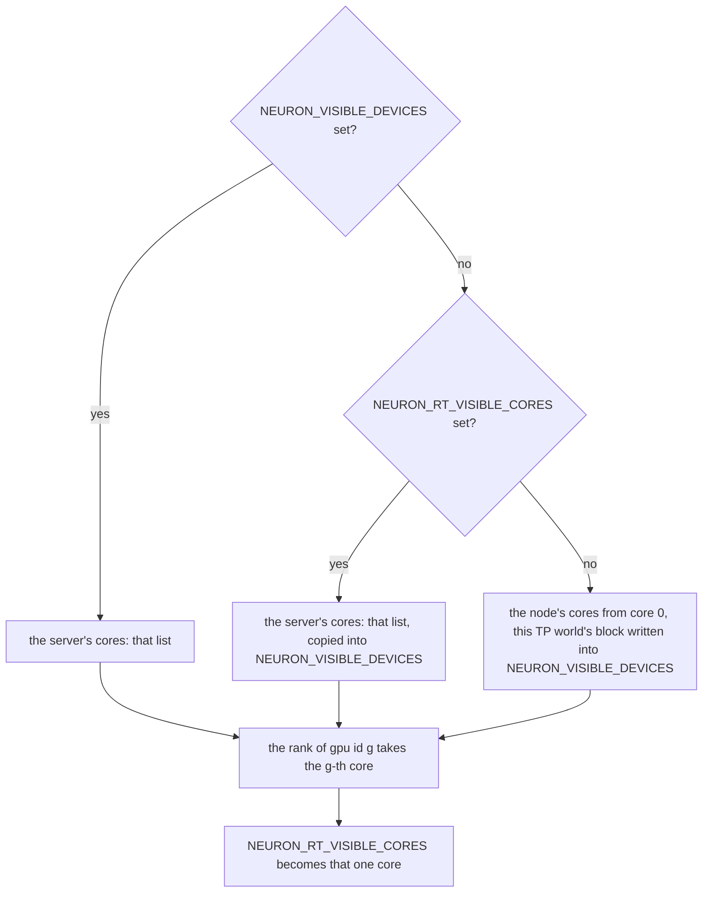
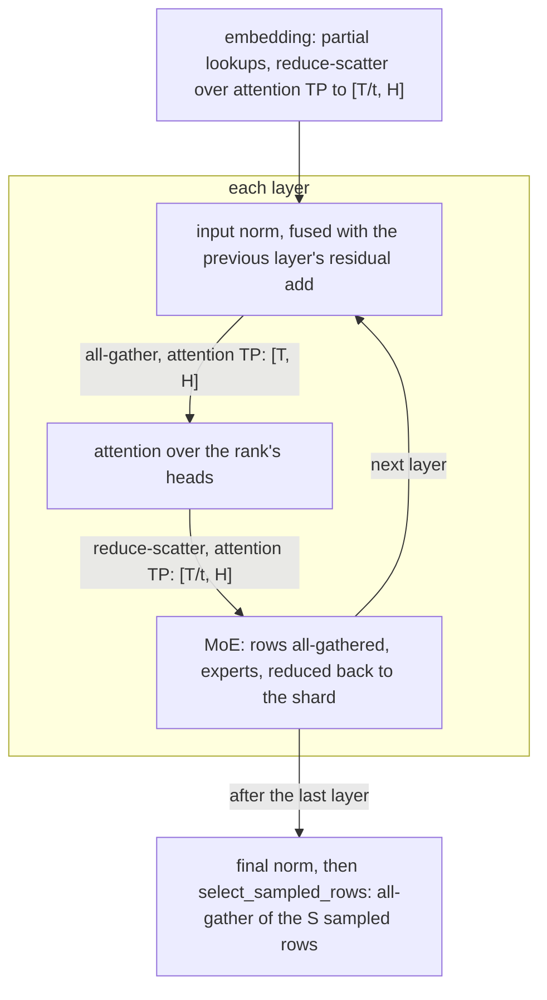
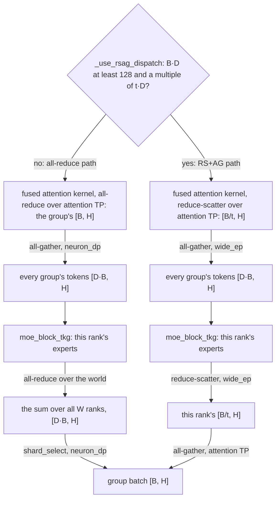
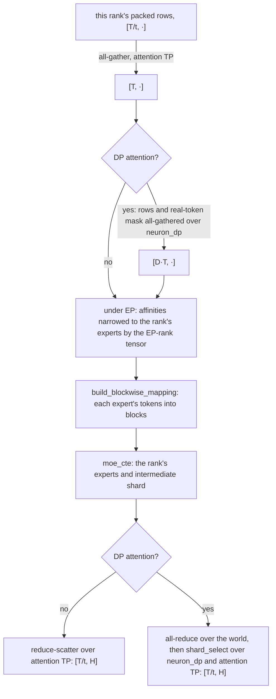
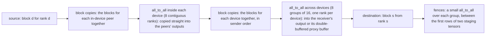
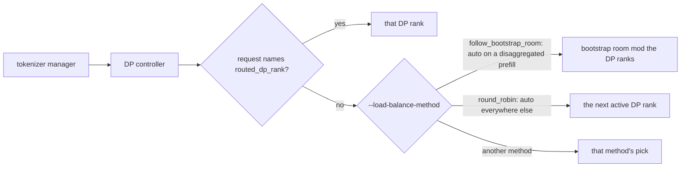
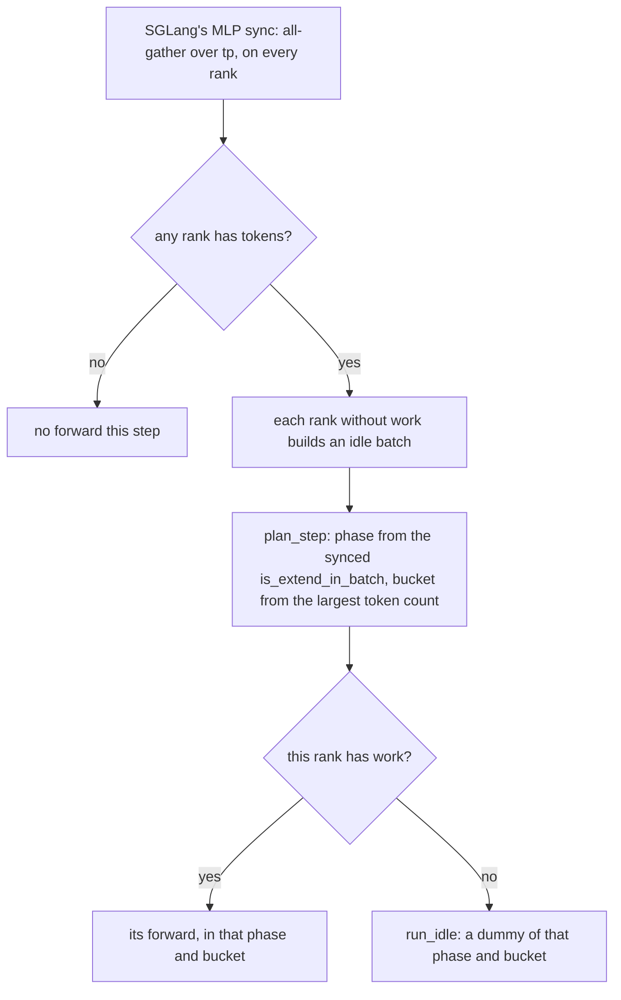
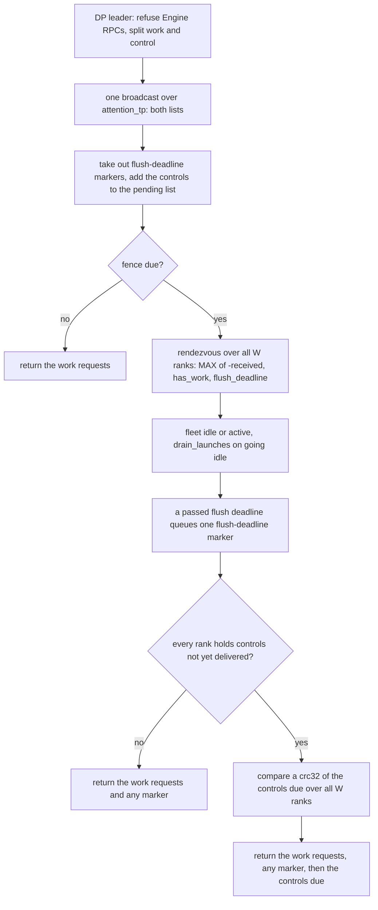
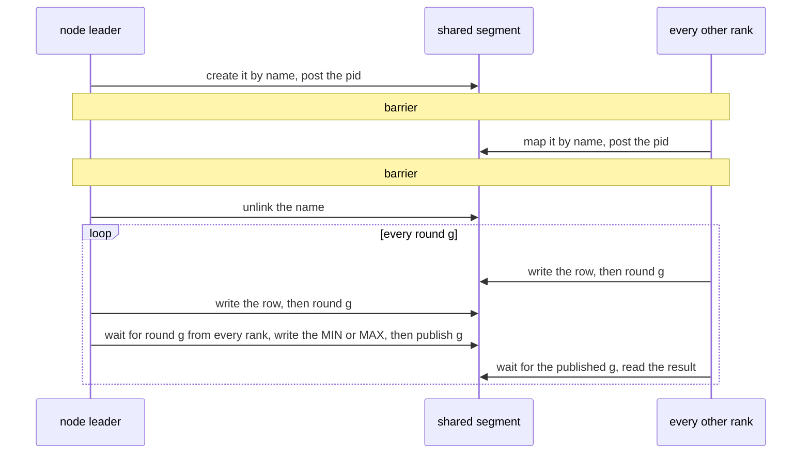
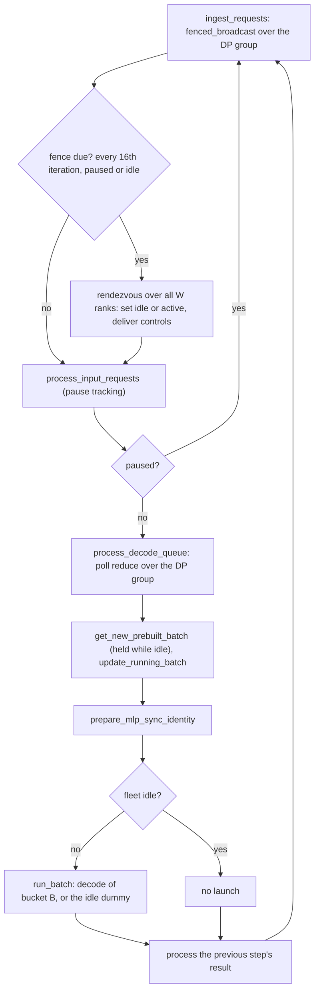

# Parallelism

## Overview

A Neuron server runs one SGLang scheduler process per rank, each on one logical NeuronCore. At every step all the ranks
of a TP world run the same compiled program: one SPMD NEFF, a single Neuron executable that every rank runs on its own
shard. The collectives that combine the shards are lowered inside the graphs. A rank's place in a group reaches the
graph as a tensor input, never as a constant, so the ranks' programs stay identical.

A launch picks its layout with SGLang's own flags, from four forms. Every server runs TP, and EP splits a MoE model's
experts over the same ranks. On top of TP a server runs either `--dp-size` replicas or DP attention, never both: SGLang
refuses `--dp-size` above 1 beside `--attn-dp-size` above 1.

| Form | Flags | What it splits | Collectives |
| --- | --- | --- | --- |
| Tensor parallelism (TP) | `--tp-size` | each layer's heads and intermediate dimension, and the vocabulary | in the graphs, over the attention-TP group, every layer |
| Replicas (data parallelism) | `--dp-size` | the requests, over independent TP worlds | none between replicas |
| DP attention | `--attn-dp-size`, or `--dp-size` with `--enable-dp-attention` | the requests, over DP groups of one TP world | attention within each group; GPT-OSS's experts across the groups; the DP lockstep over all ranks |
| Expert parallelism (EP) | `--ep-size` | a MoE layer's experts | in the graphs: the expert outputs summed over the attention-TP group (over every rank under DP attention), and GPT-OSS's prefill expert mapping over the expert mesh's rows |

GPT-OSS also runs pipeline parallelism (`--pp-size`) on a PD prefill or decode and, slower, on an aggregated server,
and GLM-5.2 and Kimi-K3 run it on their PD prefills: each stage holds a contiguous range of layers on its own TP group
and hands the next its boundary over NIXL ([Pipeline parallelism](pipeline-parallelism.md)).

Above the server, a deployment runs several servers, each on one node (Kimi-K3's decode on two) and its own NeuronCores.
The xPyD layouts of [disaggregated inference](disaggregated-inference.md) put the prefill and decode servers on separate
nodes, and a dense model or DeepSeek-V2 can run several decode servers side by side on the decode node.

`--pp-size` above 1 is refused for a model that builds no pipeline stages (`check_pipeline_stages` in
`sglang_neuron/platform.py`) and for any launch `distributed.pipeline.validate_pp_launch` does not accept
([What a launch refuses](pipeline-parallelism.md#what-a-launch-refuses)). The platform refuses the other forms when
the launch starts, naming the flag (`refuse_unserved` in `sglang_neuron/platform.py`):

- attention context parallelism (`--attn-cp-size`), and decode context parallelism (`--dcp-size`) on any launch but a
  PD decode of a model that declares it or the PD prefill of a model that declares prefill DCP (Kimi-K3)
  ([Decode context parallelism](decode-context-parallelism.md));
- a server over several nodes (`--nnodes`; an xPyD deployment runs several single-node servers), except a decode in a
  multi-node layout that its model declares (`ModelSpec.decode_layouts`: Kimi-K3's two-node decode);
- elastic EP (`--elastic-ep-backend`, `--elastic-ep-join-mode`), since torch-neuronx fixes the world when its runtime
  starts;
- SGLang's GPU-id placement (`--base-gpu-id`, `--gpu-id-step`), since `NEURON_RT_VISIBLE_CORES` places the ranks.

Two more cannot run. SGLang accepts `--moe-dp-size` above 1 only beside an equal `--attn-cp-size`, which the platform
refuses. `--dwdp-size` above 1 is not refused by name, but no such launch starts. SGLang's `handle_dwdp`
(`arg_groups/parallel_hook.py`) runs before the platform's hook. Besides turning the flag into `--tp-size` DP groups
of one rank each, with `--ep-size` equal to `--tp-size`, it turns `--disable-cuda-graph` on and sets
`SGLANG_SCHEDULER_SKIP_ALL_GATHER`. `refuse_unserved` then refuses the launch by the name `--disable-cuda-graph`, a
flag the launch did not pass.

Terms used on this page:

- **Rank**: one scheduler process and its logical NeuronCore.
- **TP world**: the `--tp-size` ranks of one torch world. A server is one TP world, or one per replica under
  `--dp-size`. Under PP the torch world holds every stage's TP group, PP-major
  ([The process layout](pipeline-parallelism.md#the-process-layout)).
- **Attention-TP group**: the ranks that split one batch's attention, dense layers and vocabulary. It is the TP world,
  or under DP attention one of its contiguous blocks.
- **DP group**: under DP attention, one attention-TP group with its own requests, scheduler batch and KV pages. Its
  attention-TP rank 0, the DP leader, receives the group's requests from SGLang's DP controller
  ([The DP controller](#the-dp-controller)). SGLang numbers the groups by their attention-DP rank.
- **Replica**: one TP world of a `--dp-size` server without DP attention, independent of the others. Some other pages
  and the code's comments call a DP group a DP-attention replica; this page does not.
- **Bucket**: one of the batch sizes (decode) or token counts (prefill) the runtime compiles a graph for. A step runs
  the graph of the smallest bucket that holds it.
- **DP lockstep**: under DP attention, every rank of the TP world runs the graph of the same phase and bucket at each
  step, a dummy when it has no work, so that every collective that crosses the DP groups meets its peers. A prefill
  gets there through SGLang's per-step exchange, a decode through the DP identity. The runtime's `dp_lockstep` is on
  whenever the attention-DP size is above 1 (`sglang_neuron/model_executor/graph_runner.py`).
- **Fleet**: all W ranks of a DP-attention server. The fleet is idle when no rank has work.

The formulas use W for the size of a TP world, D for the DP groups (1 without DP attention), t = W / D for the
attention-TP size, E for the EP degree, N for a MoE layer's experts, L for the layers, H for the hidden size, V for the
vocabulary, T for a prefill forward's tokens, B for a rank's decode batch, S for the rows a forward samples, and k for
the top logprobs a row returns. How a rank starts its runtime and joins its world is in [The runtime](runtime.md);
this page covers how the layouts map onto ranks, cores and groups, and what each form does in the graphs and on the
host. Paths are relative to the repository root.

## The widths a launch sets

| Width | Flag | Default | Meaning |
| --- | --- | --- | --- |
| W | `--tp-size` | 1 | the ranks of one TP world |
| replicas | `--dp-size` | 1 | independent TP worlds of `--tp-size` ranks each |
| D | `--attn-dp-size`, or `--dp-size` with `--enable-dp-attention` | 1 | DP groups in one TP world; D divides W |
| t | | | `--tp-size / D` |
| E | `--ep-size` | 1 | the EP degree; E divides W |

SGLang deprecates `--dp-size N --enable-dp-attention` for `--attn-dp-size N`: its resolution moves the width to
`attn_dp_size` and sets `dp_size` back to 1 (`handle_deprecated_dp_attention` in SGLang's
`arg_groups/parallel_hook.py`). The recipes use the deprecated spelling. Every layout decision of the plugin
reads the widths through `dp_widths` (`sglang_neuron/sglang_tree.py`), the only reader of `enable_dp_attention`, which
returns the replicas and the DP groups for either spelling, before or after SGLang resolves the arguments.
`rank_label` reads the published, already resolved `dp_size` and `attn_dp_size` directly.

Two per-rank sizes follow:

- **Decode batch.** `scheduler_batch` (`sglang_neuron/sglang_tree.py`) is `--max-running-requests // D`, at least 1:
  the batch one scheduler runs, divided the way SGLang's KV-cache configurator divides it. A replica runs the whole
  `--max-running-requests`. The runtime compiles a decode graph for each decode batch size, and with the decode
  context ladder one for each batch size and context ([Buckets](runtime.md#buckets)). When the launch lists no decode
  batch sizes, the platform sets them to the powers of two below this batch and the batch itself, or to the batch
  alone on a DP-attention decode. Without `--max-running-requests` the platform takes `--cuda-graph-max-bs-decode` as
  the batch, and with neither SGLang's own decode sizes stand. Either way the runtime adds the scheduler's request
  limit as the largest decode graph and drops listed sizes above it. The limit is `--max-running-requests` over D, or
  without the flag SGLang's estimate from the KV pool, and at most half the pool's tokens either way
  (`default_decode_batch_sizes` in `sglang_neuron/platform.py`, `decode_batch_buckets` in
  `sglang_neuron/model_executor/graph_runner.py`).
- **Prefill chunk.** Under DP attention SGLang divides `--chunked-prefill-size` by D. The plugin compiles the prefill
  for the divided chunk, and its chunk-grid error names the flag value to pass, the chunk times D
  (`sglang_neuron/model_executor/graph_runner.py`).

The plugin's graphs ignore SGLang's LM-head and dense-MoE communication flags (`--enable-dp-lm-head`,
`--enable-tp-lm-head-all-to-all`, `--moe-dense-tp-size`) and run the collectives this page describes. The platform
refuses none of them. SGLang itself accepts `--enable-tp-lm-head-all-to-all` only under DP attention with one rank per
DP group (`--tp-size` equal to the attention-DP size) and without `--enable-dp-lm-head`, and turns it on by itself on
such a disaggregated decode whose launch leaves it unset. It refuses `--enable-dp-lm-head` on a `--dp-size` server
without DP attention, and turns `--enable-dp-lm-head` off on a server of one DP rank.

`--moe-a2a-backend` does change the layout. For every backend that spans the TP group (`deepep`, `deepep_v2`,
`megamoe`, `mooncake`, `nixl`, `mori`, `pplx`, `flashinfer`, `flashinfer_megamoe`, `ascend_fuseep`), SGLang's
resolution sets `--ep-size` to `--tp-size` (`_a2a_ep_size` in SGLang's `arg_groups/overrides.py`), and the plugin
builds its expert groups from that size. A GPT-OSS prefill of `--tp-size 4 --ep-size 2 --moe-a2a-backend deepep`, for
example, would serve EP4. SGLang itself refuses some of them on such a launch: `pplx`, for one, needs DP attention
with at least two groups. Launch without the flag.

## Ranks and NeuronCores

Each rank owns one logical NeuronCore. The platform sets `NEURON_LOGICAL_NC_CONFIG` for the schedulers from the
layout: 2, two physical cores per logical core, on every role, and 1 on the GPT-OSS giga-kernel decode, whose 128 ranks
are the node's physical cores. It logs the host's default when it replaces it, and refuses any other value the launch
sets. A rank's device memory is its device's memory over the device's logical cores (`get_device_total_memory`,
`sglang_neuron/device.py`), its torch device is `neuron:<local rank>`, and
a runtime that sees more than one logical core is refused ("NEURON_RT_VISIBLE_CORES must name a single core").

The launch names a server's cores in `NEURON_RT_VISIBLE_CORES`, a range list such as `32-35`, or in
`NEURON_VISIBLE_DEVICES`, which takes precedence. The rank whose SGLang gpu id is g runs on the g-th of them, counting
from 0: in a single TP world g is the TP rank, and rank i of replica d has g = d·W + i (below). Each rank then narrows
its own `NEURON_RT_VISIBLE_CORES` to its one core and keeps the server's list in `NEURON_VISIBLE_DEVICES`, or, when
the launch sets neither variable, its own TP world's block of the node's cores (`prepare_process_env`,
`sglang_neuron/model_executor/runtime_init.py`).



The gpu id comes from SGLang (`init_torch_distributed_hook`):

- **One TP world** (no replicas, with or without DP attention): the gpu id is the TP rank, and so is the local rank.
  Under PP the gpu id and the local rank are the world rank, `pp_rank * tp_size + tp_rank`, so each stage runs on its
  own cores.
- **Replicas.** SGLang's DP controller hands replica d the gpu ids `[d·W, (d+1)·W)`. A rank's local rank is its gpu id
  mod W, and its replica takes the block of W cores that starts at position d·W of the server's list.

A list too short for a rank's block is refused, naming the variable and the cores the block needs.

```text
--tp-size 4 --dp-size 5 (replicas), NEURON_RT_VISIBLE_CORES unset
    replica 0: ranks 0-3 on cores 0-3    replica 1: cores 4-7    ...    replica 4: cores 16-19
--tp-size 4 --dp-size 5, NEURON_RT_VISIBLE_CORES=32-51
    replica d: ranks 0-3 on cores 32+4d to 35+4d
--tp-size 64 --dp-size 8 --enable-dp-attention, NEURON_RT_VISIBLE_CORES unset
    one TP world: rank r on core r
two servers of --tp-size 4, NEURON_RT_VISIBLE_CORES=0-3 and NEURON_RT_VISIBLE_CORES=4-7
    rank r of server i on core 4i + r
```

Everything a rank sets up for its world is per TP world, so per replica. Under DP attention the world is the whole
server.

- The Neuron runtime's collectives root (`NEURON_RT_ROOT_COMM_ID`) is keyed on the world's first core, so each
  replica's root has a port of its own.
- torch-neuronx's rank state (`init_neuron_ranks`, `sglang_neuron/parallel/neuron_init.py`) takes the torch world's
  rank and size as the global rank and world size, since torch-neuronx loads a NEFF's collectives by them: SGLang's TP
  rank and TP size, or under PP `pp_rank * tp_size + tp_rank` of `tp_size * pp_size`.
- The runtime barrier runs over the world.
- In the torch rendezvous, rank 0 of each TP world holds SGLang's distributed port, and each replica gets its own port
  from the DP controller.

[Rank bring-up](runtime.md#rank-bring-up) describes these steps and the EFA interface each rank takes from its core,
and [Process groups and placement](runtime.md#process-groups-and-placement) describes the collectives root, the torch
rendezvous, the NUMA node and the CPUs the launch leaves free.

## Process groups

### The groups SGLang builds

SGLang builds its groups on every rank: the world (`init_distributed_environment`), then, in
`initialize_model_parallel`, `tp` (the TP world), `attention_tp` (contiguous blocks of t ranks, or the `tp` group
itself when t = W), and its MoE, pipeline and context-parallel groups. On Neuron every one of them is gloo: the
platform's torch distributed backend is `gloo` and its group-coordinator device is the CPU. The plugin turns off every
device communicator SGLang offers, so nothing touches CUDA. It keeps the shared-memory message-queue broadcaster that
`tp` and `attention_tp` get from `SGLANG_USE_MESSAGE_QUEUE_BROADCASTER` (on by default), which the request broadcasts
use (`_init_model_parallel_group_without_device_communicators`, `sglang_neuron/general_plugin.py`).

The plugin reads only the world, `tp`, `attention_tp` and, under PP, SGLang's pp group, over whose stages it lays its
own groups (`sglang_neuron/parallel/state.py`); the graphs never use SGLang's MoE groups. Under DP attention
SGLang's `attention_tp` is the D groups. Of the SGLang groups the plugin reads, only the world and `tp` (the same W
ranks) cross them, and SGLang's per-step batch sync runs over `tp`. In the graphs, the plugin's `neuron_dp` columns,
`wide_ep` and expert mesh cross them.

### The groups the plugin builds

`initialize_neuron_parallel_state` (`sglang_neuron/parallel/state.py`) builds the plugin's groups when SGLang constructs
the model (`ModelHost.__init__`, `sglang_neuron/models/host.py`), from the TP world's size W, the DP groups D and the
EP degree E (`--ep-size`). Every rank builds the same groups in the same order, and `sglang_neuron/parallel/groups.py`
holds them.

| Global and name | Cells | Built when | Used by |
| --- | --- | --- | --- |
| `_NEURON_ATTN_TP`, `neuron_attn_tp` | D blocks of t consecutive ranks: the cells of SGLang's `attention_tp` | always | the attention, MLP and MoE reductions of the dense, Qwen3-MoE and DeepSeek-V2 graphs; the embedding's and LM head's vocabulary shards; the device sampler; GPT-OSS's decode attention reduction, its MoE reduction without EP, and the first ring of its expert reduction across the DP groups |
| `_NEURON_EP_TP`, `neuron_ep_tp` | E rows of W/E consecutive ranks | E > 1 | the ranks that split one expert's intermediate dimension; GPT-OSS's prefill expert mapping |
| `_NEURON_EP`, `neuron_ep` | W/E columns, one rank of each row | E > 1 | a rank's position in its column is its EP rank, which picks its experts |
| `_WIDE_EP`, `wide_ep` | all W ranks | E > 1 and D > 1 | GPT-OSS's expert exchange across the DP groups |
| `_DP`, `neuron_dp` | t columns: the ranks at one attention-TP position in every DP group | D > 1 | GPT-OSS's token gather across the DP groups, its slice back, and the second ring of its expert reduction |
| `_NEURON_{EMBEDDING,LM_HEAD,MLP}_TP`, `neuron_component_tp<c>`; `_NEURON_{EMBEDDING,LM_HEAD,MLP}_DP`, `neuron_component_dp<c>` | W / (t c) blocks of t c consecutive ranks; their columns of c ranks | the model host declares a component DP size c above 1 ([Component DP](#component-dp)) | no model yet |

```text
W=8, D=1, E=2                      (ep_group_ranks in groups.py)
  neuron_attn_tp  [0..7]
  neuron_ep_tp    [0 1 2 3] [4 5 6 7]                 rows: EP rank 0, EP rank 1
  neuron_ep       [0 4] [1 5] [2 6] [3 7]             columns

W=16, D=2, E=4
  neuron_attn_tp  [0..7] [8..15]                      DP group 0, DP group 1
  neuron_ep_tp    [0..3] [4..7] [8..11] [12..15]      two EP rows in each DP group
  neuron_ep       [c, c+4, c+8, c+12] for c = 0..3
  wide_ep         [0..15]
  neuron_dp       [p, p+8] for p = 0..7
```

The build refuses a DP size that does not divide W, an EP degree that does not divide W, and an SGLang attention TP
other than W / D ("SGLang's attention TP has N ranks, but a TP size of W over D DP replicas needs t ..."). A second call
with the same arguments does nothing; one with other arguments raises. It logs
`[neuron] parallel groups: world W, attention TP t x DP D, EP E`, followed by `, <component> DP <c>` for each declared
component DP size.

### Component DP

Component DP shards one component, the embedding, LM head or MLP, over the attention-TP ranks of c consecutive DP
groups instead of one group's t ranks: its weights split over a TP supergroup of those t c ranks, and it computes the
rows of all c groups, which their DP column (the c ranks at one attention-TP position) gathers. No model declares it:
the embedding and LM head shard over `neuron_attn_tp` (the giga-kernel decode's LM head over `wide_ep`),
and MLPs and experts as [Tensor parallelism](#tensor-parallelism) and [Expert parallelism](#expert-parallelism)
describe.

A model host declares it in `component_dp` (`sglang_neuron/models/host.py`), mapping `embedding`, `lm_head` or `mlp`
to c, which `ModelHost.__init__` passes to `initialize_neuron_parallel_state`. Each declared size gets one supergroup
and one column (`component_group_ranks`, `sglang_neuron/parallel/groups.py`), shared by the components of that size
and laid over every pipeline stage like the other groups:

```text
W=64, D=8, c=4                     (component_group_ranks)
  neuron_component_tp4  [0..31] [32..63]
  neuron_component_dp4  [0 8 16 24] [1 9 17 25] ... [32 40 48 56] ... [39 47 55 63]
```

`get_neuron_{embedding,lm_head,mlp}_tp_group()` return a component's supergroup and
`get_neuron_{embedding,lm_head,mlp}_dp_group()` its column. A component without a size, or with c = 1, gets the
attention-TP group and no column (None). Before it builds any group, the build refuses another component name, a c
that does not divide D, and two sizes of which neither divides the other.

A graph moves a batch's rows into the component's layout and back with `dp_transition(x, source, target)`, a layout
being a component's column or None for the DP group's own rows. Into a narrower layout a rank keeps its narrower
column's rows; into a wider one it all-gathers its own group's rows over the target column. Offsets come from the
source column's rank tensor, so every rank traces one graph. Equal sizes are the identity, and sizes whose columns do
not nest are refused. An LM head with component DP yields the logits of every DP group of its column, and the device
sampler samples every row a graph returns, so such a graph samples in its own forward and moves the tokens back.

### One program for every rank

- **Meshes.** Each plugin group is an SGLang `GroupCoordinator` on gloo with every `use_*` option off, so it has no
  message queue (`_make_group`). Its whole partition, every rank's cell, is registered with torch-neuronx as the replica
  groups of its process group (`register_mesh`, `sglang_neuron/backend/stack.py`), and so are the partitions of
  SGLang's world, `tp` and `attention_tp`. A traced collective names its process group, and torch-neuronx's collective
  legalization lowers it with that partition. The partition is the same on every rank, so all ranks compile one NEFF.
  Registering a different partition under a registered name raises.
- **Ascending cells.** torch-neuronx orders a group's ranks ascending, while SGLang's `rank_in_group` follows the
  declared order. A cell out of order is refused before its group exists, on every rank alike.
- **Group names.** A process group keeps the name torch gives it. torch names a group by its place in the creation
  order, which every rank follows (`new_group` is collective over the world), and builds the group's rendezvous under
  that name, so every member of a group holds the same name for it. The registry is keyed by that name, and
  torch-neuronx's collective legalization writes the registered partition in place of the name before the graph is
  lowered, so the name does not reach the NEFF: two ranks whose groups have different names compile the same program
  when the partitions are the same.
- **One gloo transport device.** torch builds each gloo group on a new transport device, and each device runs its own
  event-loop thread. A scheduler holds a device group and a CPU group per coordinator, so a node with one scheduler per
  rank would run thousands of these threads. Each wakes every 10 ms, busy or not, and takes a turn on the run queue
  that the scheduler's main thread waits on when its step's result is ready. `sglang_neuron/distributed/gloo_device.py`
  builds every gloo group of a process on one device. The groups and their collectives stay separate; only the
  polling of their sockets is shared, so one group's large transfer can delay another group's socket handling in the
  same process. The module refuses a torch whose group creator differs from the one it was checked against (torch
  2.14.0, by md5), and one whose bindings for the group options changed, which it finds by building a one-rank group
  at install.
- **Ranks as tensors.** Every group a graph shards over carries `rank_in_group_tensor`, a 1-D int32 tensor on the
  rank's device (torch.compile folds a 0-D one into a constant under chunked prefill). A forward reads a rank only
  through such a tensor: `shard_select` (`sglang_neuron/parallel/groups.py`), the embedding's id range, the sampler's
  global ids, the expert kernels' EP rank, DeepSeek-V2's first local expert and GPT-OSS's sampled-row selection. The
  graphs' `rank` input is the attention-TP rank. Python ranks appear only where the weight loaders pick a rank's shard.
- **Traceable collectives.** `sglang_neuron/parallel/collectives.py` runs `all_reduce` (sum, max or min), `all_gather`
  and `reduce_scatter` as torch's functional collectives on a group's device group. A group of one rank returns its
  input unchanged, and a reduce-scatter over a dimension the group does not divide raises.
- `SGLANG_NEURON_DEBUG_MESH=1` logs every registered and every resolved group's replica groups.

Before serving, the ranks of the TP group check that they run one program. First they compare a digest of the model,
the graph phase and the parallel layout: the TP size W, the attention-TP size t (and with them the number of DP groups
W / t), whether the ranks run in DP lockstep, the page size and the sampler (`sglang_neuron/models/contract.py`). Then,
in the warm-up, they compare the NEFF each rank compiled for every shape (`sglang_neuron/backend/spmd_check.py`). The
EP degree is not in the digest: every rank reads it from the same server arguments, and a rank whose experts were
split another way would trace other shapes, which the NEFF check refuses. Under DP attention the TP group spans every
DP group, so every rank of the server runs the same programs. [The runtime](runtime.md) describes both checks.

## Tensor parallelism

Every graph shards its layers over its attention-TP group, and each rank reads only its shard of the checkpoint
(`load_sharded_pipelined`, with the SGLang attention-TP rank and size; a parameter's loader can shard by another rank,
as GPT-OSS's experts do by their expert-TP rank). The graphs reduce over either the plugin's `neuron_attn_tp` or
SGLang's `attention_tp`; the two have the same cells, and both partitions are registered.

### Dense transformer: Qwen3 and GLM-4

The dense graphs (`sglang_neuron/models/transformer/model.py`, loaders in `weights.py` beside it) serve Qwen3 and GLM-4,
and Qwen3-MoE runs them with a sparse MoE in place of the MLP.

| Part | A rank holds | After it |
| --- | --- | --- |
| Query heads | `num_attention_heads / t`; the heads must divide | |
| KV heads | `num_key_value_heads / t`, or with more ranks than KV heads one KV head replicated over t / kv ranks: rank r holds head `r // (t / kv)`, the one its query heads group over | |
| QKV projection | one fused `[H, (q + 2 kv) · head_dim]` weight, column-parallel | |
| Output projection | its heads' rows, row-parallel | all-reduce |
| MLP | gate and up column-parallel, down row-parallel, `intermediate_size / t` each; the size must divide | all-reduce |
| Embedding | `ceil(V / t)` rows, the last shard padded; each rank looks up the ids in its range | all-reduce of the partial lookups |
| LM head | `V / t` rows; a vocabulary that does not divide is refused | none: the sampler reads the shard |

A tied checkpoint loads one table for the embedding and the LM head. Qwen3-8B, for example, holds two of its eight KV
heads on each rank at TP4, and one at TP8. The dense prefill is not sequence-parallel: every rank holds the chunk's
whole hidden states between the layers. GLM-4's differences (QKV biases, a fused gate and up, two more norms, a partial
RoPE permuted at load) are settings of the same graphs and shard the same way ([GLM-4](../model-recipes/glm-4.md)).

### DeepSeek-V2

DeepSeek-V2's multi-head latent attention (`sglang_neuron/models/deepseek_v2/model.py`) shards its query heads over
attention TP and replicates the KV down-projection and its norm, so every rank computes the same compact KV row (the
normalized latent and the RoPE key) and holds the same rows in SGLang's MLA pool. Each rank holds the KV up-projection
of its own heads, and its output projection is row-parallel and all-reduced. The MLA kernels take four query heads per
rank (`KERNEL_HEADS`), so the host refuses any `--tp-size` that gives another count: `--tp-size 4` for
DeepSeek-V2-Lite's 16 heads. The first layer's dense MLP shards like the dense transformer's; the MoE layers are under
[Expert parallelism](#expert-parallelism).

### GPT-OSS

GPT-OSS (`sglang_neuron/models/gpt_oss/`) pads its hidden size from 2880 to 3072 for the kernels. Its attention
(`GptOssAttention`, `mxfp4/common.py`) holds `64 / t` query heads and `max(1, 8 / t)` KV heads on each rank, a KV head
replicated over t / 8 ranks above attention TP 8, loaded with the SGLang attention-TP rank. The output projection's
bias is divided by t, so the reduction counts it once. The kernels bound a rank's share:

- **Prefill.** A rank's QKV columns may not exceed 3072, the smaller of the fused QKV kernel's 4096 (`MAX_FUSED_QKV`)
  and the padded hidden size, and its query heads may not exceed 17 (`MAX_HEADS`). So attention TP 1 and 2 are
  refused, and attention TP 4 and above is served. A sliding-window layer whose rank holds at least two KV heads, as at
  attention TP 4, runs the fused sliding-window kernel, which splits them over the logical core's two physical cores.
  With one KV head a rank, it runs the QKV and segmented attention kernels.
- **Decode.** The decode attention kernel takes exactly one KV head per rank, so the decode needs attention TP 8 or
  more.

The host's layout check (`_check_layout`, `sglang_neuron/models/gpt_oss/sglang_model.py`) also refuses heads that do
not divide over t, KV heads that neither divide over t nor replicate evenly across it, experts that do not divide over
E, and DP attention without EP.

**Prefill, sequence-parallel** (`mxfp4/model_prefill.py`). Between the layers each rank holds a contiguous shard of the
chunk's tokens, `[T/t, H]`:



- The embedding's reduce-scatter needs T to divide over t. Every prefill bucket does: it is a multiple of 128 and of
  the attention-TP size.
- The MoE starts with one kernel that adds the residual, norms, quantizes to MX FP8 and routes. It packs each token's
  hidden, scale and expert affinities into one row, so the gathers carry the affinities with the tokens
  ([GPT-OSS's experts](#gpt-osss-experts)).
- `select_sampled_rows` (`sglang_neuron/models/gpt_oss/sequence_parallel.py`) gathers S rows, not the whole chunk.
  Every rank contributes its row at each sampled position, and the row of the rank that owns the position is kept.

**Decode** (`mxfp4/model_decode.py`). Every rank holds its DP group's whole batch. The embedding all-reduces; each layer
runs one fused attention kernel (input norm, QKV, RoPE, attention with sinks, the KV write and the output projection),
reduces its output over attention TP, then runs one fused MoE kernel (post-attention norm, router and experts). Under
DP attention with EP the reduction around the experts takes one of two paths ([GPT-OSS's experts](#gpt-osss-experts)).

**Giga-kernel decode** (`giga/model_decode.py`). A decode laid out as `--tp-size 128 --dp-size 16 --enable-dp-attention
--ep-size 128` runs every decoder layer of a step in one call of the giga kernel
([The giga-kernel decode](../model-recipes/gpt-oss.md#the-giga-kernel-decode)). Its 128 ranks are the node's physical
cores, one rank each at one logical core per physical core, in 16 DP groups of 8 attention ranks, and each rank holds
one whole expert. Inside the call each rank works on its sequence-parallel share of its DP group's rows: each layer's
attention runs over the group's 8 ranks and its MoE exchanges tokens over all 128. After the call the ranks all-gather
every rank's rows over the world, and the fused tail applies the final norm and each rank's vocabulary slice of the LM
head, exchanges the logits in two all-to-all hops, first within a device and then across devices, and returns each
replica's greedy tokens. The DP identity, the control fence and the shared-memory rendezvous run on it as on any
DP-attention decode, over 128 ranks.

### Collectives per forward

| Graph | Embedding | Each layer | Sampling |
| --- | --- | --- | --- |
| Dense, Qwen3-MoE, DeepSeek-V2 (prefill and decode) | all-reduce | attention all-reduce; MLP or MoE all-reduce | sampler all-gather |
| GPT-OSS prefill | reduce-scatter | attention all-gather and reduce-scatter; MoE row all-gather, the expert mapping's all-gather and MAX all-reduce over the expert-TP ranks (when they are more than one), output reduce-scatter | sampled-row all-gather, sampler all-gather |
| GPT-OSS prefill, DP attention | reduce-scatter | as above, plus the row and mask all-gathers over the DP column, and the wide all-reduce in place of the reduce-scatter | as above |
| GPT-OSS decode | all-reduce | attention all-reduce; MoE all-reduce | sampler all-gather |
| GPT-OSS decode, DP attention, all-reduce path | all-reduce | attention all-reduce; DP-column all-gather; wide all-reduce | sampler all-gather |
| GPT-OSS decode, DP attention, RS+AG path | all-reduce | attention reduce-scatter; all-gather over the world; reduce-scatter over the world; attention-TP all-gather | sampler all-gather |
| GPT-OSS giga-kernel decode | inside the kernel call | inside the kernel call: attention over the DP group's ranks, the MoE's exchange over the world | all-gather of the rows over the world; the fused tail's two all-to-all hops |

Every collective but those of GPT-OSS's experts, and the giga-kernel decode's world all-gather and tail exchange, runs
over the attention-TP group, and a collective over a group of one rank is skipped. A dense, Qwen3-MoE or DeepSeek-V2
forward thus runs 1 + 2L all-reduces and one all-gather, whatever its phase.

## Vocabulary sharding and the device sampler

Every graph's LM-head group is `neuron_attn_tp`, but the giga-kernel decode's, which is the world: its LM head holds a
128th of the vocabulary's rows on each rank, and its fused tail exchanges the logits and picks the greedy tokens itself,
with no device sampler after it ([Collectives per forward](#collectives-per-forward)). The rest of this section is the
other graphs'. The embedding (`VocabDimShardedEmbedding`, `sglang_neuron/layers/embedding.py`) holds `ceil(V / t)` rows,
computes its id range from the rank tensor, masks the ids outside it and sums the partial lookups. The LM head
(`ColumnParallelLinear`, `sglang_neuron/layers/linear.py`) holds `V / t` rows, and `ModelHost` turns its output gather
off, so each rank hands its `[S, V/t]` logits straight to the device sampler (`SampledExecution`,
`sglang_neuron/models/host.py`). The logits never leave their ranks. The host sampler (`SGLANG_NEURON_SAMPLER=host`) is
the exception: there the LM head keeps its gather, and every rank returns the `[S, V]` logits for SGLang's sampler
([The host sampler](runtime.md#the-host-sampler)).

The sampler (`sglang_neuron/sampling.py`) finds each shard's candidates on its own rank and runs one all-gather of a
small payload per row; every rank then merges the candidates to the same token:

| `SGLANG_NEURON_SAMPLER` | Values per row per rank |
| --- | --- |
| `greedy` (default) | 3 + 2k: the shard's maximum, its global id, its log-normalizer, and k top-logprob candidates |
| `temperature` | 4 + 2k |
| `topk_topp` | 5 + 2 x 256: the shard's top 256 candidates (`TOP_K_MAX`) for the filters |

k is `SGLANG_NEURON_MAX_TOP_LOGPROBS`, 0 by default. A token's global id is its shard offset, `rank x V/t`, plus its
local index. The ids travel as float32, so the vocabulary must be below 2^24.

A tie goes to the smallest global id. Each rank settles it locally, with tensor max and min reductions within its
shard and over the gathered candidates (`_first_max`, `_shard_winner`), so a tie costs no collective. The sampler
never uses an index-returning max, whose Neuron lowering does not return a tie's first index.

A temperature draw picks the token whose tempered logit plus Gumbel noise is largest (the Gumbel-max trick). The noise
is a function of the request's seed, the token's position and the global id, so every rank computes the same noise
and the sharding does not change the draw. Under DP attention each DP group samples its own rows over its own
attention-TP group; nothing crosses the groups.

torch-neuronx's own vocabulary-sharding pass (`ShardIndexInjection`) is off in every process that starts the Neuron
backend (`TORCH_NEURONX_VOCAB_SHARDING_SPMD_DISABLE=1`, `disable_vocab_sharding_pass` in
`sglang_neuron/backend/stack.py`; a launch that sets another value is refused). The pass gives every graph a shard
index as an input copied to the device at each call. The copy starts only once the graph before it has retired, so it
delays each graph until its predecessor is done. The plugin's graphs take their shard offsets from the rank tensors
instead.

## Expert parallelism

### The expert mesh

With E above 1 the plugin lays the TP world out as E rows of W/E consecutive ranks (`neuron_ep_tp`) and their columns
(`neuron_ep`). Rank r's row, r // (W/E), is its EP rank; its position in the row, r mod (W/E), is its expert-TP rank.
Of the N experts it holds `[ep_rank · N/E, (ep_rank + 1) · N/E)`, and of each one's intermediate dimension, split W/E
ways, the shard its expert-TP rank numbers. The mesh spans the whole TP world, under DP attention too, where a row can
hold ranks of several DP groups. The expert kernels take the EP rank as a tensor, `neuron_ep`'s rank tensor.

GPT-OSS and Qwen3-MoE read `--ep-size`. The dense models and DeepSeek-V2 do not: the plugin still builds the EP groups,
so the degree must divide `--tp-size`, but their graphs never use them, and nothing refuses the flag.

### GPT-OSS's experts

| | E = 1 | E > 1 |
| --- | --- | --- |
| Experts on a rank | all 128 | 128 / E, a contiguous block |
| Intermediate dimension | split over attention TP | split over the EP-TP row (W/E ranks) |
| Expert-mapping group (prefill) | SGLang's attention TP | `neuron_ep_tp` |
| Output reduced over | `neuron_attn_tp` | SGLang's attention TP, or the world under DP attention |

DP attention requires E above 1: with E = 1 the experts would split over attention TP, while their padding is sized
for the whole world. The expert intermediate size, 2880 in the checkpoint, is padded so that each of the W/E shards
tiles the MXFP4 kernels (`padded_intermediate_size`, which keeps the kernels' default 3072 wherever its shard tiles;
the host logs `GPT-OSS <phase> graph: expert intermediate <n>`). At every tested layout it is 3072: a rank holds it
whole at TP8 EP8 and TP64 EP64, and 1536 of it at TP4 EP2.

Each expert tensor is narrowed to the rank's experts when it is read, then sharded by the expert-TP rank, not the
attention-TP rank, since under DP attention an EP-TP row can span DP groups. The down projection's bias is divided by
W/E, so the reduction counts it once. The router is replicated: every rank routes every token, the decode and the
prefill each from their own copy, in the layout their kernel reads (`GptOssExperts`, `mxfp4/common.py`).

**Decode.** The fused MoE kernel (`moe_block_tkg`) runs the post-attention norm, the router and the experts. Without
EP it loads only the routed experts while the batch's tokens times top-k stay below the rank's expert count, and runs
every local expert otherwise. Under EP it always runs every local expert, with the EP-rank tensor. Without DP
attention the output is all-reduced over attention TP (SGLang's `attention_tp` with EP, `neuron_attn_tp` without; the
two have the same cells).

Under DP attention with EP the experts of all W ranks serve the tokens of all D groups. Before the experts every
group's tokens are gathered, and after them the results are summed and each rank keeps its own rows. This needs every
DP group to run the same graph at the same step, whether or not it has requests: the DP lockstep of
[DP attention](#dp-attention) arranges it with idle dummies, through SGLang's per-step exchange on a prefill and
through the DP identity on a decode.

Each decode layer picks one of two paths (`_use_rsag_dispatch`), and its attention and its MoE take the same one. The
RS+AG path (reduce-scatter, then all-gather) runs when the fleet's tokens, B x D, are at least
`DECODE_RSAG_TOKEN_THRESHOLD` (128) and divide evenly over t x D ranks; otherwise the layer takes the all-reduce path.



- On the all-reduce path the sum over the world is an all-reduce over attention TP and then over the DP column when
  the two tile the world, else one ring through every rank (`_wide_ep_all_reduce`).
- On the RS+AG path the residual is sliced to the rank's `[B/t, H]` rows, so both residual adds run on the slice
  before the last all-gather.

The served decode, eight DP groups of attention TP 8 with B = 16, gives a fleet of 128 tokens over 64 ranks, so it
always takes the RS+AG path. Each rank holds two experts whole: rank r holds experts 2r and 2r + 1.

**Prefill** (`GptOssExperts` in `mxfp4/model_prefill.py`). The packed rows of the
[sequence-parallel prefill](#gpt-oss) take this path through the experts:



- `build_blockwise_mapping` (`sglang_neuron/ops/moe/moe_blockwise.py`): when the expert-mapping group has more than
  one rank and divides the local experts, each rank maps a share of the experts, and an all-gather of the tokens per
  expert and a MAX all-reduce of the slots combine the shares.
- `moe_cte` runs the block-sharded MXFP4 expert kernel. It refuses an intermediate shard narrower than 128.

The BF16 graphs (`SGLANG_NEURON_GPT_OSS_EXPERTS=bf16`, `sglang_neuron/models/gpt_oss/bf16.py`) keep this layout, the
padding and every collective, and change only the experts. The loaders dequantize each rank's shard of the MXFP4
blocks on the host into BF16 gate/up `[E_local, H, 2, I]` and down `[E_local, I, H]` weights, in the same shuffled
hidden order. The decode MoE is nkilib's `moe_block_tkg` on those weights, without scales. The prefill norms with
`rmsnorm_residual_prefill` and routes in torch, gathers the normed rows and affinities instead of the packed rows, and
runs the bf16 `moe_cte` with GPT-OSS's biases and clamped SwiGLU on 128-token blocks (`moe_experts_blockwise_swiglu`).
They build pipeline stages and serve DCP like the MXFP4 graphs. They are served only at `--tp-size 16 --ep-size 4`,
without DP attention, at prefill calls up to 8192 tokens and decode batches up to 128, where both kernel calls matched
their torch paths on a NeuronCore and the experts fit a rank's HBM
([GPT-OSS](../model-recipes/gpt-oss.md#bf16-experts-on-a-neuroncore) has the measurements), and refused on the
giga-kernel decode, which runs the MXFP4 experts in its one kernel.

### Qwen3-MoE's experts

`SparseMoE` (`sglang_neuron/models/qwen3_moe/moe.py`) refuses DP attention on every role ("Qwen3-MoE's experts are
served on attention TP without DP attention ..."), and requires E to divide both the experts and the attention TP, and
the intermediate size to divide over t / E. With E = 1 every rank holds every expert, its intermediate split over
attention TP. The router is replicated: a softmax over all experts, the top k, renormalized under `norm_topk_prob`. The
decode runs nkilib's bf16 `moe_tkg` over every local expert, in tiles of 128 tokens, with the EP-rank tensor
(`sglang_neuron/ops/moe/moe_tkg_bf16.py`); the prefill runs the bf16 `moe_cte` over the affinity columns of the local
experts, each rank building its own token-to-block mapping (`sglang_neuron/ops/moe/moe_cte_bf16.py`). One all-reduce
over attention TP sums the ranks' partials, the same that ends a dense layer's MLP, so EP adds no collective. A rank
reads only its own experts: the layer's weight mappings list the checkpoint keys of its local experts and no others,
and each loader keeps the rank's expert-TP rows of each (`weight_mappings`, `_gate_up_loader`, `_down_loader`). The
tested layout is TP4 EP4: each rank holds a quarter of the experts, each whole.

### DeepSeek-V2's experts

DeepSeek-V2's routed experts always split over the attention-TP ranks, whatever `--ep-size` says: rank r holds the
contiguous block `[r · N/t, (r + 1) · N/t)`, 16 of DeepSeek-V2-Lite's 64 at TP4, starting at a tensor offset, so every
rank traces one graph. Its weight mappings list only the checkpoint keys of the rank's block of experts, so a rank
reads those experts whole and no others. The router is replicated and selects each token's top-k experts (six for
DeepSeek-V2-Lite) by an exact reduction (`sglang_neuron/ops/moe/experts.py`). The shared experts are a TP-sharded MLP
whose partial is left unreduced, so one all-reduce per MoE layer sums the scaled routed partials and the shared one
together. The decode runs nkilib's `moe_tkg`, which needs at least twice top-k local experts (16 against 12 at TP4) and
at most 128 tokens a step, so the host refuses a `--max-running-requests` that is unset or above 128. The prefill runs
no expert kernel. It runs each of the rank's experts in torch over every token of the chunk, weights each output by
the token's routing weight for that expert (zero for a token not routed there) and accumulates in fp32
(`routed_experts`); CPU mode runs every step this way. Both phases end in the same single all-reduce.

### An all_to_all over a node's ranks inside an NKI kernel

An NKI kernel that exchanges MoE tokens over all 128 ranks of a Trainium3 node (an EP128 dispatch and combine) cannot
use one `nki.collectives.all_to_all` over all of them on runtime 2.35. The runtime builds that collective on its
latency-optimized algorithm, which relays every block bound for another device through a relay rank's channel buffer.
It refills a slot for the next tile with no read-completion sync in between, and for the next collective with none
unless the all_to_all is the last collective of its basic block. Under rank skew a receiver then gets the sender's next
tile, or its next all_to_all's block, in place of the current one, and an all_to_all that is not the last collective
reports completion before its relayed blocks land. No runtime setting and no fence inside the kernel covers
back-to-back all_to_alls, so the fix belongs in the runtime; until it ships, a kernel exchanges through the two groups
below. No served graph runs such an all_to_all: the giga-kernel
decode's MoE exchanges with all-gathers and reduce-scatters, and its fused tail already exchanges over these two hops.

`sglang_neuron/nki/ep_all_to_all.py` exchanges the same blocks in two all_to_alls whose groups take other paths:



The groups are the giga-kernel decode's fused-tail hops (`hop_meshes(128, (8, 16))` in
`sglang_neuron/ops/gpt_oss_giga_tail.py`). The result is the one all_to_all's, block for block, at every device split it
serves; neither group composes the relayed path (the runtime's collective debug log of these two groups shows the
in-device and the one-rank-per-device algorithms only). `ep_all_to_all` builds its groups inside the kernel's trace, and
every call allocates the three HBM tensors it stages through, named from the call's `name`. The runtime reports an
all_to_all that is not the last collective of its basic block complete before this rank's own sends have finished
reading its source, and the compiler may hand a tensor's HBM to another after its last use, so the exchanges are fenced:
after them, a small all_to_all over each group moves the first rows of one staging tensor into another's, which orders
it after its exchange and keeps both allocated until it, and every rank reaches it only after its exchange received
every block. `tools/collectives/all_to_all_check.py` checks it on hardware under rank skew, one exchange or several
independent ones back to back, with every destination and staging tensor filled with 0xA5 before its exchange so that a
byte the exchange never wrote shows; `tools/collectives/check_all_to_all.py` compares the outputs byte for byte.

## The DP controller

SGLang starts its DP controller on every server with more than one DP rank, counting replicas times DP groups
(`num_dp_ranks`), so on a replica server and on a DP-attention server alike. The controller sends each request to one
replica's TP rank 0 or one DP group's leader:



On every server with a DP controller, `dp_controller_blocking_recv`
(`sglang_neuron/sglang_patches/dp_controller_blocking_recv.py`) makes the controller wait on its tokenizer socket
through a `zmq.Poller`, at most 100 ms per wait. Upstream's loop instead spins, keeping a core fully busy for the
server's lifetime, and on a decode node whose ranks need every core, that core would come out of their budget.

## Data parallelism: `--dp-size` replicas

Without DP attention, `--dp-size N` starts N replicas under SGLang's DP controller. Each is a TP world of
`--tp-size` ranks with its own port arguments and distributed port, and has its own copy of everything a world sets
up: core block, collectives root, torch world, torch-neuronx rank state and runtime barrier, SGLang and plugin groups,
contract and NEFF checks, program-switch fence, KV pool, and a scheduler batch of the whole `--max-running-requests`.
Nothing crosses replicas: their graphs have no cross-replica group (`neuron_dp` exists only under DP attention), and
no host collective spans them.

Each replica's ranks count their TP ranks from 0, so:

- Trace and profile labels are `dp<d>_tp<r>` (`rank_label`, `sglang_neuron/sglang_tree.py`).
- The shared-memory segments of the node-local reductions carry the leader's pid in their names, since every
  replica's groups have the same ranks (`group_segment_name`, `sglang_neuron/distributed/node_shm_min.py`).
- The rank lists that select what to profile or trace repeat in every replica. `SGLANG_NEURON_PROFILE_RANKS` selects
  by local rank, `SGLANG_NEURON_PROFILE_SERVE_RANKS` and `SGLANG_NEURON_HOST_TRACE_RANKS` by TP rank, so `0` profiles
  or traces rank 0 of each replica, each into its own `core<n>` or `serve_rankdp<d>_tp0` profile directory and its own
  `host_rankdp<d>_tp0.tsv` trace.

On a disaggregated prefill, `prefill_dispatch_dp_rank` (`sglang_neuron/sglang_patches/prefill_dispatch_dp_rank.py`)
adapts the KV sender to replicas. Without DP attention every replica's attention-DP rank is 0. So for a request that
does not name its prefill DP rank (`disagg_prefill_dp_rank`), upstream's KV sender would fail the request on any
replica but the first under `follow_bootstrap_room` (a prefill's `auto`). Under any other method, or with
`SGLANG_DISAGGREGATION_FORCE_QUERY_PREFILL_DP_RANK`, it would register every replica with the bootstrap server as the
first. A request that names its rank skips both, and the balancer always names it. For one that does not, the
patch checks and registers the replica the controller dispatched the request to
([Disaggregated inference](disaggregated-inference.md) has the routing).

A prefill forward runs one request ([One request per prefill forward](runtime.md#one-request-per-prefill-forward)), so
a prefill server computes as many prompts at once as it has replicas. GPT-OSS's prefill runs replicas on hardware,
since its attention needs attention TP 4 or more: one server of five TP4 EP2 replicas, 20 cores, which for 8K-token
prompts and 1K-token answers keeps every decode slot filled
([Sizing a layout](disaggregated-inference.md#sizing-a-layout) gives the arithmetic). `--dp-size` replicas (without DP
attention) on a decode or an aggregated server are not run on hardware.

The dense models and DeepSeek-V2 scale a disaggregated decode another way: several independent decode servers side by
side on one node, behind the balancer (`sglang_neuron/disaggregation/balancer.py`). Server i runs on the cores i·W to
(i+1)·W - 1 (`NEURON_RT_VISIBLE_CORES`), with its own port. The hardware layouts run two for Qwen3-8B and GLM-4, five
for Qwen3-0.6B and DeepSeek-V2-Lite and one for Qwen3-30B-A3B. Each is an ordinary single-world server;
the recipes give the commands ([Qwen3](../model-recipes/qwen3.md)).

## DP attention

### The layout

Under DP attention one TP world of W ranks serves D DP groups of t ranks. Each group attends over its own requests, with
its own scheduler batch of `--max-running-requests // D` and its own KV pages, and samples its own rows. The groups
still share one world: one torch world and runtime barrier, one TP group for the host's checks and its lockstep, and
for GPT-OSS one expert mesh over every rank.

GPT-OSS's decode shows why a deployment picks this layout. GPT-OSS has 8 KV heads, and its decode attention kernel
takes exactly one per rank. In one attention-TP group of 64 ranks each KV head would be replicated over 8 ranks
(`kv_replicas` in `GptOssAttention`), and every rank would hold and read that head's KV for all of the server's
requests. Eight DP groups of attention TP 8 hold each KV head once per group, so a rank holds and reads the KV of its
own group's requests only, an eighth of the server's, while EP still spreads the 128 experts over all 64 ranks. A
dense model's graphs never cross the DP groups, so its DP groups would share nothing in their graphs, only the
lockstep; its tested disaggregated decodes are independent servers side by side instead
([Data parallelism](#data-parallelism---dp-size-replicas)).

| Group | Built by | Cells | Under DP attention |
| --- | --- | --- | --- |
| `tp` | SGLang | all W ranks | the contract and NEFF checks, SGLang's per-step batch sync on a prefill, the DP identity's loop barrier and rendezvous; the program-switch fence's rank meeting, on a prefill of more than one compiled bucket |
| `attention_tp` | SGLang | D blocks of t | the DP identity's request broadcast within a group, over its message queue; GPT-OSS's sequence-parallel gathers and slices |
| `neuron_attn_tp` | plugin | D blocks of t | the graphs' attention, MLP, vocabulary and sampler collectives |
| `neuron_dp` | plugin | t columns of D | GPT-OSS's token exchange across the groups |
| `neuron_ep_tp`, `neuron_ep`, `wide_ep` | plugin, with EP | rows, columns, all W | GPT-OSS's experts |

```text
GPT-OSS decode: --tp-size 64 --dp-size 8 --enable-dp-attention --ep-size 64
                       attention-TP position:  0    1    2   ...   7
  DP group 0  (neuron_attn_tp)               [ 0    1    2   ...   7 ]   experts   0-15
  DP group 1                                 [ 8    9   10   ...  15 ]   experts  16-31
  ...
  DP group 7                                 [56   57   58   ...  63 ]   experts 112-127
                                               |
  neuron_dp: one column per position, [p, p+8, ..., p+56]
  neuron_ep: one column of all 64 ranks (EP rank = rank); neuron_ep_tp: 64 rows of one rank; wide_ep: all 64
```

The decode context ladder compiles a decode graph for each of several context lengths and runs a step on the shortest
that holds its longest row. It is off under DP attention (`graph_runner.py`): each rank would pick its context from its
own rows, and the ranks share no row lengths, so they could not agree on one program.

### Where it is served

| Layout | Status |
| --- | --- |
| GPT-OSS decode with EP | tested on hardware: eight DP groups of attention TP 8, EP64 |
| GPT-OSS prefill with EP | served; not run on hardware |
| Qwen3 and GLM-4, decode and prefill | served; not run on hardware, and nothing in their graphs crosses the groups |
| Qwen3-MoE, decode and prefill | refused when the model is built ("Qwen3-MoE's experts are served on attention TP without DP attention ..."); an aggregated server is refused at launch (below) |
| DeepSeek-V2, decode | refused when the model is built ("DeepSeek-V2 is served on attention TP without DP attention ..."); its prefill and an aggregated server are refused at launch (below) |
| Qwen3.5, every role | tested on hardware on both PD roles: eight DP groups of attention TP 16, EP128. Its whole-model megakernel plans each step from SGLang's DP-attention exchange, so an aggregated server is served too, which its recipe runs ([Serving a whole-model megakernel](megakernel.md#serving-a-whole-model-megakernel)) |
| Kimi-K3, decode | tested on hardware: eight DP groups of attention TP 32 over two nodes, EP256, DCP 32 inside each group (its declared decode layout) |
| Kimi-K3 prefill, and GLM-5.2 on either role | refused when the model is built or at launch |
| GPT-OSS without `--ep-size` | refused when the model is built |
| An aggregated server | refused at launch: its DP ranks would run prefill and decode graphs in the same step. A whole-model megakernel that plans its steps from the exchange (Qwen3.5) is the exception |
| A prefill whose window holds the request's cached prior (DeepSeek-V2) | refused at launch: each rank would size its graph by its own request's prior, which the gathered counts do not carry |
| `SGLANG_SCHEDULER_SKIP_ALL_GATHER` set | refused at launch: the ranks pick one graph from the token counts the skipped gather leaves unset |
| A decode that misses a condition of the DP identity | refused at launch, naming the conditions (below) |

The launch refusals come from `refuse_unserved_layouts` and `resolve` in `sglang_neuron/serving_policy.py`, in the
launching process; the model refusals from each model's host or graphs when a scheduler builds it.

### A DP-attention prefill

A prefill runs SGLang's DP-attention path unchanged. Every scheduler step, SGLang's MLP sync (`dp_attn.py`)
all-gathers a short row of batch metadata from every rank over the `tp` group: its token count, its forward mode and
its graph votes (whether its batch can run a compiled prefill, decode or draft graph). The plugin's `plan_step`
(`sglang_neuron/model_executor/graph_runner.py`) then picks the graph from the gathered rows:



A dummy runs on synthetic inputs whose KV reads and writes touch only SGLang's reserved page 0. Every rank thus runs
one program per step, which GPT-OSS's experts need, since they gather every group's tokens inside it.

`mlp_sync_no_pin` (`sglang_neuron/sglang_patches/mlp_sync_no_pin.py`) rebuilds SGLang's
`ForwardBatch.prepare_mlp_sync_batch` without pinned memory, which a batch on the host cannot use here. A prefill under
attention DP also runs without SGLang's continuous input polling, which the platform turns on only for a prefill
without attention DP ([Disaggregated inference](disaggregated-inference.md)).

### A DP-attention decode: the DP identity

Under async execution every decode graph takes and returns its tokens at a fixed token width, the largest batch
bucket, so a step can launch before the previous step's tokens reach the host. On a decode with one batch bucket, one
context and a fixed token width, SGLang's per-step exchange always gives the same answer: every group runs a decode
step of bucket B. The DP identity (`sglang_neuron/managers/dp_identity.py`) takes that answer on each rank without the
exchange, which removes the MLP sync's gloo all-gather over all W ranks from every decode step. While the fleet is
active, every rank launches at every iteration, a dummy decode when it has no work of its own, so the k-th graph of
every rank meets the k-th graph of every other in their collectives. While the fleet is idle, no rank launches
([The control fence](#the-control-fence)).

The premise is strict: a rank inside a collective that its peers skip waits until the watchdog fires. So the identity
runs only where its conditions are proven, and a decode where they cannot hold is refused.

The serving policy runs it on every disaggregated decode with D above 1 (`runs_dp_identity`): GPT-OSS's decode, and a
dense model's DP-attention decode. Such a launch is refused, naming what it misses ("a decode with DP attention runs
its ranks in lockstep without a per-step exchange, which needs ..."), unless it has each of:

| Condition | Why |
| --- | --- |
| `--enable-dp-attention-local-control-broadcast` | every DP leader receives the control requests itself, so every rank holds the same sequence; by default only the first leader receives them |
| `--scheduler-recv-interval 1` | the fence counts on one request broadcast per loop iteration, and SGLang's receive skipper returns before the broadcast on the iterations it skips (`recv_requests`) |
| no `--sleep-on-idle` | an idle leader would nap in its poller while another group's KV lands, and the fleet's resume would wait |
| async execution (no `--disable-overlap-schedule`) | the decode's fixed token width, set only under async execution |
| no two-batch overlap | one launch shape |
| `--max-running-requests` | the per-rank batch B |
| no decode batch size below B in `--cuda-graph-bs-decode` or `--cuda-graph-config` | one decode batch bucket; without listed sizes the platform gives the decode B alone |

At the first `prepare_mlp_sync_batch_raw` call, each rank proves the runtime's side (`proof_checks`,
`_resolve_proof`):

- a pure decode role running the decode graphs;
- one batch bucket, DP lockstep, and a fixed token width of at least the bucket;
- no speculative decoding and no two-batch overlap;
- more queued executions per core (`NEURON_RT_XU_COMPUTE_MAX_QUEUED_REQUESTS`, 63 by default on a decode) than the
  in-flight bound (`SGLANG_NEURON_MAX_INFLIGHT_LAUNCHES`), the graphs a rank keeps launched;
- no elastic world;
- the fence's three launch flags, again.

The conditions are static, so a failure raises on every rank at its first step ("the serving policy runs the DP
identity on this decode, but it cannot hold: ..."). Success logs `[neuron] DP identity on, bucket=B (...)`.

The identity's hooks are registered only when the policy runs it (`disaggregation.register_hooks`). First,
`dp_identity.register_hooks` checks the md5 of nine upstream sources (`_UPSTREAM_MD5`); a source that differs raises,
naming it, before any hook is in place. The pinned sources are:

- the three the identity and the fence stand in for: `_broadcast_reqs_across_ranks`, whose split of work and control
  the fence redoes, and `prepare_mlp_sync_batch_raw` and `_update_gather_batch`, whose fields the identity writes;
- the five of the decode loop the fence counts on (`event_loop_overlap_disagg_decode`,
  `get_next_disagg_decode_batch_to_run`, `Scheduler.ingest_requests`, `recv_requests` and
  `maybe_prepare_mlp_sync_batch`), which give one request broadcast per loop iteration, a `continue` before the batch
  is picked while paused, and at most one MLP sync per picked batch;
- `Scheduler.update_running_batch`, whose `prepare_for_decode` makes the running batch a DECODE batch before the MLP
  sync, after `get_next_disagg_decode_batch_to_run` has merged the landed requests into it, so no PREBUILT batch
  reaches the identity (which refuses one).

`process_input_requests` and `get_new_prebuilt_batch`, which `_track_pause` and `hold_prebuilt` wrap, are not pinned.

| Hook | Upstream target | What it does |
| --- | --- | --- |
| `prepare_mlp_sync_identity` | `dp_attn.prepare_mlp_sync_batch_raw`, never called | allows only decode and idle batches of at most B rows (a decode merges its landed requests into the running batch before the sync, so no PREBUILT batch reaches it); returns no batch while the fleet is idle; otherwise gives a rank without work an idle batch and writes the fields the exchange would have, as constants: `global_num_tokens=None`, so SGLang skips the MLP-sync padding, `is_extend_in_batch=False`, the decode graph vote on, the prefill and draft votes off, and the forward mode SGLang's receive skipper reads |
| `_loop_entry_barrier` | `event_loop_overlap_disagg_decode` | sets the loop thread's timer slack to 1 µs, then waits in one barrier over `tp`'s CPU group at the decode loop's entry, so an early rank's first dummy does not wait in its collectives for the slowest rank's start-up; after the barrier, sets the fence's iteration count to 0 on every rank, so all ranks count their rendezvous from the same start |
| `fenced_broadcast` | `SchedulerRequestReceiver._broadcast_reqs_across_ranks` | the control fence (below) |
| `_track_pause` | `Scheduler.process_input_requests` | records the scheduler and whether the engine is paused |
| `hold_prebuilt` | `get_new_prebuilt_batch` | takes no transferred request into a batch while the fleet is idle |

With the identity in place, `plan_step` returns the identity bucket for every step, decode or idle, with no exchanged
counts. An idle rank runs the decode dummy described in
[Idle DP ranks](async-scheduling-and-execution.md#idle-dp-ranks), which completes through SGLang's result queue like a
real step.

### The control fence

A control request is any request that is not a tokenized generate or embedding request: aborts, pause and continue,
memory release, a cache flush. A control can stop launches or run a host collective, so it must take effect at the
same iteration on every rank; otherwise the ranks still launching would wait in their next graph for those that
stopped. Every DP leader receives the same control sequence, but at different iterations. `fenced_broadcast` replaces
SGLang's request broadcast with one that holds the controls until every rank has them:



1. The DP leader refuses Engine RPC requests at once, since they reach one leader only, then splits its requests into
   work and control.
2. One broadcast over the group's attention TP carries both lists, through `attention_tp`'s message queue (else
   SGLang's `broadcast_pyobj`). The work requests go to the scheduler at once, the controls to the rank's pending
   list. A leader's own local aborts ride the work list, as in SGLang.
3. Cache-flush deadline markers are taken out of the controls: each leader adds them by its own clock, so they would
   sit at different places in the sequences.
4. Every 16 iterations (`FENCE_EVERY`), and every iteration while the engine is paused or the fleet idle, all W ranks
   meet in one rendezvous: a MAX reduce of `[-received, has_work, flush_deadline]`, which gives the fewest controls
   any rank has received, whether any rank has work, and the latest flush deadline.
5. When no rank has work, every rank stops launching at that iteration and retires its queued launches
   (`drain_launches`), so the pages freed behind them return to the pool. The fleet resumes together at the first
   rendezvous where a rank has work. A rank has work when it has a running batch, a waiting request whose KV has
   landed, or a retracted request; a request still preallocating or receiving its KV is not work yet.
6. A passed flush deadline queues one flush-deadline marker on every rank at the same iteration, so every rank
   flushes, or gives the flush up, together.
7. Each rank then delivers its pending controls up to that fewest count. Before it delivers, the ranks compare a crc32
   of the delivered requests' types and ids in one more MAX reduce, and a mismatch raises on every rank ("DP control
   fence: the ranks hold different control requests at delivery ...").

The scheduler gets the work requests, then any flush marker, then the delivered controls. The fence is due at the
same iteration on every rank: each counts its iterations from 0 at the loop barrier, and a rendezvous or a delivered
control changes the fleet's idle state and the engine's pause at the same iteration on every rank. The fence logs,
after `[neuron] DP control fence:`, `fleet idle|active at iteration N`,
`delivering N control request(s) at iteration N (N still held)` and
`paused|resumed at iteration N (results queued N)`.

### The rendezvous transport

A gloo all-reduce is a TCP ring that lets its ranks out one after another, so the first step after an idle fleet
would wait for the last of them. The rendezvous therefore runs through one shared-memory segment of the node
(`NodeShmMin`, `sglang_neuron/distributed/node_shm_min.py`) when three conditions hold:

- the policy's `dp_rendezvous_shm` is on (every disaggregated decode);
- the host supports it: x86-64, Python 3.13 or later, a writable `/dev/shm`;
- the group is the whole world, as `tp` is under DP attention.

Otherwise it is the gloo all-reduce over `tp`'s CPU group. A first rendezvous on shared memory logs
`[neuron] DP rendezvous through shared memory over W ranks`; the gloo path logs nothing.

`NodeShmMin` is the node's shared-memory reduction for three host collectives: the poll and flag reduces (a MIN, or a
MAX for flags that must hold on any rank, over each attention-TP group), this rendezvous (a MAX over the world) and the
program-switch fence's rank meeting (a MAX over `tp`). All ranks build it together. Each call is then one round, or
several for a vector longer than the segment's capacity:



x86-64 keeps stores in program order, so a row is complete once its round number shows; the module issues no memory
fences and refuses other architectures. The name exists only during construction: the leader unlinks it after the
second barrier, once every rank has mapped the segment. Each mapping outlives the name, and Linux frees the memory with
the last one, so nothing is left in `/dev/shm` however the processes end. The ranks map the segment with
`SharedMemory(track=False)` (Python 3.13 or later), which keeps it out of Python's multiprocessing resource tracker.
That tracker unlinks the segments a process registered when the process exits; here the leader has already unlinked
the name.

A wait spins 64 polls, which hold the GIL (Python's global interpreter lock), then naps 20 µs, which releases it to
the scheduler's other threads (on a disaggregated decode, the device-output copy thread and the KV receiver's
heartbeat and listener). The waiting thread sets a 1 µs timer slack, since the kernel's default 50 µs would stretch
each 20 µs nap to as much as 70 µs. About once a second a wait checks that the ranks it waits for are alive, so a
killed rank fails the round within a second; a wait times out after 1,800 s. The leader refuses a round whose rows
differ in length, and every rank fails it.

### One decode iteration

The whole iteration runs on the scheduler's main thread, in the decode loop that `_loop_entry_barrier` wraps
(`event_loop_overlap_disagg_decode`), one step after another:



The rest of a DP-attention decode's host path:

- **Request broadcast.** The fence owns it, so the shared-memory request broadcast of a decode without DP attention
  (`sglang_neuron/distributed/request_broadcast.py`) is not registered.
- **Poll and flag reduces.** Each DP group reduces its transfers' poll states and its decode's per-request flags over
  its own attention TP, through shared-memory segments of its own where the node supports it
  (`sglang_neuron/disaggregation/poll_reduce.py`).
- **Detokenizer push.** Attention-TP rank 1 of each group streams the group's outputs instead of the DP leader
  (`sglang_neuron/sglang_patches/detokenizer_sender.py`). It needs the DP identity, an attention-TP width of at least
  2, and none of `--enable-request-time-stats-logging`, `--enable-trace`, `--enable-metrics` without
  `--enable-metrics-for-all-schedulers`, or `SGLANG_RUST_SERVER` (`detokenizer_sender_blockers`,
  `sglang_neuron/serving_policy.py`). A launch that misses one logs
  `[neuron] the DP leader streams the decode's outputs (not met: ...)`.
  [DP attention in lockstep](disaggregated-inference.md#dp-attention-in-lockstep) says why the stream is moved.

## Layouts each model serves

| Model | Tested on hardware | Served by the code, not run on hardware | Refused |
| --- | --- | --- | --- |
| GPT-OSS-120B (64 query heads, 8 KV heads, 128 experts, top-4) | aggregated TP8 EP8: 8 query heads and 1 KV head a rank, 16 whole experts a rank. Prefill of five TP4 EP2 replicas: 16 query and 2 KV heads a rank (the fused sliding-window kernel), EP rows `[0, 1]` and `[2, 3]` of 64 experts each, 1536 of each expert's intermediate a rank. Decode TP64 with eight DP groups and EP64: attention TP 8, two whole experts a rank, B = 16, the RS+AG path. The giga-kernel decode: TP128 with sixteen DP groups and EP128 at one logical core per physical core, attention TP 8, one whole expert a rank, B = 8. A PD prefill and a PD decode of two pipeline stages of 18 layers, each TP8 EP8 | other attention TPs that divide the heads, 4 and above on a prefill and 8 and above on a decode; experts split over attention TP without EP and without DP attention; a DP-attention prefill with EP; an aggregated server of two pipeline stages of 19 and 17 layers, each TP8 EP8 | prefill attention TP 1 or 2; decode attention TP below 8; DP attention without EP; DP attention on an aggregated server; 128 ranks in any layout other than the giga-kernel decode's; a target other than trn3; `--pp-size` above 1 with `--dp-size` replicas or DP attention, or on the giga-kernel decode |
| Qwen3-0.6B | aggregated TP4; one TP4 prefill and five TP4 decode servers side by side | DP attention on a decode or a prefill; `--dp-size` replicas | |
| Qwen3-8B | aggregated TP4 and TP8 (one of its eight KV heads a rank); one TP4 prefill and two TP4 decode servers | DP attention on a decode or a prefill; `--dp-size` replicas | |
| Qwen3-30B-A3B | aggregated TP4 EP4 (a quarter of the experts a rank, each whole); one TP4 EP4 prefill and one TP4 EP4 decode server | EP 1 and 2 at TP4; `--dp-size` replicas | DP attention on any role |
| GLM-4-9B | aggregated TP4; one TP4 prefill and two TP4 decode servers | DP attention on a decode or a prefill; `--dp-size` replicas | |
| DeepSeek-V2-Lite | aggregated TP4 (16 of 64 routed experts a rank); one TP4 prefill and five TP4 decode servers | `--dp-size` replicas | a `--tp-size` other than 4 (four query heads a rank); DP attention on any role; `--max-running-requests` unset or above 128 |
| GLM-5.2 (64 query heads, MLA with DeepSeek sparse attention, 256 routed experts, top-8, one shared expert) | disaggregated 1P1D only: a PD prefill of four TP32 EP32 pipeline stages over 18, 20, 20 and 20 layers, each stage the prefill kernel's own context-parallel group; the giga-kernel decode of TP128 EP128 without DP attention, its DP2 x CP4 attention and EP128 MoE inside the kernel, at 32 slots of 128k or 1M positions; behind the 1M decode, also a PD prefill of sixteen TP8 EP8 stages over 3 layers and then 5 each ([GLM-5.2](../model-recipes/glm52.md#the-served-pairings)) | the 128k decode behind the sixteen-stage prefill | an aggregated server; any other prefill layout, layer split or chunk; DP attention or `--dp-size` on either role; a pipelined decode, decode context parallelism, and a decode of other than 128 ranks |
| Qwen3.5-397B-A17B (45 GDN and 15 full-attention layers) | disaggregated 1P1D only, one trn3 node a role at one logical core per physical core: a PD prefill of TP128 with eight DP-attention groups (attention TP 16) and EP128 on the whole-model megakernel, and a PD decode of the same layout that splits each group's KV over its 16 ranks (`SGLANG_NEURON_QWEN35_KV_CP=16`; [Qwen3.5 PD](../model-recipes/qwen35-pd.md)) | the aggregated server of the same layout ([Qwen3.5 radix](../model-recipes/qwen35-radix.md)) and the PD decode without the KV split, which their recipes run on hardware | a launch without `--enable-nvidia-megakernel`; a target other than trn3; an `--ep-size` other than `--tp-size`; `--pp-size` and `--dcp-size` above 1; `SGLANG_NEURON_QWEN35_KV_CP` on a prefill or an aggregated server; a PD pairing of two attention-TP sizes |
| Kimi-K3 (93 layers: 69 KDA and 24 MLA; MXFP4 experts) | disaggregated only, on three trn3 nodes at one logical core per physical core: a PD prefill of eight TP16 pipeline stages (`SGLANG_PP_LAYER_PARTITION=12,12,12,12,12,12,12,9`) on one node, each stage's MLA rows in DCP 16 placement and its experts over the stage's TP group; a PD decode over two nodes, TP256 EP256 in eight DP-attention groups of attention TP 32 with DCP 32 inside each group, DSPARK at k = 3 or 7 ([Kimi-K3](../model-recipes/kimi-k3.md)) | | an aggregated server; DP attention on the prefill; a `--pp-size` other than 8 or another layer split; a prefill DCP size other than the TP size; a prefill EP size other than 1 or the TP size; a decode over several nodes in another layout; a target other than trn3 |

Every model also refuses, when it is built, heads, KV heads, intermediate sizes, experts or a vocabulary that do not
split over their ranks. The model recipes give the launch commands ([model recipes](../model-recipes/index.md)), and the
[feature and model compatibility](../guides/feature-model-compatibility.md) guide summarizes them. The full command
lines of GPT-OSS's disaggregated servers are in [Disaggregated inference](disaggregated-inference.md#configuration)
and the [GPT-OSS recipe](../model-recipes/gpt-oss.md).

## Parallelism in a new model

`ModelHost.__init__` (`sglang_neuron/models/host.py`) runs the model's `check_launch`, then builds the plugin's groups
from SGLang's resolved TP, attention-DP and EP sizes, then calls `build_graph`. A new model's graphs therefore only
pick their groups and refuse what their kernels cannot serve; it adds no shared code for any layout on this page.
[Onboarding a model](../model-dev/onboarding-models.md) lists the host's and the graphs' members.

- **Shard over attention TP.** Attention, the MLP, the embedding and the LM head shard over
  `groups.get_neuron_attn_tp_group()` (`sglang_neuron/parallel/groups.py`), and every reduction is a collective of
  `sglang_neuron/parallel/collectives.py`, whose result the caller must use. The graph names its LM head `lm_head` and
  that head's group `lm_head_tp_group`: the host turns the head's output gather off, and the device sampler all-gathers
  its candidates over that group.
- **Ranks as tensors.** Inside a forward a rank is read only through a group's `rank_in_group_tensor`, or through
  `shard_select`. Python ranks belong in the weight loaders, which pick each rank's shard.
- **Component DP.** An embedding, LM head or MLP that shards over the attention-TP ranks of several DP groups is
  declared in the host's `component_dp`, and its graph takes the component's groups and moves its rows with
  `dp_transition` ([Component DP](#component-dp)). No model declares it yet.
- **Refuse at construction.** `check_launch` refuses every layout the kernels cannot take, naming the flag to change,
  as GPT-OSS's `_check_layout` and DeepSeek-V2's head-count check do. A check that reads the built groups, as
  Qwen3-MoE's does, refuses in the graph's constructor instead.
- **Experts.** A MoE model that serves `--ep-size` reads the EP degree and the DP groups from `STATE`
  (`sglang_neuron/parallel/state.py`) and its EP rank from `neuron_ep`'s rank tensor. It reads only its own experts from
  the checkpoint: Qwen3-MoE's weight mappings list them, and GPT-OSS narrows each packed expert tensor to them. Its
  experts either reduce over one attention-TP group, and the model refuses DP attention, as Qwen3-MoE does (DeepSeek-V2,
  which ignores `--ep-size`, takes its expert block from `neuron_attn_tp`'s rank tensor and refuses DP attention in
  `check_launch`); or they span every DP group, and the model gathers every group's tokens over `neuron_dp` and sums
  over `wide_ep`, as GPT-OSS does.
- **DP attention.** A graph that never crosses the DP groups needs nothing for DP attention: the DP lockstep, the idle
  dummies and the DP identity are the runtime's, and the runtime turns the decode context ladder off under DP
  attention. A model whose prefill window holds the request's cached prior sets `prefill_holds_prior` on its host and
  its catalog entry (`sglang_neuron/models/catalog.py`), and the launch then refuses its DP-attention prefill.

## Configuration

| Name | Default | Effect |
| --- | --- | --- |
| `--tp-size` | 1 | the TP world; the attention TP is `--tp-size / D` |
| `--dp-size` | 1 | the replicas, or with `--enable-dp-attention` the DP groups |
| `--attn-dp-size` | 1 | the DP groups, SGLang's current spelling |
| `--enable-dp-attention` | off | the deprecated spelling's switch |
| `--ep-size` | 1 | the EP degree; divides `--tp-size`; read by GPT-OSS and Qwen3-MoE |
| `--max-running-requests` | unset | the server's running requests: each DP group's scheduler runs `// D` of them, each replica all of them; required by the DP identity, and by DeepSeek-V2 at 128 or below |
| `--chunked-prefill-size` | SGLang's | divided by D under DP attention |
| `--enable-dp-attention-local-control-broadcast` | off | required by the DP identity |
| `--scheduler-recv-interval` | 1 | must be 1 under the DP identity |
| `--cuda-graph-bs-decode`, the decode `bs` of `--cuda-graph-config` | the platform's | no size below the per-rank batch under the DP identity |
| `--sleep-on-idle`, `--enable-two-batch-overlap`, `--disable-overlap-schedule` | off | refused under the DP identity |
| `--pp-size` | 1 | above 1 on a GPT-OSS PD prefill or decode, or on an aggregated GPT-OSS server, served slower, and on the PD prefills of GLM-5.2 and Kimi-K3 ([Pipeline parallelism](pipeline-parallelism.md#configuration)) |
| `--attn-cp-size`, `--nnodes`, elastic EP, `--base-gpu-id`, `--gpu-id-step` | SGLang's single-node defaults | any other value refused, except `--nnodes 2` on Kimi-K3's declared two-node decode |
| `--dcp-size` | 1 | above 1 on a PD decode of one TP group (no DP) of a model that declares it ([Decode context parallelism](decode-context-parallelism.md)), on Kimi-K3's PD prefill (equal to the stage's TP size), and in each DP-attention group of Kimi-K3's declared decode layout (32); refused elsewhere |
| `--moe-a2a-backend` | `none` | a backend that spans the TP group sets `--ep-size` to `--tp-size` |
| `--dwdp-size` | 1 | above 1 refused: SGLang resolves it, before the platform's hook, into `--tp-size` DP groups of one rank each with `--ep-size` equal to `--tp-size`, and also turns `--disable-cuda-graph` on, which the platform refuses by that name |
| `NEURON_RT_VISIBLE_CORES`, `NEURON_VISIBLE_DEVICES` | the node's first cores | the server's cores, the rank of gpu id g on the g-th; each rank's `NEURON_RT_VISIBLE_CORES` becomes its one core |
| `SGLANG_SCHEDULER_SKIP_ALL_GATHER` | off | refused with DP attention |
| `SGLANG_USE_MESSAGE_QUEUE_BROADCASTER` | on | gives `tp` and `attention_tp` the message queue the request broadcasts use |

The environment that shapes these layouts, from the logical-core setting and the runtime's queue depth per role to the
sampler's payload, the mesh log and the vocabulary-sharding pass, is in the
[configuration reference](../guides/reference-configuration.md): the
[variables the runtime reads](../guides/reference-configuration.md#environment-variables-the-runtime-reads), the
[settings the platform overwrites](../guides/reference-configuration.md#settings-the-platform-overwrites) and
[fixes](../guides/reference-configuration.md#settings-the-platform-fixes-and-refuses-at-another-value), and the
[Neuron runtime defaults](../guides/reference-configuration.md#neuron-runtime-defaults).

## Code map

| Module | Owns |
| --- | --- |
| `sglang_neuron/platform.py` | `refuse_unserved` (CP, several nodes, elastic EP, GPU-id placement), `check_pipeline_stages`, `default_decode_batch_sizes`, `NEURON_LOGICAL_NC_CONFIG` |
| `sglang_neuron/sglang_tree.py` | the reads of SGLang's topology: `dp_widths`, `attention_dp_size`, `scheduler_batch`, `rank_label` |
| `sglang_neuron/parallel/state.py` | building the plugin's groups, their meshes and rank tensors; `tp_barrier` |
| `sglang_neuron/parallel/groups.py` | the group globals, their rank formulas, the getters, `shard_select`, `dp_transition` |
| `sglang_neuron/parallel/collectives.py` | the traceable collectives |
| `sglang_neuron/parallel/neuron_init.py` | torch-neuronx's rank state, the world check, the runtime barrier |
| `sglang_neuron/model_executor/runtime_init.py` | core placement, the collectives root, the bring-up hook |
| `sglang_neuron/backend/stack.py` | the mesh registry, the vocabulary-sharding pass turned off |
| `sglang_neuron/distributed/gloo_device.py` | the shared gloo transport device |
| `sglang_neuron/distributed/node_shm_min.py` | the shared-memory MIN and MAX reductions |
| `sglang_neuron/distributed/request_broadcast.py` | the shared-memory request broadcast of a decode without DP attention |
| `sglang_neuron/disaggregation/poll_reduce.py` | the poll and flag reduces over each attention-TP group |
| `sglang_neuron/serving_policy.py` | which mechanisms run; the DP-attention refusals, the identity's launch conditions and the detokenizer push's conditions |
| `sglang_neuron/managers/dp_identity.py` | the DP identity, the control fence and its rendezvous |
| `sglang_neuron/model_executor/graph_runner.py` | `plan_step` under DP lockstep and the identity, the idle dummies |
| `sglang_neuron/model_executor/program_fence.py` | the program-switch fence's rank meeting over `tp` |
| `sglang_neuron/models/host.py` | the per-model parallel setup and its `component_dp` declaration, the LM head and sampler wiring |
| `sglang_neuron/models/transformer/`, `sglang_neuron/models/qwen3_moe/`, `sglang_neuron/models/deepseek_v2/`, `sglang_neuron/models/gpt_oss/` | each family's sharding and collectives |
| `sglang_neuron/models/gpt_oss/sequence_parallel.py` | `select_sampled_rows`, the sampled rows of the sequence-parallel prefill |
| `sglang_neuron/layers/embedding.py`, `sglang_neuron/layers/linear.py` | the vocabulary-sharded embedding and LM head |
| `sglang_neuron/ops/moe/` | the expert kernels and the blockwise expert mapping |
| `sglang_neuron/nki/ep_all_to_all.py` | the node-wide all_to_all for NKI kernels: `ep_all_to_all`, `replica_groups` |
| `sglang_neuron/sampling.py` | the sharded device sampler |
| `sglang_neuron/sglang_patches/prefill_dispatch_dp_rank.py`, `dp_controller_blocking_recv.py`, `mlp_sync_no_pin.py`, `detokenizer_sender.py` | the DP-related upstream patches |
