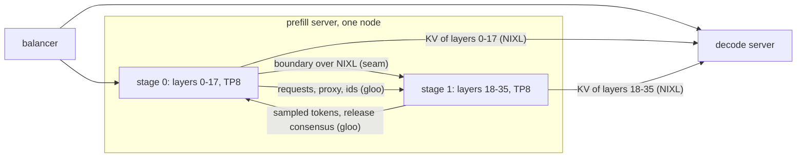
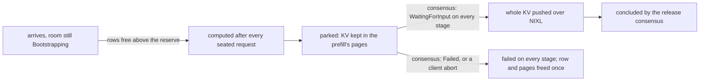
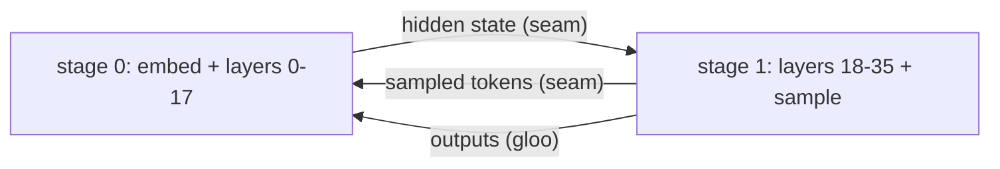

# Pipeline parallelism

## Overview

Pipeline parallelism (PP) splits a model's decoder layers into contiguous **stages**, each on its own tensor-parallel
(TP) group. A stage hands the next one its boundary, the hidden state after its last layer. `--pp-size N` serves N
stages.

The plugin serves PP on GPT-OSS-120B and on the PD prefills of GLM-5.2 and Kimi-K3, each server on one node:

- **A pipelined PD prefill** (`--disaggregation-mode prefill --pp-size 2`): two TP8 stages of 18 layers on 16 ranks.
  Its decode is launched as usual, or pipelined in the same stages, and takes each stage's KV by global layer id.
- **A pipelined PD decode** (`--disaggregation-mode decode --pp-size 2`), behind a pipelined prefill of the same
  stages, or behind an unpipelined prefill at the decode's attention TP that sends each decode stage the KV of its
  layers ([The pipelined decode](#the-pipelined-decode)).
- **A pipelined aggregated server** (`--pp-size 2`, no `--disaggregation-mode`): two TP8 stages that each run the
  prefill and the decode of their layers, on SGLang's own PP loop. It is served but slower: that loop waits on the host
  for each micro-batch's outputs, and the stage's device idles meanwhile
  ([The pipelined aggregated server](#the-pipelined-aggregated-server)).
- **GLM-5.2's pipelined PD prefill** (`--disaggregation-mode prefill`, `--pp-size 4 --tp-size 32` or `--pp-size 16
  --tp-size 8`): four or sixteen stages, each one program of the vendored prefill giga kernel, in front of the
  unpipelined giga-kernel decode, which takes each stage's KV by global layer id into its own caches. It runs this
  page's PD prefill loop and seam, with the model's own boundary (each rank's residual shard, and at PP16 the stage's
  top-k picks) and launch rules ([GLM-5.2](../model-recipes/glm52.md#the-prefill)).
- **Kimi-K3's pipelined PD prefill** (`--disaggregation-mode prefill --pp-size 8 --tp-size 16`): eight stages of a
  16-rank TP group at LNC1, which hand each other three declared boundary kinds
  ([Kimi-K3](../model-recipes/kimi-k3.md#the-parallel-layout)).

Every other pipelined launch is refused at startup, naming each reason
([What a launch refuses](#what-a-launch-refuses)).

PP adds ranks to a prefill without widening its collectives: each stage runs TP8 over half the layers, so a chunk's
forward on one stage is shorter, and stage 0 runs chunk k+1 while stage 1 runs chunk k.

SGLang already has the PP machinery (a scheduler per stage and TP rank, the micro-batches, the request relay, the
proxy dict, per-stage KV pools). The plugin adds the Neuron parts:

- a stage build of the model whose graphs take and return the boundary;
- the **seam**, which moves the boundary HBM to HBM over NIXL (`sglang_neuron/distributed/pp_seam.py`);
- scheduler patches that run SGLang's PD PP loops with no host wait in front of a forward
  ([The PP loop in the overlap order](#the-pp-loop-in-the-overlap-order));
- on a pipelined PD decode, a device-side relay of the last stage's sampled tokens to stage 0;
- the process layout, KV registration and launch checks (`sglang_neuron/distributed/pipeline.py`).

[Parallelism](parallelism.md) covers a stage's TP, EP and DP layout, [Disaggregated
inference](disaggregated-inference.md) the PD protocol, and [Async scheduling and
execution](async-scheduling-and-execution.md) the overlap schedule. Paths are relative to the repository root, and
SGLang's code is named by its module (`sglang.srt.managers.scheduler_pp_mixin`).

## Key concepts

**Stage.** One pipeline rank, owning the global decoder layers `[start_layer, end_layer)` on `--tp-size` ranks.
SGLang's split picks the ranges (`get_pp_indices`, which honours `SGLANG_PP_LAYER_PARTITION`), so the plugin's model
and SGLang's KV pools always agree.

**Global layer id.** A layer's index in the full model. Checkpoint keys, KV pool entries, sliding-window parity and the
PD layer pairing all use it, on every stage.

**Boundary.** What a stage hands the next for each chunk: the un-normed hidden state and the residual not yet added,
which the next stage's first input norm adds. Each is sharded by sequence over the stage's attention-TP ranks:
`[chunk / tp, 3072]` bf16 per rank on GPT-OSS (its kernels' padded hidden size).

**Seam.** One `NeuronPPSeam` per process, owning NIXL-registered device rings: a send ring per kind of tensor its stage
sends and a landing ring per kind it receives. The kinds are the prefill's hidden state and residual, the decode's
hidden state, and a pipelined PD decode's sampled tokens (kind `tk`). A PD role's seam carries its own phase's kinds;
an aggregated server's carries both phases' boundaries and no tokens. A boundary slot moves from stage s, TP rank r to
stage s + 1, TP rank r, one NIXL WRITE per tensor. The sampled tokens wrap round instead, from the last stage to stage
0 at the same TP rank (`seam_peers` in `sglang_neuron/distributed/pp_seam.py`).

**Declared prefill kinds.** A model whose prefill boundary tensors differ in width, dtype or rows declares each one
(`NeuronModel.pp_prefill_boundary_kinds`, `{name: pp_seam.BoundaryKind}`): its kind, width and dtype, whether its rows
are sharded by sequence over the attention TP ranks, and a count of row blocks. Every stage's slot of a kind holds
`blocks` row blocks of the largest prefill bucket, so the slots of every boundary have one size; a stage sends `sent`
and receives `received` blocks of its step's bucket, a prefix of the slot that is all a WRITE moves. A boundary that
grows by one block per stage (an attention-residual bank laid out block-major) declares the pipeline's largest block
count and each stage's own counts. A declared kind takes its own ack tags; a model that declares nothing keeps `ph` and
`pr` as above, and each further tensor it names is kind `x<i>` at the width and dtype `NeuronModel.pp_boundary_spec`
gives it.

**Step id.** SGLang's PP proxy dict still travels the stage ring, but it carries the seam's step id and a batch
fingerprint instead of the boundary tensors. A receiver refuses a step or a batch other than the one it scheduled.

**Micro-batch.** One of SGLang's `pp_size` scheduling slots; iteration i of the PP loop serves micro-batch
`i % pp_size`. A prefill micro-batch is one chunk of one request
([One request per prefill forward](runtime.md#one-request-per-prefill-forward)).

**PP overlap.** Async execution on a pipelined PD role, the only way one runs. The PP loop runs in the **overlap
order**: every stage launches a micro-batch before it waits on anything. On a prefill, SGLang turns its overlap
schedule off under PP and the asynchronous last stage takes its place (`ServingPolicy.overlap_schedule`); on a decode
the overlap schedule stays on (`sglang_neuron/sglang_patches/pp_overlap_schedule.py`). A pipelined aggregated server
runs synchronously, with no async execution (`serving_policy.resolve`).

## Architecture



Two transports connect the stages:

- **The seam** carries the boundary. Stage s's forward writes it into claimed send slots, and a worker thread WRITEs
  them into stage s + 1's landing slots, which are that stage's graph inputs.
- **SGLang's gloo ring** carries the rest: the requests stage 0 receives, the proxy dict, the transferred request ids,
  the release consensus and the last stage's sampled tokens. Each goes from one stage's TP leader to the next stage's,
  which broadcasts it to its stage.

Every stage sends the KV of its own layers to the decode, as SGLang's PD prefill does under PP. The plugin tags each
entry with its global layer, so the decode pairs a stage's 36 K and V entries with its own entries of the same layers
(`sglang_neuron/sglang_patches/pd_kv_layer_ids.py`).

Each stage keeps its own radix tree over its layers' pages. The stages schedule the same requests and process the same
results at the same loop points, so their trees insert and evict the same prefixes, and a hit reuses the same pages on
every stage.

### The process layout

Ranks are PP-major, as SGLang numbers them: world rank = `pp_rank * tp_size + tp_rank`, so a PP2 x TP8 prefill runs
ranks 0-7 as stage 0 and 8-15 as stage 1. Each stage's ranks take their own NeuronCores and build their own plugin
groups; SGLang's pp group of a TP position is that position's rank in every stage. Host traces and profiles name a
rank `pp<stage>_tp<rank>` (`sglang_neuron/parallel/state.py`, `sglang_neuron/sglang_tree.py`).

### The stage build

A model opts in by declaring its stage contract (`catalog.ModelSpec.pipeline_stages`, checked at launch). GPT-OSS builds
the stage `[start_layer, end_layer)` with global layer indices, so the sliding layers stay the even global layers and
the KV and checkpoint keys stay global. The embedding is on the first stage, the final norm, LM head and sampler on the
last. A non-last stage's graph writes its boundary into the seam slots it was handed and returns them instead of tokens.
Stages are built from the per-layer prefill and decode graphs, not the giga-kernel decode. Each stage loads only its
layers' weights and binds only its layers' KV (`NeuronModel.bind_kv_cache`). On CPU, the two stages of a PP2 split
composed give exactly the whole model's logits. GLM-5.2's prefill builds a stage as one program of its prefill kernel
over the stage's layers, at the splits its launch rules require ([GLM-5.2](../model-recipes/glm52.md#the-prefill)), and
its decode runs no pipeline.

## A step on the stages

A chunk's forward on a stage that is not the last goes through the seam in four moves:

```mermaid
sequenceDiagram
  participant H0 as stage 0 host
  participant D0 as stage 0 device
  participant W as stage 0 seam worker
  participant H1 as stage 1 host
  participant D1 as stage 1 device
  H0->>H0: claim the next send slot of each boundary tensor
  H0->>D0: launch the forward; it writes the boundary into the slots
  H0->>W: send_claimed(launch event); the host goes on to the next micro-batch
  H0->>H1: proxy dict: step id + batch fingerprint (gloo)
  W->>W: wait for the forward's launch event
  W->>D1: one NIXL WRITE per tensor into the landing slots
  H1->>H1: build inputs; take the landing slots as graph inputs
  H1->>D1: right before the submit, wait for the WRITE's notification
  H1-->>W: ack the slots once its forward has run
```

1. **Claim.** Before the launch, the stage claims the next slot of each boundary tensor (`claim_send_slot`), and the
   forward writes into it in place. A claim waits only if the slot's previous step is not acked yet.
2. **Send.** `send_claimed` hands the step and the forward's launch event to the seam's worker thread and returns. The
   worker waits for the event, then posts one NIXL WRITE per tensor, the notification naming the tensor, step and
   rows. Without NIXL patch 0009 (below) it also sends a commit once every WRITE completed.
3. **Receive.** The next stage takes its landing slot while it builds the step's inputs (`recv(..., wait=False)`) and
   waits for the landing right before the graph's submit (`await_landed`). The slot is the graph's device input, with
   no host copy. At a program switch the fence's drain and rank meeting run first, while the WRITE is still on its
   way, and the landing wait follows them ([The program-switch fence](runtime.md#the-program-switch-fence)).
4. **Release.** Once the forward that read a slot has run, the receiver acks it over gloo (two integers): a middle
   stage after its own next send, the last stage from `release_after`, an aggregated server's last stage right after
   its host readback (`release_all`). A sender reuses a slot only after the ack.

The n-th send on stage s is the n-th receive on stage s + 1, since SGLang drives every stage through the same batch
sequence. Each ring holds `2 * max(2, pp_size)` slots, enough for the `pp_size + 2` micro-batches a stage can hold in
flight in the overlap order (`pp_seam.ring_capacity`). The seam's NIXL agent runs without a progress thread: every
seam call that waits polls NIXL itself.

NIXL patch 0009 drops the notification of a partly failed transfer, so with it the notification alone means the slot
landed; without it a landing also waits for the sender's commit (every WRITE succeeded). Each rank reads at seam build
whether its LIBFABRIC plugin carries 0009 (its log string), and the commit is dropped only when every rank's does; a
world without 0009 logs a warning once. With the [NIXL patches](../../patches/nixl/README.md) a failed WRITE errors at
the sender and the target counts only notified transfers. The sender then poisons its seam and tells its receivers, so
no slot is consumed and the server stops without an output.

## The PP loop in the overlap order

SGLang's PD prefill PP loop (`SchedulerPPMixin.event_loop_pp_disagg_prefill`) has the last stage send the outputs of
the forward it just launched, and stage 0 waits for them before handing on its next requests. With an asynchronous last
stage that send must read the tokens back first, so both stages idle for a host round trip on every micro-batch.

The plugin runs the same loop in the **overlap order** instead
(`sglang_neuron/sglang_patches/pp_prefill_overlap_loop.py`), rebuilt from SGLang's pinned source with named
substitutions. With N = `pp_size` and L = N + 1, iteration i serves micro-batch `i % N`, and every stage:

1. receives requests, decides the bootstrap queue and polls its transferred requests, as SGLang does;
2. applies the release consensus of iteration i - L before it schedules (stage 0 takes it from the last stage, the
   others from the previous stage);
3. schedules and launches; a stage that is not the last hands on its proxy at once, and commits its previous proxy
   send only after the launch;
4. on the last stage, sends stage 0 the consensus of iteration i, then the outputs of iteration i - 1, with iteration
   i's forward already queued behind them;
5. processes iteration i - L: the last stage from the outputs it sent, the others from the ones they received;
6. on a stage that is not the last, hands on this iteration's requests, transferred ids and applied consensus.

No host waits for a forward with nothing queued behind it: stage 0 waits only for its own device and for the next stage
to take its requests, the last stage only for its landing and the forward before the one it just launched. Every stage
applies the same consensus and processes the same iterations at the same loop points, so they schedule the same
batches. The cost is one iteration of latency: a request's last-chunk KV send and first token come one iteration later
than in SGLang's loop at `--pp-async-batch-depth 1`.

A launched batch leaves its micro-batch slot before it is processed, so the loop keeps it in `pp_overlap_records` for
the idle and drain checks (`sglang_neuron/sglang_patches/pp_loop_state.py`); SGLang's in-flight batches include it, so
an abort still finds its requests.

The order departs from SGLang's in four places, each resting on a Neuron property the module pins or checks:

- **The proxy commit comes after the launch.** The proxy is fresh host tensors (the boundary goes on the seam), so the
  previous send may complete after the next launch. SGLang commits first because a CUDA graph's proxy outputs are views
  its next replay overwrites.
- **No receive event or readback.** There is no PP comm stream and the outputs are host tensors.
- **The last stage processes the outputs it sent.** Upstream sends them round the ring back to the last stage. Here
  they are host tensors, the same bytes, so the last stage uses them as sent and the stage before it does not forward
  them.
- **The last stage's commit order.** Gloo pair sends complete when the receiver takes them, so the last stage commits
  each send to stage 0 L sends of its kind later.

### The asynchronous last stage

The last stage's forward returns at its launch with a pending sample, its tokens still on the device. SGLang queues
each micro-batch's outputs at launch and sends them later; `sglang_neuron/sglang_patches/pp_last_stage_async.py`
queues the pending outputs instead, and the send fills them from the sample's host copy. In the overlap order that
send comes right after the next launch, so it waits at most for the earlier forward's tail.

### KV after the forward

Every stage returns from its forward at the launch, and SGLang's PD prefill sends a middle chunk's KV at the stage's
next scheduling step, possibly before the forward has written it.
`sglang_neuron/sglang_patches/pp_prefill_kv_after_forward.py` makes the newest launch
(`device_io.last_launch_event`) the chunk's wait event, which SGLang's NIXL transfer worker waits on, off the scheduler
thread. A last chunk's KV goes after the last stage's outputs for it arrived, so it needs no event.

### Early last-chunk sends and the early answer

With `SGLANG_NEURON_PP_PREFILL_EARLY_LAST_SEND=1`, a stage does not wait for the outputs to come round the ring before
it sends a request's last chunk. A stage other than the last sends the chunk right after it launches the chunk's
forward, with the launch as its wait event and with no metadata row
(`sglang_neuron/sglang_patches/pp_prefill_last_send.py`). The last stage sends its chunk and the metadata row in step 4,
right before the outputs go to stage 0. The processing does not send the chunk again, and every other part of the
processing stays at its loop point, so the stages still schedule the same batches. The decode admits the request when
every source reported and the last stage's row landed, and it fails a room whose row does not land in 30 s
(`sglang_neuron/sglang_patches/pd_metadata_wait.py`).

The release of a request comes L iterations after its last chunk, and SGLang answers the request only there. With the
early sends, stage 0 answers a request when it processes the last chunk
(`sglang_neuron/sglang_patches/pp_prefill_early_answer.py`, `SGLANG_NEURON_PP_PREFILL_EARLY_ANSWER`, on by default).
The release then frees the KV and inserts the prefix-cache entry at its own point, as before. A next turn that reaches
the prefill before that release and extends the request's whole prompt waits for the release, when the release inserts
more of the prompt than the tree holds (`sglang_neuron/sglang_patches/pp_prefill_inflight_wait.py`).

## Compute ahead on a pipelined PD prefill

A decode grants a request its seat (a request row; on GLM-5.2's decode, one of the kernel's 32 slots) only when one is
free, and SGLang's prefill starts a request only once the seat's `TransferInfo` has arrived. With more requests in
flight than seats, a waiting request then waits for its prefill too, and each freed seat idles through a prefill's
compute and push. SGLang's own answer, optimistic prefill, is forced off at `--pp-size` above 1: a request not yet
bootstrapped changes state at each stage's own poll, so the stages would schedule different batches.

Compute ahead (`sglang_neuron/sglang_patches/pp_prefill_compute_ahead.py`) keeps SGLang's park-and-push path and makes
it safe under PP with one rule: every state change of a request whose bootstrap is pending happens at one loop point,
through the same PP consensus that already decides the bootstrap queue, so all stages change it in the same iteration.



- **The reserve.** Admission keeps `2 * pp_size + 3` rows (`pp_prefill_admission_floor`: 11 at PP4, 35 at PP16) for
  requests whose seat is granted. Without it every row could hold a parked request while the decode, whose order need
  not follow the prefill's, gives its free seats to requests that still need a row: rows would wait for seats and seats
  for rows. With it a seated request always finds a row, finishes and frees its seat.
- **Failures.** A pending request that fails or is aborted is handled once, by whichever place holds it (the waiting
  queue, the chunked slot, a launched forward or the in-flight queue), and its room is failed in every stage's own
  status, so the release consensus concludes it on every stage. That includes the first stage's bootstrap timeout,
  which only that stage's poll sees.
- **Pages.** A parked request holds its pages until its push, so the launch must state `--max-running-requests`,
  `--max-total-tokens` and `--context-length`, and its pool must hold every request it may park and one seated request,
  each at the full context. A launch that does not runs without compute ahead and logs why
  (`_prefill_compute_ahead` in `sglang_neuron/serving_policy.py`).
- **The trade.** A request that waited for a seat no longer waits for its prefill's compute, and may wait up to one
  prefill iteration for its push once the seat is granted. Below the seat count nothing changes: the `TransferInfo`
  arrives before the first chunk's result.

Nothing changes on the decode, in the push protocol or in the NIXL patches, and the 300 s bootstrap timeout still counts
from the request's arrival. It runs only for a model whose catalog entry declares it (`prefill_compute_ahead` in
`sglang_neuron/models/catalog.py`, set for GLM-5.2), and every GLM-5.2 pairing but the 1M one on PP16, whose pool is too
small for it, serves with it.

## The pipelined decode

A pipelined decode runs a decode step down the stages: stage 0's graph embeds the step's input ids and runs its layers,
hands its boundary (the hidden state, `[batch, 3072]` bf16 on every rank) to the next stage over the seam, and the last
stage samples. At PP2, while stage 1 runs micro-batch 0's step, stage 0 runs micro-batch 1's.



**The token relay.** Stage 0 can launch micro-batch m's next step only with the tokens stage 1 sampled for m's last
step. Reading them on the host would put a round trip in front of every launch, so the last stage relays them to stage
0 over the seam (`ServingPolicy.pp_token_relay`):

1. the last stage's graph samples into a claimed token send slot, and the seam's worker WRITEs it to stage 0's token
   ring once the forward has run (the slot is also the step's pending token vector, read on the host before reuse);
2. after each launch, stage 0 registers the forward's rows as futures of the tokens to come
   (`async_execution.stash_seam_tokens`);
3. when stage 0 builds a step's inputs, SGLang's FutureMap resolves them to the landing slot, which the graph reads as
   its input ids. Micro-batches interleave, so the relay plans a step from the forward most of its rows come from: an
   unchanged batch reads the slot directly, a changed one through the graph's in-graph reorder.

The other stages' input ids are zero placeholders, the same on every stage's host, so the batch fingerprints agree.

**The loop.** `sglang_neuron/sglang_patches/pp_decode_overlap_loop.py` runs SGLang's PD decode PP loop in the overlap
order: a stage launches a micro-batch's next step with the previous one unprocessed, hands on its proxy at once, and
processes a step `pp_size + 1` iterations after its launch. It needs the overlap schedule SGLang turns off under PP;
`sglang_neuron/sglang_patches/pp_overlap_schedule.py` keeps it on and passes the stage's proxy through run_batch's
overlap branch. A request that finished at a step runs one more, discarded step, as in SGLang's overlap scheduler.

**Admission and holds.** Upstream's decode admission puts requests that arrive together into one micro-batch;
`sglang_neuron/sglang_patches/pp_decode_micro_batch_bound.py` caps each at `pp_max_micro_batch_size`, so every
micro-batch fills. The stages must keep the same free KV pages, or one would retract alone and launch a batch the
others do not, so a failed room is held and released on every stage at the same consensus point
(`sglang_neuron/sglang_patches/pp_decode_held_release.py`, [Failures and aborts](#failures-and-aborts)). The decode
radix cache is refused for the same reason ([What a launch refuses](#what-a-launch-refuses)).

**What bounds it.** Two micro-batches keep two stages busy only if a micro-batch's round trip (two steps plus two hops)
fits in two steps. The WRITE itself lands almost at once, but each hop also holds the sender's wait for its forward and
the receiver's host work before the submit. So each stage waits about two hops between steps, and that wait is in the
time per output token; more micro-batches in flight would hide it.

**Pairing with the prefill.** Each decode stage names its layers (`[start, end)`) in a trailing frame of its NIXL
registration (`sglang_neuron/sglang_patches/pp_decode_stage_transfer.py`), beside the head-major and DCP frames;
SGLang's parser ignores it.

- *Behind a pipelined prefill of the same PP size*, a decode stage pairs with the prefill stage of the same PP rank,
  as in SGLang, and both must use the same `SGLANG_PP_LAYER_PARTITION`. SGLang never compares the partitions: it would
  serve a decode stage of more layers than its prefill stage with those layers never written. Each prefill stage
  refuses a decode stage of another range at registration, naming both ranges, and that stage's requests fail with the
  reason ([Failures and aborts](#failures-and-aborts)).
- *Behind an unpipelined prefill* (TP8 in front of a PP2 x TP8 decode), SGLang asserts at first contact. Here each
  decode stage targets the prefill's one stage, each prefill rank expects one destination per decode stage, and the
  prefill sends each stage only its layers' KV, paired by global layer id (`pd_kv_layer_ids`), from one dlist per
  stage. A stage at another attention TP, at DCP, of an MLA pool or a pool with state components, with mixed
  destination memory kinds, or with a layer the prefill does not hold, is refused when it registers.

A pipelined decode behind a pipelined prefill of another PP size keeps SGLang's assert at first contact.

## The pipelined aggregated server

An aggregated server with `--pp-size 2` runs both phases on two stages. Each stage builds the prefill and the decode
graph of its layers, one runtime per phase, and both runtimes share the process's seam, which carries the prefill
boundary (`ph`, `pr`) and the decode boundary (`dh`), each kind with its own step counter (`pp_seam._specs`). The stage
graphs, the in-place boundary writes and the landing are the PD roles'.

It runs on SGLang's own PP loop (`SchedulerPPMixin.event_loop_pp`), unpatched: the plugin registers the loop state,
connects the ring before the first send, and pins the loop's source (`pp_loop_state.register_aggregated`). The loop is
synchronous. A stage takes the previous stage's proxy before it launches and sends its own right after, so the
boundary goes over the seam as on a PD role. The last stage samples, reads the tokens back on its host and releases its
landing slots at once. The outputs then go round the gloo ring, and every stage processes them on its host before it
schedules that micro-batch again, its device idle meanwhile. That is why it is slower than the PD roles' overlap order.

Since every stage holds the sampled tokens on the host, the first stage takes its decode input ids from there: no token
relay, no fixed decode token width, and every decode batch bucket is served. There is no async execution, with or
without `--disable-overlap-schedule` (`serving_policy.resolve`).

The stages switch between the prefill and decode programs at different moments, and the program-switch fence meets
only a stage's own TP group, so no stage waits at a fence for another
(`sglang_neuron/model_executor/program_fence.py`).

On the chunk cache it runs SGLang's hybrid SWA memory, as the unpipelined server does ([Hybrid SWA
memory](runtime.md#hybrid-swa-memory)): each stage keeps its sliding layers' KV in a window pool of its own and binds
its layers by global id. Under a radix tree it runs one KV pool (the radix mode is refused pipelined). Every stage sizes
its pools alike from the stages' synced token count, and its window pool for a prefill chunk per micro-batch
(`sglang_patches/pp_pool_resolve.py`).

The served layout is GPT-OSS-120B PP2 x TP8 (MoE EP8) with `SGLANG_PP_LAYER_PARTITION=19,17`: the last stage, which also
runs the final norm, the LM head and the sampler, holds two layers fewer.

## Failures and aborts

**A failed seam operation.** A failed WRITE, a missed notification or a refused step leaves the stage pair out of step
for good. The first cause poisons the seam, and every later seam call raises it instead of a timeout it caused.

**An aborted request.** An AbortReq reaches every stage with the requests of the same iteration, since a later stage
takes them from its previous stage, so every stage drops the request in the same iteration.

- **A request being chunked.** SGLang's PD prefill PP loop never runs the pending chunked abort its other loops run.
  `sglang_neuron/sglang_patches/pp_pending_chunked_abort.py` runs it at the top of `process_prefill_chunk`, so the
  request stops chunking at the abort instead of at the end of its prompt.
- **A request in the bootstrap consensus window.** SGLang handles it: the abort concludes the request's sender as
  failed, so no later poll is good, and the request never reaches a waiting queue.

**A room that fails on one stage.** SGLang decides the bootstrap queue on stage 0 from every stage's status in its
`PPConsensusStore`, and the later stages apply stage 0's polls, so all stages drop the request in the same iteration.

**A request computed ahead.** A request that left the bootstrap queue before its room was bootstrapped changes state
only at the compute-ahead consensus point, on every stage alike
([Compute ahead on a pipelined PD prefill](#compute-ahead-on-a-pipelined-pd-prefill)).

**A failed room on a pipelined decode.** SGLang fails the room on every decode stage in the same iteration, but each
stage would then decide alone whether to hold its pages (from whether its destination was published or its ABORT went
out) and release the hold when its own prefill ranks acked.
`sglang_neuron/sglang_patches/pp_decode_held_release.py` holds every failed room on every stage and releases it once
every stage's group agrees, as one key per hold in the release consensus that the ring keeps only when every stage put
it in. Every stage then frees the pages at the same point of its admission sequence.

## Configuration

PP turns on with SGLang's `--pp-size`. GLM-5.2's prefill points have their own commands
([Launching a pairing](../model-recipes/glm52.md#launching-a-pairing)). The commands below run in the container image,
with the checkpoint mounted at `/models` ([container guide](../guides/container.md)); in a development environment, run
them with `SGLANG_PLATFORM=neuron` and the NIXL overlay first on `PYTHONPATH`. A PP2 x TP8 GPT-OSS-120B prefill, on one
node:

```bash
SGLANG_PP_LAYER_PARTITION=18,18 \
python3 -m sglang.launch_server --model-path /models/gpt-oss-120b \
  --kv-cache-dtype fp8_e4m3 --context-length 10240 --chunked-prefill-size 8192 --page-size 128 \
  --disaggregation-mode prefill --disaggregation-transfer-backend nixl --disaggregation-bootstrap-port 8998 \
  --pp-size 2 --tp-size 8 --ep-size 8 --max-running-requests 8 --max-total-tokens 172032 \
  --mem-fraction-static 0.5 --host <prefill node> --port 30000
```

A pipelined decode behind it, on the other node, with the same partition and one decode batch size, the micro-batch
(16 running requests over two micro-batches of 8):

```bash
SGLANG_PP_LAYER_PARTITION=18,18 \
python3 -m sglang.launch_server --model-path /models/gpt-oss-120b \
  --kv-cache-dtype fp8_e4m3 --context-length 10240 --chunked-prefill-size 8192 --page-size 128 \
  --disaggregation-mode decode --disaggregation-transfer-backend nixl --disaggregation-bootstrap-port 8998 \
  --pp-size 2 --tp-size 8 --ep-size 8 --max-running-requests 16 --cuda-graph-bs-decode 8 \
  --scheduler-recv-interval 1 --tokenizer-worker-num 1 --max-total-tokens 172032 --mem-fraction-static 0.5 \
  --host <decode node> --port 30000
```

A pipelined aggregated server, on one node, with no `--disaggregation-mode`:

```bash
SGLANG_PP_LAYER_PARTITION=19,17 \
python3 -m sglang.launch_server --model-path /models/gpt-oss-120b \
  --kv-cache-dtype fp8_e4m3 --context-length 10240 --chunked-prefill-size 8192 --page-size 128 \
  --pp-size 2 --tp-size 8 --ep-size 8 --max-running-requests 64 --max-total-tokens 655360 \
  --mem-fraction-static 0.8 --host <node> --port 30000
```

| Flag / variable | Default | Effect |
| --- | --- | --- |
| `--pp-size N` | 1 | the number of stages; above 1 the launch runs the PP checks and SGLang's PP loop |
| `SGLANG_PP_LAYER_PARTITION` | unset | a comma list of layer counts, one per stage, read by SGLang and the stage build alike; unset, SGLang balances the layers. A pipelined prefill and a pipelined decode must set the same partition, or each prefill stage refuses its decode stage by name; a pipelined decode behind an unpipelined prefill may set any |
| `--pp-async-batch-depth` | 0 | must be 0: a pipelined PD role runs its loop in the overlap order with `pp_size` micro-batches, which keeps a prefill's stages busy. A decode's stages wait about two hops per step, which a deeper loop would hide, but none is served yet. The aggregated server also runs `pp_size` micro-batches; no run covers a deeper loop's buffered last stage there |
| `--max-running-requests` | SGLang's | on a prefill, the stages hold up to `pp_size + 2` chunks scheduled and unprocessed, and up to `pp_size + 1` transferred requests waiting for the release consensus; a prefill that computes ahead and runs at or below `2 * pp_size + 3` (7 at PP2, 11 at PP4, 35 at PP16, `pipeline.pp_prefill_admission_floor`) computes no request ahead and leaves a stage idle between forwards, so the launch refuses it; any other prefill below it gets a warning. On a decode, each micro-batch holds `max_running_requests // pp_size` (SGLang's `pp_max_micro_batch_size`), the one decode batch size |
| `SGLANG_NEURON_PP_BOUNDARY_DUMP_DIR` | unset | a directory; every rank that sends over the seam writes its first boundary sends to `s<pp rank>_r<tp rank>_send<n>.pt` there (each kind's rows as sent, in their own dtype, and the ranks, the send's index and each kind's step under `__meta__`), to compare a stage's boundary with a reference run's. The worker reads the slots between the forward and their WRITE, so the dumped sends are not timing-representative; later sends are not read |
| `SGLANG_NEURON_PP_BOUNDARY_DUMP_STEPS` | 4 | how many sends each rank writes |

## What a launch refuses

`distributed.pipeline.validate_pp_launch` refuses every pipelined launch but the ones above, naming each reason
(`pp_launch_problems`):

- on a PD decode (`pp_decode_problems`): the giga-kernel decode; `SGLANG_ENABLE_DELAY_SAMPLE`; any decode batch size
  but the micro-batch (`--cuda-graph-bs-decode` of `--pp-max-micro-batch-size`, or
  `--max-running-requests // --pp-size`), since one decode graph's boundary fills the seam's slots; and SGLang's decode
  radix cache (`--disaggregation-decode-enable-radix-cache`): SGLang's loop agrees across stages on what they
  preallocate, transfer and retract, but not on each stage's own tree match, which sets the pages it allocates
  ([The pipelined decode](#the-pipelined-decode));
- on a PD role, `--disable-overlap-schedule`, which turns off the async execution both PD roles run on (an aggregated
  server runs without it either way);
- a nonzero `--pp-async-batch-depth`;
- `--dp-size` replicas and DP attention: the stage graphs and the seam carry one TP group's batch;
- a whole-model megakernel;
- `SGLANG_PP_SKIP_PURE_CHUNKED_OUTPUT_COMM`: the seam sends every boundary in order;
- `--enable-dynamic-chunking`: SGLang would profile chunk sizes on the first stage alone, off the compiled prefill;
- a request waiting or running timeout: each stage would time a request out by its own clock;
- `--tokenizer-worker-num` above 1;
- `--scheduler-recv-interval` above 1: every stage must receive every iteration;
- a `SGLANG_PP_LAYER_PARTITION` that is not one positive count per stage.

The arguments every launch refuses stay refused under PP: `--nnodes` above 1, `--attn-cp-size` above 1, `--dcp-size`
above 1 except on the PD prefill of a model that declares prefill DCP (Kimi-K3's, DCP 16 over each stage's TP group),
and speculative decoding, which only the unpipelined decodes of GLM-5.2 and Kimi-K3 serve
([What a launch refuses](runtime.md#what-a-launch-refuses)). A model without a stage build is refused before any
scheduler loads weights (`platform.check_pipeline_stages`).

A pipelined server answers two control requests with HTTP 400 (`general_plugin._refuse_pause_under_pp`,
`_refuse_timed_flush_under_pp`):

- `/pause_generation` in `in_place` or `retract` mode. SGLang's PP loops never read the pause flag, so an in-place
  pause would not pause. A retract empties only the current micro-batch and, under the overlap schedule, pops a result
  queue the overlap-order decode loop never fills, freeing KV of steps still in flight. `abort` mode is served: the
  tokenizer aborts every request without the scheduler's pause, and the scheduler finds them in every micro-batch.
- `/flush_cache` with a timeout. Each stage's request leader sends its deadline markers
  ([Failures and aborts](disaggregated-inference.md#failures-and-aborts)) by its own clock, so one stage could flush
  while another gives up, and their prefix caches would differ. A flush without a timeout is allowed, but each stage
  flushes only when it is idle, so send it to an idle server.

## Upstream SGLang and the plugin

| SGLang | On Neuron | The plugin |
| --- | --- | --- |
| The PD prefill PP loop exchanges a micro-batch's outputs around its launch. | Under the asynchronous last stage both stages would idle for a host round trip per micro-batch. | `pp_prefill_overlap_loop` runs SGLang's loop rebuilt in the overlap order, and adds its launched batches to `_collect_inflight_batches`. |
| The last rank's queued outputs are device tensors, with a stream event to wait on. | A pending sample's tokens are on the device, and the CPU device's stream wait does nothing. | `pp_last_stage_async` fills the queued outputs from the sample's host copy right before the send. |
| A middle chunk's KV is sent at the stage's next scheduling step. | A stage's forward returns at its launch, so the KV may not be written yet. | `pp_prefill_kv_after_forward` makes the newest launch the chunk's wait event, which SGLang's transfer worker waits for. |
| The PD prefill PP loop never runs the pending chunked abort. | The same on every backend. | `pp_pending_chunked_abort` runs it before the stage schedules. |
| `build_kv_layer_ids` answers [] for a pool that wraps no token KV view. | A PP stage and a full-stack decode register different entry counts, and SGLang refuses to pair them without ids. | `pd_kv_layer_ids` publishes the Neuron pool's global layer ids. |
| The aggregated PP loop (`event_loop_pp`) processes each micro-batch's outputs on every stage's host before it schedules the micro-batch again. | A stage's device idles while its host waits. | Served as it is, slower; `pp_loop_state` pins it, and the stages relay no tokens. |
| `init_pp_loop_state` starts every PP loop. | Under lazy gloo init a pair connects at its first use, which can deadlock the ring's first sends. | `pp_loop_state` connects the ring first and starts the overlap order's empty records. |
| On the head-slice transfer (a decode of another attention TP), `CommonKVManager.get_mha_kv_ptrs_with_pp` reads an uneven split's decode entries as main plus draft layers. | A Neuron decode has no draft KV, so upstream sends the stage's V entries to other layers. | `pd_kv_layer_ids` also wraps it and pairs a stage's K and V entries with a whole-stack decode's, whatever the split; a decode stage of other layers is refused. |
| The PD decode PP loop (`event_loop_pp_disagg_decode`) launches a micro-batch's next step only after it processed the step before. | The first stage's host would wait a forward per step for the last stage's outputs. | `pp_decode_overlap_loop` runs SGLang's loop rebuilt in the overlap order, the first stage's input ids taken from the tokens the last stage relays over the seam. |
| SGLang turns its overlap schedule off under PP, and run_batch's overlap branch calls the worker without the stage's proxy tensors. | The overlap-order decode loop launches on that branch. | `pp_overlap_schedule` keeps the overlap schedule on for a pipelined decode and passes `pp_proxy_tensors` through the overlap branch. |
| `GroupCoordinator.send_tensor_dict`, called by `SchedulerPPMixin._pp_send_dict_to_next_stage` with the attention-TP group, sends each rank 1/attn_tp of every proxy or output tensor whose element count divides by attention-TP, and the receiver all-gathers over attention-TP; SGLang has no switch to turn this off. This is correct only when all ranks of a stage hold the same tensor. | A per-rank tensor, such as an SP-sharded prefill hidden state, would reassemble with the right shape and rows taken from other ranks' shards, with no error. | `general_plugin._pp_proxy_send_checked` wraps `_pp_send_dict_to_next_stage` and raises on any proxy tensor the transport would slice (more than one element, divisible by attention-TP). The boundary rides the seam, never the proxy; the proxy carries only one-element descriptors, which are always sent whole. |
| The PD decode admission takes waiting requests into the micro-batch it schedules, up to `max_running_requests`. | Requests that arrive together all join one micro-batch, and the others stay empty. | `pp_decode_micro_batch_bound` bounds each micro-batch's admission at `pp_max_micro_batch_size`. |
| `CommonKVManager._resolve_rank_mapping` asserts on a pipelined decode behind an unpipelined prefill, and the NIXL prefill refuses a decode stage's fewer KV entries (`_prepare_payload_xfer`). | A PP2 x TP8 decode cannot run behind a TP8 prefill. | `pp_decode_stage_transfer` maps each decode stage to the prefill's one stage, which sends each stage its own layers' entries by global layer id; the stage names its layers in a registration frame. |
| At equal PP sizes SGLang never compares the roles' layer partitions. | A decode stage of more layers than its prefill stage is served with layers that never receive KV. | `pp_decode_stage_transfer` refuses, at registration, a decode stage whose layer range is not the prefill stage's, naming both. |
| Each decode stage decides from its own state whether to hold a failed room's KV, and when to release it. | The stages would keep different free pages, and one that retracts alone launches a batch the others do not. | `pp_decode_held_release` holds a failed room's KV on every stage and releases it at one consensus point. |
| `KVCacheConfigurator.config_from_budget` re-solves a stage's pools from the synced token count only where that count changed. | The stage holding the minimum keeps a larger window pool, so the stages run out of window pages at different requests. | `pp_pool_resolve` re-solves every stage from the synced count; a served hybrid launch needs a sliding and a full-attention layer on every stage, since the split depends on the kinds a stage holds. |
| `compute_swa_request_cap` sizes the window pool for one prefill chunk in flight, two under the overlap schedule. | The PP loop puts a chunking request's next chunk in the next micro-batch before the stage ran the previous one, so a stage holds a chunk per micro-batch. | `pp_pool_resolve` counts a chunk per micro-batch in the cap, as the step-0 proof does (`hybrid_swa.check_window_pool`). |

Every patched function and every function a patch relies on is md5-pinned against SGLang 43881a7. A changed source is
refused at startup, naming the function.
