# The runtime

The runtime covers everything between `python -m sglang.launch_server` and a compiled graph running on a NeuronCore: how
the plugin enters SGLang, how a launch resolves and what it refuses, how each scheduler process brings up its
NeuronCore, how a model is hosted and compiled, what one step does, and how the KV cache is laid out. Three topics have
pages of their own: [Parallelism](parallelism.md) (the TP, attention-DP and EP groups),
[Async scheduling and execution](async-scheduling-and-execution.md) (a step launched before the previous one is read
back), and [Disaggregated inference](disaggregated-inference.md) (prefill and decode servers and the KV transfer between
them). Paths on this page are relative to the repository root.

## Overview

sglang-neuron is an SGLang platform plugin. SGLang keeps what it already does: the HTTP server and the tokenizer, the
scheduler and its overlap loop, the radix cache, the paged KV bookkeeping and the request lifecycle. The plugin adds the
Neuron platform that SGLang resolves, hooks where SGLang's CUDA assumptions do not hold, a model host for each served
architecture with its compiled graphs, the attention metadata, and the KV pool and allocator. SGLang's own tensors stay
on the host (`--device cpu`); only the graphs, their weights and the KV pool live on the NeuronCore.

Every forward runs one compiled graph. `torch.compile` with torch-neuronx's `neuron` backend compiles a graph into a
NEFF, the Neuron executable, for one static shape. The runtime therefore compiles one graph for every shape it serves (a
*bucket*) before the server takes its first request, and pads each step to the smallest bucket that holds it.

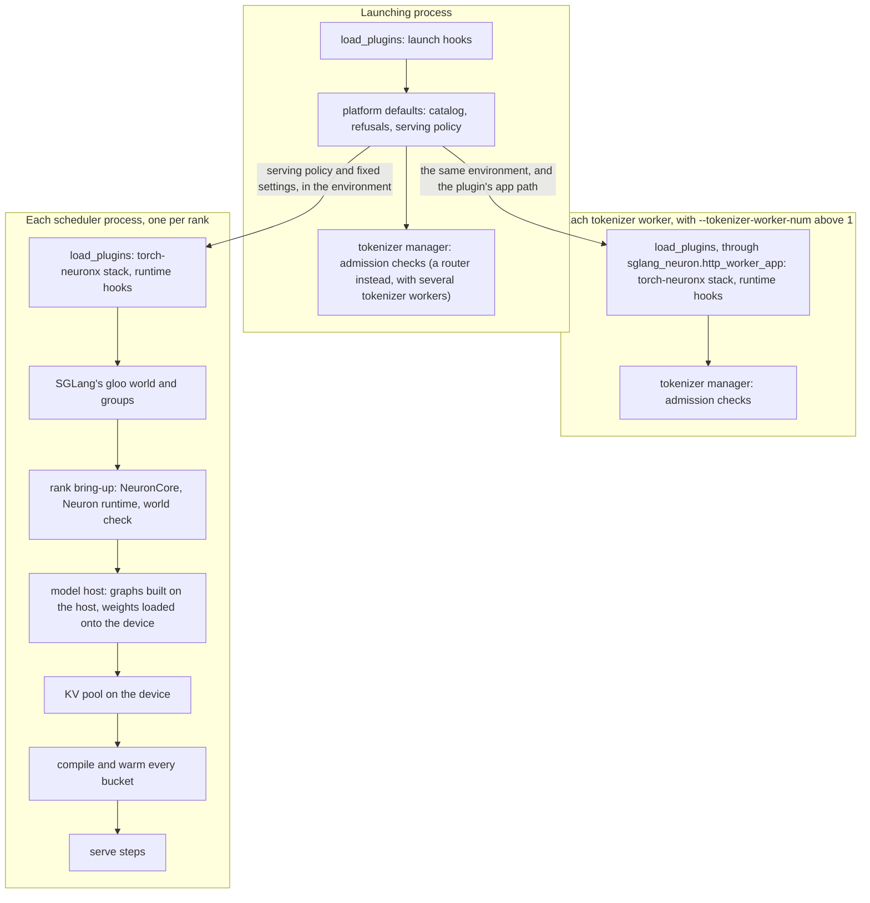

| Term | Meaning |
| --- | --- |
| Role | What a server runs: `aggregated` (prefill and decode in one server), or `prefill` or `decode` of a disaggregated deployment (`--disaggregation-mode`). |
| Rank | One scheduler process, SGLang's TP rank, running on one logical NeuronCore. |
| Logical NeuronCore | Two physical NeuronCores that share one HBM bank and run one program (`NEURON_LOGICAL_NC_CONFIG=2`, LNC2). The GPT-OSS giga-kernel decode and every role of GLM-5.2, Qwen3.5 and Kimi-K3 run one physical core per logical core (LNC1). |
| Attention TP, DP group | Under DP attention (`--attn-dp-size D`, or the deprecated `--dp-size D --enable-dp-attention`) one TP world splits into D DP groups of TP / D ranks each, the attention-TP size; without DP attention the attention-TP size is the TP size. A replica is instead one independent TP world of a plain `--dp-size` server ([Parallelism](parallelism.md#the-widths-a-launch-sets)). |
| Graph family | A role's prefill graphs or its decode graphs. An aggregated server has both. |
| Bucket | One compiled shape of a family: a prefill token count, or a decode batch size over a decode context. |
| Chunk | `--chunked-prefill-size`, divided by the attention-DP size under DP attention: the most tokens one prefill forward takes, and the largest prefill bucket. |
| NEFF | The compiled program of one bucket's graph, which torch-neuronx loads and submits. |
| SPMD | Every rank of a TP group runs the same compiled program, its rank a tensor input rather than a traced constant; the ranks check it before serving ([Warm-up and the SPMD check](#warm-up-and-the-spmd-check)). |
| CCOM | The Neuron runtime's collectives. The ranks of a TP world bootstrap them from one root address, `NEURON_RT_ROOT_COMM_ID`, which the runtime reads when it starts ([Process groups and placement](#process-groups-and-placement)). |
| Page | 128 KV token slots: one SGLang page, and one block of the attention kernels. |

## Entry points

The package registers two SGLang entry points in `pyproject.toml`:

```toml
[project.entry-points."sglang.srt.platforms"]
neuron = "sglang_neuron:activate"

[project.entry-points."sglang.srt.plugins"]
neuron_hooks = "sglang_neuron.general_plugin:register"
```

- **The platform.** `activate` (`sglang_neuron/__init__.py`) returns `sglang_neuron.platform.NeuronSRTPlatform` when
  `torch_neuronx` is importable, and nothing otherwise. On a Neuron host SGLang resolves this platform even without
  `SGLANG_PLATFORM`, since it is the only one that activates there. The plugin installs its hooks only under
  `SGLANG_PLATFORM=neuron`, so the platform refuses a launch without it.
- **The general plugin.** SGLang's `load_plugins()` runs every general plugin once per process and then applies the
  hooks they registered. It runs in the launching process before the server arguments are parsed, and again in each
  scheduler, the DP controller and the detokenizer, which SGLang starts as fresh interpreters (`spawn`). What
  `general_plugin.register` installs depends on the process (diagram below).
- **Tokenizer workers.** SGLang's tokenizer workers (`--tokenizer-worker-num` above 1) import the HTTP app by its path
  and never call `load_plugins()`. The platform points them at `sglang_neuron.http_worker_app:app`, which is SGLang's
  own app imported after `load_plugins()` (`sglang_neuron/sglang_patches/tokenizer_worker_plugins.py`). Without it the
  workers, which serve every request, would admit what the device sampler refuses and lose the abort logprob converter.
  An unset `SGLANG_HTTP_SERVER_APP_PATH` and SGLang's default are replaced by the plugin's app; any other value is
  refused.

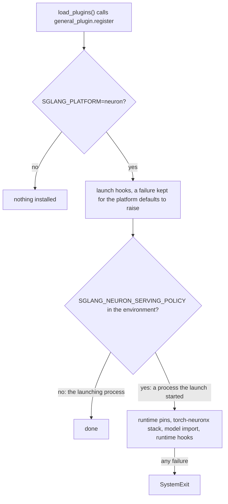

SGLang's loader only logs an exception a plugin raises, and then serves on. A hook that failed to install would
therefore serve the launch without it, so registration fails closed:

- Every `HookRegistry` hook goes through `ResolvingHookRegistry` (`sglang_neuron/general_plugin.py`). It resolves the
  hook's target when the hook registers and raises, naming the target, when the installed SGLang has no such function.
  SGLang itself resolves targets only when it applies the hooks, and skips one that does not resolve. The MXFP4
  quantization entry and the `neuron` attention backend are written directly into SGLang's registries
  (`sglang_neuron/sglang_patches/quantization_registry.py`, `general_plugin._register_attention_backend`).
- A hook that replaces, rewrites or skips SGLang logic, or changes what the original reads, is pinned by the md5 of its
  target's dedented source, taken from SGLang 43881a7 (`sglang_neuron/sglang_patches/source_guard.py`). So is each
  upstream function a patch relies on without hooking it, for example `memcpy_cpu`, `get_quantization_config` and the
  tokenizer workers' `http_server` functions. A changed source stops the launch: "its source (md5 X) is not the
  upstream SGLang source <patch> wraps". A hook that only calls the original and adds behaviour around it is not
  pinned, and neither are the weight-update refusals, which answer the endpoint with HTTP 400 without running it. A
  pipelined server's pause and timed-flush refusals pin what they hand other requests to:
  `TokenizerManager.pause_generation` (it sends the scheduler no abort pause) and `TokenizerControlMixin.flush_cache`
  (its first argument is the timeout). `sglang_neuron/general_plugin.py` lists its own pins, `sglang_neuron/platform.py`
  the host sampler's grammar masks (checked on a host-sampler launch only), and
  `sglang_neuron/model_executor/async_execution.py`, `sglang_neuron/managers/dp_identity.py`,
  `sglang_neuron/disaggregation/poll_reduce.py` and each module in `sglang_neuron/sglang_patches/` their own targets.
- Most hooks that rewrite SGLang logic rebuild the upstream function from its own source with exact text substitutions,
  each of which must occur once (`source_guard.with_substitutions`). The rebuilt function keeps upstream's file and line
  numbers in tracebacks. A closure or a decorated function is refused, since a rebuild would lose its cells or apply its
  decorators twice, unless the caller names the decorator's line and applies the decorator itself, as
  `pd_decode_result_lag` does for upstream's `torch.no_grad()`. `mlp_sync_no_pin`, `abort_rid_match`,
  `dp_controller_blocking_recv`, `prefill_dispatch_dp_rank`, `pd_status_lock`, `pd_decode_result_lag`,
  `bootstrap_listen_backlog`, `detokenizer_sender` and three of the NIXL patches (`nixl_head_major`,
  `nixl_peer_refusal`, `nixl_settle_then_ack`) are built this way.
- The torch and torch-neuronx functions the plugin wraps are pinned the same way, against torch 2.14.0 and torch-neuronx
  2.14.3.0.2115+149b6fca1 (`sglang_neuron/backend/torch_pins.py`, `sglang_neuron/backend/executor_cache.py`,
  `sglang_neuron/backend/direct_submit.py`, `sglang_neuron/distributed/gloo_device.py`).
- A launch hook that fails is recorded, and the platform defaults refuse the launch with its error, where the user sees
  it. A runtime hook that fails raises `SystemExit("sglang_neuron: runtime registration failed (...)")`, which SGLang's
  loader does not catch, so the process stops instead of serving with some hooks missing.

Where two hooks share a target, SGLang applies the REPLACE hook first and wraps it in the AROUND hooks.
`PrefillAdder.add_chunked_req` is such a target: the chunk grid's copy of upstream's method (REPLACE), wrapped by
the hook that notes a pass carries a chunked request (AROUND). The hooks, by what they serve:

| Installed in | Target (hook type) | What it does |
| --- | --- | --- |
| every process (the launch hooks) | `QUANTIZATION_METHODS["mxfp4"]` (registry entry) | An inert config for GPT-OSS's MXFP4 name; the experts run in the model's own kernels (`sglang_neuron/quant.py`). |
| | `handle_model_specific_adjustments` (AROUND) | Lets SGLang's GPT-OSS checks accept a launch whose backends are both `neuron`. |
| | `register_attention_backend("neuron")` | The `neuron` choice of `--attention-backend`. |
| | `TokenizerManager._validate_one_request` (AROUND) | The admission refusals ([What a launch refuses](#what-a-launch-refuses)). |
| | `TokenizerManager.convert_logprob_style` (AROUND) | Keeps an aborted request's logprob history in its output. |
| | the six weight-update methods (AROUND) | Answer HTTP 400: the model's weights are loaded into its compiled graphs once. |
| | `TokenizerControlMixin._execute_profile` (AROUND) | `/start_profile` with the `NEURON` activity ([Profiling](../guides/profiling.md)). |
| | `CommonKVBootstrapServer._run_server` (REPLACE) | The PD bootstrap server listens with a backlog of 4096, which a decode of 128 ranks fits (`sglang_neuron/sglang_patches/bootstrap_listen_backlog.py`). |
| | `Engine._launch_detokenizer_subprocesses` (REPLACE) | Names each detokenizer worker's endpoint from the router's, so a DP group's rank 1 can push to its worker directly (`sglang_neuron/sglang_patches/detokenizer_sender.py`). |
| processes the launch started (the runtime hooks) | `ModelRunner.init_torch_distributed` (AROUND) | The rank bring-up ([Rank bring-up](#rank-bring-up)). |
| | `init_model_parallel_group` (AROUND) | Turns every device communicator off: the groups are gloo, and the device collectives run inside the graphs. |
| | `dp_attention.memcpy_func` (REPLACE) | SGLang's torch copy instead of its CUDA-only Triton copy. |
| | `get_available_gpu_memory` (AROUND), `KVCacheConfigurator._apply_token_constraints` (AROUND) | The KV pool sized from the NeuronCore's HBM ([Pool size](#pool-size)). |
| | `_bind_threads_if_cpu`, `adjust_config_with_unaligned_cpu_tp` (AROUND, skipped) | SGLang's CPU-engine thread binding and TP head re-alignment do not apply: `cpu` is only where SGLang's tensors live. |
| | `get_numa_node_if_available` (AROUND) | Each scheduler binds to its NeuronCore's NUMA node ([Process groups and placement](#process-groups-and-placement)). |
| | `ModelRunner.sample` (AROUND), `SamplingBatchInfo.from_schedule_batch` (AROUND, sampled device modes only) | The device sampler's tokens instead of SGLang's sampler, which runs only on the host sampler's logits, and a seed for every row ([Device sampling](#device-sampling), [The host sampler](#the-host-sampler)). |
| | `PrefillAdder.add_one_req`, `preempt_to_schedule` (AROUND); `add_chunked_req` (REPLACE, and AROUND); `add_one_req_ignore_eos`, `Scheduler.init_deterministic_inference_config` (AROUND) | One request per prefill forward, on the chunk grid ([One request per prefill forward](#one-request-per-prefill-forward)). |
| | `Scheduler.flush_cache` (AROUND) | Waits for every launched step before SGLang resets the pools, then clears the [token relay](async-scheduling-and-execution.md#the-token-relay). |
| | the token relay and readback hooks (async execution only), `host_loop` (only under `SGLANG_NEURON_HOST_TRACE`), `flush_deadline_markers`, `abort_rid_match`, `batch_record_light` | [Async scheduling and execution](async-scheduling-and-execution.md). |
| | `mlp_sync_no_pin`, `dp_controller_blocking_recv`, the request broadcast, the DP identity, `detokenizer_sender` | [DP attention](parallelism.md#dp-attention), [DP attention in lockstep](disaggregated-inference.md#dp-attention-in-lockstep). |
| | `SchedulerProfilerManager._profile` (AROUND) | `/start_profile` with the `NEURON` activity in each scheduler ([Profiling](../guides/profiling.md)). |
| | `process_disagg_prefill_inflight_queue` (AROUND) and the disaggregation hooks | [Disaggregated inference](disaggregated-inference.md). |

A process that registered the runtime logs `[neuron] runtime registered (serving policy {...})`.

## How a launch resolves

`NeuronSRTPlatform.apply_server_args_defaults` (`sglang_neuron/platform.py`) runs in the launching process as SGLang's
platform-defaults pass, before SGLang's memory, model-specific and data-parallel passes. SGLang records what a platform
sets as resolution results, which it publishes to every process. The steps run in this order, and the first refusal
stops the launch:

```mermaid
flowchart LR
    A["hooks installed"] --> B["hub id to local snapshot"] --> C["catalog entry"] --> D["unserved features"]
    D --> E["KV page and dtype, quantization"] --> F["model package and settings"] --> G["plugin variables"]
    G --> H["serving policy"] --> I["decode batch sizes"] --> J["process settings, ports, CPUs"]
    J --> K["SGLang arguments for Neuron"]
```

1. **Hooks.** `general_plugin.check_launch` refuses a launch whose launch hooks did not install, and a launch without
   `SGLANG_PLATFORM=neuron`.
2. **Checkpoint.** A `--model-path` that is not a directory is a Hugging Face hub id. It is fetched once, here, through
   SGLang's own download (`*.safetensors`, `*.json` and `*.py`, without `original/`; the Hugging Face cache,
   `--download-dir`, `--revision` and `HF_HUB_OFFLINE` apply), and `--model-path` becomes the local snapshot, which
   every scheduler then reads. The tokenizer and the served model name keep the hub id.
3. **Model.** The catalog (`sglang_neuron/models/catalog.py`) is looked up by the first entry of the checkpoint's
   `architectures` that it lists. It reads the checkpoint's `config.json` itself (through transformers' `AutoConfig`
   where the path holds no `config.json`), since building SGLang's model config this early would memoise arguments
   that are still resolving. An architecture the catalog does not list is refused.
4. **Unserved features.** `refuse_unserved` refuses every argument the runtime does not serve, naming each
   ([What a launch refuses](#what-a-launch-refuses)).
5. **KV cache and quantization.** A launch without `--page-size` gets 128, the first of the pages the model declares
   (catalog `page_sizes`; Qwen3.5: 512, or 256, 1024 or 2048), or the page the model's own launch rules give for its role
   and layout (GLM-5.2: `--tp-size` x 32 on the prefill, 1,024 at PP4 x TP32 and 256 at PP16 x TP8; on the
   decode the page of the prefill point it pairs with, 1,024 without `--page-size`; Kimi-K3: 128 on both roles); any
   other page size, a `--kv-cache-dtype` the model's graphs do not serve, a `--radix-cache-backend` the runtime does
   not serve ([Prefix (radix) cache](#prefix-radix-cache)), a `--quantization` the model does not list, and a
   checkpoint quantized with a method the model does not list are refused.
6. **Model settings.** `SGLANG_EXTERNAL_MODEL_PACKAGE` names the model's package, so SGLang's model registry in every
   process imports that model alone, and the model's launch settings are fixed (GPT-OSS:
   `NKILIB_EXPERIMENTAL_ATTN_TKG_NO_SWAP=1`). A fixed setting (`serving_policy.set_launch_setting`) takes its value
   where the environment does not set it, accepts the same value (booleans compared as SGLang's `EnvBool` reads them),
   and refuses any other with the reason.
7. **Plugin variables.** An `SGLANG_NEURON_*` name the runtime does not read, a malformed sampler mode, rank list, serve
   window or device mode, an `SGLANG_RETURN_ORIGINAL_LOGPROB` other than `true`, `1`, `false` or `0`, and
   an `SGLANG_NEURON_MAX_TOP_LOGPROBS` that is not a non-negative integer, or above 256 under the `topk_topp` sampler,
   are refused ([Configuration](#configuration)). The host sampler is refused without `--disable-overlap-schedule`, and
   with what runs only under async execution or the device sampler ([The host sampler](#the-host-sampler)).
8. **Serving policy.** Resolved from the role and the arguments, and exported
   ([The serving policy](#the-serving-policy)).
9. **Decode batch sizes.** Without `--cuda-graph-bs-decode` or decode sizes in `--cuda-graph-config`, the platform sets
   SGLang's decode batch sizes ([Buckets](#buckets)).
10. **Process settings.** `TORCH_NEURONX_ENABLE_STREAMS=1` is set whatever the environment holds, and
    `NEURON_LOGICAL_NC_CONFIG` is set from the layout: 1 on the giga-kernel decode, else the model's degree (2, or 1
    for GLM-5.2, catalog `logical_nc`). The launching
    process has already imported torch-neuronx, whose import writes an unset variable back (streams as `0`, the LNC as
    the host's default), so a launch's own value cannot be told from none. The platform logs a replaced
    `TORCH_NEURONX_ENABLE_STREAMS=0` and replaces any other streams value silently; it logs an LNC equal to the host's
    default that it replaces, and refuses any other LNC value that contradicts the layout. A prefill or decode server's
    settings follow ([Settings the platform fixes](disaggregated-inference.md#settings-the-platform-fixes)). Then the
    CCOM port offset and a fresh rendezvous key are exported, tokenizer workers get the plugin's app, and the CPUs and
    NUMA nodes are placed ([Process groups and placement](#process-groups-and-placement)).
11. **SGLang's arguments for Neuron**, last:

| Argument | Value | Why |
| --- | --- | --- |
| `--device` | `cpu`, where the launch leaves it unset or names `cuda` or `neuron` | SGLang's batch tensors, samplers and caches live on the host. |
| `--attention-backend` | `neuron` | The models run attention, KV writes included, inside their graphs. |
| `--sampling-backend` | `pytorch` | The graphs sample on the device and SGLang's sampler is skipped, except on the host sampler, whose logits it samples on the host. |
| `--enable-torch-compile` | on | On its `cpu` device SGLang builds a graph runner only with it, and the runtime is built in that slot ([Compilation](#compilation)). |
| `--grammar-backend` | `none`, except on the host sampler, which keeps the launch's | The device sampler serves no grammar; the host sampler masks its logits with SGLang's grammar backend. |
| `--disable-hybrid-swa-memory` | left off, SGLang's default, where hybrid SWA memory is served (the chunk cache, or the radix cache in its radix mode); on elsewhere | The sliding layers' KV in a window pool of its own, or one KV pool for every layer ([Hybrid SWA memory](#hybrid-swa-memory)). |

The platform's other methods give SGLang the Neuron classes:

| Method | Answer |
| --- | --- |
| `capabilities` | Graph capture only: no Triton kernels, piecewise graphs, HiCache device kernels or PyNccl communicators. |
| `get_graph_runner_cls` | `NeuronGraphRunner` (`sglang_neuron/model_executor/graph_runner.py`). |
| `get_kv_pool_cls` | `NeuronMHATokenToKVPoolKind` for the MHA kind, `NeuronMLATokenToKVPool` for the MLA kind, SGLang's own for any other. |
| `get_paged_allocator_cls` | `NeuronPagedTokenToKVPoolAllocator`. |
| `get_quantization_config("mxfp4")` | `NeuronPassthroughQuantConfig`, which gives no layer a quantization method. |
| `get_compile_backend` | `eager`: SGLang's own compiled helpers run on host tensors. |
| `get_piecewise_backend_cls` | Raises: piecewise graphs are not served. |
| `get_torch_distributed_backend_str` | `gloo`. |
| `get_group_coordinator_device` | The CPU: every SGLang group coordinator is gloo on the host. |
| `get_device_total_memory`, `get_current_memory_usage` | The device's memory over its logical cores, from `neuron-ls`; the bytes this process holds on its core, from the Neuron runtime through `torch.neuron.mem_get_info()` (`sglang_neuron/device.py`). |
| `synchronize` | Reads back every pending sample of the process, once its rank's runtime has started (`synchronize_pending`, `sglang_neuron/model_executor/async_execution.py`). |
| `get_torch_profiler_activity` | CPU: the device timeline comes from the Neuron runtime's profiler ([Profiling](../guides/profiling.md)). |

## The serving policy

The serving policy (`sglang_neuron/serving_policy.py`) records which host-path mechanisms a launch runs. The launching
process resolves it once, from the role and the server arguments, and exports it as JSON in
`SGLANG_NEURON_SERVING_POLICY`, so every process the launch starts reads the same record. No mechanism is a user
switch: a mechanism runs wherever its conditions hold. The record also carries the launch's own choice of radix tree,
which every process needs before it sees the arguments. A process without the variable gets an
aggregated policy without async execution.

| Field | On | Mechanism |
| --- | --- | --- |
| `role` | `prefill` or `decode` from `--disaggregation-mode`, else `aggregated` | |
| `async_execution` | every launch without `--disable-overlap-schedule` | SGLang's overlap schedule with the device token relay ([Async scheduling and execution](async-scheduling-and-execution.md)) |
| `program_switch_fence` | an aggregated server; a role whose runtime has more than one compiled shape fences too, decided per runtime | [The program-switch fence](#the-program-switch-fence) |
| `request_broadcast_shm`, `node_local_poll_shm`, `dp_rendezvous_shm` | a decode server | The request broadcast, the disaggregation poll reduces and the DP rendezvous through the node's shared memory instead of gloo |
| `dp_identity` | a decode server with attention DP above 1 | Every DP rank takes the result of SGLang's per-step batch-metadata exchange (its MLP sync) as the constant it is and launches every iteration ([The DP identity](parallelism.md#a-dp-attention-decode-the-dp-identity)) |
| `detokenizer_sender_rank1` | where its conditions hold | Attention-TP rank 1 of each DP group streams the group's outputs instead of the DP leader, straight to detokenizer worker `attn_dp_rank % N` under `--detokenizer-worker-num N` above 1 |
| `giga_decode` | the decode of a model with a giga-kernel decode, over that kernel's layout (`serving_policy.giga_decode_layout`) | The GPT-OSS giga-kernel decode: every layer of a step in one kernel call, on the node's 128 physical cores at one logical core each ([The giga-kernel decode](../model-recipes/gpt-oss.md#the-giga-kernel-decode)) |
| `decode_result_lag` | the giga-kernel decode | The decode processes each step's result after it has launched the in-flight bound of later steps, 2 by default ([Async scheduling and execution](async-scheduling-and-execution.md#the-giga-kernel-decodes-result-lag)) |
| `chunk_keyed_tree` | a launch with `--radix-cache-backend neuron-chunk` | Every process registers the backend; the prefill block table drops its extra chunk of columns ([Prefix (radix) cache](#prefix-radix-cache)). On a decode (`ServingPolicy.decode_radix_prefill_chunks`, derived) the tree keys the decode's own per-rank chunk, and the decode pairs only with prefills whose chunk divides it ([The decode radix cache](disaggregated-inference.md#the-decode-radix-cache)) |

A decode with DP attention runs the DP identity, and a launch that misses one of its conditions is refused, naming it.
The conditions, and why each is needed, are in
[A DP-attention decode: the DP identity](parallelism.md#a-dp-attention-decode-the-dp-identity). Where the detokenizer
stream's own conditions fail, the decode logs which one failed and the DP leader streams, as in SGLang
([DP attention in lockstep](disaggregated-inference.md#dp-attention-in-lockstep)). The shared-memory forms are in
[Host path](disaggregated-inference.md#host-path). Under attention DP the policy also refuses the layouts the graphs
cannot serve: an aggregated server, the prefill of a `prefill_holds_prior` model, and
`SGLANG_SCHEDULER_SKIP_ALL_GATHER` ([Where it is served](parallelism.md#where-it-is-served)). A whole-model megakernel
whose ranks plan each step from SGLang's DP-attention exchange (`MegakernelServing.dp_steps_from_exchange`: Qwen3.5)
serves DP attention on an aggregated server too, and its decode keeps that exchange in place of the DP identity.

## Process start-up

### Processes and threads

The launching process runs the platform defaults. With one tokenizer worker (the default) it also runs SGLang's
tokenizer manager, so the admission checks and the weight-update refusals run there. With `--tokenizer-worker-num`
above 1 the launching process only routes requests, and those checks run in each tokenizer worker. Every process the
launch starts loads the plugins again and finds the serving policy, so each scheduler, the DP controller, the
detokenizer and every tokenizer worker set up the torch-neuronx stack and install the runtime hooks. A scheduler runs:

| Thread | What runs on it |
| --- | --- |
| The scheduler's main thread | Model construction, compile and warm-up, every step's host work and submit, the fence's meetings. |
| `neuron-output` (one worker) | Result readbacks on a prefill or an aggregated server under async execution; a decode server reads inline on the main thread (`sglang_neuron/model_executor/async_execution.py`). |
| torch-neuronx's runtime worker | NEFF loads, which read the compiler variables from the environment (see [The torch-neuronx stack](#the-torch-neuronx-stack)). |
| One gloo event loop | The sockets of every gloo group of the process (`sglang_neuron/distributed/gloo_device.py`). |

### The torch-neuronx stack

`process_init.init_stack` (`sglang_neuron/process_init.py`) sets up the process once, before SGLang builds any group:

1. **torch-neuronx** (`init_backend`, `sglang_neuron/backend/init.py`), in this order:
   - `CUDA_VISIBLE_DEVICES` becomes empty.
   - A launch's `NEURON_CC_FLAGS` or `NEURON_COMPILER_OPT_LEVEL` other than the plugin's own values (`""` and `-O1`)
     is refused: the plugin sets both per graph family ([Compiler arguments](#compiler-arguments)).
   - `NKI_DISABLE_TRACE_CACHE` is set to `1` (a launch value other than `1` is refused): NKI's trace cache keys a
     kernel trace without the compiler arguments, so one family's trace would serve another.
   - Both compiler variables get a value if unset, so the compile scopes later only replace values and never add or
     remove a name. torch-neuronx's runtime worker reads them with `getenv` while it loads a NEFF, and adding or
     removing an environment name reallocates glibc's environment array under that reader, which segfaults the load.
   - torch-neuronx's vocab-sharding pass is turned off (`TORCH_NEURONX_VOCAB_SHARDING_SPMD_DISABLE=1`, another value
     refused). It gives every graph a per-call input copied on the graphs' stream, which delays each graph until the
     one before it finishes.
   - torch-neuronx must be the native backend (`torch_neuronx.nki_hop`) with its `neuron` dynamo backend registered.
   - The executor binding cache ([The executor binding cache](#the-executor-binding-cache)) and the graph-submit wrap
     (`sglang_neuron/backend/device_io.py`) are installed.
   - The torch rendezvous port hold (`sglang_neuron/backend/port_hold.py`) is installed.

   In a CPU-mode process a stand-in `neuron` device replaces the steps after the trace-cache one; the port hold is
   still installed.
2. **SGLang's device module.** `torch.get_device_module()` without an argument returns `torch.cpu`, since SGLang's
   device is the host.
3. **gloo.** Every gloo group of the process is built on one transport device, so the process runs one gloo event loop
   instead of one per group.

Process groups keep the names torch gives them
([One program for every rank](parallelism.md#one-program-for-every-rank)).

The process then imports the model's package strictly. SGLang imports `SGLANG_EXTERNAL_MODEL_PACKAGE` leniently: a
model module that raises is skipped, and SGLang builds its own class for the architecture instead. The plugin imports
the package again and lets the error stop the process. Then the runtime hooks register.

`SGLANG_NEURON_CPU_MODE=1`, with `TORCH_DEVICE_BACKEND_AUTOLOAD=0` so that `import torch` does not load torch-neuronx
through its device-backend entry point, runs the same code without a Neuron device: the plugin
does not import torch-neuronx, a stand-in `torch.neuron` module answers the device queries, the graphs compile with
`aot_eager`, every kernel takes its torch path, and the rank bring-up below skips the runtime.

### Rank bring-up

`init_torch_distributed_hook` (`sglang_neuron/model_executor/runtime_init.py`) wraps SGLang's
`ModelRunner.init_torch_distributed` on each scheduler's main thread. By then the scheduler has already built SGLang's
gloo world and groups (`bootstrap.init_parallel_runtime`), and the model is not built yet:

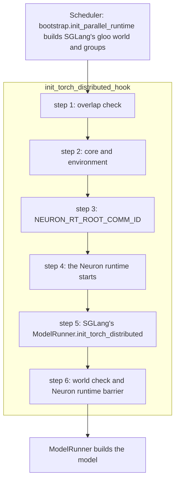

1. **Overlap check.** The scheduler's final overlap schedule must agree with the policy's `async_execution`. SGLang's
   argument passes after the platform defaults could otherwise change the schedule and leave the async executor under
   a synchronous loop, or the synchronous executor under the overlap loop.
2. **Core and environment.** The rank takes its NeuronCore (see
   [Process groups and placement](#process-groups-and-placement)) and sets its environment:

   | Variable | Value | A launch's value |
   | --- | --- | --- |
   | `NEURON_VISIBLE_DEVICES` | the server's cores, from the launch's `NEURON_RT_VISIBLE_CORES`, else the node's first cores (a plain `--dp-size` replica's own block of them) | kept |
   | `NEURON_RT_VISIBLE_CORES` | this rank's one core | overwritten |
   | `NEURON_RT_MAP_HBM` | `1` | overwritten |
   | the role's runtime defaults (below) | per role | kept |
   | `OMP_NUM_THREADS` | `1` | kept |
   | `FI_EFA_IFACE` | the EFA interface of this core's Neuron device, for the disaggregated KV transfer; a failed lookup warns | kept |
   | `NEURON_RT_INSPECT_*` | a device and system profile into `core<core>`, for local ranks in `SGLANG_NEURON_PROFILE_RANKS` | overwritten |

   torch's intra-op and inter-op pools are capped at two threads: torch sized them to the host when it was imported,
   before `OMP_NUM_THREADS` was set, and one full pool per rank oversubscribes the host many times over.
3. **Collectives bootstrap.** `NEURON_RT_ROOT_COMM_ID` is set to the CCOM root address
   ([Process groups and placement](#process-groups-and-placement)). The runtime reads it only when it starts, so it
   is set before step 4.
4. **Runtime start.** `device_io.check_streams` refuses a process whose torch-neuronx streams are off
   (`TORCH_NEURONX_ENABLE_STREAMS` not 1) and a `SGLANG_NEURON_MAX_INFLIGHT_LAUNCHES` that is not an integer of 1 or
   more. `init_neuron_ranks` (`sglang_neuron/parallel/neuron_init.py`) sets torch-neuronx's rank, world size, local rank
   and local world size from SGLang's torch world, its TP world or under PP every stage's TP ranks PP-major (normally a
   `neuron` process group does this; the plugin's groups are gloo), then starts the runtime on `neuron:<local rank>`. It
   refuses a runtime that already started, a runtime that sees more than one logical core, and a current device other
   than the rank's. A SIGTERM handler then turns the first SIGTERM into `SystemExit`, so the interpreter's normal exit
   closes the Neuron runtime; without it the devices stay open and the next server's collectives can stall.
5. **SGLang's step.** The wrapped `ModelRunner.init_torch_distributed` runs. In SGLang 43881a7 it reads the device
   memory free before the model loads, the baseline SGLang later sizes the KV pool from ([Pool size](#pool-size)).
6. **World check.** The torch world must be the one torch-neuronx was given, and a Neuron runtime barrier over the world
   confirms every rank joined the collectives bootstrap (`Neuron runtime barrier passed (rank r of n)`).

Each rank starts the Neuron runtime with its role's defaults (`runtime_defaults`) and the model's own over them (its
launch hooks' `rank_runtime_env`, catalog `launch_hooks`); a launch that sets one keeps its own value. A whole-model
megakernel (`catalog.MegakernelServing`, `ServingPolicy.megakernel`) runs every layer's collectives inside each kernel
call over all the server's ranks, the giga-kernel decode's regime, so every role it serves (aggregated, prefill,
decode) gets the giga-kernel decode's settings
([Megakernels](megakernel.md#serving-a-whole-model-megakernel)):

| Variable | Value | Roles | Why |
| --- | --- | --- | --- |
| `NEURON_RT_DISABLE_EXECUTION_BARRIER` | `1` | every role | The ranks fence at program switches instead ([The program-switch fence](#the-program-switch-fence)). |
| `NEURON_SCRATCHPAD_PAGE_SIZE` | `3584` (MB), or the model's page for the role (catalog `scratchpad_page_mb`, the serving policy's) | every role | Must match the compiler's `--hbm-scratchpad-page-size`, which the graphs compile with at the same page, except under the LNC2 contiguous scratchpad, where the runtime ignores it. |
| `NEURON_RT_IO_RING_CACHE_SIZE` | `32`; `4` on GLM-5.2's 1M decode point (its launch setting, `models/glm52/points.py`) | every role | Must stay above the in-flight bound: a step's outputs reach the host up to the bound's launches of their program later (the giga-kernel decode's result lag), so a ring no deeper than the bound could hand the host another step's bytes. The runtime's start refuses it (`device_io.check_io_ring`). |
| `NEURON_RT_XU_COMPUTE_MAX_QUEUED_REQUESTS` | `63` on a decode or a whole-model megakernel, else `32` | every role | A prefill forward is long enough that 32 queued executions cover it. |
| `NEURON_RT_DBG_VECTOR_DGE_SKIP_NOTIF`, `NEURON_RT_DBG_INTRA_RDH_CHANNEL_BUFFER_SIZE` | `1`, 80 MiB | prefill and decode, and every role of a whole-model megakernel | The DMA settings the disaggregated roles' graphs were validated with. |
| `NEURON_RT_XU_WORKER_ENABLE_LOW_LATENCY_COMPLETION` | `0` | decode, and every role of a whole-model megakernel | The runtime's polling thread competes with the scheduler for the host. |
| `NEURON_RT_DBG_CC_DMA_QOS_SERVICE_LEVEL` | `3`; `0` on GLM-5.2's decode | the giga-kernel decode, and every role of a whole-model megakernel | Its collectives run inside its one execution a step; their DMA queues get service level 3 (lower is higher), the level GPT-OSS's giga-kernel decode is measured at. GLM-5.2's decode takes the highest, 0, ahead of its weight stream, which gives a shorter step than 3 on the 128k decode (its rank hook, `rank_runtime_env`). |

### Process groups and placement

- **Cores.** The launch names a server's cores in `NEURON_RT_VISIBLE_CORES` (or `NEURON_VISIBLE_DEVICES`), a range
  list such as `32-35`, and rank i runs on the i-th; without either the server takes the node's first cores. How a
  `--dp-size` replica takes its block, with examples, is in
  [Ranks and NeuronCores](parallelism.md#ranks-and-neuroncores). A `--base-gpu-id` other than 0 and a `--gpu-id-step`
  other than 1 are refused, since they would move ranks onto other cores.
- **Collectives bootstrap.** Every rank computes the Neuron runtime's root address on its own, without a collective: the
  root host (the `--dist-init-addr` host unless it is a wildcard, else `MASTER_ADDR`, else this node's address) at port
  61234 plus the world's first core plus the launch's offset. The launching process picks the offset
  (`SGLANG_NEURON_CCOM_PORT_OFFSET`, kept if the environment already sets it): the smallest multiple of the node's core
  count, below 900, at which the root port of every core of the launch binds free on the root host. Launches on disjoint
  cores then never share a port, and a relaunch steps past a port that a dying predecessor's root still holds. No free
  offset, or a root host that is not an IPv4 address of this node, refuses the launch.
- **Torch rendezvous.** SGLang picks its distributed port by binding it once and releasing it. Another process, for
  example another server's Neuron runtime, can take the port before torch binds it, and a runtime holding the port
  accepts the connection but never answers as a TCPStore. So when SGLang's init method is `tcp://` to a loopback or
  wildcard address and no store is passed, rank 0 of each TP world binds the port itself and keeps it bound (the
  plugin's port hold, `sglang_neuron/backend/port_hold.py`; diagram below). The rendezvous file is
  `/tmp/sglang_neuron_dist_port_<port>_<key>`. Its key (`SGLANG_NEURON_RENDEZVOUS_KEY`) is fresh for every launch, so
  two servers that request one port, even two started by one script, stay apart. A `--dist-init-addr` or `--host`
  with a real address goes through torch's own rendezvous.

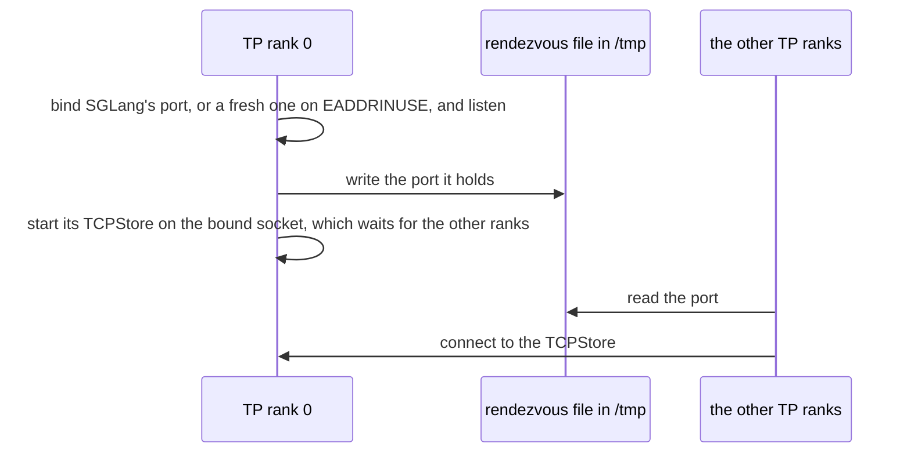

- **Groups.** The model host builds the plugin's process groups when SGLang constructs the model
  (`initialize_neuron_parallel_state`, `sglang_neuron/parallel/state.py`). Which groups exist, their cells, their mesh
  registration and the rank tensors a graph reads are in
  [The groups the plugin builds](parallelism.md#the-groups-the-plugin-builds) and
  [One program for every rank](parallelism.md#one-program-for-every-rank).
- **CPUs.** On a trn3 host the launching process leaves vCPU 2 and its hyperthread siblings out of its CPU affinity,
  which every process it starts inherits: the hypervisor takes them from time to time
  (`sglang_neuron/cpu_placement.py`).
- **NUMA.** Every role binds each scheduler to the NUMA node of its NeuronCore, read from `neuron-ls` (NeuronCore
  numbering is not PCI order), unless the launch passes `--numa-node`. An unbound scheduler's pages migrate under the
  kernel's automatic NUMA balancing, whose page faults land inside its steps' submits, and one rank's late launch holds
  up a forward's collectives on every other rank. The platform sets `--numa-node` and `SGLANG_NUMA_BIND_V2=0`, so SGLang
  binds in process through libnuma instead of re-executing the scheduler under `numactl`, which would need `numactl`
  installed. SGLang's scheduler looks its node up in the raw `server_args.numa_node`, but a platform default never
  reaches that field: SGLang publishes platform defaults into each process's runtime context instead.
  `sglang_neuron/sglang_patches/numa_node_published.py` therefore makes the lookup read the published value; without it
  every scheduler would run on every CPU of the host. torch-neuronx's own rank setup would also pin the process to its
  device's NUMA node, but only a `neuron` process group runs it. The plugin's groups are gloo and it sets the ranks
  itself ([Rank bring-up](#rank-bring-up), step 4), so CPU affinity is SGLang's alone.

## The model host and the model contract

A model joins the runtime as one package under `sglang_neuron/models/` and one catalog entry. The steps to add one, with
the served models as examples, are in [Onboarding a model](../model-dev/onboarding-models.md); this section describes
the mechanism the runtime gives every model.

### The catalog

The catalog (`sglang_neuron/models/catalog.py`) holds what the launching process must know about a model before anything
else, and imports nothing heavy, since that process reads it first. Each `ModelSpec` names the model's package, its KV
dtypes, its quantization methods, its launch settings, and whether its prefill window holds a request's cached prefix
(`prefill_holds_prior`). That flag is also a host attribute; the catalog repeats it because the serving policy, which
refuses DP attention on such a model's prefill, resolves before any model is imported. A model may also name its
logical-core degree (`logical_nc`, 2 by default), a module of its own launch rules (`launch_hooks`): its KV page for
the launch's role and layout, the launches it refuses (run in the launching process after the pipeline check) and the
runtime environment each rank of a role sets before its runtime starts (`model_executor/runtime_init.py`), and a
module of its own PD KV hand-off (`kv_handoff`), for a decode whose KV lives in its kernel's own caches
(`sglang_neuron/sglang_patches/kernel_kv_handoff.py` registers its hooks on that model's PD servers only):

| Architecture | Package | KV dtypes | Other |
| --- | --- | --- | --- |
| `GptOssForCausalLM` | `sglang_neuron.models.gpt_oss` | `fp8_e4m3` | quantization `mxfp4`; launch setting `NKILIB_EXPERIMENTAL_ATTN_TKG_NO_SWAP=1` |
| `Qwen3ForCausalLM` | `sglang_neuron.models.qwen3` | `auto`, `bf16`, `bfloat16` | |
| `Glm4ForCausalLM` | `sglang_neuron.models.glm4` | `auto`, `bf16`, `bfloat16` | |
| `Qwen3MoeForCausalLM` | `sglang_neuron.models.qwen3_moe` | `auto`, `bf16`, `bfloat16` | |
| `Qwen3_5MoeForCausalLM` | `sglang_neuron.models.qwen35` | `auto`, `bf16`, `bfloat16` | `page_sizes` 512, 256, 1024 and 2048 (512 without `--page-size`); `logical_nc` 1; a whole-model megakernel (`megakernel`, served with `--enable-nvidia-megakernel`) whose ranks plan each step from the DP-attention exchange (`dp_steps_from_exchange`) and serve async steps (`async_steps`); `chunk_state_checkpoints`; the decode's HiCache switch `SGLANG_NEURON_QWEN35_HICACHE` (`decode_hicache_env`); `pd_prefill_reposts_failed_writes` |
| `DeepseekV2ForCausalLM` | `sglang_neuron.models.deepseek_v2` | `auto`, `bf16`, `bfloat16` | `prefill_holds_prior` |
| `GlmMoeDsaForCausalLM` | `sglang_neuron.models.glm52` | `auto`, `bf16`, `bfloat16` | quantization `quark`; `logical_nc` 1; launch rules `sglang_neuron/models/glm52/launch.py`, by PD role: the prefill (PP4 x TP32, EP32, split 18,20,20,20, or PP16 x TP8, EP8, split 3 and fifteen 5s) with its point's recipe (`point_settings` in `sglang_neuron/models/glm52/prefill/recipe.py`) as its launch settings, the decode on the decode giga kernel (TP128 without DP attention, `giga_decode_dp` 1) with that kernel's static recipe and its decode point's settings (`sglang_neuron/models/glm52/points.py`, `SGLANG_NEURON_GLM52_POINT`) as its `giga_decode_launch_settings`, and the `greedy` and `topk_topp` samplers; `scratchpad_page_mb` 1344 on the prefill, the decode point's on the decode (512 at 128k, 128 at 1M); pipeline stages and compute ahead on the prefill; its KV hand-off (`kv_handoff`) `sglang_neuron/models/glm52/pd/handoff.py` |
| `KimiK3ForConditionalGeneration` | `sglang_neuron.models.kimi_k3` | `fp8_e4m3` | quantization `compressed-tensors`; `logical_nc` 1; launch setting `NEURON_SCRATCHPAD_PAGE_SIZE=512`; pipeline stages and `prefill_context_parallel` on the PD prefill; on the PD decode, `decode_context_parallel`, one declared decode layout (`decode_layouts`: `sglang_neuron/models/kimi_k3/decode/capability.py`, two nodes, TP256, eight DP-attention groups, EP256, DCP32) and the speculative algorithm `DSPARK` (`speculative_algorithms`); `chunk_state_checkpoints`; `pd_prefill_reposts_failed_writes`; upstream's Kimi-K3 attention override provider skipped (`skipped_override_providers`); launch rules `sglang_neuron/models/kimi_k3/launch.py`: the PD prefill and the PD decode only, a 128-token page on both, and the `topk_topp` sampler and the 512 MB scratchpad page as their launch settings |

The platform points SGLang's registry at the package, so a process imports only the model it serves, and a model's
kernels and launch rules stay in its own package.

### The host

SGLang builds the host class the package registers (`EntryClass`), a subclass of `ModelHost`
(`sglang_neuron/models/host.py`). Its constructor:

1. runs the model's `check_launch(config)`, which refuses a checkpoint or layout its graphs do not serve before any
   weight loads ([What a launch refuses](#what-a-launch-refuses));
2. builds the plugin's process groups for the launch's TP, EP and attention-DP sizes;
3. reads the role's phase: `all` on an aggregated server, else `prefill` or `decode`;
4. on a prefilling role, applies the chunk-grid policy
   ([One request per prefill forward](#one-request-per-prefill-forward));
5. builds the role's graphs inside `torch.device("cpu")`, both a prefill and a decode graph on an aggregated server. The
   weights then reach the device once, at the load: a graph built on the device would hold two copies at the peak and
   leave no room for the LNC2 scratchpad at the top of HBM, and the NEFF load would fail;
6. sets each graph's `lm_head.gather_output = False`, since the sampler reads each rank's vocabulary shard, and wraps
   each graph with the device sampler of the launch's mode (`SampledExecution`), except a graph that picks its tokens
   in its own forward (`samples_in_forward`, the giga-kernel decode's fused tail), which runs alone. On the host
   sampler every graph runs alone and returns its rows' logits, gathered over the vocabulary.

`load_weights` ignores SGLang's lazy iterator over the checkpoint: the first graph reads this rank's shards from the
local snapshot onto the device, buffers and parameters the checkpoint does not provide are moved to the device, and on
an aggregated server the decode graph takes the prefill graph's parameters and KV scales, so the server holds one copy
of the weights. Parameters that differ between the two graphs by name, shape or dtype are refused. A second load is
refused: the weights are not updated in place.

A host's class attributes shape its buckets and their checks ([Buckets](#buckets)):

| Attribute | Default | What it does |
| --- | --- | --- |
| `prefill_ladder` | on | Compiles the prefill tiles below the chunk too. GPT-OSS turns it off: its MXFP4 prefill graph is the slow one to compile, and its prefill servers run whole chunks of long prompts. Qwen3.5 turns it off too: its paged prefill picks its own buckets (`sglang_neuron/models/qwen35/prefix.py`). |
| `decode_context_ladder` | off | Compiles each decode batch bucket over a quarter and a half of the context too. A model turns it on once its decode attention reads only its graph's context; Qwen3, Qwen3-MoE, GLM-4 and DeepSeek-V2 do. |
| `segmented_prefill` | on | Subjects every prefill bucket to the segmented kernel's tile check. DeepSeek-V2 turns it off, since its prefill has its own MLA kernel, and so do GLM-5.2, Qwen3.5 and Kimi-K3, whose prefills run their own kernels. |
| `prefill_holds_prior` | off | Makes a prefill's bucket hold its cached prefix too. DeepSeek-V2 turns it on. |

A host can also override `neuron_compiler_args(phase, args)`, which sets each family's compiler arguments
([Compiler arguments](#compiler-arguments)). Two more seams serve a model whose decode builds its own step:

- `runtime_class` names a `NeuronModelRuntime` subclass to run the model's graphs, one that builds its steps' inputs
  itself; the GPT-OSS giga-kernel decode builds them in one numpy pass and one upload.
- `neuron_after_warmup(family, warmed_keys)` runs on every rank once a family has warmed and the SPMD check passed
  ([Warm-up and the SPMD check](#warm-up-and-the-spmd-check)), with each warmed graph's NEFF keys. The giga-kernel
  decode checks there that the DMA-order schedule its package ships fits the compiled program: the schedule's
  kernel-call scope is the program's, and enough of its constraints name the program's DMAs. The compiler arguments
  name the schedule by its content, so the program is the one compiled with it. A raise fails the launch.

### The graph contract

A graph is an `nn.Module` that takes the step's device inputs (`input_ids`, `positions`, `attn_metadata`,
`sampling_positions` and `rank`) and returns this rank's vocabulary shard of the logits of its sampled rows. It exposes
`lm_head`, `lm_head_tp_group`, `config.vocab_size`, `get_kv_spec()` (one `LayerSpec(name)` per attention layer, in the
pool's layer order), `bind_kv_cache` and `load_weights(path, device)`; the table is in
[Onboarding a model](../model-dev/onboarding-models.md). The runtime keys each layer's metadata by the name
`layers.{i}.self_attn`, so a graph's attention layers carry those names, unless the graph declares its layers itself:
`layer_names` (each layer's name, one per hidden layer in the pool's order) and `sliding_windows` (each layer's window,
None for full attention), which then replace the names and the config's `layer_types`. `NeuronModel.bind_kv_cache`
(`sglang_neuron/models/base.py`) binds each layer's K and V buffers from the pool by name; both graphs of an aggregated
server bind the same buffers.

### The model contract digest

When a runtime is built, its ranks agree on what they serve before any graph compiles
(`sglang_neuron/models/contract.py`). The layer kinds come from the graph's declaration, or else from the config's
`layer_types` (all full attention without it). A kind other than `full_attention`, `sliding_attention` or a recurrent
one (`linear_attention`, `kda`, each with its state family), a stateful kind no state spec family serves, a sliding
layer without a positive `sliding_window`, and a `layer_types` shorter than the layer count are refused; so are a
declaration of one of `layer_names` and `sliding_windows` without the other, one whose length is not the layer count,
one that names a layer twice, and a negative window. The digest covers the architecture, each layer's name, window
and state family, the head and KV-head counts, the hidden and vocabulary sizes, the graph family and the parallel
layout (TP size, attention-TP size, DP lockstep, page size, sampler mode), and the settings the model's own programs
depend on, which a host returns from `fleet_digest()` (none by default; a graph variant the model picks from its
environment, for example). The TP group all-gathers it over gloo, and a rank that resolved another layout fails with
"the model contract differs across the engine's ranks" instead of desynchronising a collective later.

## Compilation

SGLang builds its decode graph runner during `ModelRunner` start-up, after the model is built, its weights are loaded
and the KV pool is allocated. On SGLang's `cpu` device it does so whenever torch.compile is on, also on a prefill
server, so the runtime is built in that slot on every role. This page calls it the *runtime build*:

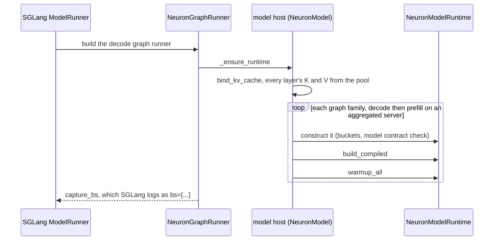

The ranks build their runtimes in the same order. SGLang's log brackets the build (`Capture target decode CPU graph
begin` and `... end. bs=[...]`). On an aggregated or decode server `bs` lists the warmed decode batch buckets. On a
prefill server it lists the batch sizes `BucketConfig` derives, for which no graph is compiled; there the warmed
shapes are the `[neuron] warm prefill` lines.

### Buckets

`BucketConfig` (`sglang_neuron/model_executor/graph_runner.py`) derives the buckets from SGLang's resolved arguments.
The context is the resolved context length (`--context-length`, else the checkpoint's) rounded up to whole tiles of 256
tokens (LNC 2 x the attention kernels' 128-token tile), over which the decode kernel splits a batch's prior.

The prefill attention of GPT-OSS, Qwen3, Qwen3-MoE and GLM-4 is the segmented prefill kernel (the host's
`segmented_prefill`). It reads a request's cached prefix in segments of a fixed KV segment tile: 512, 1024, 2048, 4096
or 8192 tokens (`SUPPORTED_KV_SEGMENT_SIZES`, `sglang_neuron/utils/bucket_utils.py`). 8192 is the most the kernel's
on-chip memory (SBUF) holds, since a segment's KV tile stays resident. The runtime uses each prefill bucket as its
graph's tile, so on such a model every prefill bucket, the chunk included, must be one of the five tiles. The kernel
compiles any other tile without an error and generates garbage, so the warm-up refuses it. `--chunked-prefill-size`
(divided by the attention-DP size under DP attention) is therefore one of the five tiles. DeepSeek-V2's MLA prefill
takes the whole request instead, and its chunk is the context.

| Family | Buckets | Rule |
| --- | --- | --- |
| Prefill (every role but decode) | the chunk, and smaller token counts | The chunk is `--chunked-prefill-size`, which SGLang divides by the attention-DP size under DP attention. Without `--cuda-graph-bs-prefill`, every KV segment tile (512, 1024, 2048, 4096, 8192) below the chunk that fits is added, so the last piece of a prompt runs the smallest graph that holds it; with it, the listed counts below the chunk. A count fits when it is a multiple of 128 and of the attention-TP size, and above the attention-TP size. A model without `prefill_ladder` (GPT-OSS) compiles the chunk alone and refuses listed counts below it. |
| Decode batch | every listed size from 1 to `max_running`, and `max_running` itself | `max_running` is SGLang's per-worker running-request limit: `--max-running-requests` divided by the attention-DP size, or without it the limit SGLang works out from the KV pool, at most half the pool's tokens either way. The listed sizes are SGLang's decode batch sizes. Without `--cuda-graph-bs-decode` or decode sizes in `--cuda-graph-config`, the platform sets them to the powers of two below the scheduler's batch and the batch itself, so a batch pads to at most twice its size; the batch is `--max-running-requests` over the attention-DP size. Without `--max-running-requests` that ladder runs up to `--cuda-graph-max-bs-decode`, and with neither flag SGLang's own decode sizes stand; the largest graph is then `max_running`. A decode under the DP identity keeps the batch alone. |
| Decode context | the context, and its half and quarter | With `decode_context_ladder` and no DP attention, each decode batch bucket is also compiled over a quarter and a half of the context (each rounded up to 256 tokens), and a step runs the smallest context that holds its longest row, since the decode attention reads its graph's whole context. Under DP attention the ranks exchange token counts, not row lengths, so the context stays whole. |

The shapes warmed are one prefill graph per token bucket, and one decode graph per batch bucket and context. The cached
prefix length is a runtime tensor, so a cold prefill and a prefix-cache hit share one NEFF. A decode server has no
prefill buckets. Without `--max-running-requests`, `max_running` is SGLang's estimate from the pool: the pool's tokens
over the context length times 512, clamped to 2048..4096 and at most half the pool's tokens. The largest decode graph
would then have 2048 rows or more on any pool of 4096 tokens or more, so a launch states the flag to bound it;
DeepSeek-V2 refuses a launch without it.

For example, the Qwen3-8B recipe ([Qwen3](../model-recipes/qwen3.md)) served aggregated with
`--tp-size 4 --context-length 4096 --chunked-prefill-size 2048 --max-running-requests 64 --max-total-tokens 266240`
compiles prefill buckets 512, 1024 and 2048, and decode batch buckets 1, 2, 4, 8, 16, 32 and 64, each over contexts
1024, 2048 and 4096. Its decode runtime warms 21 shapes and its prefill runtime 3, each logging its own `warmup done`
line, over a pool of 266240 / 128 + 1 = 2081 blocks.

### Compiler arguments

Every family starts from `COMPILER_ARGS` (`sglang_neuron/model_executor/graph_runner.py`), one argument per line:

```text
--auto-cast=none
--verbose=35
-O1
--internal-hlo2tensorizer-options=--modular-flow-mac-threshold=10
--internal-backend-options=--enable-verifier=false
--hbm-scratchpad-page-size=3584
```

The scratchpad page must exceed the largest per-layer KV buffer, because the compiler copies any variable that crosses a
page boundary, the aliased KV cache views included. `ModelHost.neuron_compiler_args` compiles the decode at `-O2`
without the modular-flow threshold, unless the decode traces the sampler's top-k (`SGLANG_NEURON_MAX_TOP_LOGPROBS`
above 0, or the `topk_topp` sampler; [Device sampling](#device-sampling)), which `-O2` miscompiles; the prefill keeps
the defaults. A host overrides the arguments for each family; a whole-model kernel's families are in
[Compiling the kernel graphs](megakernel.md#compiling-the-kernel-graphs).

torch-neuronx ignores a graph's own compiler arguments. It reads `NEURON_COMPILER_OPT_LEVEL` and `NEURON_CC_FLAGS` from
the environment at the call that compiles a graph, and both are part of the NEFF's persistent cache key. The plugin
therefore sets them around each warm-up call, under a lock, and restores the previous values afterwards
(`compile_scope`, `sglang_neuron/backend/stack.py`). The optimisation level goes into `NEURON_COMPILER_OPT_LEVEL` and
the other arguments into `NEURON_CC_FLAGS`, with two changes to torch-neuronx's defaults, each made only when the
argument list states no choice of its own:

- `--model-type=generic` is appended last, overriding the `--model-type transformer` torch-neuronx prepends: the
  transformer model type deadlocks GPT-OSS's packed-FP8 decode under DP attention, where the compiler places MoE work
  between the attention kernel's cross-core exchange and the reduce-scatter. A list that names a model type keeps it.
- `--hierarchy-splitter=false` joins the hlo2tensorizer options unless they already hold it: torch-neuronx's StableHLO
  carries the module hierarchy, which would switch the compiler to the hierarchy splitter, and the plugin's program uses
  the split finder.

What each family compiles with (`torchneuronx_compiler_env`, `sglang_neuron/backend/stack.py`). The decode drops the
modular-flow threshold, so its hlo2tensorizer options argument holds `--hierarchy-splitter=false` alone:

| Family | `NEURON_COMPILER_OPT_LEVEL` | `NEURON_CC_FLAGS` |
| --- | --- | --- |
| Prefill, and a decode that traces the sampler's top-k | `-O1` | `--auto-cast=none --verbose=35 '--internal-hlo2tensorizer-options=--modular-flow-mac-threshold=10 --hierarchy-splitter=false' --internal-backend-options=--enable-verifier=false --hbm-scratchpad-page-size=3584 --model-type=generic` |
| Decode | `-O2` | `--auto-cast=none --verbose=35 --internal-backend-options=--enable-verifier=false --hbm-scratchpad-page-size=3584 --internal-hlo2tensorizer-options=--hierarchy-splitter=false --model-type=generic` |

`build_compiled` compiles each family with `torch.compile(..., backend="neuron", fullgraph=True, dynamic=False)`
(`aot_eager` in CPU mode). `dynamic=False` keeps every bucket a static graph: dynamo would otherwise mark a dimension
dynamic after another family's call saw another size, and torch-neuronx's NKI wrapper refuses symbolic shapes. dynamo's
cache limits are lifted to hold every bucket, and torch-neuronx's eager fallback is off, so a graph whose lowering fails
raises instead of running eagerly. A decode server's graph calls differ between steps only in tensors, so its dynamo
guards keep only the tensor guards
([Dynamo guards and launch cost](async-scheduling-and-execution.md#dynamo-guards-and-launch-cost)). The compiled graph
is then wrapped by the program-switch fence where one is installed.

### Warm-up and the SPMD check

`warmup_all` runs under SGLang's grad mode, so dynamo's guards match the serving loop:

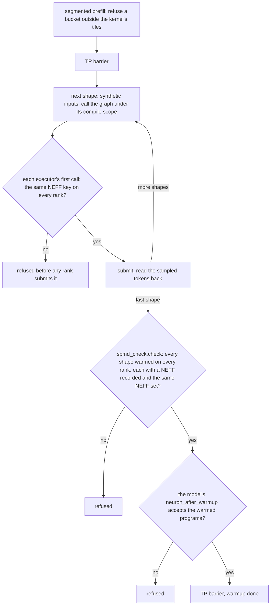

Each shape logs `[neuron] warm <kind> bucket=<n>` (with ` context=<c>` for a decode shape). Its synthetic inputs touch
only page 0 ([Page 0 and padding](#page-0-and-padding)). The sampled tokens are read back inside the compile scope, so
the first execution, the NEFF load on torch-neuronx's runtime worker, also finishes under the compiler environment that
compiled it. `[neuron] warmup done in <s>s (<n> shapes)` ends the warm-up.

Each rank lowers its graph from its own trace, and nothing in torch-neuronx checks that the ranks compiled the same
program. A rank-dependent constant reaching a trace would compile a different NEFF on one rank, whose collectives
would then hang or return wrong results. The SPMD check (`sglang_neuron/backend/spmd_check.py`) catches that by
comparing each NEFF's cache key across the TP group: the sha256 of the program's StableHLO, with its rank- and
run-dependent attributes stripped, and the compiler's version hash. The rank is a graph input (`rank`), so every rank
traces the same program.

Serving runs under `torch.compiler.set_stance("fail_on_recompile")`: a shape that was not warmed is refused instead of
compiled, since its first execution would skip the SPMD check.

### Compile caches

torch-neuronx keeps compiled programs in its persistent caches, `TORCH_NEURONX_NEFF_CACHE_DIR` and
`TORCH_NEURONX_HLO_CACHE_DIR`. A relaunch that compiles the same StableHLO under the same compiler environment finds the
same NEFFs and skips the compile. Besides the shapes and compiler arguments the flags set, two less obvious things
change the entries. The KV pool's block count is a dimension of every graph, so the cache holds across launches only
when the pool size is stable, which `--max-total-tokens` gives ([Pool size](#pool-size)). The decode graphs' entries
also depend on the path of the plugin's checkout, so a server reuses them only from the same checkout path. A server
answers `/health` only after its warm-up, so with a cold cache the first launch of a model is the long one.

A NEFF's cache key covers neither the NKI kernel sources its graph calls nor the kernel library's version, so a cache
built before a kernel changed would serve the old kernel. The first launch on an empty cache root therefore writes a
`KERNEL_SOURCES` stamp, the digest of the kernel sources (the plugin files that define or call NKI kernels, the plugin
modules a kernel's code imports, whose code runs inside its trace, and the vendored kernel copies but their Markdown),
and a launch whose kernel sources or kernel library differ is refused before its first compile, as is a non-empty root
without a stamp (`sglang_neuron/backend/compile_cache.py`). `python -m sglang_neuron.backend.compile_cache stamp <root>`
stamps a cache its operator knows this checkout's sources built.

The compiler needs no stamp: torch-neuronx keys a NEFF on the version of the neuronxcc package the process imports,
and the release compiles with the pinned neuronx-cc only (`release/neuron_sdk.toml`). That key describes the
compile only while the `neuronx-cc` first on `PATH` runs that same package, which a GLM-5.2 launch checks before it
compiles (`Toolchain.same_install` in `sglang_neuron/release/toolchain.py`). `python tools/neuron_release.py digest
--show` prints the toolchain this environment compiles with.

### The executor binding cache

torch-neuronx runs a compiled graph through its `Executor`, which prepares every input in Python on every call and
checks every mutated input's copy-back target before and after the execution. A serving graph has hundreds of inputs
(weights, KV buffers, tables), and a step changes a few. The executor binding cache
(`sglang_neuron/backend/executor_cache.py`) keeps, per executor and input position, the prepared tensor of an input that
preparation did not copy, and reuses it while the input is the same object. It skips the copy-back checks while their
objects are unchanged, and drops the tensor dumper when `TORCH_NEURONX_DYNAMO_TENSOR_DUMPS` is unset. A KV bind
invalidates it. It also hands each submit the NEFF key of the graph about to run, which the fence reads, and reports
each executor's first call to the SPMD check, which compares that executor's NEFF key across the ranks. Its wrapped
methods are pinned to torch-neuronx 149b6fca1, and another build refuses to install it, naming the method.

The giga-kernel decode also skips the layers above the executor, through a direct submit
(`sglang_neuron/backend/direct_submit.py`). Its graph serves one shape under tensor guards only, so dynamo's guards and
argument handling, AOTAutograd's wrapper and torch-neuronx's output code compute nothing on a step: the direct submit
builds the executor's inputs itself and calls the executor, whose own call runs as before. It binds over the warm-up's
call and the first serving step's, which must hand the executor the same objects apart from the step's own tensors, run
one execution, return the executor's outputs unchanged and have no Python side effect. The steps after the bind still
take the full path as shadow steps, and each must hand the executor the list the direct submit builds. From then on a
step checks its tensors against the bound ones. A step that differs takes the full call path, a failed bind or shadow
step keeps every later step on it, and a KV bind makes it bind again. It runs on a device for the giga-kernel decode
only. On another torch or torch-neuronx build, or with other guards or more shapes, it does not start and the graph
keeps the full path, with the reason logged.

## A step

SGLang builds the batch, and the runtime turns it into one launch of a compiled bucket ([Buckets](#buckets)). A decode
batch reaches the runtime through SGLang's graph-runner slot (`NeuronGraphRunner.can_run_graph`: a decode or idle batch
no larger than the largest decode bucket), and a prefill through the model's forward (`NeuronModel.forward`). Both take
the same path:

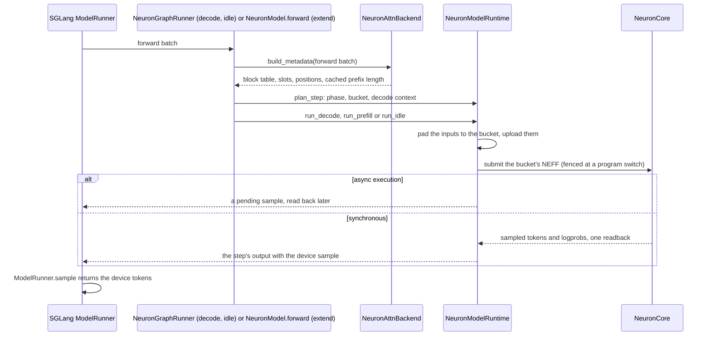

### Metadata

`NeuronAttnBackend.build_metadata` (`sglang_neuron/attention/backend.py`) builds exact, unpadded metadata on the host
from SGLang's batch: the block table `block_table[b, j] = req_to_token[pool index of b, j x 128] // 128` (int32, built
in numpy over a cached view of `req_to_token`, -1 past a request's pages in a batch of more than one), the slot of each
new token (SGLang's `out_cache_loc`), the sequence lengths and positions, and the prefill's cached prefix length. Under
DP attention SGLang pads an extend or idle batch, and the metadata is sliced back to the real sizes. SGLang's
`init_forward_metadata` hooks build nothing, since the runtime builds the metadata itself, and the backend's attention
methods raise, since the graphs run attention.

### Picking the bucket

`plan_step` picks the step's phase, bucket and decode context:

- A decode takes the smallest batch bucket that holds its rows and, with a context ladder, the smallest context that
  holds its longest row.
- A prefill takes the smallest token bucket that holds its new tokens, or, for a model whose prefill window holds the
  prior (DeepSeek-V2), its new tokens and its cached prefix.
- Under DP attention every rank must run the same graph, so the bucket is chosen from the largest token count of any
  DP group, which SGLang gathers each step, and the phase from SGLang's synced `is_extend_in_batch`. A rank without
  requests runs that graph on a dummy batch. Under the DP identity the decode bucket is a constant and nothing is
  exchanged.

### Inputs

`build_model_inputs` pads the metadata to the bucket. A prefill takes one request: its token ids are zero-padded, its
positions padded with the last position, its slots padded with 0 (so padded tokens write page 0), and its block table is
the context's width (plus one chunk of -1 columns on the chunk grid). A decode pads its rows: padded rows get slot 0 and
a block table whose column 0 is page 0, so each has one valid key, since a fully masked row would fault the decode
kernel. Under async execution a decode's graph takes no host `input_ids`. It reads the previous step's device token
vector, and a `token_control` input names, for each row, the entry of that vector to take or a host token id to use
instead. The graph returns a fixed width of tokens, the largest batch bucket
([Fixed-width decode token I/O](async-scheduling-and-execution.md#fixed-width-decode-token-io)).

A prefill's token ids, positions, slots, block table, cached prefix and sampling position go up in one upload (in a
sampled mode its sampling inputs follow, one upload each). A decode's block table, its sliding-window tables and its
sampling inputs are staged: the device copy is reused while the value is unchanged, and a changed value gets a fresh
device tensor, never an in-place write, since a queued graph may still read the old one. Each attention layer gets its
metadata by name: the block table, slots, page size, the table width, the cached prefix and the KV segment size, plus a
trimmed table and a position offset for a decode's sliding-window layers
([Sliding-window layers](#sliding-window-layers)).

### Launch and results

The launch waits for the oldest launch while `SGLANG_NEURON_MAX_INFLIGHT_LAUNCHES` launches are in flight, then
calls the compiled graph. The plugin's submit wrap (`sglang_neuron/backend/device_io.py`) runs right before
torch-neuronx's `execute_compiled_graph`. Inside a fenced model call it first runs the program-switch fence. It then
makes the default stream, which runs the graphs, wait for the uploads this thread queued on torch-neuronx's side stream
(at a program switch the fence has ordered them already, before its meeting). The side stream carries the host copies,
so that no copy sits between two graphs ([Two streams](async-scheduling-and-execution.md#two-streams)). Under async
execution the step returns a pending sample, read back later
([Reading a step's outputs](async-scheduling-and-execution.md#reading-a-steps-outputs)). Otherwise the host reads every
output in one readback, and a step whose sampled ids hold a negative id, or one at or above the checkpoint's vocabulary
size, is refused, never emitted. The `ModelRunner.sample` hook then returns the graph's tokens, logprobs and top
logprobs instead of running SGLang's sampler. On the host sampler the one output is the logits, read back and handed to
SGLang's sampler ([The host sampler](#the-host-sampler)).

### Device sampling

The graphs sample on the device (`sglang_neuron/sampling.py`). Each rank reads its vocabulary shard of the logits, and
one all-gather over the LM head's group carries each shard's best candidate and its log-normaliser. Under `greedy` and
`temperature` it also carries the shard's top-logprob candidates, if any. Under `topk_topp` it carries instead the
shard's top 256 logits and their token ids, the filter pool, from which the top logprobs are also taken: 5 + 2 x 256
values per row and shard. Token ids travel as float32, so the vocabulary must be smaller than 2^24.
`SGLANG_NEURON_SAMPLER` picks the mode for the whole launch:

| Mode | Draw |
| --- | --- |
| `greedy` (default) | The exact argmax. A sampled request is refused at admission. |
| `temperature` | An exact draw from `softmax(logits / T)` over the whole vocabulary (Gumbel-max). Top-k, top-p and min-p are refused at admission. |
| `topk_topp` | `temperature` plus SGLang's top-k, top-p and min-p filters, over a pool of the global top 256 tokens; a larger nucleus is truncated to the pool, and a top-k above 256 is refused. |

A draw's noise is a function of the request's seed, the token's position and the token id, so it is the same on every
rank and does not depend on the request's row in the batch or on the vocabulary sharding. A request's seed is its
`sampling_seed`. Without one, the plugin's `SamplingBatchInfo.from_schedule_batch` hook fills in a hash of its request
id (`request_seed`). The copies of a seeded sampled request with `n` above 1 would draw identical tokens, so such a
request is refused ([At admission](#at-admission)).

Ties go to the smallest token id through max and min reductions, since the Neuron lowering of an index-returning max
does not return the first index. The device sampler never calls `torch.topk` on a device tensor either, since that
lowering returns wrong candidates after an all-gather. Its top-k runs one of two ways:

- The top-logprob candidates of the `greedy` and `temperature` modes are an exact reduction, k rounds of the same max
  and min reductions (`_exact_topk`).
- The `topk_topp` pool, and the top logprobs taken from it, run nkilib's rotational top-k kernel where it takes the
  shape, else the exact reduction (`_pool_topk` in `sglang_neuron/sampling.py`, over the kernels of
  `sglang_neuron/sampling_topk.py`). The pool's logits are fp32, which keeps it off GpSIMD's `nisa.topk`: that kernel
  hangs when it shares a NEFF with the sampler's vector work.

Every graph computes `SGLANG_NEURON_MAX_TOP_LOGPROBS` top-logprob candidates per row, a width fixed when the graph
compiles, so the variable is a launch setting and a request that asks for more is refused at admission. `-O2`
miscompiles the sampler's top-k, so a decode that traces it (top logprobs above 0, or the `topk_topp` sampler)
compiles at `-O1` ([Compiler arguments](#compiler-arguments)).

Logprobs follow SGLang's sampler: of `softmax(logits / T)` for a sampled row, of the raw logits for a greedy row, and of
the raw logits for every row under `SGLANG_RETURN_ORIGINAL_LOGPROB`.

### The host sampler

`SGLANG_NEURON_SAMPLER=host` samples on the host with SGLang's own sampler. Each graph runs without
`SampledExecution`, its LM head gathered over the vocabulary group, and returns its sampled rows' logits; the step reads
them back as `next_token_logits`, and the `ModelRunner.sample` hook hands them to SGLang's sampler. That serves
penalties, `min_new_tokens`, logit bias, custom logit processors, any top-k, top-p and min-p, output-token logprobs, any
number of top logprobs and token-ID logprobs. The platform keeps SGLang's grammar backend here (xgrammar by default),
so `json_schema`, `regex`, `ebnf` and `structural_tag` are served too: SGLang applies each constrained row's bitmask to
the logits on the host with xgrammar's CPU kernel. Admission refuses only beam search, prompt logprobs and a sampled
request's `sampling_seed` ([At admission](#at-admission)): SGLang's sampler reads seeds only under
`--enable-deterministic-inference`, which Neuron refuses, so it would draw unseeded. The plugin's seed hook stays off
for the same reason, since SGLang would take the seeds it fills in as a request for a seeded draw.

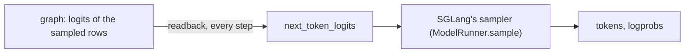

Every step waits on the host for its logits before SGLang samples, so there is no token to run ahead on, and the
launch runs without async execution. `platform.check_host_sampler` refuses a host-sampler launch:

- without `--disable-overlap-schedule`, which is how a launch turns async execution off;
- with `--pp-size` above 1: a pipelined role runs asynchronously, and its decode relays sampled tokens on the device;
- on a decode with DP attention, whose DP identity needs async execution ([The serving policy](#the-serving-policy));
- with `SGLANG_NEURON_MAX_TOP_LOGPROBS` above 0, the device sampler's width (SGLang's sampler returns as many as asked);
- with `--enable-strict-thinking`, whose thinking mask xgrammar applies through a backend-level kernel that takes
  device logits only (`XGrammarGrammarBackend.apply_vocab_mask`).

Both grammar masks are pinned (`platform._HOST_SAMPLER_SOURCES_MD5`): a request grammar's `apply_vocab_mask` for its
CPU branch, and the backend-level one for having none. The giga-kernel decode, whose fused tail returns tokens, takes
the greedy sampler only, and the contract digest carries the sampler mode, so every rank of an engine runs the same one
([The model contract digest](#the-model-contract-digest)).

### One request per prefill forward

A prefill graph takes one request's chunk. The plugin's `PrefillAdder` hooks stop a pass after its first request and
admit nothing beside a chunked request. They preempt running requests only for a request the pass then admits, since
a preemption for a refused request would only make the preempted requests recompute.

On a prefilling role with the radix cache on or chunked prefill enabled, the forwards also stay on the chunk grid
(`sglang_neuron/sglang_patches/prefill_chunk_grid.py`). Upstream's `PrefillAdder` cuts a forward wherever its token
budget runs out. On the grid every forward but a prompt's last is exactly one chunk, and none is longer, since the
chunk is the largest prefill bucket. A cold prompt runs one compiled tile per chunk, `[0, C)`, `[C, 2C)` and so on,
and a prefix-cache hit at page m runs `[m, m + C)`, `[m + C, ...)`. Every forward's cached prefix thus stays a whole
number of pages, the only prefix the segmented kernel takes.

The grid sets SGLang's truncation alignment to the chunk. SGLang's deterministic inference sets the same alignment, so
the scheduler refuses `--enable-deterministic-inference` wherever the grid is kept. SGLang already refuses that flag
at launch ([At the platform defaults](#at-the-platform-defaults)), so this is a second guard.

With SGLang's default radix tree the prefill's block table carries one chunk of extra -1 columns. The segmented kernel
reads a forward's own blocks right after its prior and pads the table only to the next multiple of the chunk, so a hit
whose prior lies within a chunk of the context's end would otherwise read columns that do not exist. On the
chunk-keyed tree (`--radix-cache-backend neuron-chunk`, [Prefix (radix) cache](#prefix-radix-cache)) every prior is a
whole number of chunks, the kernel's own pad covers the read, and the table keeps the context's width, so the prefill
compiles a graph of its own. A streaming session is refused on every prefilling role, since a streaming turn resumes at
the previous turn's whole KV, which is off the kernel's block grid.

## The program-switch fence

An aggregated server alternates its prefill and decode programs, and the collectives of both use the runtime's shared
collective buffers and semaphores. A rank that starts one program while a slower peer still runs the other corrupts the
peer's logits and KV. The Neuron runtime's per-execution barrier covers synchronous submission only, and torch-neuronx
submits every execution asynchronously, so each rank starts the runtime with that barrier off
(`NEURON_RT_DISABLE_EXECUTION_BARRIER=1`, unless the launch sets it) and the ranks fence instead
(`sglang_neuron/model_executor/program_fence.py`).

The fence is installed once per process on an aggregated server, and on any role whose runtime warms more than one
shape: a dense model's prefill tiles, or a decode's batch and context buckets. A prefill or decode server whose runtime
has one program never installs it; GPT-OSS's prefill server (the chunk alone) and its DP-attention decode server (one
batch bucket, the whole context) are such servers. On an aggregated server every runtime is fenced, one-program
runtimes included.

Right before a model execution is submitted, the executor binding cache hands the fence its NEFF:

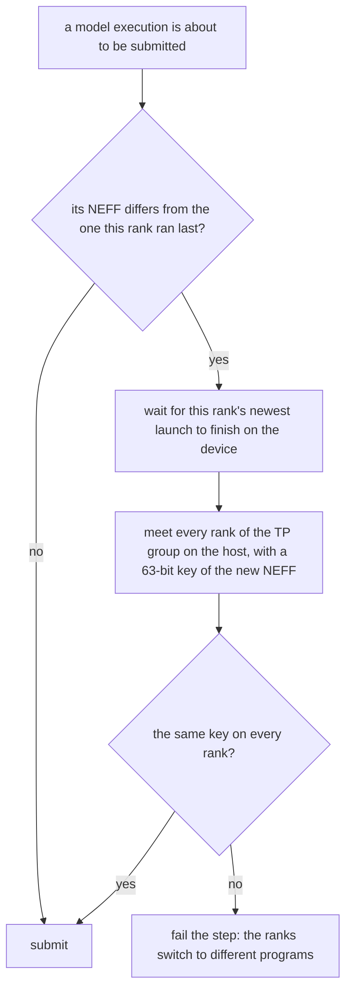

The meeting goes through the node's shared memory where the node supports it, else through a gloo all-reduce of
`[key, -key]` with MAX, which gives every rank the largest and the smallest key. Ranks about to switch to different
programs therefore fail the step instead of running against each other's collectives. Steady decode, one program step
after step, never fences. Only the runtimes' compiled graphs count; torch-neuronx's eager kernels carry no
collectives. Warm-up executions are model calls too: the fence wraps the compiled graph before the warm-up, so the
ranks also meet between consecutive warm-up shapes. The log reports the first 16 fences and every 100th after them,
with the device-sync and meeting times, so the first fences it reports are the warm-up's.

The device is idle from the old program's end to the new one's start, so the fence keeps the rest of the submit off
that stretch:

- **Order.** The fence's hook runs ahead of every other pre-execute hook. On a PP stage after the first, the drain and
  the meeting therefore overlap the wait for the previous stage's boundary (the seam's landing hook, which does not
  touch the collective buffers) instead of following it, and the landing wait comes after the meeting.
- **Uploads.** Between its sync and its meeting the fence makes the default stream wait for the step's uploads
  (`device_io.wait_uploads`), so the submit finds nothing left to order and only the submit follows the meeting.
- **Polling.** The sync and the shared-memory meeting poll for up to `SPIN_S` (2 ms) without sleeping, yielding the
  core between polls (`device_io.spin_until`), and block only after it: a thread woken from a sleep or a blocking wait
  goes through the run queue. A steady decode almost never switches; a prefill whose prompts move between its chunk
  shapes can switch at about every other execution.

The host trace gets each switch's `fence` row ([The host trace](../guides/profiling.md#the-host-trace)).

## KV cache

The KV cache is SGLang's paged KV cache with Neuron pools: SGLang keeps the token-to-slot bookkeeping on the host, and
the plugin's pool holds the K and V on the NeuronCore in the layout the attention kernels read.

### Pages

A page is 128 tokens, unless the model declares its own pages or its launch rules give one
([How a launch resolves](#how-a-launch-resolves), step 5): a launch without `--page-size` gets that page, and any other
page size is refused. The 128-token page holds a sliding layer's whole window, as the fused sliding-window prefill
kernel needs, and it is one kernel block, so the kernels read SGLang's pages through the block table the metadata
builds. The pool holds SGLang's `max_total_num_tokens`
slots, a whole number of pages, plus page 0, which SGLang reserves and never allocates: `max_total_num_tokens / 128 + 1`
blocks.

The KV dtype is the model's (`ModelSpec.kv_cache_dtypes`): GPT-OSS takes only `fp8_e4m3` (`torch.float8_e4m3fn`), the
other models `auto`, `bf16` or `bfloat16`. The MHA pool stores an fp8 cache in the real float8 dtype rather than
SGLang's uint8 (the same bytes), since the kernels take the raw buffers.

### The MHA pool

`NeuronMHATokenToKVPoolKind` (`sglang_neuron/mem_cache/memory_pool.py`) is SGLang's MHA pool kind, which SGLang requires
to subclass `MHATokenToKVPool`; its constructor never runs `MHATokenToKVPool`'s, and its storage is its own. Per layer,
K and V are `[num_blocks, kv_heads, 128, head_dim]` on the rank's device: a page holds its heads contiguously, heads
outermost. The pool reports `kv_head_major`, so a disaggregated KV transfer between servers of different attention-TP
sizes slices a page by head ([The KV layout across the wire](disaggregated-inference.md#the-kv-layout-across-the-wire)).
For that transfer the pool reports device addresses (on torch-neuronx a tensor's `data_ptr()` is not its device address)
and one page's bytes per item, in SGLang's order, every layer's K then every layer's V.

A model that takes every layer's cache in one kernel call declares paired layers while it is built
(`sglang_neuron/model_executor/kv_layout.py`), before SGLang builds the pool. The pool then allocates layers 2j and
2j + 1 as the two halves of one K tensor and one V tensor of twice the blocks, and keeps the pairs (`layer_pairs`) for
the model to bind; the model that declares the pairing refuses an odd layer count before the pool exists. Each layer's
buffer is the contiguous view of its half, so every per-layer path, the transfer's registration among them, sees the
pages it sees in an unpaired pool. The GPT-OSS giga-kernel decode is the one model that declares it.

Only the graphs write the cache, so the pool's `set_kv_buffer` raises. The pool refuses what its layout does not have:
host copies of the KV other than HiCache's (host offload and host-pool retraction backup; `get_device_pool_infos`
describes the per-layer K and V tensors for the HiCache host pool); every other `MHATokenToKVPool` method,
each raising with its own name; the options for post-capture sizing, a KV quantization method, another cache layout and
speculative KV copies; and a V or sliding-window head dim other than the K head dim.

### Packed FP8 K

An fp8 cache stores K packed: `[num_blocks, kv_heads, 64, head_dim, 2]`, two consecutive tokens per bf16-sized slot,
with V unpacked. The nkilib qkv, segmented-prefill and decode kernels take fp8 KV only in this layout. The decode kernel
shrinks a page so that a row's pages tile its partitions (`resize_block_len`,
`sglang_neuron/ops/attention/attention_decode_mask.py`). Since the packed layout holds token pairs, the kernel reads
the packed cache directly only where the shrunk page keeps at least two tokens (`packed_fp8_viable_for_bucket`,
`sglang_neuron/ops/attention/attention_decode.py`). Otherwise it would unpack and repack each full layer's whole pool
on every step, and on a disaggregated decode it would write that stale copy over KV that a transfer had just landed. A
context of whole 512-token tiles (2 x LNC x 128) keeps every decode bucket viable. GPT-OSS therefore refuses a
`--context-length` that, rounded up to 256 tokens, is not a multiple of 512, and the sliding-window tables align to
the same tiles.

GPT-OSS reads its KV scales from the checkpoint's `k_scale` and `v_scale` (1 where the checkpoint has none) and inverts
them, since the decode kernels quantize by multiplying; the prefill kernels quantize by dividing and get the inverse
back, so both write the same bytes. An aggregated server's decode graph shares the prefill graph's scales.

### The MLA pool

DeepSeek-V2 uses SGLang's MLA pool, `NeuronMLATokenToKVPool`, with its buffers on the NeuronCore: per layer
`[size + 128, 1, kv_lora_rank + qk_rope_head_dim]`, one compact row per token slot, page 0 reserved. The MLA kernels
read the rows by slot, and a disaggregated transfer moves whole pages of rows, reported as device addresses with one
page of rows per item. The pool refuses its own writes, host copies, host pools, and the options `use_dsa`,
`override_kv_cache_dim` and `dcp_replicated`.

The same pool serves an FP8 latent and DCP, standalone or as the leaf of SGLang's hybrid linear-attention pool:

- `--kv-cache-dtype fp8_e4m3` is stored as uint8, as upstream stores it; `get_block_buffer` gives a layer's rows as
  blocks `[pages + 1, 128, kv_lora_rank + qk_rope_head_dim]` of those bytes, which a kernel reads as float8_e4m3fn.
- Under DCP the pool carries its rank's placement (`dcp`), as the MHA pool does, so the attention metadata localizes
  slots and the allocator checks SGLang's widened size; on the hybrid pool both read its leaf.
- A model that declares `KVLayout.zero_fresh_pages` (for kernels that read whole blocks past a sequence's end) gets
  each page zeroed on every layer as the paged allocator hands it out, in eager fills of 64 page ids, one compiled shape
  warmed when the pool is built. Page 0 is zero at build and stays zero only if nothing writes slot 0, which the
  model's own write slots decide. The pool takes the allocator's zero-page contract with `zero_policy` on_alloc
  (`mem_cache/allocator.py`): the fill runs as pages are handed out, not as they are freed, and waits for the HiCache
  loads in flight (an eager fill rewrites more of the layer buffer than its pages, and a load writes that buffer by
  DMA). A PD decode refuses on_alloc: its pages receive KV over NIXL, which the device does not order behind an eager
  fill. Without the declaration the pool declares no policy and nothing zeroes its pages.
- PD: a standalone pool names its entries' global layers (`get_kv_layer_ids`, published by
  `sglang_patches/pd_kv_layer_ids.py`); the hybrid pool's own ids are upstream's.

### The recurrent-state pool

A model with recurrent-state layers (KDA, GDN, Mamba-2) declares its state (`mem_cache/state_spec.StateSpec`: the
global state layers and each per-slot component) and names its pool class, `NeuronModel.state_pool_class =
NeuronStatePool.bind(spec, ops)`, before SGLang builds the pools; `ops` are the model's kernel slot operations
(`mem_cache/state_ops.StateOps`, eager torch by default). SGLang keeps its own bookkeeping: `HybridReqToTokenPool` maps
requests to state slots, its slot allocator hands them out, the radix cache owns checkpoint slots, and the PD connector
registers and sends the state. `sglang_patches/state_pool_class.py` hands the model's class to every request table its
configurator builds, and drains the pool's pending operations before SGLang's state storage resets its slots.

`NeuronStatePool` (`mem_cache/state_pool.py`) is an upstream `MambaPool` whose tensors live on the NeuronCore,
`[state layers, size + 2, *per-slot shape]`: slot 0 is upstream's padding slot, a trailing sink takes a padded bucket's
writes, and upstream's view covers slots `[0, size]`. The per-slot shapes, dtypes, slice axes and shard groups are
upstream's (a KDA conv window `[K - 1, channels]`, the temporal dtype from `--mamba-ssm-dtype`), so its PD entries are
the ones upstream's pool publishes, with device addresses, and SGLang slices them between attention TP sizes as it
slices its own. It refuses a kernel-layout component, upstream options it does not implement, layers the model did not
declare, cache parameters of another shape or dtype, and a radix cache whose checkpoints the kernel cannot make exact
(`mem_cache/state_checkpoint.py`).

### Page 0 and padding

Page 0 absorbs everything that is not a real request's KV. A prefill's padded tokens write slot 0, and a decode's padded
rows write slot 0 and read block 0 at column 0. Warm-up and an idle DP rank's dummy steps write only slot 0 and read
only block 0; a decode dummy reads a live context of 1024 tokens laid over block 0 and -1 after it, since a one-token
context makes an idle rank's dummy step slower than the real ranks' steps, which all wait for it.

### Sliding-window layers

On one KV pool (`--disable-hybrid-swa-memory`, and wherever [Hybrid SWA memory](#hybrid-swa-memory) is not served) a
sliding layer holds its request's pages like a full layer. A decode's sliding layers read a table trimmed to their
window: the window's W - 1 prior keys and the active token's page span `ceil((W - 1) / 128) + 1` columns, rounded up to
whole 256-token tiles (512 with the packed FP8 K cache) and capped at the table's width. Each row's trimmed table starts
at column `max((seq_len - 1) // 128 - columns + 1, 0)`, carries -1 past the table's width, and comes with the position
offset of its first column (`swa_kv_pos_offset`). For a 128-token window with the packed cache that is 4 columns, 512
tokens. A prefill's sliding layers take the whole table, and the kernel masks the window.

#### Hybrid SWA memory

Hybrid SWA memory, SGLang's default for a model with sliding-window layers, keeps the sliding layers' KV in a window
pool of its own (`mem_cache/hybrid_swa.py`). A sliding layer reads at most its last W keys, so the window pool holds
each running request's window and SGLang frees the pages behind it as the request moves on
(`ScheduleBatch.maybe_evict_swa`, every `SGLANG_SWA_EVICTION_INTERVAL` tokens); the full layers keep every token. For
GPT-OSS at 8,192 tokens a request needs about half the KV. The platform keeps this default where it is served (on the
chunk cache, below) and turns `--disable-hybrid-swa-memory` on elsewhere, logging why for a model that declares it.
Under a radix tree it runs only in its radix mode, `SGLANG_NEURON_HYBRID_SWA_RADIX=1`.

SGLang builds it from the platform's classes: `SWAKVPool` over two Neuron block-layout pools
(`get_kv_pool_cls(kind="mha")`) and `SWATokenToKVPoolAllocator` over two Neuron paged allocators
(`get_paged_allocator_cls`), driven in lock step. The model binds each layer's buffers by layer id
(`SWAKVPool.get_kv_buffer`), so a sliding layer gets the window pool's. SGLang's scheduler and the attention metadata
still address KV by full-pool slot, so `build_model_inputs` translates a sliding layer's inputs through the allocator's
`full_to_swa_index_mapping` before each launch:

- its slot mapping, slot by slot (padding writes slot 0, which maps to 0);
- its block table, page by page: the allocator takes a window page with every full page at the same in-page offsets,
  so a page translates by its first slot. A page behind the window, already freed, maps to the reserved page 0, which
  the window mask never reads. A decode translates its trimmed table, a prefill the whole table (a second chunk reads
  its first window of keys from the window pool).

The translated slots go up in the step's one upload, and a decode's translated table is staged like the plain one.

It is served on an aggregated server of a model that declares it (`catalog.ModelSpec.hybrid_swa_memory`: GPT-OSS),
with chunked prefill: on the chunk cache, pipelined or not, and in the radix mode on the radix cache, unpipelined. Each
stage of a pipelined server builds its own layers' pools and binds them by global layer id
(`NeuronModel.bind_kv_cache`, from the stage's start, since `SWAKVPool` keeps `start_layer` 0), and every stage sizes
its pools alike from the synced token count (`sglang_patches/pp_pool_resolve.py`), so the stages run out of window
pages together.

On the chunk cache with `--max-running-requests`, SGLang sizes the window pool for its worst case
(`SWARequestCapPoolConfigurator`); otherwise it gives it `--swa-full-tokens-ratio` of the full pool's tokens. Either
way the runtime proves at step 0 that the pool holds the most the running requests can keep in it at once
(`check_window_pool`), so none is ever retracted for want of window pages, and refuses a smaller pool, naming the
ratio that fits. A request keeps what its frees leave behind its position (a window on the chunk cache, whole pages of
`max(window, page)` under a tree), plus the eviction interval, a page of rounding and its next decode page, and under a
tree the window of the checkpoint it matched. Each prefill chunk in flight holds a chunk: one, two under the overlap
schedule, and one per micro-batch on a pipelined server (SGLang's cap counts one; `pp_pool_resolve` counts the
micro-batches). For GPT-OSS's 64 requests at page 128 that is 49,280 tokens on the chunk cache (SGLang's own cap) and
65,664 on the radix cache, against a full pool of 655,360.

A prefill chunk after earlier ones, or over a cached prefix, reads its window prior (the window of keys before its
first query) from the window pool. SGLang keeps it: a chunked request frees window KV only behind its window, and the
tree ends a match only where a window of live window KV lies behind it, which the request locks. The runtime still
checks every key of that prior before the launch, and raises rather than let the kernel read the reserved page as KV.

##### The radix mode

Under a radix tree hybrid SWA memory changes what the prefix cache hits, so it is opt-in:
`SGLANG_NEURON_HYBRID_SWA_RADIX=1`. The window pool keeps a request's window KV only behind the tree's inserts (one at
each chunk boundary, and the finish insert of the whole prompt); an insert of n tokens frees the window KV below
`page_floor(n - 1 - 128)`. The tree hits only where a window of live window KV lies behind the hit, so a hit is the
last such checkpoint in the shared prefix's whole pages, or none, where one pool hits at the page floor. For a
10,222-token prompt in GPT-OSS's 8,192-token chunks (checkpoints at 8,064, 8,192 and 10,112):

| Shared prefix | One pool | Radix mode |
| --- | --- | --- |
| 128, 256, 4,113 | 128, 256, 4,096 | none |
| 8,191 | 8,064 | 8,064 |
| 8,192, 8,193 | 8,192 | 8,192 |
| 8,337 | 8,320 | 8,192 |
| the whole prompt again | 10,112 | 10,112 |

So a shared system prompt shorter than a chunk hits nothing in the radix mode, while a conversation's next turn still
hits at the previous turn's finish insert. `sglang_patches/finish_swa_frontier.py` frees a finished request's window
pages behind its window before its insert, as SGLang does for an unfinished one; otherwise a request that finished in
its prefill would insert its whole prompt as live window KV, which a later request matching inside it would lock.

These launches run one pool and refuse the radix mode, naming every reason:

| Launch | Why |
| --- | --- |
| `--disable-hybrid-swa-memory` | The flag asks for one pool. |
| A model without `hybrid_swa_memory` | Its graphs read no translated tables. |
| A PD prefill or decode | SGLang's window-state transfer slices a page between attention TPs per token, as if token-major, while Neuron pages are head-major (`sglang_patches/nixl_head_major.py` adapts the KV pages only). |
| The radix cache without the radix mode | The window tree hits a shared prefix only at its window checkpoints (above). |
| The radix mode on a pipelined server | No run covers it. |
| A pipelined server with a stage that holds no sliding-window or no full-attention layer (`SGLANG_PP_LAYER_PARTITION`) | SGLang sizes a stage's pools by the kinds of layer it holds, so that stage would not match the others' counts. |
| `--enable-hierarchical-cache` | The Neuron host pool mirrors one KV pool. |
| `--radix-cache-backend neuron-chunk` | The chunk-keyed tree keys a plain KV pool only. |
| `--chunked-prefill-size` 0 or below | An unchunked prompt keeps all its window KV until its prefill ends (and a chunk SGLang resolves off later is refused at step 0). |
| The radix cache with `SGLANG_OPT_UNIFIED_CACHE_FREE_OUT_OF_WINDOW_SLOTS` off | The tree would keep a chunked prefill's whole window KV, which the sizing does not count. |

The SGLang sources the layout relies on are md5-pinned at launch: the pool's build, layer routing and translation; the
allocator's lock-step allocation, mapping writes and frees through the mapping (which reset it to 0); the window frees'
rule; and the sizing's choice and request cap.

### Pool size

SGLang sizes the pool from the device memory. The plugin reads that as the device's memory over its logical cores
(from `neuron-ls`, under the launch's logical core degree) minus the bytes this process's runtime holds, the minimum
over the ranks of the group SGLang passes. SGLang keeps `(1 - --mem-fraction-static)` of the memory that was free
before the weights loaded outside the pool. On Neuron that slack holds what the runtime loads after the pool at
warm-up: every bucket's NEFF and its scratchpad.

The pool's block count is a dimension of every compiled graph, so a pool sized from each launch's reading would compile
each launch's own graphs. The plugin's hook around SGLang's `KVCacheConfigurator._apply_token_constraints` therefore
makes `--max-total-tokens` the pool's size:

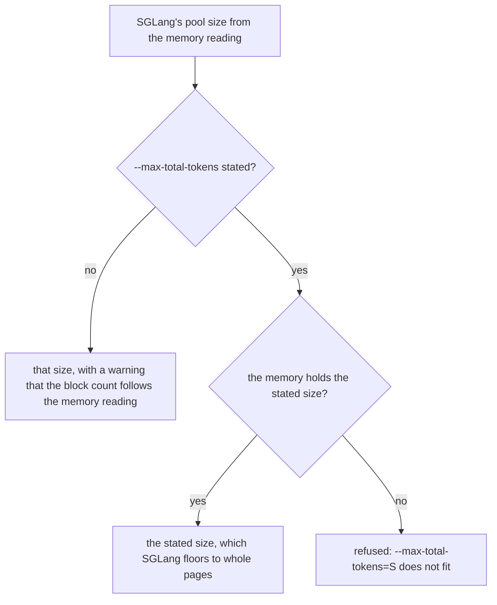

The refusal reads "--max-total-tokens=S does not fit: the device memory holds a KV pool of T tokens"; SGLang itself
would only warn and use the smaller size. The MHA pool logs its geometry:
`Neuron KV pool: layers=... blocks=... page=128 kv_heads=... head_dim=... dtype=... (... GB)`. The MLA pool logs
SGLang's own `KV Cache is allocated` line.

A model host that builds its own pools defines `configure_kv_cache(configurator, pre_model_load_memory=...)`, which
the plugin calls instead of SGLang's `KVCacheConfigurator.configure` (GLM-5.2's host does). It returns SGLang's
`KVCacheConfigResult`. The plugin refuses a pool that is not the platform's (`NeuronMHATokenToKVPoolKind`,
`NeuronMLATokenToKVPool`), an allocator other than `NeuronPagedTokenToKVPoolAllocator`, and a size other than the
stated `--max-total-tokens` floored to whole pages: the runtime binds the pool's buffers in the kernels' block layout,
and the allocator holds a freed page until the launches that read it have run ([The allocator](#the-allocator)). Every
rank must build the same size, as SGLang does by taking the minimum over the ranks, or the ranks compile different
graphs and the SPMD check refuses them.

A layer's K or V buffer must also stay below the 3584 MB scratchpad page; past it the compiler copies the buffer
instead of aliasing it ([Compiler arguments](#compiler-arguments)). In the MHA pool that buffer is blocks x the rank's
KV heads x 128 x head dim x the dtype's size. Nothing refuses a larger buffer, so `--max-total-tokens` is what keeps it
below the page.

### The allocator

`NeuronPagedTokenToKVPoolAllocator` (`sglang_neuron/mem_cache/allocator.py`) is SGLang's paged allocator with every
behaviour kept (page alignment, page 0 reserved, the partial-page contract of `last_loc`, free groups and staged free
pages) and three host-side fast paths on the scheduler's critical path:

- **Extend.** The slots are worked out per request from the lengths' host copies: a request first fills its prefix's
  last page from `last_loc + 1`, then takes whole pages from the free list in order. SGLang's `alloc_extend_naive`
  builds and indexes some twenty tensors as long as the extend.
- **Decode.** A one-row batch's new-page count is read on the host; other batches use SGLang's count, then SGLang's
  `alloc_decode_naive`.
- **Free.** `page_heads` (`sglang_neuron/mem_cache/page_set.py`) turns a freed slot index into one slot per touched page
  with a bitmap, in O(n + pages), and hands that to SGLang's own `free`. SGLang would sort the index with
  `torch.unique` on one host thread, which every free pays and which, with many requests at a large page, can outlast
  a decode step. The fast path applies to a CPU integer index of at least `max(4096, pages / 8)` slots within the pool;
  any other index goes to SGLang unchanged. Its callers are request finish, radix eviction and the disaggregation frees.

On a prefill or decode server SGLang stages freed pages (`need_sort`) and returns them to the free list only when an
allocation runs short. A request can finish while steps that hold its row are still on the device (one step, or the
in-flight bound's worth under the giga-kernel decode's result lag), and they still write into its pages. On a decode
server a page's next owner can be a request whose KV arrives over NIXL, which the device does not order after those
steps ([Freed KV pages](async-scheduling-and-execution.md#lifetimes-while-launches-overlap)). So on a decode no
staged page goes back before every launch that may touch it has finished (a prefill's go back as upstream's do, since
there the next owner's KV is written by its own forward, which the device runs after those steps):

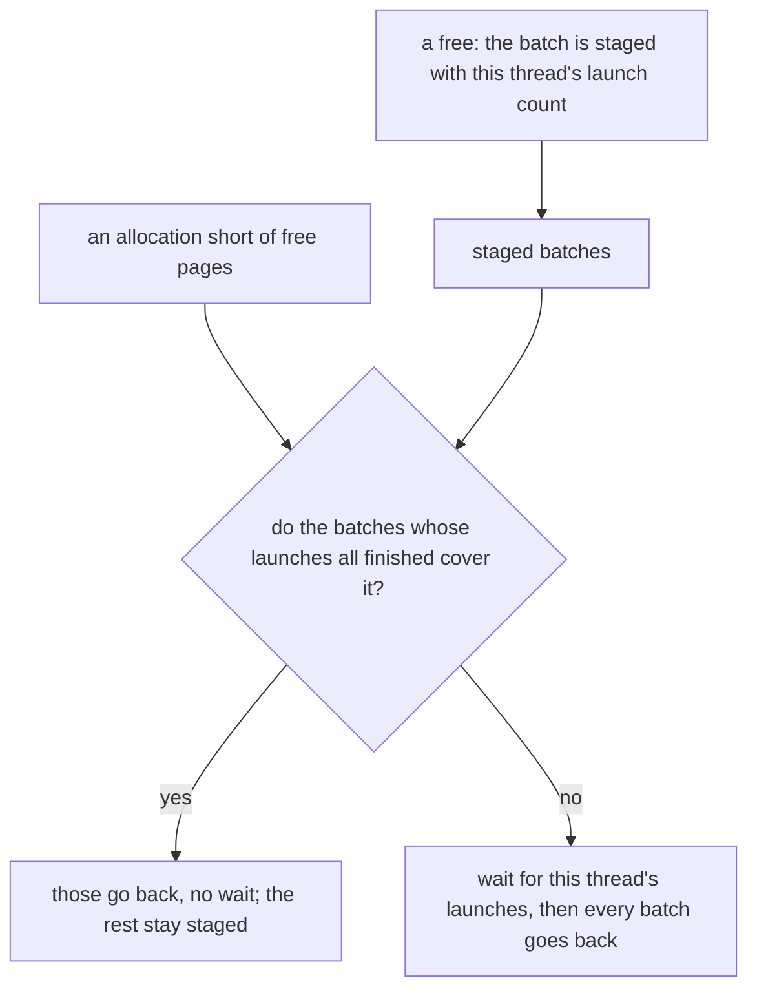

No launch after a free holds the freed row, so a batch is safe once the launches up to the count at its free have run.
`device_io.retired_launches` gives that lower bound: every launch older than the in-flight window has been waited for,
and the graphs run in launch order. The counts are the thread's that launches the graphs, the scheduler's, where every
free and allocation of the pool runs; a free on another thread, whose count would read 0, is refused by name. The
decode's preallocation (`alloc_extend`) and its growth (`alloc_decode`) name the pages they need, so they wait only when
the safe batches fall short; SGLang's own `alloc` names none and waits whenever a staged batch may still be touched. A
short allocation is a decode server's normal case once its pool has been through a few batches of requests, and a wait
there holds one DP rank's next launch, and every other rank at the next barrier, behind its queued steps.

### Prefix (radix) cache

SGLang's radix cache is on by default on every prefilling role, aggregated or prefill. A PD decode runs one only with
SGLang's `--disaggregation-decode-enable-radix-cache`, and then reuses a prefix's KV without its transfer
([The decode radix cache](disaggregated-inference.md#the-decode-radix-cache)); it is refused on a pipelined or DCP
decode. With pages of 128, a hit is a whole number of pages, which the runtime asserts. On the chunk grid a hit at page
m runs the chunks from m, and since the cached prefix length is a runtime input the hit reuses the cold prefill's
NEFFs. The segmented kernel takes any page-multiple prefix, so a hit's
logits are close to a cold prefill's, not bit-identical. DeepSeek-V2's prefill window holds the prefix with the new
tokens, so its bucket is chosen by both. A cache flush waits for every launched step before SGLang resets the pools.
Hits at every page and chunk edge are checked against cold runs: aggregated on Qwen3-0.6B, DeepSeek-V2-Lite and
GPT-OSS, and through a prefill/decode pair on Qwen3-8B.

The hierarchical cache (`--enable-hierarchical-cache`, HiCache L2) keeps the prefixes the pool evicts in host memory and
copies them back on a later hit, through the Neuron host pool (`sglang_neuron/mem_cache/host_pool.py`): a pinned
layer-first host copy of the MHA pool's per-layer K and V tensors, moved a page run at a time with the runtime's batch
DMA on a store thread and a load thread. A paired pool's layer, half of its pair's tensor, moves as the pair's runtime
tensor at the half's offset. A store waits for the graphs launched before it, and so does a load on an
aggregated server; the forward that reads a load waits for it. On an aggregated server the scheduler holds that
forward's batch back while the load runs and decodes the running batch meanwhile
(`sglang_neuron/mem_cache/hicache_hold.py`; `SGLANG_NEURON_HICACHE_ASYNC_LOAD=0` turns it off). It is served on
aggregated and prefill servers over the MHA pool, with one KV pool. It is refused with an L3 storage backend other than
the remote DRAM tier (`--hicache-storage-backend`; [HiCache remote DRAM tier](../guides/hicache-remote-dram.md)). It is
refused on a decode server, unless the model's catalog entry names a switch that opts its decode in
(`ModelSpec.decode_hicache_env`; Qwen3.5's `SGLANG_NEURON_QWEN35_HICACHE`). It is refused with `--pp-size` above 1 and
with `--radix-cache-backend neuron-chunk`, unless the model keeps chunk state checkpoints (Qwen3.5, Kimi-K3). Over a
token context-parallel MHA pool a host page holds this rank's shard of the page
([The host tier](context-parallelism.md#the-host-tier)).

The paged MLA / DSA pools (`sglang_neuron/mem_cache/mla_pool.py`, which `SGLANG_NEURON_MLA_POOL=paged` selects for
SGLang's MLA kind; DeepSeek-V2 serves it) have host pools of their own (`sglang_neuron/mem_cache/mla_host_pool.py`), on
the same transfer engine. SGLang's assembler builds an MLA pool's host copy without a per-platform class choice, so the
plugin hooks its `build_kv_host_pool` and `_build_sidecar_host_pool` for a Neuron latent pool: the KV host pool carries
the latent and every other paged buffer the model declares, and a DSA pool's index keys go to SGLang's INDEXER side
pool, which shares the KV pool's host pages and indices. A host page holds this rank's block of the SGLang page in every
region (one per layer of each buffer); under token context parallelism (a declared KV layout's `cp_size`,
`sglang_neuron/model_executor/kv_layout.py`) the page id is the block id on every rank, so each rank moves its own block
with SGLang's indices, untranslated. A decode-context-parallel pool is refused: SGLang's DCP index translation assumes
round-robin token owners, and the Neuron DCP pool keeps whole blocks per rank. The KPool request tails are not prefix
pages and stay on the device. The same pools' `get_cpu_copy` / `load_cpu_copy` (SGLang's retraction backup) copy the
request's whole pages of every paged buffer and its request row of the tails with the runtime's DMA after the launched
graphs, so no graph compiles for them while serving.

Kimi-K3 keeps its MLA rows in SGLang's MLA pool on the NeuronCore (`NeuronMLATokenToKVPool`, the full-attention leaf of
SGLang's hybrid pool) and its KDA state in the state pool. Both get Neuron host pools on the same transfer engine
(`sglang_neuron/mem_cache/hybrid_host_pool.py`), DCP pools included: under DCP the allocator page is one block on every
rank, so a transfer of whole allocator pages moves this rank's whole blocks.

`--radix-cache-backend neuron-chunk` keys the tree on whole chunks instead
(`sglang_neuron/mem_cache/chunk_keyed_tree.py`, `sglang_neuron/sglang_patches/chunk_keyed_tree.py`). Every process of a
launch that names it registers the backend in SGLang's radix-cache registry; the factory builds SGLang's unified radix
tree with the chunk as its page, while the allocator keeps 128-token pages. The forwards are the same on both trees;
what a hit reuses is not:

| | SGLang's default tree | `neuron-chunk` |
| --- | --- | --- |
| A hit | every whole page of the shared prefix, short of the prompt's last token | every whole chunk of it: on a chunk of C tokens, at most C - 128 tokens fewer than a page hit |
| A prompt of one chunk or less | hits | never hits |
| A finished request's insert | the prompt and the outputs, in whole pages | the prompt's whole chunks: an aggregated server reuses no earlier turn's outputs |
| Eviction | whole pages | whole chunks |
| A hit's prefill | close to a cold one's, not bit-identical | bit-identical to a cold one's |
| The prefill's block table | one chunk of extra columns | the context's width, its own compiled graph |

A chunk-keyed hit resumes a cold prefill at a chunk boundary: the same forward of the same tokens on the same prior
and tile, over KV that whole on-grid forwards of the same tokens wrote. So its prefill, and its first output token, is
bit-identical to a cold run's; later tokens match only where the decode runs in the same batches. The price is reuse:
GPT-OSS's disaggregated benchmark (8192-token prompts on an 8192-token chunk) would get no hits at all, which is why the
default tree stays the default. On GPT-OSS's aggregated server every hit
is the chunk floor of the shared prefix, and every hot answer equals its cold run's token for token and logprob for
logprob, since each request runs alone.

It is served on a prefill or aggregated server of a model whose prefill runs the segmented kernel (GPT-OSS, Qwen3,
Qwen3-MoE and GLM-4) or keeps a recurrent-state checkpoint at every chunk end (`chunk_state_checkpoints`: Qwen3.5 and
Kimi-K3, which refuse SGLang's default tree), so pipelined on GPT-OSS and Kimi-K3, where each stage keeps its own tree
and inserts the same chunks ([Pipeline parallelism](pipeline-parallelism.md#architecture)). A PD decode of those models
but Kimi-K3, whose DCP decode refuses a radix cache, serves it with `--disaggregation-decode-enable-radix-cache`: its
tree keys the decode's own per-rank `--chunked-prefill-size`, and it pairs only with prefills whose chunk divides it
([The decode radix cache](disaggregated-inference.md#the-decode-radix-cache)). KV cache events (`--kv-events-config`)
report chunk-sized blocks on it.

### Recurrent state

A model with recurrent layers (a `linear_attention` or `kda` entry in the config's `layer_types`; the contract
carries each as a `LayerKind` with its state family, `gdn` or `kda`, in `models/contract.py`) keeps its per-request
state in SGLang's request-table state pool, built as a `mem_cache/state_pool.NeuronStatePool`: canonical slots
(`[layers, slots + 2, *shape]`, padding slot and sink) plus the working rows the kernel banks state through, bound at
pool build to the model's state declaration (`mem_cache/state_spec.py`: each family's component shapes, dtypes,
conv slice axis and checkpoint grid, in one digest). The declaration drives the megakernel pool layout
(`state_pool.layout_parts`, the `recurrent_state` / `conv_state` kinds of `megakernel/pools.py`) and is what SGLang's
configurator builds (`PoolLayout.state_pool_class`, through the pool-layout seam's `_init_mamba_pool`). At
graph-runner build `state_pool.check_model_state` refuses a mismatch three ways: a recurrent layer the model's
`state_spec` does not cover, a spec layer the contract has no recurrent layer for, and a request table that got
SGLang's own `MambaPool` because the model declared no pool class. `mem_cache/state_checkpoint.py` checkpoints state
at the kernel's capture grid (chunk multiples plus one) against the radix cache's insert grid, refusing a radix mode
whose checkpoints would misalign; `mem_cache/state_ops.py` is the default torch implementation of the pool's row and
track moves. A reset drains the pool before clearing the request table (the seam's `StateStorage.clear` wrap), and a
failed drain quarantines the pool: every later operation raises with the first failure. Qwen3.5 (GDN) and Kimi-K3
(KDA) declare recurrent state ([Recurrent state](recurrent-state.md)).

## What a launch refuses

A refusal names what to change. The platform refuses up front, in the launching process; each scheduler refuses at
start-up what only it can check; and the tokenizer manager answers a request it cannot serve with an error at admission,
never serving it with an option silently dropped.

### At the platform defaults

- the launch hooks not installed (an SGLang that changed under a hook), and a launch without `SGLANG_PLATFORM=neuron`;
- an architecture the catalog does not list;
- `--attn-cp-size` above 1, and `--nnodes` above 1 (an xPyD deployment runs several single-node servers), except a PD
  decode in a layout over that many nodes that its model declares (`ModelSpec.decode_layouts`: Kimi-K3's two-node
  decode). `serving_policy.declared_decode_layout` selects the layout by `--nnodes` and `--tp-size`, and refuses the
  launch, naming each flag of the layout it misses;
- `--dcp-size` above 1 on any launch but these, with every reason named
  ([Decode context parallelism](decode-context-parallelism.md#how-it-works)): a PD decode of one TP group (no DP
  attention, no `--dp-size`) of a model that declares decode context parallelism; a PD decode in a decode layout its
  model declares, with that layout's DP-attention groups and DCP size (Kimi-K3: DCP32 inside each of its eight groups);
  and the PD prefill of a model that declares prefill context parallelism (`prefill_context_parallel`: Kimi-K3, with
  DCP over each pipeline stage's TP group);
- `--pp-size` above 1 on a model that builds no pipeline stages, and every pipelined launch but a PD prefill or decode
  under the overlap schedule and an aggregated server on SGLang's synchronous PP loop
  ([What a launch refuses](pipeline-parallelism.md#what-a-launch-refuses));
- `--speculative-algorithm` other than `NEURON_MTP`, a decode kernel that runs its model's MTP layer itself
  (`sglang_neuron/speculative/neuron_mtp.py`, which checks its own arguments): every other decode step samples one
  token per request, the one token the relay carries; and `NEURON_MTP` for a model whose decode runs no MTP step. A
  model serves it by naming the host side of its step in its catalog entry (`ModelSpec.mtp_host`; GLM-5.2's is
  [Async MTP K7](../model-recipes/glm52.md#async-mtp-k7)). A model whose own speculative worker serves another
  algorithm lists it in `ModelSpec.speculative_algorithms`, which lifts the refusal for it (Kimi-K3's decode:
  `DSPARK`, [Kimi-K3](../model-recipes/kimi-k3.md#pd-decode));
- `--enable-lora` and `--lora-paths` (the graphs carry no adapter weights), `--enable-mixed-chunk` (a forward runs one
  graph), `--enable-return-routed-experts` (the experts are routed inside the graph), and elastic EP (torch-neuronx
  fixes the world when the runtime starts);
- `--enable-hierarchical-cache` on a decode server whose model's catalog entry does not opt the decode in, and with
  `--pp-size` above 1 or with `--radix-cache-backend neuron-chunk` on a model that keeps no chunk state checkpoints (no
  run covers any of them), and a `--hicache-storage-backend` other than the remote DRAM tier;
- a `--radix-cache-backend` other than `neuron-chunk` and, on a Kimi-K3 PD prefill, `kimi-prompt`; SGLang's default tree
  on a model that keeps its recurrent-state checkpoints at chunk ends only (Qwen3.5, Kimi-K3); and `neuron-chunk` with
  `--disable-radix-cache` (no tree to key), with `--enable-lmcache` or `--enable-flexkv` (SGLang builds the named
  backend in place of the cache they select), on a decode without `--disaggregation-decode-enable-radix-cache` (no
  tree), with `--enable-streaming-session` or a per-rank chunk that is not whole 128-token pages, or on DeepSeek-V2 (its
  chunk is its context, so no prompt shares a whole chunk) ([Prefix (radix) cache](#prefix-radix-cache));
- `--is-embedding`, `--enable-return-hidden-states` and `--return-hidden-states-mode`: the graphs return sampled tokens,
  no hidden states;
- `--enable-memory-saver`: torch-memory-saver pauses CUDA allocations only, and the KV pools and weights are
  torch-neuronx's;
- a `--load-format` other than `auto` or `safetensors`: another format, or dummy weights, would serve graphs of unloaded
  parameters;
- `--disable-cuda-graph`, which would only mark SGLang's own decode graphs disabled, and a `--prefill-attention-backend`
  or `--decode-attention-backend` other than `neuron`;
- `--base-gpu-id` other than 0 and `--gpu-id-step` other than 1;
- a page size other than 128 or the model's own page ([How a launch resolves](#how-a-launch-resolves), step 5), a KV
  dtype the model does not serve, and a `--quantization` or checkpoint quantization the model does not serve;
- a setting the platform fixes, stated with another value: the model's package and launch settings,
  `SGLANG_NUMA_BIND_V2`, a prefill or decode server's settings, and `SGLANG_HTTP_SERVER_APP_PATH` with more than one
  tokenizer worker;
- an unknown `SGLANG_NEURON_*` name, a malformed plugin variable, `SGLANG_RETURN_ORIGINAL_LOGPROB` outside `true`, `1`,
  `false` and `0`, and an `SGLANG_NEURON_MAX_TOP_LOGPROBS` that is not a non-negative integer, or above 256 under
  `topk_topp`;
- DP attention on an aggregated server (except a whole-model megakernel's whose ranks plan each step from the
  DP-attention exchange: Qwen3.5), on the prefill of a `prefill_holds_prior` model, or with
  `SGLANG_SCHEDULER_SKIP_ALL_GATHER`, and a DP-attention decode that misses a condition of the DP identity
  ([The serving policy](#the-serving-policy));
- a model with a giga-kernel decode at 128 ranks in any layout other than that decode's, or with a
  `--max-running-requests` that does not give each DP group a multiple of its 8 attention ranks, and a
  `NEURON_LOGICAL_NC_CONFIG` the layout contradicts (other than torch-neuronx's default for the host, which is
  replaced);
- the host sampler without `--disable-overlap-schedule`, or with `--pp-size` above 1, on a decode with DP attention,
  with `SGLANG_NEURON_MAX_TOP_LOGPROBS` above 0, or with `--enable-strict-thinking` ([The host
  sampler](#the-host-sampler));
- on the giga-kernel decode, a sampler other than greedy and top logprobs above 0 (its fused tail returns greedy tokens
  only), and any flag of the giga kernel's build (`GIGA_KERNEL_FLAG_PREFIX`, `models/catalog.py`) other than the
  ones the platform pins;
- on a prefill or decode server, a `--disaggregation-transfer-backend` other than `nixl`, and on a decode a
  `--disaggregation-decode-retraction-backup` other than `none` (the pool keeps no host copy);
- no free CCOM root port offset below 900, and a root host that is not an IPv4 address of this node;
- in SGLang's own argument pass after the platform defaults, `--enable-deterministic-inference`: `neuron` is not one of
  SGLang's deterministic attention backends.

### When a scheduler starts

A scheduler meets these refusals in the order of its start-up ([Overview](#overview)): the runtime build and the
warm-up come after the weights have loaded, and the warm-up compiles every bucket the cache does not hold.

- **Registration**, which exits the process: an SGLang without a function a runtime hook targets, or a pinned SGLang,
  torch, torch-neuronx executor or gloo source that changed; a torch-neuronx that is not the native backend or has no
  `neuron` dynamo backend; `NEURON_CC_FLAGS` or `NEURON_COMPILER_OPT_LEVEL` other than the plugin's values;
  `TORCH_NEURONX_VOCAB_SHARDING_SPMD_DISABLE` or `NKI_DISABLE_TRACE_CACHE` other than `1`;
  `SGLANG_EXTERNAL_MODEL_PACKAGE` unset, or a model module that raises on import; on the giga-kernel decode, a
  `SGLANG_NEURON_MAX_INFLIGHT_LAUNCHES` outside 2 to 4 (the launched steps its result processing trails by).
- **Rank bring-up:** an overlap schedule that disagrees with the policy; a core list too short for the rank's block;
  `TORCH_NEURONX_ENABLE_STREAMS` off, or a `SGLANG_NEURON_MAX_INFLIGHT_LAUNCHES` that is not an integer of 1 or more; a
  Neuron runtime started before the ranks were set, one that sees more than one logical core, or a current device other
  than the rank's; a device memory reading that fails (SGLang first reads it in step 5 of [Rank
  bring-up](#rank-bring-up)); a torch world other than torch-neuronx's.
- **The model host**, through each model's `check_launch` and graph construction:
  - GPT-OSS: nkilib imported on the QK path the decode does not serve (the swapped one for the per-layer graphs, the
    non-swapped one for the giga-kernel decode); a target other than Trainium3; DP attention with `--ep-size 1`;
    attention heads that do not split over the attention TP, or KV heads that neither split nor replicate evenly;
    experts that do not split over EP; a `layer_types` other than "even layers slide"; and the `--context-length` rule
    of [Packed FP8 K](#packed-fp8-k). Its giga-kernel decode also refuses layers that do not pair sliding and full
    attention, more than 18 pairs, other than one whole expert per rank, per-layer KV scales, an image without the giga
    kernel or the fused tail's sorted top-k, and a neuronx-cc older than the release the sorted top-k is validated with.
  - DeepSeek-V2: a dtype other than bf16; DP attention; a TP size that does not give four query heads per rank; a
    context that is not a multiple of 512, or above 4096; `--max-running-requests` unset or above 128 (the decode's
    fused MoE kernel takes at most 128 tokens a step); a `--chunked-prefill-size` other than the context.
  - Qwen3, GLM-4 and Qwen3-MoE: a dtype other than bf16, a quantized checkpoint, a scaled RoPE, attention heads or an
    intermediate size that do not shard over the attention TP, and KV heads that neither shard over nor replicate
    evenly across it. Qwen3 and Qwen3-MoE, which builds on Qwen3's config, also refuse sliding-window layers and
    attention biases. Qwen3-MoE also refuses dense MLP layers, DP attention, an `--ep-size` that does not divide both
    the expert count and the attention TP, and an expert intermediate size that does not shard over the attention
    TP / EP ranks.
  - Qwen3.5: a role other than an aggregated server or a PD role; a layer order, or a GDN, attention or expert width,
    that the giga kernels do not take; an `--ep-size` other than `--tp-size`; heads that do not shard over a DP
    replica; a KV page that is not a multiple of 128, or on the paged pool not a power of two;
    `SGLANG_NEURON_QWEN35_KV_CP` above 1 on a role other than the PD decode, or other than the replica's rank count;
    `SGLANG_NEURON_QWEN35_KV_TM=1` on a role other than a paged PD prefill without KV context parallelism; a device
    sampler other than `greedy`; and, at the weight load, no weight pack (`SGLANG_NEURON_QWEN35_PACK`).
  - GLM-5.2 and the Kimi-K3 prefill: the refusals in each recipe ([GLM-5.2](../model-recipes/glm52.md#what-is-refused),
    [Kimi-K3](../model-recipes/kimi-k3.md#what-a-prefill-launch-refuses)).
  - On a prefilling role, `--enable-streaming-session`.
- **The KV pool**, as SGLang sizes and allocates it: a `--max-total-tokens` the device memory cannot hold, and a KV pool
  option or head dim the pool does not have. A model that builds its own pools (`configure_kv_cache`): a pool or an
  allocator that is not the platform's, or a size other than the stated `--max-total-tokens` in whole pages.
- **The runtime build:** a chunk that is not a prefill bucket (one of 0 or below included); a `--cuda-graph-bs-prefill`
  count that is not a KV segment tile or does not fit the attention TP, or any count below the chunk for GPT-OSS; a
  sampler mode the model's execution does not support; an unsupported layer kind, or a model contract that differs
  between ranks.
- **The warm-up:** a prefill bucket outside the segmented kernel's tiles, ranks that compiled different NEFFs, and on
  the giga-kernel decode a DMA-order schedule that does not fit the compiled program (`neuron_after_warmup`).

### At admission

- a prompt given as `input_embeds` or with `positional_embed_overrides` (the graphs embed token ids on the device), and
  prompt token ids outside the vocabulary, which would index past the embedding table;
- `n` above 1 on a prefill or decode server, whose copies would share one bootstrap room;
- beam search;
- a sampled request's `sampling_seed` on the host sampler, whose SGLang sampler reads seeds only under
  `--enable-deterministic-inference`; on a device sampler, a `sampling_seed` outside int64, and a seeded sampled request
  with `n` above 1, whose copies would draw identical tokens;
- on a device sampler, what it does not apply (the host sampler, SGLang's own, applies all of it):
  - a sampled request on a `greedy` server (greedy is `top_k` 1 or a temperature below 1e-6), top-k, top-p or min-p on
    a `temperature` server, a `top_k` above 256 on a `topk_topp` server, and a sampled request's `top_k` below 1 other
    than -1;
  - penalties, `min_new_tokens`, `logit_bias`, `json_schema`, `regex`, `ebnf`, `structural_tag` and
    `custom_logit_processor`;
  - more top logprobs than `SGLANG_NEURON_MAX_TOP_LOGPROBS` (counted with or without `return_logprob`),
    `token_ids_logprob` (an empty list included) and `return_sampling_mask`;
- with `return_logprob`, a `logprob_start_len` given as a list for a single request, and prompt logprobs (a
  `logprob_start_len` other than -1 inside the prompt): the prefill graph returns the last token's logits only;
- on the giga-kernel decode, `return_logprob`: its fused tail returns tokens only;
- on Qwen3.5, a sampled request (other than temperature 0 or `top_k` 1) and `return_logprob`: its kernels sample
  greedily and return no logprobs;
- on Kimi-K3, at the tokenizer of both PD servers (the model's `validate_request`): structured outputs, penalties, min-p,
  `min_new_tokens`, `logit_bias`, a custom logit processor, `return_logprob` and hidden states;
- the weight-update endpoints, answered with HTTP 400;
- on a pipelined server, `/pause_generation` in `in_place` or `retract` mode (SGLang's PP loops do not pause) and
  `/flush_cache` with a timeout (each stage's request leader would time it out by its own clock), answered with
  HTTP 400 ([What a launch refuses](pipeline-parallelism.md#what-a-launch-refuses)).

## Configuration

A launch configures the runtime with SGLang's flags. The runtime reads its own variables, all named `SGLANG_NEURON_*`
(`sglang_neuron/env_registry.py`): `SGLANG_NEURON_SAMPLER` and `SGLANG_NEURON_MAX_TOP_LOGPROBS` (the sampler,
[Device sampling](#device-sampling), [The host sampler](#the-host-sampler)); `SGLANG_NEURON_CPU_MODE`;
`SGLANG_NEURON_DEBUG_MESH` (the mesh log); `SGLANG_NEURON_HOST_TRACE`, `SGLANG_NEURON_HOST_TRACE_RANKS`,
`SGLANG_NEURON_HOST_TRACE_SPANS`, `SGLANG_NEURON_PROFILE_DIR`, `SGLANG_NEURON_PROFILE_RANKS`,
`SGLANG_NEURON_PROFILE_DEVICE_MODE`, `SGLANG_NEURON_PROFILE_SERVE_RANKS`, `SGLANG_NEURON_PROFILE_SERVE_START` and
`SGLANG_NEURON_PROFILE_SERVE_STEPS` (the host trace and device profiles, [Profiling](../guides/profiling.md));
`SGLANG_NEURON_WEIGHT_HASH_DIR` (each rank's md5 of its loaded weights); and `SGLANG_NEURON_SERVING_POLICY`,
`SGLANG_NEURON_CCOM_PORT_OFFSET` and `SGLANG_NEURON_RENDEZVOUS_KEY`, which the platform sets itself. The platform
refuses any other name with that prefix, so a misspelled variable stops the launch instead of being ignored. The
settings divide as the [configuration reference](../guides/reference-configuration.md) lists them, each with its
values:

- the [variables the runtime reads](../guides/reference-configuration.md#environment-variables-the-runtime-reads): the
  sampler and the device sampler's top logprobs ([Device sampling](#device-sampling)), CPU mode, the mesh log, and the
  host trace and device profiles ([Profiling](../guides/profiling.md));
- the variables the platform
  [sets for every process](../guides/reference-configuration.md#variables-the-platform-sets-for-every-process),
  which a launch leaves unset: the serving policy, the CCOM port offset, the torch rendezvous key, the model package
  and, with more than one tokenizer worker, the tokenizer workers' app path;
- the [settings the platform overwrites](../guides/reference-configuration.md#settings-the-platform-overwrites) and the
  ones it fixes, [refusing another
  value](../guides/reference-configuration.md#settings-the-platform-fixes-and-refuses-at-another-value), each described
  on this page where its mechanism is ([How a launch resolves](#how-a-launch-resolves), [The torch-neuronx
  stack](#the-torch-neuronx-stack), [Rank bring-up](#rank-bring-up));
- the [Neuron runtime defaults](../guides/reference-configuration.md#neuron-runtime-defaults) per role, and the
  [server arguments the platform sets](../guides/reference-configuration.md#server-arguments-the-platform-sets).

A prefill or decode server's own settings are in
[Settings the platform fixes](disaggregated-inference.md#settings-the-platform-fixes), and SGLang's `/start_profile`
with the `NEURON` activity is in [Profiling](../guides/profiling.md).

## Code map

| Module | Owns |
| --- | --- |
| `sglang_neuron/__init__.py` | The platform entry point (`activate`). |
| `sglang_neuron/platform.py` | The launch's defaults and refusals, and the classes SGLang builds. |
| `sglang_neuron/general_plugin.py` | The plugin entry point, the launch and runtime hooks and their pins, admission, KV capacity, the device-sample hook, one request per prefill forward. |
| `sglang_neuron/serving_policy.py` | The serving policy and the fixed launch settings. |
| `sglang_neuron/sglang_tree.py` | SGLang's topology reads: `dp_widths`, `attention_dp_size`, `scheduler_batch`. |
| `sglang_neuron/env_registry.py`, `sglang_neuron/envs.py` | The `SGLANG_NEURON_*` registry and accessors. |
| `sglang_neuron/quant.py` | The inert MXFP4 config. |
| `sglang_neuron/http_worker_app.py` | The tokenizer workers' app: SGLang's, imported after `load_plugins()`. |
| `sglang_neuron/process_init.py` | The process's stack set-up, SGLang's device module. |
| `sglang_neuron/backend/init.py` | torch-neuronx's set-up for serving and its refusals, and the CPU-mode stand-in device. |
| `sglang_neuron/backend/torch_pins.py` | The torch functions the plugin wraps, pinned. |
| `sglang_neuron/distributed/gloo_device.py` | The process's one gloo transport device. |
| `sglang_neuron/device.py` | The device mixin: `neuron-ls`, device memory. |
| `sglang_neuron/cpu_placement.py` | Reserved CPUs and NUMA binding. |
| `sglang_neuron/sampling.py`, `sglang_neuron/sampling_topk.py` | The device samplers and their admission checks; the NKI top-k of the `topk_topp` pool. |
| `sglang_neuron/models/catalog.py`, `sglang_neuron/models/host.py`, `sglang_neuron/models/base.py`, `sglang_neuron/models/contract.py` | The catalog, the model host and weight sharing, runtime dispatch and the KV bind, the model contract. |
| `sglang_neuron/models/phase.py`, `sglang_neuron/mem_cache/kv_cache.py` | The process's phase (`all`, `prefill` or `decode`); `LayerSpec` and `KVSpec`. |
| `sglang_neuron/utils/bucket_utils.py` | The KV segment tiles and the decode batch ladder. |
| `sglang_neuron/model_executor/runtime_init.py` | Rank bring-up, the CCOM bootstrap, the runtime defaults, the clean exit. |
| `sglang_neuron/model_executor/graph_runner.py` | Buckets, step inputs, compile and warm-up, the step's launch, `NeuronGraphRunner`. |
| `sglang_neuron/model_executor/program_fence.py` | The program-switch fence. |
| `sglang_neuron/backend/stack.py` | The compile backend, the compiler environment and its scopes, the mesh registry. |
| `sglang_neuron/backend/device_io.py` | Uploads, readbacks, the submit wrap, device addresses, memory stats. |
| `sglang_neuron/backend/executor_cache.py`, `sglang_neuron/backend/spmd_check.py` | The executor binding cache and the cross-rank NEFF check. |
| `sglang_neuron/backend/direct_submit.py` | The giga-kernel decode's direct submit to its bound executor. |
| `sglang_neuron/backend/port_hold.py`, `sglang_neuron/parallel/neuron_init.py`, `sglang_neuron/parallel/state.py` | The torch rendezvous, torch-neuronx's ranks, the plugin's groups. |
| `sglang_neuron/attention/backend.py` | The step's attention metadata. |
| `sglang_neuron/mem_cache/memory_pool.py`, `sglang_neuron/mem_cache/allocator.py`, `sglang_neuron/mem_cache/page_set.py` | The MHA and MLA pools and the allocator. |
| `sglang_neuron/mem_cache/chunk_keyed_tree.py`, `sglang_neuron/sglang_patches/chunk_keyed_tree.py` | The chunk-keyed radix tree (`--radix-cache-backend neuron-chunk`) and its launch refusals. |
| `sglang_neuron/mem_cache/state_spec.py`, `state_ops.py`, `state_checkpoint.py`, `state_pool.py` | The recurrent-state declaration, its default torch moves, the checkpoint grid and the request-table state pool. |
| `sglang_neuron/model_executor/kv_layout.py` | The KV layout a model declares before its pool is built (paired layers). |
| `sglang_neuron/sglang_patches/` | The SGLang patches, each with its pins. |
