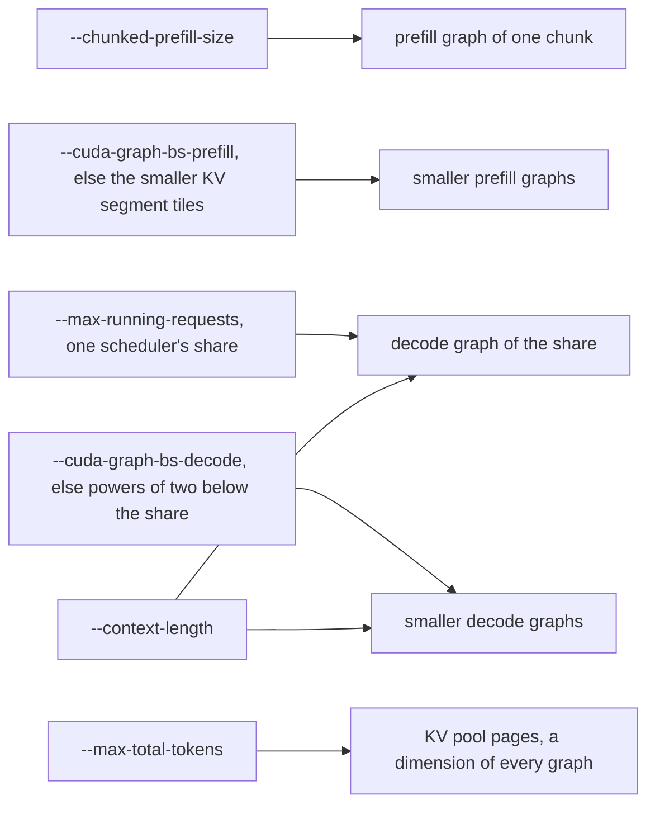
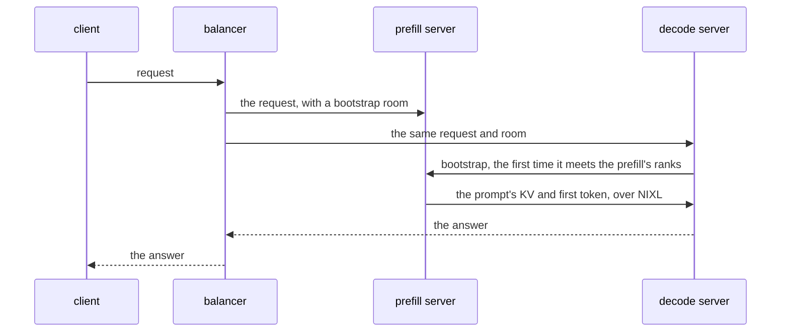

# Quickstart

The commands below run inside the container, with the checkpoints mounted at `/models`; the
[container guide](../guides/container.md) has the `docker run` that starts it. In a development environment
([setup guide](setup-guide.md#build-a-development-environment)), run them with the venv's Python and
`SGLANG_PLATFORM=neuron`, which the image sets.

## Aggregated

Launch with SGLang's own launcher. These are the validated flags for Qwen3-8B:

```bash
python3 -m sglang.launch_server \
  --model-path /models/Qwen3-8B --tp-size 4 --context-length 4096 --chunked-prefill-size 2048 \
  --max-running-requests 64 --max-total-tokens 266240 --mem-fraction-static 0.6
```

The platform sets the rest: pages of 128 tokens, the `neuron` attention backend over any `--attention-backend`, and
SGLang's batch tensors on the host. The graphs sample on the device, greedily by default
(`SGLANG_NEURON_SAMPLER=greedy`): a request must set `temperature` 0 or `top_k` 1, and any other request, including one
that sets no temperature, is refused at admission. A launch with `SGLANG_NEURON_SAMPLER=temperature` or `topk_topp`
serves sampled requests ([device sampling](../guides/features-guide.md#device-sampling) says what each sampler serves).
The platform runs the schedulers at LNC2 (`NEURON_LOGICAL_NC_CONFIG=2`; LNC1 on the GPT-OSS giga-kernel decode and every
role of GLM-5.2, Qwen3.5 and Kimi-K3, set from the layout and the model) with torch-neuronx's streams on
(`TORCH_NEURONX_ENABLE_STREAMS=1`); leave both unset.
`NEURON_RT_VISIBLE_CORES` picks the server's cores (a range such as `4-7`); without it the server takes the node's first
cores.

The server listens on 127.0.0.1:30000 (`--host`, `--port`); in a container, give `--host 0.0.0.0` with a published port,
or the node's address with `--network host` ([container guide](../guides/container.md)). It compiles and warms every
graph before it answers `/health`, so with a cold torch-neuronx compile cache (`TORCH_NEURONX_NEFF_CACHE_DIR`,
`TORCH_NEURONX_HLO_CACHE_DIR`) the first launch is the long one. Once `/health` answers, send a greedy request:

```bash
curl -s http://127.0.0.1:30000/generate -H 'Content-Type: application/json' \
  -d '{"text": "The capital of France is", "sampling_params": {"temperature": 0, "max_new_tokens": 16}}'
```

The graphs' shapes come from the flags, so a launch with the same flags compiles the same graphs and the next launch
starts from torch-neuronx's compile cache:



A scheduler refuses a chunk that is not a multiple of 128 and of the attention TP size or, for a model whose prefill
runs the segmented kernel (GPT-OSS, Qwen3, Qwen3-MoE and GLM-4), not one of that kernel's KV segment tiles (512, 1024,
2048, 4096 or 8192); under DP attention the chunk is divided by the attention-DP size first. GPT-OSS compiles the chunk
alone and refuses `--cuda-graph-bs-prefill` below it. A scheduler's share of `--max-running-requests` is all of it on
each `--dp-size` replica and is split over the groups under DP attention. Without the flag SGLang sizes the share from
the KV pool, and the smaller decode sizes come from `--cuda-graph-max-bs-decode` and the powers of two below it or,
without that flag too, from SGLang's own sizes. Qwen3, Qwen3-MoE, GLM-4 and DeepSeek-V2 also compile each decode batch
size over a quarter and a half of `--context-length`, except on a server with DP attention. A disaggregated decode
server with DP attention compiles the share alone: it needs a stated `--max-running-requests` and no
`--cuda-graph-bs-decode` size below the share ([the serving policy](../design/runtime.md#the-serving-policy)). The
decode graphs' cache entries also depend on where the plugin is installed, so a development environment serves from
one checkout path to reuse them (in the image the path is fixed).

## Disaggregated

A prefill server computes a prompt's KV and writes it into a decode server's KV pool over NIXL and EFA; the decode
server generates the answer. Each server runs on one node, and the validated layouts put the two on separate nodes; each
node's container runs with the node's network and its EFA devices ([container guide](../guides/container.md)). The
image's NIXL carries the patches the transfer needs ([NIXL patches](../../patches/nixl/README.md)); a development
environment loads it from the overlay `NIXL_WHEELS=<dir> bash tools/build_nixl.sh <out dir>` builds, with `<out dir>`
ahead of SGLang on `PYTHONPATH` and `NIXL_PLUGIN_DIR` unset. Both servers take the model's flags plus the role's:

```bash
# on the prefill node
python3 -m sglang.launch_server \
  --model-path /models/Qwen3-8B --tp-size 4 --context-length 4096 --chunked-prefill-size 2048 \
  --max-running-requests 64 --max-total-tokens 266240 --mem-fraction-static 0.6 \
  --disaggregation-mode prefill --disaggregation-transfer-backend nixl --host <prefill node>

# on the decode node: the same, with --disaggregation-mode decode --host <decode node>
```

A balancer sends each request to both servers at once: the plugin's PD load balancer:

```bash
python3 -m sglang_neuron.disaggregation.balancer --prefill http://<prefill node>:30000 \
  --decode http://<decode node>:30000
```



For each request the balancer picks the prefill replica with the fewest prefills outstanding and the decode server with
the fewest requests whose responses have not ended.

Clients send their requests to the balancer, which listens on 127.0.0.1:8000 (`--host`, `--port`). It routes
single-prompt requests on `/generate`, `/v1/completions` and `/v1/chat/completions` and answers a batch of prompts with
a 400. `--prefill` and `--decode` repeat for more servers. The balancer hands every prefill server's requests the one
`--bootstrap-port` it is given (default 8998, the default of SGLang's `--disaggregation-bootstrap-port`), so every
prefill server behind it must use that port, and two of them cannot share a node. To get more prefill capacity on one
node, give one server several replicas with `--dp-size`.

A deployment can run several prefill and decode servers (xPyD), and a prefill server can hold several replicas
(`--dp-size`). The GPT-OSS decode runs DP attention, with the flags in its
[recipe](../model-recipes/gpt-oss.md) and [example](../../examples/gpt_oss_120b/).
[Disaggregated inference](../design/disaggregated-inference.md) covers the transfer, the failure handling and the
settings the platform fixes for both roles. The [disaggregated tutorial](../tutorials/disaggregated-1p1d.md) walks
through one prefill and one decode server step by step, then checks its accuracy on GSM8K.
