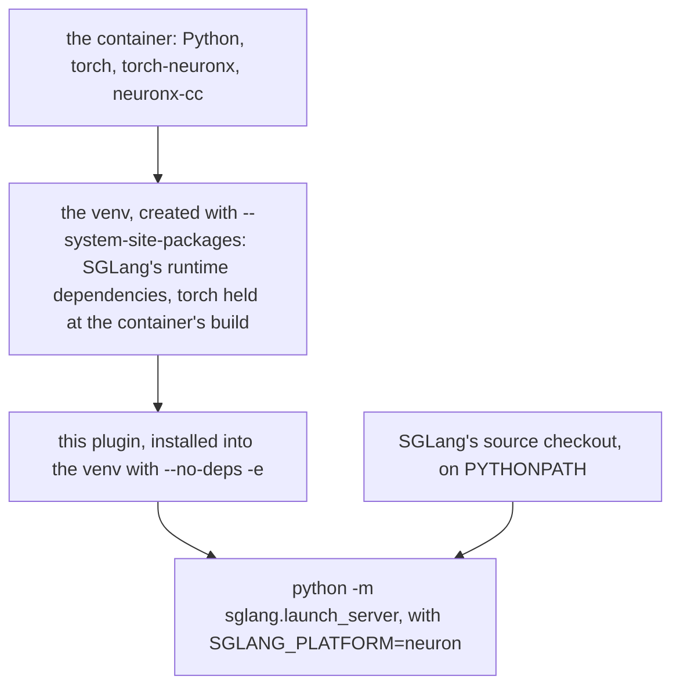

# Setup guide

There are two ways to run the plugin: the container image, which has everything installed, and a development
environment you build by hand, for working on the plugin itself.

## Use the container

The image `public.ecr.aws/neuron/pytorch-inference-sglang-neuron:<tag>` holds SGLang at `43881a7`, the plugin, the
Neuron SDK 2.33.0 libraries and compiler, and NIXL for prefill/decode disaggregation. It sets `SGLANG_PLATFORM=neuron`,
so a server starts with SGLang's own launcher and no other setup.

What the host needs:

- A Trainium instance (Trn3 for the language models, trn2.48xlarge for the diffusion pipelines; each
  [recipe](../model-recipes/index.md) names its own).
- The Neuron driver of Neuron SDK 2.33.0 (`aws-neuronx-dkms` 2.31.7.0 or later): `ls /dev/neuron*` lists the devices.
  On an instance that just booted, wait until it does.
- Docker, and the checkpoints on a local disk.
- For prefill/decode over two nodes: EFA (`/dev/infiniband/uverbs*`) between the nodes.

```bash
docker pull public.ecr.aws/neuron/pytorch-inference-sglang-neuron:<tag>
```

The [container guide](../guides/container.md) has the `docker run` options (the devices, the mounts, the compile
cache, the network), how to check the container, and how to stop a server. Then serve a model: the
[quickstart](quickstart.md) launches one, and each model's [example](../../examples/) launches its tested layout.

## Build a development environment

The container image is built from this repository with `docker/build.sh` ([docker/README.md](../../docker/README.md)).
This section builds the same environment by hand.

The plugin runs in the AWS Neuron container, which ships torch and torch-neuronx. SGLang runs from a source checkout at
`43881a7`, the revision the plugin's SGLang patches are written against, in a venv the setup script builds over the
container's own torch:

```bash
docker run --rm -it --privileged --network host --shm-size=16g -v /path/to/work:/work \
  <a Neuron container image with the versions in the table below> /bin/bash

# inside the container, from this repository's checkout under /work
git clone https://github.com/sgl-project/sglang /work/sglang
git -C /work/sglang checkout 43881a7
NEURON_RT_VISIBLE_CORES=0 scripts/setup_sglang_main_env.sh /work/venv /work/sglang
export PYTHONPATH=/work/sglang/python
```

Importing torch loads torch-neuronx, which claims NeuronCores, so the script runs on one core. It builds a new venv and
refuses a directory that already exists; to run it again, remove the venv or give it another directory. A server then
launches with the venv's Python and `SGLANG_PLATFORM=neuron`, and a prefill/decode server also needs NIXL: build it
with `NIXL_WHEELS=<dir> bash tools/build_nixl.sh <out dir>`, put `<out dir>` ahead of SGLang on `PYTHONPATH` and
leave `NIXL_PLUGIN_DIR` unset ([NIXL patches](../../patches/nixl/README.md) says what `<dir>` holds).

### The validated release

The plugin is pinned to Neuron SDK 2.33.0. `sglang_neuron/release/neuron_sdk.toml` names it: each package below with the URL
it is published at and its sha256 (the wheel's or the .deb's, as the index lists it), the libraries' own sha256, and
the release's container by digest. GLM-5.2's hardware gates ran on it, with the two deviations
below ([Measured](../model-recipes/glm52.md#measured)). GPT-OSS's gates ran on
an earlier, pre-release build of the same compiler line, neuronx-cc 2.28.4568.0, the oldest its sampling tail accepts
(`SORTED_TOPK_MIN_COMPILER` in `sglang_neuron/ops/gpt_oss_giga_tail.py`).

| Package | Version | Published at |
|---|---|---|
| neuronx-cc | 2.28.7631.0+8f7b0cf5 | pip.repos.neuron.amazonaws.com |
| nki | 0.7.0+37713544100.gfede04bb | pip.repos.neuron.amazonaws.com |
| aws-neuronx-runtime-lib | 2.35.30.0-d2725ccb8 | apt.repos.neuron.amazonaws.com |
| aws-neuronx-collectives | 2.35.43.0-354ad3064 | apt.repos.neuron.amazonaws.com |
| aws-neuronx-tools | 2.33.38.0-f874d5618 | apt.repos.neuron.amazonaws.com |
| aws-neuronx-dkms (the host's driver) | 2.31.7.0 or later | apt.repos.neuron.amazonaws.com |

The release's own torch-neuronx container,
`public.ecr.aws/neuron/torch-neuronx:2.14.0-neuronx-py314-sdk2.33.0-ubuntu26.04` at digest
`sha256:b4648437b8c7dbfa2acde18301a4bb4ae9658da5a412da75c59693ed4fd308ec`, carries these packages, with
torch-neuronx 2.14.3.0.1+b1b6c66 built from the release's public source (the published wheels are 2.14.3.0.282). A
launch takes any build of the 2.14.3 line. Pull the container by the digest: a tag can be moved. The SGLang-Neuron
image is built on this container, so it runs these packages and its torch-neuronx 2.14.3.0.1+b1b6c66, with NIXL added.

This guide runs as written in that container: the setup script, `tools/neuron_release.py check` and a Qwen3-0.6B TP4
server at the flags of [its recipe](../model-recipes/qwen3.md) answering a greedy request, on a trn3 node. On a node
without PyPI access, give the script a wheelhouse (below).

A GLM-5.2 launch, prefill or decode, refuses a neuronx-cc, nki, runtime or collectives library other than the pinned
ones, naming the pinned package; it reads the versions only. To check an environment's installed files against the
pin's hashes, run it with the launch's environment, from a checkout of this repository (or in the QA image, from
`/opt/sglang-neuron/src`):

```bash
python tools/neuron_release.py check    # one line per package, exit status 1 when any differs
```

The hardware gates ran the pinned packages in an Ubuntu 24.04 container (glibc 2.39) with Python 3.14.6 and torch
2.14.0+cu130, and two packages beside the release (`deviations` in the pin, each with its reason):

| Package | Version | Why not the release's |
|---|---|---|
| torch-neuronx | 2.14.3.0.2115+149b6fca1 | the release's builds (the 2.14.3.0.282 wheels, the container's 2.14.3.0.1) need glibc 2.43 (Ubuntu 26.04) |
| NIXL (nixl-cu13) | 1.5.0 | the release ships no NIXL; the PD transfer registers its KV regions with it |

### Why SGLang runs from a source checkout

SGLang's `python/pyproject.toml` pins `torch==2.14.1` and a CUDA stack (`flashinfer_python`, `sglang-kernel`,
`sgl-deep-ep`, `sgl-deep-gemm`, `nvidia-cutlass-dsl`, `cuda-python`, ...), and has no Neuron dependency variant.
`pip install -e python` would replace the container's torch and break torch-neuronx; `--no-deps` leaves SGLang's
runtime dependencies (fastapi, orjson, transformers, xgrammar, ...) unmet, and the container ships none of them.

So the container's torch and torch-neuronx stay untouched and everything else sits on top of them:



The script installs SGLang's `runtime_base` and `runtime_common` sets (`python/pyproject_other.toml`; `runtime_base` is
what SGLang's `srt_empty` installs) except the packages only optional features use (`av`, `deepseek-recipe`,
`modelscope`, `py-spy`, `smg-grpc-servicer`, `outlines`, `timm`). It adds `tokenizers`, `watchfiles` and `zstandard`
from `python/pyproject.toml`, and `dill`, which SGLang imports (`sglang/srt/sampling/custom_logit_processor.py`) but
does not declare. Every package takes SGLang's own requirement for it: the line `python/pyproject_other.toml` gives it
(the pins SGLang's own `srt_empty` and `runtime_common` installs use), or `python/pyproject.toml`'s for the three
packages `pyproject_other.toml` does not list; a package neither file pins installs at pip's current release.
`tools/sglang_runtime_requirements.py` reads both files from the checkout without changing it and prints the list the
script installs. It also installs the CPU `torchvision` wheel matching the container's torch (SGLang imports it
unconditionally), and this plugin with `--no-deps -e`, which registers the entry points SGLang finds the platform and
the hooks through. It then lists the requirements still unmet (`tools/check_sglang_deps.py`) and imports the serving
entry points (`tools/import_sglang_entrypoints.py`).

The script installs from PyPI, except the CPU `torchvision` wheel matching the container's torch
(`torchvision==0.29.0` for torch 2.14), which it takes from `https://download.pytorch.org/whl/cpu` unless the venv can
already import torchvision. On a node without access to them, give pip a wheelhouse through the environment,
`PIP_NO_INDEX=1 PIP_FIND_LINKS=<dir>`, holding every package the script installs: the runtime set (`pip download -r`
the list the tool prints), that torchvision wheel, and `setuptools>=69` to build the plugin. `PIP_NO_INDEX` makes pip
ignore the script's `--index-url` as well.

#### Requirements left unmet

- `torch==2.14.1`: the container keeps its own 2.14.0 build. An SGLang change that needs a newer torch API fails at
  import or first use, not silently.
- The pins `python/pyproject.toml` sets where `python/pyproject_other.toml` sets another or none (`openai`,
  `apache-tvm-ffi`, `compressed-tensors`): the venv has `pyproject_other.toml`'s, as SGLang's own `srt_empty` install
  does.
- The optional serving modes' packages (`smg-grpc-servicer`, `modelscope`, `outlines`, `timm`, `torchaudio`,
  `torchcodec`, ...): not installed; the HTTP server the plugin serves through does not import them.
- Packages only `python/pyproject.toml` declares, outside both runtime sets (`numba`, `nvidia-ml-py`,
  `tml-renderers`): not installed; no serving entry point imports them. `tools/check_sglang_deps.py` reads
  `pyproject.toml`, so it lists them as unmet, with the optional `deepseek-recipe` and `py-spy` the script drops.
- CUDA-only packages (`flashinfer_python`, `sglang-kernel`, `sgl-deep-ep`, `sgl-deep-gemm`, `sgl-flash-mla`,
  `nvidia-cutlass-dsl`, `nvidia-mathdx`, `nvshmem4py-cu13`, `cuda-python`, `flash-attn-4`, `quack-kernels`,
  `tilelang`, `humming-kernels`, `kernels`, `torch_memory_saver`, ...): missing. SGLang guards these imports, and the
  Neuron path (the plugin's attention backend, models, allocator and sampler) never calls them.

### What the plugin relies on in SGLang

Platform interface (`sglang.srt.platforms.interface.SRTPlatform`, implemented in `sglang_neuron/platform.py`):
`capabilities` (`graph_capture=True`), `apply_server_args_defaults`, `get_default_attention_backend`,
`get_graph_runner_cls`, `get_kv_pool_cls`, `get_paged_allocator_cls`, `get_quantization_config`,
`get_compile_backend`, `get_piecewise_backend_cls`, `get_group_coordinator_device`, `get_dispatch_key_name`,
`init_backend`, and the device mixin (`sglang_neuron/device.py`).

Plugin hooks (SGLang's `HookRegistry`, installed by `general_plugin.register()`):

- **Launch hooks**, in every process: request admission, the logprob conversion, the refused weight-update endpoints,
  the attention backend choice, SGLang's GPT-OSS backend check accepting the `neuron` backend, the MXFP4 quantization
  name, and a `NEURON` profile's `/start_profile` and `/stop_profile`.
- **Runtime hooks**, in every process a launch starts: the Neuron runtime's start inside SGLang's distributed init,
  process groups without CUDA communicators, host-side copies and memory queries where SGLang assumes a GPU, device
  sampling, a KV pool of exactly the stated `--max-total-tokens` (or a refusal), one request per prefill forward, a
  `flush_cache` that drains the device first, the overlap schedule's asynchronous execution, and the disaggregated
  roles' KV transfer.
- **Patches** (`sglang_neuron/sglang_patches/`): changes to SGLang behaviour that no platform method or subclass can
  make. Each module's docstring says what it changes and why.

Every patch, and every hook that skips or replaces an SGLang function's logic, checks that function's source against
`43881a7` and refuses to install where one of them differs, so an SGLang change there is a startup error rather than a
silent behaviour change. A hook whose SGLang target no longer exists refuses the launch the same way. The weight-update
refusals are the one exception to the source check: they answer 400 whatever the function holds.

Most modules keep each pin (the source's md5) beside the code that relies on it. The modules in
`source_guard.PINNED_MODULES` keep theirs in one file, `sglang_neuron/sglang_patches/upstream_pins.json`; after
re-validating them against another SGLang revision, `python tools/pin_upstream_sources.py --write` rewrites it, and
`--check` reports every pin that differs from the SGLang on `PYTHONPATH`.
