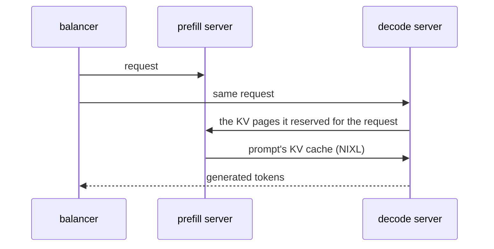
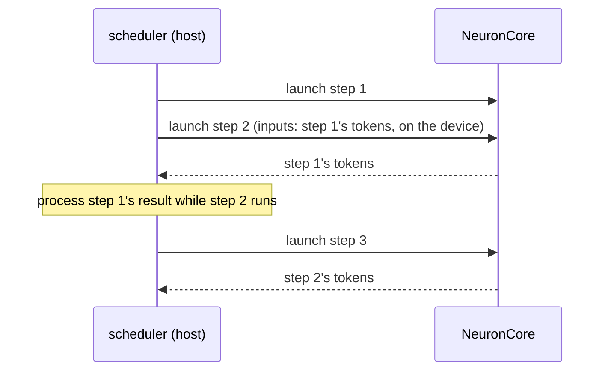
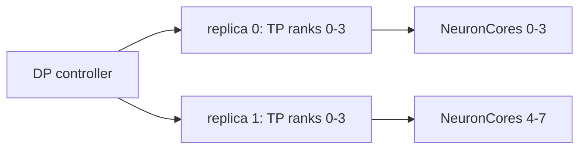
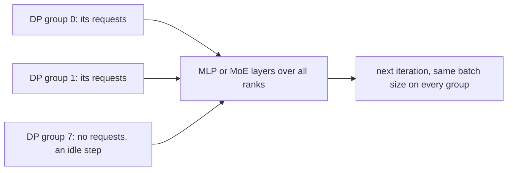
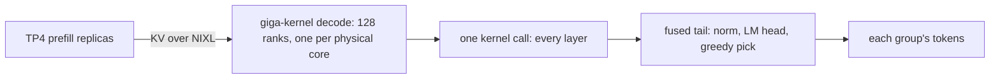
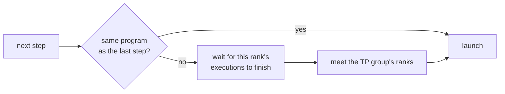

# Features

What each feature does, whether it is always on or which flag turns it on, and where its design is described. Flags
are SGLang's own; the few environment variables the runtime adds are in the
[configuration reference](reference-configuration.md). A launch the runtime cannot serve is refused at startup with a
message that names the setting at fault ([What a launch refuses](../design/runtime.md#what-a-launch-refuses)), and
[Feature and model compatibility](feature-model-compatibility.md) says which model serves which feature.

## Serving

### Disaggregated prefill and decode

Prefill servers and decode servers, each on a single node and its own NeuronCores. The prefill and decode servers may
be on different nodes. A balancer in front sends each request to one prefill server and one decode server, and the
prefill sends the prompt's KV cache to the decode over NIXL.



- **Turn on:** `--disaggregation-mode prefill` on each prefill server and `--disaggregation-mode decode` on each decode
  server, both with `--disaggregation-transfer-backend nixl`. Any other transfer backend is refused.
- **Fixed by the platform:** the NIXL backend and its EFA settings, how a failed transfer's pages are released, the
  prefill's input polling and early prefix send, and the decode's retraction backup. A launch that states another value
  for one of them is refused ([Settings the platform
  fixes](../design/disaggregated-inference.md#settings-the-platform-fixes)).
- **Design:** [Disaggregated inference](../design/disaggregated-inference.md).

### Aggregated serving

One server runs both the prefill and the decode graphs. This is the default when the launch gives no
`--disaggregation-mode`. Its ranks fence every switch between the two ([Program-switch fence](#program-switch-fence)).

### Async scheduling and execution

SGLang's overlap schedule. The scheduler launches the next step before it processes the last one's result, and a
decode step's input tokens are the previous step's output, already on the device, so the host never waits for a step
before launching the next.



- **Always on**, unless the launch passes `--disable-overlap-schedule`.
- **Check it:** with `SGLANG_NEURON_HOST_TRACE=<dir>`, every asynchronously launched step's row in the host trace
  carries `+a` ([The host trace](profiling.md#the-host-trace)).
- **Design:** [Async scheduling and execution](../design/async-scheduling-and-execution.md).

### Tokenizer workers

SGLang's multi-tokenizer HTTP workers. Each worker loads the plugin's admission checks.

- **Turn on:** `--tokenizer-worker-num <n>`. The platform sets `SGLANG_HTTP_SERVER_APP_PATH` to
  `sglang_neuron.http_worker_app:app` and refuses any other app path. GPT-OSS's decode runs four.

### Data-parallel replicas

`--dp-size <replicas>` without DP attention runs that many independent copies of the server's `--tp-size` layout
behind SGLang's DP controller. Each replica runs the whole `--max-running-requests` on its own block of `--tp-size`
NeuronCores.



- **Turn on:** `--dp-size <replicas>`. Replica d runs on the d-th block of `--tp-size` cores in
  `NEURON_RT_VISIBLE_CORES`, or of the node's first cores when that variable is not set; a list must name at least
  `<replicas> × --tp-size` cores.
- **Example:** GPT-OSS's prefill server runs as five replicas of TP4:
  `--disaggregation-mode prefill --tp-size 4 --ep-size 2 --dp-size 5` (from
  `examples/gpt_oss_120b/run_prefill.sh`).
- **Design:** [Data parallelism](../design/parallelism.md#data-parallelism---dp-size-replicas) and
  [Process groups and placement](../design/runtime.md#process-groups-and-placement).

### DP attention

The server's ranks split into DP groups. Each group attends over its own requests, and the MLP or MoE layers run over
all the server's ranks. On a decode server every group runs the same compiled batch size in every iteration, so the
plugin can answer SGLang's per-step exchange of batch sizes itself instead of running it. A group with no requests runs
an idle step, so every collective still has all its ranks.



- **Turn on:** `--dp-size <groups> --enable-dp-attention`. SGLang marks this spelling deprecated in favour of
  `--attn-dp-size <groups>`, which gives the same layout.
- **On a decode server it needs:** async execution, `--max-running-requests` with no decode batch size below its
  per-group share, `--enable-dp-attention-local-control-broadcast`, `--scheduler-recv-interval` at SGLang's default of
  1, no `--sleep-on-idle` and no two-batch overlap. A DP-attention decode that misses one is refused, naming it.
- **On a prefill server** it is served (Qwen3, GLM-4, and GPT-OSS with `--ep-size`) and keeps SGLang's per-step
  exchange.
- **Refused** on an aggregated server, whose groups would mix prefill and decode programs in one step, and with
  `SGLANG_SCHEDULER_SKIP_ALL_GATHER`. Qwen3-MoE and DeepSeek-V2 refuse it on every role.
- **Example:** GPT-OSS's decode, eight DP groups of attention TP8 on 64 NeuronCores, 16 requests per group (from
  `examples/gpt_oss_120b/run_decode.sh`):

  ```bash
  --disaggregation-mode decode --disaggregation-transfer-backend nixl --kv-cache-dtype fp8_e4m3 \
    --tp-size 64 --dp-size 8 --enable-dp-attention --ep-size 64 \
    --enable-dp-attention-local-control-broadcast --max-running-requests 128
  ```

- **Design:** [DP attention](../design/parallelism.md#dp-attention) and
  [The serving policy](../design/runtime.md#the-serving-policy).

### Giga-kernel decode

On GPT-OSS, a decode server laid out as the giga kernel's mesh runs every decoder layer of a step in one call of
nkilib's giga kernel, and the final norm, LM head and greedy pick in one more. Its 128 ranks are the node's 128 physical
NeuronCores, one rank each: 16 DP-attention groups of attention TP8, with one expert per rank. The prefill servers in
front of it are the usual TP4 ones.



- **Turn on:** launch the decode server as `--disaggregation-mode decode --tp-size 128 --dp-size 16
  --enable-dp-attention --ep-size 128` (or `--attn-dp-size 16`), with the DP-attention decode's own flags
  (`--enable-dp-attention-local-control-broadcast`, and a `--max-running-requests` that gives each of the 16 DP groups
  a multiple of 8 requests, 128 in `examples/gpt_oss_120b/run_decode_giga.sh`). The layout selects it, and the
  platform runs that server at one physical core per logical core (`NEURON_LOGICAL_NC_CONFIG=1`).
- **Refused:** sampling other than greedy, top logprobs and requests that ask for logprobs (the fused tail returns
  tokens only); GPT-OSS at 128 ranks in any other layout; one physical core per logical core on any other server.
- **Example:** the decode command in the [GPT-OSS recipe](../model-recipes/gpt-oss.md#serving), and
  `examples/gpt_oss_120b/run_decode_giga.sh`.
- **Design:** [The giga-kernel decode](../model-recipes/gpt-oss.md#the-giga-kernel-decode) and
  [Its result lag](../design/async-scheduling-and-execution.md#the-giga-kernel-decodes-result-lag).

### Expert parallelism

The experts of a MoE model split over `--ep-size` ranks, and each expert's intermediate dimension over the
`--tp-size / --ep-size` ranks that hold the same experts. Under DP attention the experts span all the groups.

- **Turn on:** `--ep-size <ranks>` (GPT-OSS, Qwen3-MoE). Without it, Qwen3-MoE splits each expert's intermediate
  dimension over the attention TP ranks. A GPT-OSS launch with DP attention needs `--ep-size`. DeepSeek-V2 always puts
  whole routed experts on each attention TP rank.
- **Design:** [Expert parallelism](../design/parallelism.md#expert-parallelism).

## Compiled shapes

Every graph is compiled and warmed before the server takes its first request, and serving never compiles a new shape.
The shapes come from the launch's flags, and a step runs the smallest compiled shape that holds it.

### Prefill tiles and chunked prefill

Each prefill forward takes one request. A prefill compiles a graph of the chunk (`--chunked-prefill-size`) and, on
every model but GPT-OSS and Qwen3.5, one of each smaller tile (on Kimi-K3, of each tile of whole stripe cycles), so the
last piece of a prompt runs the smallest graph that holds it.

- **Always on.** On the models other than GPT-OSS, `--cuda-graph-bs-prefill` lists the smaller token counts to compile
  instead of the defaults. GPT-OSS compiles the chunk's graph alone and refuses `--cuda-graph-bs-prefill` below it.
- **Constraints:** on a role that prefills, the chunk (under DP attention, `--chunked-prefill-size` divided by the DP
  size) is a multiple of 128 and of the attention TP size, and larger than the attention TP size. On GPT-OSS, Qwen3,
  Qwen3-MoE and GLM-4 it is also 512, 1024, 2048, 4096 or 8192, the KV segment sizes of the segmented prefill kernel.
  The models that run their own prefill kernels have their own rules (Qwen3.5, Kimi-K3:
  [Compiled shapes](feature-model-compatibility.md#compiled-shapes)).
  DeepSeek-V2's chunk equals `--context-length`, and each of its prefill steps runs the smallest graph that holds the
  request's cached prefix and its new tokens.
- **Example:** on Qwen3, `--chunked-prefill-size 2048 --tp-size 4` compiles prefill graphs of 512, 1024 and 2048
  tokens; GPT-OSS compiles the 2048-token graph alone.
- **Design:** [Buckets](../design/runtime.md#buckets).

### Decode batch ladder

A decode compiles one graph for each power of two below its batch, and one of the batch itself, so a smaller batch pads
to the next size up instead of to the whole batch. The batch is one scheduler's share of `--max-running-requests`: all
of it on a `--dp-size` replica, divided over the groups under DP attention. Without `--max-running-requests` it is
`--cuda-graph-max-bs-decode`, and with neither SGLang's own sizes stand.

- **Always on.** `--cuda-graph-bs-decode`, or decode sizes in `--cuda-graph-config`, lists the sizes instead. A
  DP-attention decode compiles its batch alone, the one size all its groups run.
- **Example:** `--max-running-requests 64` compiles decode batches of 1, 2, 4, 8, 16, 32 and 64 rows.
- **Design:** [Buckets](../design/runtime.md#buckets).

### Decode context ladder

The decode attention reads its graph's whole context. A model that opts in also compiles each batch size over a quarter
and a half of the context, and a step runs the smallest context that holds its longest row.

| `--max-running-requests 64 --context-length 4096` | context 1024 | context 2048 | context 4096 |
| --- | --- | --- | --- |
| batch 1, 2, 4, 8, 16, 32, 64 | 7 graphs | 7 graphs | 7 graphs |

- **Always on** for the models that opt in (Qwen3, Qwen3-MoE, GLM-4, DeepSeek-V2). Off under DP attention, where the
  groups share only their token counts, not their rows' lengths.
- **Check it:** each warm-up logs `[neuron] warm decode bucket=<rows> context=<tokens>`, and each runtime then logs
  `[neuron] warmup done in <seconds>s (<n> shapes)`. An aggregated server logs one such line for its decode graphs and
  one for its prefill graphs.
- **Design:** [Buckets](../design/runtime.md#buckets).

### Program-switch fence

When a rank is about to run a different compiled program from the one it ran last, it first waits for its own
executions to finish and meets the other ranks of its TP group, so no rank starts the new program while a peer still
runs the old one on the shared collective buffers.



- **Always on** on an aggregated server, and on any server that compiled more than one shape. Steady decode, one
  program step after step, never fences.
- **Design:** [The program-switch fence](../design/runtime.md#the-program-switch-fence).

### Same program on every rank

At startup the ranks of a TP group compare a digest of what each one is about to compile, then the program each rank
compiled for every shape. A rank whose settings differ fails at startup instead of in a mismatched collective.

- **Always on.**
- **Design:** [The model contract digest](../design/runtime.md#the-model-contract-digest).

## Caching

### Prefix (radix) cache

SGLang's radix cache on every server that prefills. A prefilling server keeps its forwards on whole chunks, except the
one that ends a prompt, so a prefix-cache hit still runs a compiled shape.

- **On by default**, as in SGLang; `--disable-radix-cache` turns it off.
- **Decode server:** off by default, as in SGLang; `--disaggregation-decode-enable-radix-cache` gives a PD decode its
  own tree, so a request whose prompt starts with a prefix the decode holds on its DP rank takes only the pages after
  it from the prefill. A later turn that reuses KV the decode wrote is close to a cold run, not bit-identical.
- **Keyed on whole chunks**, opt-in: `--radix-cache-backend neuron-chunk` makes a hit's prefill bit-identical to a cold
  one, for hits of whole chunks only. A prompt of one chunk or less never hits, and an aggregated server reuses no
  earlier turn's outputs. Served on a prefill or aggregated server of GPT-OSS, Qwen3, Qwen3-MoE and GLM-4, and of
  Qwen3.5 and Kimi-K3, which keep their recurrent state only at chunk ends and so refuse SGLang's default tree.
- **Decode server keyed on whole chunks**, opt-in: `--radix-cache-backend neuron-chunk` with
  `--disaggregation-decode-enable-radix-cache` keeps only KV the prefills computed for whole chunks, and gives each
  request only KV from a prefill of the same fingerprint (chunk, tree, TP, EP, attention TP and DP, PP), so a hit
  decodes over its cold run's KV bits. The tree keys the decode's `--chunked-prefill-size` over its attention-DP groups,
  which must be whole 128-token pages, and the decode serves only prefills on `neuron-chunk` or `--disable-radix-cache`
  whose chunk divides it: behind GPT-OSS's 8192-token prefill chunk, its DP8 decode needs `--chunked-prefill-size
  65536`. Requests of a prefill it cannot pair with fail with the reason; the decode keeps serving the others.
- **Hierarchical cache (HiCache L2):** `--enable-hierarchical-cache` keeps the prefixes the pool evicts in host memory
  and copies them back on a later hit, on aggregated and prefill servers with an MHA pool, the paged MLA / DSA pool (the
  latent, the DSA index keys, each rank its own block of a CP page) or Kimi-K3's MLA and state pools. `--hicache-ratio`
  sizes the host copy. On multi-turn sessions `--hicache-write-policy write_through` serves best: `write_back` copies on
  eviction, in the way of the request that needs the pages, and `write_through_selective` copies a prefix only once it
  has been hit, which a session's history rarely is before it leaves the device.
- **Refused:** the decode radix cache on a pipelined decode (`--pp-size` above 1) and on a DCP decode (`--dcp-size`
  above 1); the hierarchical cache on a decode server (served for a model whose catalog entry opts its decode in,
  Qwen3.5), pipelined or on `neuron-chunk` (both served for a model that keeps state checkpoints at chunk ends,
  Qwen3.5 and Kimi-K3), and with an L3 storage backend
  (`--hicache-storage-backend`) other than the [remote DRAM tier](hicache-remote-dram.md). `--radix-cache-backend
  neuron-chunk` is refused on a decode without
  `--disaggregation-decode-enable-radix-cache` or with `--enable-streaming-session`, with `--disable-radix-cache`,
  `--enable-lmcache` or `--enable-flexkv`, and on DeepSeek-V2. Any other `--radix-cache-backend` but `kimi-prompt`
  (the Kimi-K3 PD prefill's prompt cache, [Kimi-K3](../model-recipes/kimi-k3.md#the-kimi-prompt-cache)) is refused.
- **Design:** [Prefix (radix) cache](../design/runtime.md#prefix-radix-cache),
  [The decode radix cache](../design/disaggregated-inference.md#the-decode-radix-cache).

### KV cache

The KV cache is in pages of 128 tokens, in a dtype the model's graphs serve. A launch without `--page-size` gets 128;
another page size, or a KV dtype the model does not serve, is refused.

- `--kv-cache-dtype fp8_e4m3` for GPT-OSS, which serves no other; `auto`, `bf16` or `bfloat16` for the other models.
- `--max-total-tokens` sizes the pool. Without it the pool is sized from the free device memory, and the compiled
  graphs, and so the compile cache, then depend on that reading.
- **Design:** [KV cache](../design/runtime.md#kv-cache).

## Sampling

### Device sampling

The graphs sample on the device unless the launch picks the host sampler.

- `SGLANG_NEURON_SAMPLER` picks the sampler for the launch: `greedy` (the default), `temperature`, or `topk_topp` for
  SGLang's top-k, top-p and min-p filters over the top 256 tokens. Under `topk_topp`, a top-p nucleus wider than 256
  tokens is cut to those 256.
- `host` reads each step's logits back and runs SGLang's own sampler, for what the device samplers refuse: penalties,
  `min_new_tokens`, logit bias, custom logit processors, structured outputs (`json_schema`, `regex`, `ebnf`,
  `structural_tag`), a top-k above 256, token-ID logprobs and any number of top logprobs. It draws unseeded, so a
  sampled request's `sampling_seed` is refused. Each step waits for its logits, so it needs
  `--disable-overlap-schedule`, and it is refused with `--pp-size` above 1, on a decode with DP attention, with
  `SGLANG_NEURON_MAX_TOP_LOGPROBS` set, and with `--enable-strict-thinking`.
- `SGLANG_NEURON_MAX_TOP_LOGPROBS` sets the most top logprobs a request may ask for (none by default).
- A request that asks for something the launch's sampler does not apply is refused at admission with an error, never
  served with the option dropped. Where the launch could run the `host` sampler and it serves the option, the error
  names it.
- **Example:** a launch with `SGLANG_NEURON_SAMPLER=temperature` serves `{"sampling_params": {"temperature": 0.7,
  "max_new_tokens": 128}}`, and refuses the same request with `"top_p": 0.9` at admission ("top_k / top_p / min_p
  filtering is not applied by this Neuron device sampler ..."); `topk_topp` serves both.
- **Design:** [Device sampling](../design/runtime.md#device-sampling), [The host
  sampler](../design/runtime.md#the-host-sampler).

## Placement

### NeuronCores and NUMA binding

`NEURON_RT_VISIBLE_CORES` names a server's cores, and rank i runs on the i-th. Every scheduler is bound to the NUMA
node of its NeuronCore.

- **Always on.** `--numa-node` picks the nodes instead. `--base-gpu-id` and `--gpu-id-step` are refused: the cores, not
  GPU ids, place a server.
- **Example:** two TP4 servers side by side on one node, such as two decode servers:
  `NEURON_RT_VISIBLE_CORES=0-3` with `--port 30001`, and `NEURON_RT_VISIBLE_CORES=4-7` with `--port 30002`.
- **Design:** [Process groups and placement](../design/runtime.md#process-groups-and-placement).

## Diagnostics

### System profile and host trace

A system profile of a window of a running server, through SGLang's `/start_profile` with `{"activities": ["NEURON"]}`;
a profile set at launch with `SGLANG_NEURON_PROFILE_RANKS` or `SGLANG_NEURON_PROFILE_SERVE_RANKS`; and a per-rank
timeline of the scheduler loop's phases (`SGLANG_NEURON_HOST_TRACE`). All are off unless asked for.

- **How:** [Profiling](profiling.md).
