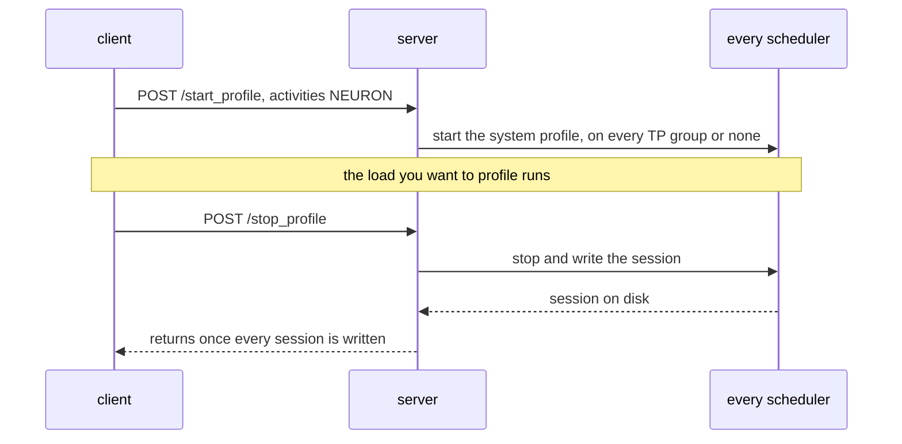
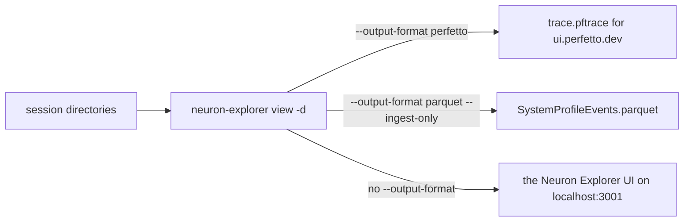
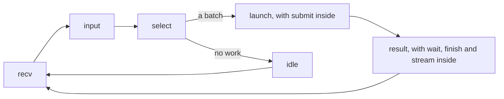

# Profiling

Two records show where a server's time goes: the Neuron runtime's system profile, which records every program
execution and every collective wait on the server's NeuronCores, and the host trace, a timeline of each scheduler
loop's phases. Both are off unless asked for.

## A system profile of a running server

SGLang's `/start_profile` and `/stop_profile` record the Neuron runtime's system profile when the activity is
`NEURON` (`sglang_neuron/sglang_patches/neuron_system_profile.py`):

```bash
curl -X POST http://<server>:<port>/start_profile -H 'Content-Type: application/json' \
  -d '{"activities": ["NEURON"], "output_dir": "/tmp/profile"}'
# ... run the load to profile ...
curl -X POST http://<server>:<port>/stop_profile
```



Every scheduler (on the giga-kernel decode, DP group 0's first rank alone) writes one session directory,
`<instance>_pid_<pid>/<start ns>/`, under the request's `output_dir`, else `SGLANG_TORCH_PROFILER_DIR`, else `/tmp`. A
session holds the records of that scheduler's NeuronCores: an `nc_exec_running` event per program execution on each of
the scheduler's physical cores (two at LNC2, one at LNC1; column `pcore_idx`), so count or pair executions on one of
them; the `cc_exec_barrier` waits of its collectives; and the host's `nrt_model_submit` calls.

- **NEURON runs alone.** A request that adds any other activity (`CPU`, `GPU`, `MEM`, `RPD`) is refused, and so is
  one with `start_step`, `num_steps` or `profile_by_stage`: the profile spans the two calls, not a count of steps. A
  start while any profile runs, SGLang's own or a NEURON one, is refused until `/stop_profile`.
- **Not with the serve window.** A server launched with `SGLANG_NEURON_PROFILE_SERVE_RANKS` refuses every
  `/start_profile` ([Profiles set at launch](#profiles-set-at-launch)).
- **Every group or none.** On a server of several TP groups (DP attention, or a prefill of several replicas) a start
  succeeds on every group or fails on all of them.
- **One rank on the giga-kernel decode.** There only DP group 0's first rank writes a session. Every rank meets the
  others at the kernel's barrier inside each step, so that rank's barrier waits show, every step, when the last rank
  arrived, and a session on all 128 ranks would slow the run and give a trace too large to open. A giga step records
  many more runtime events than a per-layer step, so that rank's runtime buffers up to 32 million events per
  NeuronCore between exports.
- **The session exports as it records.** Every 2 seconds torch-neuronx has the runtime append each core's new events
  to a chunk in the session directory (`ntrace.nc<core>.part`). The stop writes the rest and joins the chunks into the
  session's `ntrace.pb`, the file every reader below opens. Chunks left in a directory mean the session is still
  recording or its stop failed. A rank that ran a forward in the window but has no `ntrace.pb` lost its events: its
  log says why, and `/stop_profile` reports it.
- **Keep the window out of a measured run.** Starting a profile pauses each scheduler for about a step, and stopping it
  pauses each scheduler while the last events are written and the chunks joined (the log gives each stop's time, `its
  stop took`); `/stop_profile` returns once every session is on disk. While a session records, each export can also
  delay one program submission on that rank by the time the runtime takes to drain the core's events, so the trace
  shows a short gap every 2 seconds that an unprofiled run does not have. Put the window in a warm-up run, or start
  the run you measure after `/stop_profile` returns.
- **Disaggregated servers.** Start and stop the window on each server, the prefill and every decode server; each writes
  its own sessions on its own node.

## Profiles set at launch

For a profile set when the server starts, from process start or over a window of decode steps, the runtime reads these
variables ([Configuration reference](reference-configuration.md#environment-variables-the-runtime-reads)); a malformed
value (a rank list, the window's start or step count, or the device mode) refuses the launch, naming the variable:

| Variable | Records |
| --- | --- |
| `SGLANG_NEURON_PROFILE_RANKS` | the Neuron runtime's device and system profile from process start, for those local ranks, in `core<n>/` |
| `SGLANG_NEURON_PROFILE_SERVE_RANKS`, `_START`, `_STEPS` | the device and system profile of every execution in `_STEPS` decode steps (default 4) from decode step `_START` (default 16), for those TP ranks, in `serve_rank<r>/` (`serve_rankdp<d>_tp<r>/` for each replica of a plain `--dp-size` server); every TP rank drains its device and meets at a barrier at the window's first and last step, so keep the window out of a measured run |
| `SGLANG_NEURON_PROFILE_DEVICE_MODE` | the device mode of the `SGLANG_NEURON_PROFILE_RANKS` profile: `model` profiles one execution of each program, `session` every execution |
| `SGLANG_NEURON_PROFILE_DIR` | where those two profiles go, `/tmp/neuron_profile` by default (not the `/start_profile` sessions, which follow the request's `output_dir`) |

The serve window records every execution while it is open, through torch-neuronx's `torch.profiler` integration
(`torch_neuronx.profiling.NeuronConfig` with its device and runtime modes): the length of the window, `_STEPS`, bounds
what it records. The profile carries the NEFFs it needs to be read, copied from the NEFF cache
(`TORCH_NEURONX_NEFF_CACHE_DIR`, `/tmp/neff_cache` by default). `torch.profiler` runs one session per process, and a
second start ends the first without an error, so:

- **One or the other per server.** A server launched with `SGLANG_NEURON_PROFILE_SERVE_RANKS` refuses every
  `/start_profile`, `NEURON` and SGLang's own activities alike, on every rank and every replica, for as long as it
  runs; launch it without the window to use `/start_profile`.
- **One profile per rank.** A launch that selects a rank in both `SGLANG_NEURON_PROFILE_RANKS` and the window is
  refused, since a second session would replace the first; select each rank in one of the two. Under `--pp-size`,
  local rank `s * tp + r` is TP rank `r` of pipeline stage `s`, which a window over TP rank `r` selects. A launch
  environment that sets `NEURON_RT_INSPECT_ENABLE` itself starts the runtime's profile on every rank, so with the
  window it is refused too.

## Opening a profile

`neuron-explorer` reads the session directories, and the launch-time profiles' `core<n>/` and `serve_rank<r>/`
directories the same way (`-d <dir>`). It turns them into one of three things:




- **Perfetto.** Copy one session directory per rank (each scheduler's latest `<start ns>/`) under one directory and
  convert it; neuron-explorer reads every session under it, whatever the subdirectory names, so leave older sessions
  out. A serve-window profile keeps the NEFFs its device profile needs beside its session, in `serve_rank<r>/neffs/`:
  copy the window's `serve_rank<r>/` whole, its one session and `neffs/` together, not its `<start ns>/` alone:

  ```bash
  neuron-explorer view -d <dir> --output-format perfetto \
    --system-trace-secondary-group=worker_gid,lnc_idx --output-file trace.pftrace
  ```

  Open `trace.pftrace` in [ui.perfetto.dev](https://ui.perfetto.dev) with "Open trace file"; the browser loads it
  locally.
- **Tables.** Convert one session to Parquet:

  ```bash
  neuron-explorer view -d <session> --output-format parquet --output-file <out> --ingest-only
  ```

  This writes `SystemProfileEvents.parquet`, one row per event, under the folder `<out>`. Without `--ingest-only` it
  goes on to serve the Neuron Explorer UI and does not exit. `--output-format summary-json`, given without
  `--output-file`, prints the session's total duration and the count of each event type.
- **Neuron Explorer.** `neuron-explorer view -d <session>` without `--output-format` processes the session and serves
  the Neuron Explorer UI at `http://localhost:3001` (`-p` sets the port). The UI's API server runs on port 3002, and
  the command keeps both servers running until it is stopped. On a remote host, forward both ports. To add a session
  to a Neuron Explorer server that is already running, use
  `neuron-explorer upload --endpoint <server API URL> --profile-directory <session> --wait`.

### What to look for

- **An idle gap before a step:** the device sat idle between two programs, waiting for its host or the runtime, or,
  on a server below saturation, for its next request. On a server with no host overhead the next program is already
  queued and the gap is close to zero.
- **A long `cc_exec_barrier`:** a rank waited in a collective for a peer that arrived late. Match the ranks' executions
  by end time, since a collective releases its ranks together, after removing each rank's clock offset (the median
  difference of its end times from another rank's); the rank with the shortest wait arrived last.
- **A long `nc_exec_running`:** the program itself, or the device resources it shares, ran long.

## The host trace

`SGLANG_NEURON_HOST_TRACE=<dir>` makes each traced TP rank write a timeline of its scheduler loop to
`<dir>/host_rank<r>.tsv` (`host_rankdp<d>_tp<r>.tsv` for each replica of a plain `--dp-size` server);
`SGLANG_NEURON_HOST_TRACE_RANKS` lists the traced TP ranks (every rank when unset)
(`sglang_neuron/model_executor/host_trace.py`). Each row of the tab-separated file (columns `kind`, `start`, `end`,
`arg`) is a phase with its start and end in CLOCK_REALTIME nanoseconds, the clock of the system profile, so the two
line up to within each device's clock offset; `arg` is the phase's batch or count:

One pass of the scheduler loop, with the phases nested inside `launch` and `result`:



| Phase | What it times |
| --- | --- |
| `recv` | receiving requests, including the cross-rank broadcast |
| `input` | processing the received requests |
| `select` | picking the next batch |
| `launch` | building and launching a step and, for a synchronous step, waiting for its outputs; its batch is marked `+a` when the step was launched asynchronously: the launch returned without waiting for the step's outputs, so the host could go on while the device ran it |
| `submit` | inside a launch, the graph call that submits the program |
| `fence` | inside a submit, the program-switch fence's device sync and rank meeting |
| `result` | processing a step's result |
| `wait` | inside a result, waiting for an async step's outputs |
| `finish` | inside a result, the finish-state handling of the batch's requests, summed into one row that starts with the result |
| `stream` | inside a result, streaming the batch's output to the detokenizer |
| `gc<g>` | one Python garbage collection of generation g |
| `idle` | the loop's idle handler |
| `<Class.method>` | each function or method named in `SGLANG_NEURON_HOST_TRACE_SPANS`, by its last two name components, to split a phase further: `sglang.srt.managers.schedule_batch.ScheduleBatch.prepare_for_decode` is timed as `ScheduleBatch.prepare_for_decode` |

A batch is `P<requests>x<tokens>` for a prefill, `D<rows>` for a decode, `I` for an idle step and `-` for none. The rows
are buffered and written right after an asynchronous launch, so the trace adds no I/O to a step's critical path; a
stretch without asynchronous launches writes once it has buffered 65,536 rows, wherever it is. An idle loop drops the
rows of a stretch that received, launched or held no work, and writes those of a stretch that served work once it is
idle with nothing pending, so the file is complete once the server has gone idle or exited.

A launch not marked `+a` returned only once its own step's outputs were on the host, so the device sat idle from the
end of that step until the next launch. The phases between the two launches name what the host was doing meanwhile.
