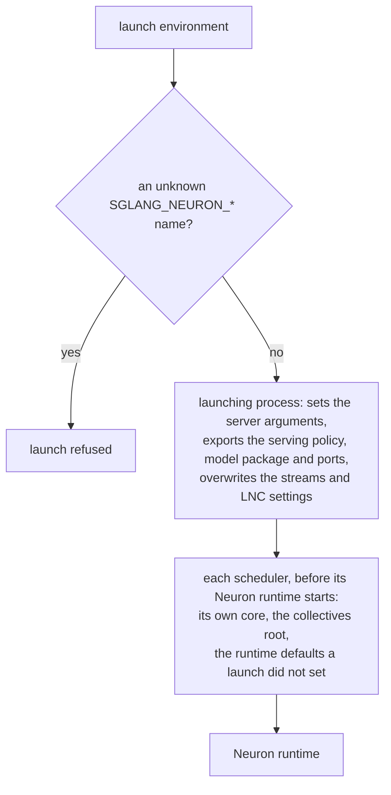

# Configuration reference

A launch configures the runtime with SGLang's own flags. The runtime adds a few environment variables for settings that
SGLang has no flag for, sets others itself for every process a launch starts, and refuses a launch that states another
value for a setting it fixes. This page lists all of them. What each refused flag or request is, and why, is in
[What a launch refuses](../design/runtime.md#what-a-launch-refuses).

## The launch environment

| Variable | Meaning |
| --- | --- |
| `SGLANG_PLATFORM` | `neuron` selects the platform; the plugin installs its hooks only under it, and a launch that resolves the Neuron platform without it is refused. |
| `NEURON_RT_VISIBLE_CORES` (or `NEURON_VISIBLE_DEVICES`, which wins when both are set) | The server's NeuronCores, a range list such as `4-7`; rank i runs on the i-th, and each rank then sees only its own core. Without either the server takes the node's first cores, and each replica of a plain `--dp-size` launch its own block of them. `--base-gpu-id` and `--gpu-id-step` are refused in its favour. |

## Environment variables the runtime reads

The platform refuses any other `SGLANG_NEURON_*` name in a launch's environment (`sglang_neuron/env_registry.py`), so a
misspelled variable stops the launch instead of being ignored. The sampler, the top-logprobs cap, the rank lists, the
serve window, the device mode and the hybrid SWA radix mode are parsed at launch, and a malformed value is refused,
naming the variable.

| Variable | Default | Meaning |
| --- | --- | --- |
| `SGLANG_NEURON_SAMPLER` | `greedy` | The sampler: `greedy` takes the argmax, `temperature` draws from the tempered distribution over the whole vocabulary, `topk_topp` adds SGLang's top-k, top-p and min-p filters over the top 256 tokens, and `host` runs SGLang's own sampler on the logits read back each step (with `--disable-overlap-schedule`). A request the sampler cannot serve is refused at admission. |
| `SGLANG_NEURON_GPT_OSS_EXPERTS` | `mxfp4` | GPT-OSS's expert format: `mxfp4` runs the checkpoint's MXFP4 experts (the prefill quantizes activations to MX FP8); `bf16` runs BF16 experts dequantized from the MXFP4 blocks on the host, at about four times the memory, as an accuracy reference on BF16 activations. The rest of the graphs is the same, and `--quantization` stays MXFP4. `bf16` is served only at `--tp-size 16 --ep-size 4`, where its kernels were measured on a NeuronCore and fit a rank's HBM. Any other value is refused. |
| `SGLANG_NEURON_QWEN35_PACK` | unset | The Qwen3.5 launch's packed checkpoint directory (`models/qwen35/weights.py`). A Qwen3.5 launch refuses to start without it; other models never read it. |
| `SGLANG_NEURON_QWEN35_KV_CP` | `1` | The Qwen3.5 P/D decode role's KV context-parallel degree (`models/qwen35/config.KV_CP_ENV`): at 16 the decode context-parallels the KV of each paged-attention page over the 16-rank replica and the PD transfer scatters each page's block to the rank that attends over it. Refused on any role but the PD decode; a positive integer only. |
| `SGLANG_NEURON_QWEN35_KV_TM` | `0` | `1` stores the kv_cp=1 Qwen3.5 PD prefill's K pages token-major, like its V pages (`models/qwen35/config.KV_TM_ENV`). The kv_cp=16 decode's K pages are token-major, and the kv_cp scatter refuses a dim-major prefill K pool at registration, so a prefill paired with that decode sets it ([Qwen3.5 PD](../model-recipes/qwen35-pd.md)). |
| `SGLANG_NEURON_QWEN35_HICACHE` | `0` | `1` opts the Qwen3.5 PD decode's KV and state pools into HiCache's host tier; without it `--enable-hierarchical-cache` is refused on the decode (the catalog entry's `decode_hicache_env`). |
| `SGLANG_NEURON_QWEN35_SCATTER_MAX_DESCS` | `32768` | The kv_cp scatter's bound on the EFA descriptors of one posted batch (`sglang_patches/kv_cp_scatter.py`, page-aligned); the 256K PD prefill sets 8192. |
| `SGLANG_NEURON_QWEN35_SCATTER_DRAIN` | `1` | `1` settles the kv_cp scatter's previous posted batch before it posts the next, so an EFA queue pair never holds a whole request's descriptors; `0` posts without settling. |
| `SGLANG_NEURON_QWEN35_SCATTER_DUMP` | unset | `1` logs the kv_cp scatter's descriptor layout and count of every send. A debugging aid. |
| `SGLANG_NEURON_QWEN35_STATE_DUMP` | unset | `1` logs, at a request's first decode step on each Qwen3.5 decode rank, a checksum of every layer's received GDN state slot (`models/qwen35/runtime.py`). A debugging aid. |
| `SGLANG_NEURON_STATE_CKPT_RESERVE_GB` | `2` | The device memory, in GiB, the int8 recurrent-state checkpoint store (`--enable-int8-mamba-checkpoint`) leaves free for the programs' loads when it sizes itself (`mem_cache/state_checkpoint_pool.py`); a store that would leave less is refused. |
| `SGLANG_NEURON_HYBRID_SWA_RADIX` | `0` | `1` runs hybrid SWA memory under the radix cache, its window pool checked at start-up to hold what the tree keeps: a shared prefix then hits only at the tree's window checkpoints (its chunk-boundary inserts and a finished request's last window), not at its page floor ([The radix mode](../design/runtime.md#the-radix-mode)). Refused, naming every reason, on a launch it does not serve, `--disable-radix-cache` among them. Only `0` and `1` are accepted. |
| `SGLANG_NEURON_MLA_POOL` | `rows` | The pool SGLang's MLA kind gets: `rows`, SGLang's MLA pool on the NeuronCore (one compact row per token slot); `paged`, the paged latent pool (`sglang_neuron/mem_cache/mla_pool.py`: freed pages zeroed before reuse, HiCache L2 and retraction host copies). DeepSeek-V2 reads either through the same graphs: at one block a page and no context parallelism the paged pool's blocks viewed as rows are the row pool's layout, byte for byte. Only `rows` and `paged` are accepted. |
| `SGLANG_NEURON_DSV2_MAX_CONTEXT` | `4096` | The longest `--context-length` a DeepSeek-V2 launch is let through, for a long-context probe: the prefill kernel holds the whole window in SBUF, 9 bytes a token on each partition, so a longer window may not compile. |
| `SGLANG_NEURON_HBM_TAIL_GUARD` | `0` | `1` holds the last MiB of the Neuron runtime's small-allocation arena, at the top of the HBM aperture, from the runtime start for the life of the process, so no NEFF instruction stream ends within the engines' prefetch reach of the bound (the workaround for NRT status 1200, "Stuck in collectives op"; `sglang_neuron/backend/hbm_tail_guard.py`). On the Neuron device only; refused in CPU mode. Only `1` and unset are accepted. |
| `SGLANG_NEURON_GLM52_POINT` | `128k` | GLM-5.2's decode point, on both PD roles: `128k`, 32 slots of 131,072 positions, or `1m`, 32 slots of 1,048,576. It sets the decode giga kernel's geometry and kernel settings and the KV formats the prefill writes, so both servers of a pair set the same one, and a prefill rank refuses a decode of another point at first contact. Any other value is refused ([The served points](../model-recipes/glm52.md#the-served-pairings)). |
| `SGLANG_NEURON_GLM52_WEIGHT_STORE` | unset | The GLM-5.2 decode's weights: the directory of a weight store built once from the checkpoint for the decode point's geometry, in the decode giga kernel's per-rank layout, or `zeros`, zero weights of the store's shapes for a device time without a store, whose tokens mean nothing. A GLM-5.2 decode needs it, and refuses a store built for another sharding, naming the field, or from another checkpoint ([The weight stores](../model-recipes/glm52.md#the-weight-stores)). |
| `SGLANG_NEURON_GLM52_ATTN_W8` | `1` | The GLM-5.2 decode's attention weights in FP8: `1` loads `wq_b` and `o_proj` as e4m3 bytes, half their bf16 bytes, each scale a power of two folded exactly into a neighbouring weight, so the rounding is the only change; `0` serves both in bf16. Any other value is refused when the weights load. |
| `SGLANG_NEURON_GLM52_PD_MTP` | unset | `1` on a GLM-5.2 prefill whose decode drafts with the MTP layer (`--speculative-algorithm NEURON_MTP`): its last stage registers and sends the prompt's MTP rows. At first contact a prefill rank refuses a drafting decode without it, and a decode without MTP with it. Only `1`, `0` and unset are accepted. |
| `SGLANG_NEURON_GLM52_MTP_SYNTHETIC_AL` | unset | Benchmark only: an acceptance length from 1 to 8 that the GLM-5.2 async MTP decode pins, keeping each step's drafts at fixed rates whatever their tokens, so throughput runs compare at one acceptance. The answers are then not the target's distribution, and the worker logs a warning. Every verifying slot takes the synthetic count, whatever the request. Set, the step graph traces a few more ops, so it compiles a program of its own; unset, the graph is the served one. Refused with `SGLANG_NEURON_GLM52_LOGIT_TEST_DIR`. |
| `SGLANG_NEURON_HICACHE_ASYNC_LOAD` | `1` | With the hierarchical cache on an aggregated server, a prefill whose host pages are still loading is held back while the running batch decodes, and runs once its load has landed, so the decode steps go on during the load. Any other value turns the hold off, and the prefill then waits for its load on the scheduler thread, which launches no step meanwhile ([Prefix (radix) cache](../design/runtime.md#prefix-radix-cache)). |
| `SGLANG_NEURON_MAX_TOP_LOGPROBS` | `0` | The most top logprobs a request may ask a device sampler for; at most 256 under `topk_topp`, and unset under `host`, whose sampler returns any number. Above 0 the decode compiles at `-O1` instead of `-O2`, as it does under the `topk_topp` sampler whatever this value is. |
| `SGLANG_NEURON_MAX_INFLIGHT_LAUNCHES` | `2` | The graph launches a scheduler keeps in flight ([The in-flight bound](../design/async-scheduling-and-execution.md#the-in-flight-bound)); on the giga-kernel decode, also the steps its result processing trails by, 2 to 4. A value that is not an integer of 1 or more is refused when the runtime starts. |
| `SGLANG_NEURON_PROFILE_RANKS` | unset | A comma list of local ranks whose Neuron runtime records its device and system profile from process start, into `<profile dir>/core<n>/` (`n` the rank's NeuronCore; on a plain `--dp-size` server the listed local ranks of every replica record). Those ranks set the runtime's `NEURON_RT_INSPECT_*` variables over any launch value. |
| `SGLANG_NEURON_PROFILE_SERVE_RANKS`, `SGLANG_NEURON_PROFILE_SERVE_START`, `SGLANG_NEURON_PROFILE_SERVE_STEPS` | unset, 16, 4 | The device and system profile of every execution in `_STEPS` decode steps from step `_START`, for the listed TP ranks, into `<profile dir>/serve_rank<r>/` (`serve_rankdp<d>_tp<r>/` for each replica of a plain `--dp-size` server), through torch-neuronx's `torch.profiler` integration. A server launched with the window refuses every `/start_profile`, and a launch that selects a rank in both the window and `SGLANG_NEURON_PROFILE_RANKS`, or that sets `NEURON_RT_INSPECT_ENABLE` itself, is refused ([Profiling](profiling.md#profiles-set-at-launch)). |
| `SGLANG_NEURON_PROFILE_DEVICE_MODE` | `model` | The device mode of the `SGLANG_NEURON_PROFILE_RANKS` profile: `model` profiles one execution of each program, `session` every execution while the profile is on. |
| `SGLANG_NEURON_PROFILE_DIR` | `/tmp/neuron_profile` | Where those profiles go. |
| `SGLANG_NEURON_HOST_TRACE` | unset | A directory; each traced TP rank writes a timeline of its scheduler loop's phases to `host_rank<r>.tsv` there (`host_rankdp<d>_tp<r>.tsv` for each replica of a plain `--dp-size` server) ([Profiling](profiling.md#the-host-trace)). |
| `SGLANG_NEURON_HOST_TRACE_RANKS` | every rank | A comma list of the TP ranks the host trace records. |
| `SGLANG_NEURON_HOST_TRACE_SPANS` | unset | A comma list of dotted function or method names the host trace times as rows of their own, each named by its last two components ([Profiling](profiling.md#the-host-trace)). |
| `SGLANG_NEURON_WEIGHT_HASH_DIR` | unset | A directory; after loading, each rank writes the md5 of every parameter and buffer of each of its graphs to `weights_rank<r>_<phase>.txt` there (`weights_rankdp<d>_tp<r>_<phase>.txt` for each replica of a plain `--dp-size` server, `weights_rankpp<s>_tp<r>_<phase>.txt` for each pipeline stage), one sorted line per tensor, to find the tensors that differ between ranks or launches. It copies every weight to the host, which slows the start-up. |
| `SGLANG_NEURON_PP_BOUNDARY_DUMP_DIR` | unset | A directory; under `--pp-size` above 1, every rank that sends over the PP seam writes its first `SGLANG_NEURON_PP_BOUNDARY_DUMP_STEPS` (4 when unset) boundary sends there, one `s<pp rank>_r<tp rank>_send<n>.pt` each, to compare a stage's boundary with a reference run's ([Pipeline parallelism](../design/pipeline-parallelism.md#configuration)). A count that is not a non-negative integer is refused. |
| `SGLANG_NEURON_PP_BOUNDARY_DUMP_STEPS` | `4` | How many sends each rank writes under `SGLANG_NEURON_PP_BOUNDARY_DUMP_DIR`. |
| `SGLANG_NEURON_REQUIRE_NKI_KERNELS` | unset | SGLang Diffusion (FLUX.1-dev): `1` makes an NKI kernel gate that takes its torch fallback raise ([FLUX.1-dev](../model-recipes/flux1-dev.md)). |
| `SGLANG_NEURON_DISABLE_NKI_KERNELS` | unset | SGLang Diffusion (FLUX.1-dev): `1` makes every NKI kernel gate take its torch fallback. |
| `SGLANG_NEURON_KIMI_K3_TEST_DUMP_DIR` | unset | Test-only, the Kimi-K3 test dump: a directory both roles can reach. Set on the prefill and the decode, each rank writes under `<request id>/`: after a prefill request's last chunk, each stage rank's MLA and drafter row blocks of the request's pages and its KDA state slot (`stage<s>/rank<r>/`: a `manifest.json` and one `.bin` a tensor, `models/kimi_k3/prefill_dump.py`), and the vocabulary shard of the logits each role samples from: the prefill's last stage the row of the request's last prompt position, the decode each step's verify rows of the accepted prefix (`models/kimi_k3/logits_dump.py`). The graphs hand out these logits, so a launch with the dump compiles graphs of its own, and the prefill waits for its launched graphs before each dumped request's copies; take no perf numbers from it. |
| `SGLANG_NEURON_KIMI_K3_TEST_DUMP_RID` | unset | A regular expression; with `SGLANG_NEURON_KIMI_K3_TEST_DUMP_DIR`, only requests whose id it matches are dumped (every request when unset). |
| `SGLANG_NEURON_DEBUG_MESH` | unset | `1` logs every process group's replica groups. |
| `SGLANG_NEURON_LINGBOT_TIMING_FILE` | unset | SGLang Diffusion (LingBot-World-V2): a path; the LingBot stage appends one JSON row of engine-side timings per served chunk there. |
| `SGLANG_NEURON_WAN_VAE_PATCH_PARALLEL_SIZE` | unset | SGLang Diffusion (Wan2.2): the VAE's patch-parallel group size, ranks `0` to size - 1, clamped to the world: 1, 2, 4, 8, 16 or a multiple of 32. Unset, the pipeline takes the degree for the task at its load-time resolution (the first `--warmup-resolutions` entry, else 480 x 832): 16 / 32 / 64 for T2V and 16 / 32 / 32 for I2V at 480p / 720p / 1080p. |
| `SGLANG_NEURON_VAE_MAX_DEVICE_GATHER_BYTES` | unset | SGLang Diffusion (Wan2.2): a positive byte count, the size of each chunk the patch-parallel VAE gathers its tiles in on the device, in place of 128 MiB. FLUX.1-dev's VAE keeps its 512 MiB. |
| `SGLANG_NEURON_WAN_SAVE_VIDEO_PT` | unset | SGLang Diffusion (Wan2.2), for accuracy checks: a `.pt` path the pipelines save each request's decoded frames to (`[T, 3, H, W]` bf16 in [0, 1]); `{index}` in the path numbers one file per request. |
| `SGLANG_NEURON_WAN_SAVE_VIDEO_PT_INDICES` | unset | With `SGLANG_NEURON_WAN_SAVE_VIDEO_PT`, a comma list of the 0-based request indices (per process) to save, e.g. `6` for the last of 2 warm-ups and 5 runs. Unset, every request is saved. |
| `SGLANG_NEURON_HICACHE_STATS` | unset | `1` logs each host-tier transfer's pages, runs, ops and timing, and how long the async load held each prefill back. |
| `SGLANG_NEURON_HICACHE_VERIFY` | unset | `1` reads every HiCache copy back and compares it with its source: on an MHA pool every store and load; on the MLA and state host pools every load, when its batch call returns and again right before the forward that reads it (in 256-byte chunks), with the runtime batch calls that overlapped it; and logs each fresh-page zero fill with the loads in flight. It waits for each copy on the scheduler thread, so a run with it measures no timing ([KV cache](../design/runtime.md#kv-cache)). Slow; a debugging aid. |
| `SGLANG_NEURON_GLM52_LOGIT_TEST_DIR` | unset | Test-only: a directory both servers of a GLM-5.2 1P1D write teacher-forced logits under, for a logit comparison against HF GPU goldens. The decode (`--speculative-algorithm NEURON_MTP` only, refused otherwise and with `SGLANG_NEURON_GLM52_MTP_SYNTHETIC_AL`) builds the served MTP K7 graph with one input and two outputs more: a request naming its golden tokens in `custom_params["neuron_forced_token_ids"]` keeps every draft, emits the golden tokens, and decode rank 0 writes each step's rows of full-vocabulary logits to `<dir>/<rid>/decode_r<first row>.pt`; the prefill's last stage writes the prompt's last row to `<dir>/<rid>/prefill.pt`. Each forced step reads back, so it runs synchronously, and forced requests go one at a time. Unset, the graphs are the served ones and a request naming golden tokens is refused (`sglang_neuron/models/glm52/logit_probe.py`). |
| `SGLANG_NEURON_KIMI_PROMPT_HOST_SLOTS` | `0` | The Kimi-K3 PD prefill with `--radix-cache-backend kimi-prompt`: the host page slots of each rank (`0`: no host tier). A slot holds this rank's MLA rows and drafter rows of one KV page. An END entry that the device drops goes to the host first, and a later prompt that it is a prefix of restores it ([Kimi-K3](../model-recipes/kimi-k3.md#prefix-cache)). |
| `SGLANG_NEURON_KIMI_PROMPT_HOST_STATE_SLOTS` | a twentieth of the page slots | The host state slots of each rank: a slot holds this rank's KDA state of one END entry. |
| `SGLANG_NEURON_KIMI_PROMPT_KEEP_PREVIOUS` | `1` | `0`: an END entry that a next turn extends goes first in the eviction order, in place of staying in the group of the new entry. |
| `SGLANG_NEURON_KIMI_PROMPT_CHUNK_ENDS` | `1` | `0`: keep END entries only, and no state at the chunk ends of a running request. |
| `SGLANG_NEURON_KIMI_PROMPT_VERIFY_COPY` | unset | `1` reads back each page copy of a kimi-prompt hit and compares it with its source, and raises on a difference. The read-back waits for the device; take no performance numbers with it. |
| `SGLANG_NEURON_KIMI_K3_FORCED_AL` | unset | Benchmark only: the Kimi-K3 decode accepts this mean number of rows a step (in `[1, k + 1]`) in place of the verify's acceptance, so step-time runs (the 1M-context decode step, a decode alone on the fake transfer) compare at one acceptance. The served programs run as they are; the answers are then not the target's, and the worker logs a warning. A value outside the range is refused. |
| `SGLANG_NEURON_KIMI_K3_STEP_TIMES` | unset | `N`: the Kimi-K3 decode worker logs its step times (host: step period, SGLang's time between steps, batch read, plan, upload with the input ring's wait / writes / fallback, submit, result read; device: period, idle before the verify, verify, draft) once every `N` decode steps, on the first DCP rank of each replica; `N,all`: on every rank. |
| `SGLANG_NEURON_KIMI_K3_SAMPLING` | `contract` | The sampling of a Kimi-K3 `/v1/chat/completions` request. `contract`: the request samples with the Kimi-K3 values, temperature 1.0 when it renders the think channel (the template's `thinking` kwarg, on unless the request turns it off) and 0.6 without it, and top-p 0.95, whatever the request sets; this is the Kimi-K3 API's behaviour. `client`: the request samples with its own values and SGLang's defaults (temperature 1.0, top-p 1.0 for a request that sets none). `/generate` requests always keep their own values. Another value is refused at launch. |
| `SGLANG_NEURON_PP_PREFILL_EARLY_LAST_SEND` | `0` | `1`: on a pipelined PD prefill, every stage sends a request's last chunk at its own forward. A stage other than the last sends the chunk's KV and the request's state right after it launches the forward (the transfer waits for the forward), with no metadata row. The last stage sends its KV, its state and the metadata row as soon as the outputs are on its host. Without it, every stage sends the chunk when the PP loop processes it, after the first token has come to that stage round the PP ring: under load, stage s sends about s + 1 stage times after the forward, and the decode waits for the last of them. The decode admits the request when every source reported and the last stage's metadata row has landed; a row that does not land in 30 s after every report fails the room. A request with a pending bootstrap, logprobs, a sampling mask, a grammar, EAGLE draft data or a KV checksum sends at its processing, as without it. Another value than `0` or `1` is refused. The Kimi-K3 launch rules set `1` on the prefill when the launch environment does not set it. |
| `SGLANG_NEURON_PP_PREFILL_EARLY_ANSWER` | `1` | On a pipelined PD prefill, answer a request (the HTTP 200 and the response) right after the stage processes its last chunk, for each request that every stage sent at its forward (`SGLANG_NEURON_PP_PREFILL_EARLY_LAST_SEND`). Without it, the prefill answers at the release, about pp_size + 1 chunk times later under load. A router that reads the prefill's response before the decode's (SGLang's router), and a chat or completions stream (its 200 comes with its first chunk), then hold the decode's first token until the release. The KV, the prefix cache and the release do not change. `0`: answer at the release. |
| `SGLANG_NEURON_PP_PREFILL_INFLIGHT_WAIT_PASSES` | `1000000` | On a pipelined PD prefill: a request whose prompt starts with the whole prompt of a request that waits for its release waits for that release, when the release inserts more of that prompt into the prefix cache than the cache holds now. Then it takes the hit. Other requests schedule as before. The value is the most forward passes it waits: only a pass in which the prefill schedules a forward counts, so an idle prefill waits for a long transfer. A failed or aborted predecessor ends the wait. At the limit the request computes the rest of its prompt without that hit, and a warning names it. `0`: no wait. |
| `SGLANG_NEURON_KIMI_K3_STEP_LOG` | `0` | `1`: the Kimi-K3 decode worker logs one `K3STEP` line for each harvested verify step, on the first DCP rank of each replica: the epoch time, the replica, the step, the context, `k + 1`, the batch rows, and for each row its row 0, its accepted rows and the end of its request id (`-` for a row without a request, `x` for a row that the harvest did not store). Debug only. |
| `SGLANG_NEURON_CPU_MODE` | `0` | `1`: no Neuron device. The graphs compile with `aot_eager` and the ops take their torch paths. Any value but `0` or `1` is refused. |

SGLang's own `SGLANG_RETURN_ORIGINAL_LOGPROB` (logprobs of the untempered distribution) is read by the device sampler
too, and accepts `true`, `1`, `false` and `0` only, in any case.

## Variables the platform sets for every process

The launching process sets these for the schedulers and workers it starts. Leave them out of the launch environment:
the serving policy and the rendezvous key are overwritten, a `SGLANG_NEURON_CCOM_PORT_OFFSET` already set is kept, and
the model package and app path are refused at another value.

| Variable | Value |
| --- | --- |
| `SGLANG_NEURON_SERVING_POLICY` | The serving policy the launching process resolved, as one record every scheduler reads ([The serving policy](../design/runtime.md#the-serving-policy)). |
| `SGLANG_NEURON_CCOM_PORT_OFFSET` | The offset of the Neuron runtime's collectives bootstrap ports, the smallest multiple of the node's core count at which every core of the launch has a free port on the root host. |
| `SGLANG_NEURON_RENDEZVOUS_KEY` | A fresh key per launch, which keeps two servers' torch rendezvous apart. |
| `SGLANG_EXTERNAL_MODEL_PACKAGE` | The model's package (`sglang_neuron.models.<model>`), so each process imports that model alone. |
| `SGLANG_HTTP_SERVER_APP_PATH` | `sglang_neuron.http_worker_app:app` on a launch with `--tokenizer-worker-num` above 1, so each tokenizer worker loads the plugin; a launch may leave it empty or at SGLang's default. |

## Settings the platform overwrites

The schedulers get these whatever the launch's environment says. The platform logs a replaced
`TORCH_NEURONX_ENABLE_STREAMS` of 0, and a replaced `NEURON_LOGICAL_NC_CONFIG` equal to the host's default; it refuses
any other `NEURON_LOGICAL_NC_CONFIG` that contradicts the layout.

| Variable | Value | Why |
| --- | --- | --- |
| `TORCH_NEURONX_ENABLE_STREAMS` | `1` | The host copies get their own stream instead of running between two graphs; each rank refuses to start without it. |
| `NEURON_LOGICAL_NC_CONFIG` | `2`; `1` on the giga-kernel decode and both GLM-5.2 roles | The graphs and kernels are built for two physical NeuronCores per logical core. The GPT-OSS giga-kernel decode (`--tp-size 128 --dp-size 16 --enable-dp-attention --ep-size 128` on a decode) is traced for one rank on each of the node's 128 physical cores, as are the GLM-5.2 decode giga kernel (`--tp-size 128 --ep-size 128` on a decode) and prefill kernel (the catalog's `logical_nc`). |

## Settings each rank sets

Each rank sets these before its Neuron runtime starts (`prepare_process_env` and `set_root_comm_id` in
`sglang_neuron/model_executor/runtime_init.py`), whatever the launch's environment says, and logs no value it replaces.
A CPU-mode rank sets none of them. Each rank also caps torch's CPU thread pools at two threads, since one pool the
size of the host per rank would oversubscribe the host's CPUs many times over.

| Variable | Value | Why |
| --- | --- | --- |
| `NEURON_RT_VISIBLE_CORES` | the rank's own core | Each rank sees only its NeuronCore. The server's cores (the launch's `NEURON_RT_VISIBLE_CORES`, else the node's first cores, or a plain `--dp-size` replica's own block of them) are kept in `NEURON_VISIBLE_DEVICES`, unless the launch sets that variable itself ([Process groups and placement](../design/runtime.md#process-groups-and-placement)). |
| `NEURON_RT_MAP_HBM` | `1` | Maps the device memory for EFA's RDMA, which NIXL's KV transfers write into; set on every role. |
| `NEURON_RT_ROOT_COMM_ID` | the root host (`--dist-init-addr`, else `MASTER_ADDR` or this node) at port 61234 plus the world's first core plus `SGLANG_NEURON_CCOM_PORT_OFFSET` | Every rank derives the collectives bootstrap address without a collective. |

Every process of the runtime also sets `CUDA_VISIBLE_DEVICES` to empty (`sglang_neuron/backend/init.py`), in CPU mode
too.

## Settings the platform fixes and refuses at another value

| Setting | Value | On | Why |
| --- | --- | --- | --- |
| `NKILIB_EXPERIMENTAL_ATTN_TKG_NO_SWAP` | `1`; `0` on the giga-kernel decode | GPT-OSS | nkilib fixes its QK path when it is imported. The per-layer decode attention is validated on the non-swapped path, the giga kernel's attention on the swapped one. |
| The giga kernel's build flags (seven variables, `models/catalog.py`) | the values the DMA-order schedule was derived on | the giga-kernel decode | nkilib reads them when it builds the kernel. A different flag changes only a few of the kernel's DMAs, which the schedule check after warm-up cannot see, so the platform sets them at launch and refuses any other variable of the kernel's flag family (the prefix `GIGA_KERNEL_FLAG_PREFIX` in `models/catalog.py`) in the launch environment. |
| `SGLANG_NUMA_BIND_V2` | `0` | every launch | `--numa-node` binds each scheduler in process (libnuma); SGLang's other path re-executes the scheduler under `numactl`, which binds nothing where `numactl` is not installed. |
| `NEURON_CC_FLAGS`, `NEURON_COMPILER_OPT_LEVEL` | unset (the plugin's own `""` and `-O1` are accepted) | every launch | The plugin sets each graph family's compiler arguments around its compile; a launch value would compile torch-neuronx's own ops with it. |
| `TORCH_NEURONX_VOCAB_SHARDING_SPMD_DISABLE` | `1` | every launch on a Neuron device | The vocab-sharding pass gives every graph a per-call input copied between graphs. |
| `NKI_DISABLE_TRACE_CACHE` | `1` | every launch | NKI's trace cache keys a kernel trace without the compiler arguments, so one graph family's trace would serve another. |

The settings the platform fixes for a prefill or decode server (the NIXL backend and its EFA receive setting, KV
release, the prefill's early send and input polling, and the decode's retraction backup) are in
[Settings the platform fixes](../design/disaggregated-inference.md#settings-the-platform-fixes).

## Neuron runtime defaults

Each rank starts the Neuron runtime with its role's defaults (`runtime_defaults` in
`sglang_neuron/model_executor/runtime_init.py`), the model's own over them (its launch hooks' `rank_runtime_env`), and
the two host settings at the end of the table (`prepare_process_env`). A launch that sets one keeps its own value; a
CPU-mode rank sets none of them.

| Variable | Value | Roles |
| --- | --- | --- |
| `NEURON_RT_DISABLE_EXECUTION_BARRIER` | `1` | every role: the ranks fence at the switches between programs instead ([The program-switch fence](../design/runtime.md#the-program-switch-fence)) |
| `NEURON_SCRATCHPAD_PAGE_SIZE` | `3584` (MB); the model's page for its role where the catalog declares one (GLM-5.2: 1344 on the prefill; on the decode its point's, 512 at 128k and 128 at 1M) | every role; keep it equal to the compiler's `--hbm-scratchpad-page-size`, which the graphs are compiled with |
| `NEURON_RT_IO_RING_CACHE_SIZE` | `32`; `4` on GLM-5.2's 1M decode point, which fits a core's HBM only with that ring | every role |
| `NEURON_RT_XU_COMPUTE_MAX_QUEUED_REQUESTS` | `63` on a decode server or a whole-model megakernel, else `32` | every role |
| `NEURON_RT_DBG_VECTOR_DGE_SKIP_NOTIF`, `NEURON_RT_DBG_INTRA_RDH_CHANNEL_BUFFER_SIZE` | `1`, `83886080` (80 MiB) | prefill and decode servers, and every role of a whole-model megakernel: the DMA settings their graphs were validated with |
| `NEURON_RT_XU_WORKER_ENABLE_LOW_LATENCY_COMPLETION` | `0` | a decode server and every role of a whole-model megakernel: its queued executions complete without the runtime's polling thread, which competes with the scheduler for the host |
| `NEURON_RT_DBG_CC_DMA_QOS_SERVICE_LEVEL` | `3`; `0` on GLM-5.2's decode | the giga-kernel decode and every role of a whole-model megakernel: it runs every layer's collectives inside its one execution a step, and the runtime serves their DMA queues at level 3 (lower is higher), the level GPT-OSS's giga-kernel decode is measured at. GLM-5.2's decode takes the highest, 0, ahead of its weight stream, which gives a shorter step than 3 on the 128k decode (its rank hook, `rank_runtime_env` in `sglang_neuron/models/glm52/launch.py`) |
| `OMP_NUM_THREADS` | `1` | every role |
| `FI_EFA_IFACE` | the EFA interface of the rank's Neuron device | every role; if the lookup fails, a warning is logged and the rank runs without it |

## Server arguments the platform sets

`apply_server_args_defaults` (`sglang_neuron/platform.py`) sets these while SGLang resolves the arguments:

| Argument | Value | Why |
| --- | --- | --- |
| `--device` | `cpu` (when unset, `cuda` or `neuron`) | SGLang's batch tensors live on the host; the plugin owns each rank's NeuronCore. |
| `--attention-backend` | `neuron` | The models run attention inside their compiled graphs. |
| `--sampling-backend` | `pytorch` | The graphs sample on the device and SGLang's sampler is skipped, except on the host sampler, whose logits it samples on the host. |
| `--enable-torch-compile` | on | SGLang builds the platform's decode graph runner on its `cpu` device only with it. |
| `--grammar-backend` | `none`, except on the host sampler, which keeps the launch's | The device sampler serves no grammar, and refuses constrained requests at admission; the host sampler masks its logits with SGLang's grammar backend. |
| `--disable-hybrid-swa-memory` | left off (SGLang's default) on an aggregated GPT-OSS server with chunked prefill on the chunk cache, pipelined or not, or unpipelined on the radix cache with `SGLANG_NEURON_HYBRID_SWA_RADIX=1`; on elsewhere | Off, the sliding layers' KV is in a window pool of its own, about half a GPT-OSS request's KV at 8,192 tokens, its size proven at start-up (a refused launch names the `--swa-full-tokens-ratio` that fits); on, every layer uses one KV pool ([Hybrid SWA memory](../design/runtime.md#hybrid-swa-memory)). |
| `--page-size` | `128` when unset | The graphs serve pages of 128 tokens; any other is refused. |
| `--model-path` | the local snapshot of a hub id | A hub id is fetched once in the launching process through SGLang's download, and every scheduler reads the snapshot. |
| `--cuda-graph-bs-decode` | When neither it nor `--cuda-graph-config` lists decode sizes: the powers of two below the scheduler's batch, plus the batch, and the decode `max_bs` set to the batch. The batch is `--max-running-requests` divided over the attention-DP groups; without it, the decode `max_bs` (`--cuda-graph-max-bs-decode` or `--cuda-graph-config`); with neither, SGLang's own sizes stand. | One decode graph per size; a DP-attention decode keeps the batch alone ([Buckets](../design/runtime.md#buckets)). |
| `--numa-node` | each scheduler's NeuronCore's NUMA node, when unset | An unbound scheduler takes the kernel's NUMA-balancing faults and reaches its collectives late. |
| `--disaggregation-decode-retraction-backup` | `none` on a decode server; any other is refused | The Neuron KV pool keeps no host copy to back a retracted request up to. |

## SGLang arguments with a Neuron value

| Argument | Value | Meaning |
| --- | --- | --- |
| `--radix-cache-backend` | unset (SGLang's default tree, keyed on 128-token KV pages), `neuron-chunk`, or `kimi-prompt` on the Kimi-K3 PD prefill | `neuron-chunk` keys the prefix cache on whole `--chunked-prefill-size` chunks ([Prefix (radix) cache](../design/runtime.md#prefix-radix-cache)): a hit's prefill and first output token are bit-identical to a cold run's, but a prompt of one chunk or less never hits and an aggregated server reuses no earlier turn's outputs. Served on a prefill or aggregated server of GPT-OSS, Qwen3, Qwen3-MoE or GLM-4, and on their decode with `--disaggregation-decode-enable-radix-cache` ([The decode radix cache](../design/disaggregated-inference.md#the-decode-radix-cache)), where `--chunked-prefill-size` sizes only the tree: it must give each rank whole 128-token pages, and the decode serves only prefills on `neuron-chunk` or `--disable-radix-cache` whose chunk divides each rank's. `kimi-prompt` keeps the end of each finished prompt, so a next turn hits at the exact end of the turn before ([Kimi-K3](../model-recipes/kimi-k3.md#the-kimi-prompt-cache)). Any other value is refused, and so is `neuron-chunk` with `--disable-radix-cache`, `--enable-lmcache` or `--enable-flexkv` (SGLang builds the named backend in their cache's place), on a decode without `--disaggregation-decode-enable-radix-cache` or with `--enable-streaming-session`, and on DeepSeek-V2. |
