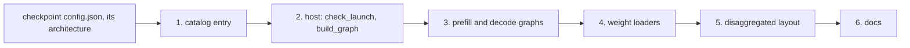

# Onboarding a model

A model joins the runtime as one package under `sglang_neuron/models/` and one entry in the model catalog. Nothing
shared in the runtime changes: it serves every model the same way, and a model that needs something of its own keeps it
in its own files. The exception is SGLang's own model-specific code. Where SGLang refuses a model on Neuron, the plugin
carries a patch, pinned to the SGLang source it patches, in `sglang_neuron/sglang_patches/` and registered in
`general_plugin.py`. GPT-OSS has two: one lets SGLang's GPT-OSS attention-backend check accept the Neuron backend, and
one registers the `mxfp4` quantization name, which the platform's `get_quantization_config` (`platform.py`) answers with
the inert `NeuronPassthroughQuantConfig` (`sglang_neuron/quant.py`). The [GPT-OSS
recipe](../model-recipes/gpt-oss.md#the-sglang-patches) describes both.

This page walks through each piece in the order a launch meets them, with the served models as examples: the dense
models (Qwen3, GLM-4) and Qwen3-MoE reuse the shared dense transformer, while GPT-OSS and DeepSeek-V2 bring graphs of
their own.

## 1. The catalog entry

The platform reads the catalog (`sglang_neuron/models/catalog.py`) in the launching process, by the architecture the
checkpoint's `config.json` names, once a hub id has been resolved to its local snapshot and before any other launch
check. An architecture without an entry is refused. The entry says:

| Field | What it holds |
| --- | --- |
| `package` | The model's package, `sglang_neuron.models.<model>`. The platform points SGLang's model registry at it (`SGLANG_EXTERNAL_MODEL_PACKAGE`), so each process imports this model alone. |
| `kv_cache_dtypes` | The `--kv-cache-dtype` values its graphs serve: `("auto", "bf16", "bfloat16")` for a bf16 cache, `("fp8_e4m3",)` for GPT-OSS. Any other is refused. |
| `quantizations` | The quantization methods its graphs serve, as a checkpoint's `quantization_config` or `--quantization` names them; empty for a bf16 model. |
| `launch_settings` | Environment settings its kernels read when they are imported, each with its reason. The platform sets them for every process and refuses a launch that states another value. |
| `prefill_holds_prior` | Whether its prefill window holds a request's cached prefix beside its new tokens (DeepSeek-V2's MLA prefill). The launching process uses it to refuse `--enable-dp-attention` on such a model's prefill server. The host states the same value, which sizes the step's bucket; the two must agree. |
| `giga_decode`, `giga_decode_launch_settings`, `giga_decode_dp` | Whether the model has a decode that runs every layer of a step in one kernel call over that kernel's own layout (`serving_policy.giga_decode_layout`), the settings that decode's server gets in place of `launch_settings`, and its attention DP: 16 for SGLang's DP attention groups (GPT-OSS), 1 for a kernel that runs its own inside (GLM-5.2, `--tp-size 128` without DP attention). GPT-OSS and GLM-5.2 set them. |
| `giga_decode_samplers` | The sampler modes (`SGLANG_NEURON_SAMPLER`) the giga-kernel decode's tail serves: `("greedy",)` for a tail that returns greedy tokens (GPT-OSS), `("greedy", "topk_topp")` for one that samples on device (GLM-5.2). |
| `mtp_host` | A module of the host side of the model's in-kernel MTP step, which `--speculative-algorithm NEURON_MTP` serves (`sglang_neuron/speculative/neuron_mtp.py` lists what it defines); empty for a model without one, which refuses the algorithm. GLM-5.2's is `sglang_neuron/models/glm52/mtp/host.py`. |
| `mem_fraction_static` | The `--mem-fraction-static` a launch of each PD role takes when it names none (`(("prefill", 0.75),)` for GLM-5.2); a role it does not name keeps SGLang's default. |
| `prefill_compute_ahead` | Whether the model's pipelined PD prefill computes a request before its decode grants a seat (`sglang_neuron/sglang_patches/pp_prefill_compute_ahead.py`). |
| `owns_dsa_attention` | Whether a DSA model's launch rules choose its attention backend and page, so SGLang's DeepSeek-family adjustments set neither for it (`sglang_neuron/sglang_patches/dsa_platform_adjustments.py`). |
| `scratchpad_page_mb` | The HBM scratchpad page, in MiB, its graphs compile with and the runtime bills in, by PD role (`(("prefill", 1344), ("decode", 512))` for GLM-5.2 at its 128k decode point, each kernel's own); a role it does not name keeps the plugin's 3584 MiB. |
| `logical_nc` | The logical-core degree its graphs and kernels are built for (`NEURON_LOGICAL_NC_CONFIG`), 2 unless the model's kernels run on single cores (GLM-5.2's 1). |
| `launch_hooks` | A module of the model's own launch rules, imported in the launching process (stdlib imports only at module level): `kv_page_size(server_args)`, `launch_problems(server_args, checkpoint_config, environ)`, `launch_settings(server_args)` and `rank_runtime_env(role)` (the Neuron runtime settings a rank of the role starts with over the plugin's defaults, unless the launch sets them), each for the launch's PD role, and optionally `validate_request(obj, preferred_sampling_params, server_args, vocab_size)`, the model's own admission rules, run on every request. GLM-5.2's is `sglang_neuron/models/glm52/launch.py`. |
| `kv_handoff` | A module of the model's PD KV hand-off, for a decode whose KV lives in its kernel's own caches rather than SGLang's pool: its `DECODE_HOOKS` and `PREFILL_HOOKS`, which `sglang_neuron/sglang_patches/kernel_kv_handoff.py` registers on the model's PD servers (GLM-5.2's `sglang_neuron/models/glm52/pd/handoff.py`). Without it the model keeps upstream's transfer path. |

The catalog imports nothing heavy.

## 2. The host

The package holds a module (by convention `sglang_model.py`) whose `EntryClass` lists the host, a subclass of
`ModelHost` (`sglang_neuron/models/host.py`). The host class is named exactly after the architecture the catalog lists
(`Qwen3ForCausalLM`), because SGLang's registry stores each `EntryClass` under its class name and looks up the
checkpoint's architecture by it. Every process the
launch starts imports each module directly under the package strictly, so a module there that fails to import stops the
process. SGLang builds the host for the checkpoint. The host sets up the parallel layout,
builds this server's role graphs (both on an aggregated server), follows each with the device sampler and loads their
weights. A model's host implements two methods and sets a few class attributes:

| Member | What it does |
| --- | --- |
| `name` | The model's name in every message. |
| `check_launch(config)` | Refuses, at construction and naming what to change, a checkpoint or layout the graphs cannot serve: its dtype, its quantization, layer kinds, a RoPE scaling, heads that do not split over the attention TP ranks. Every refusal a model can make here, before any weight loads, is one a user does not find after minutes of loading. |
| `build_graph(phase, config)` | Builds the `prefill` or `decode` graph on the host from the checkpoint's config. |
| `prefill_ladder` | Whether the prefill also compiles the KV segment tiles below the chunk (on by default; GPT-OSS's prefill runs whole chunks only). |
| `decode_context_ladder` | Whether the decode also compiles each batch size over a quarter and a half of the context. Turn it on once the decode attention reads only its graph's context. |
| `segmented_prefill` | Whether the prefill attention is the segmented kernel, whose KV segment tile is the token bucket (off for a model with a prefill attention of its own). |
| `prefill_holds_prior` | As the catalog entry. |
| `component_dp` | The DP size of each of `embedding`, `lm_head` and `mlp` that shards over the attention-TP ranks of that many DP groups ([Component DP](../design/parallelism.md#component-dp)); none by default, and no model declares one yet. |

Qwen3's host is the smallest example (`sglang_neuron/models/qwen3/sglang_model.py`): `check_launch` refuses a dtype
other than bf16 and builds the config once, which refuses what the dense transformer does not serve, and
`build_graph` returns the dense transformer of that config.

## 3. The graphs

A graph is an `nn.Module` the runtime compiles once per bucket. It takes the step's inputs and returns this rank's
vocabulary shard of the logits of its sampled rows; the host follows it with the device sampler.

| Member | What the runtime expects |
| --- | --- |
| `forward(input_ids, positions, attn_metadata, sampling_positions, rank)` | `positions` are the step's token positions. `attn_metadata` maps each attention layer's name (`layers.{i}.self_attn`, the names `get_kv_spec` returns) to a dict of its block table (`block_table_tensor`), slot mapping (`slot_mapping`), cached prefix length (`cached_seq_len`), KV page size (`block_size`) and the bucket's sizes (`max_query_len`, `max_blocks_per_seq`, `kv_segment_size`); in decode, a sliding layer's table is trimmed to its window and its dict adds that window's offset (`swa_kv_pos_offset`). `sampling_positions` names the rows whose logits are sampled; `rank` is this rank's attention-TP rank as a tensor, so every rank traces one graph. |
| `lm_head`, `lm_head_tp_group` | The vocabulary-sharded LM head and the group it is sharded over; the host sets `lm_head.gather_output = False`, and the sampler reduces over the group. |
| `config.vocab_size` | The vocabulary the sampler draws from. |
| `get_kv_spec()` | A `KVSpec` (`sglang_neuron/mem_cache/kv_cache.py`) of one `LayerSpec(name)` per attention layer, in the pool's layer order; `bind_kv_cache` receives each layer's buffers under that name. Name layer `i` `layers.{i}.self_attn`: the runtime keys `attn_metadata` by those names, which it derives from the config's layers (`sglang_neuron/models/contract.py`), so a graph that names its layers otherwise finds no metadata unless it declares them: `layer_names` (one name per hidden layer, in the pool's order) and `sliding_windows` (each layer's window, None for full attention) on the graph replace the derived names and the config's `layer_types`. |
| `bind_kv_cache(caches)` | Takes each layer's K and V buffers by its name. Both graphs of an aggregated server bind the same buffers. |
| `load_weights(path, device)` | Loads this rank's shards of the checkpoint onto the device. |

A dense model reuses `TransformerForCausalLM` (`sglang_neuron/models/transformer/model.py`) and changes only what
differs, as settings of `TransformerConfig` or as an override:

- **Settings.** `qk_norm` (Qwen3), `qkv_bias`, `post_attention_norm` and `post_mlp_norm`, a partial `rotary_dim`
  (GLM-4), `tie_word_embeddings`.
- **The MLP.** `build_mlp(config, layer_idx)` returns the layer's MLP, and `mlp_weight_mappings(src, dst)` maps its
  parameters to their checkpoint keys. Qwen3-MoE overrides both: it returns its sparse MoE block and maps the block's
  router and per-expert keys (`sglang_neuron/models/qwen3_moe/sglang_model.py`).
- **The checkpoint layout.** `fused_gate_up = True` when the checkpoint stores one `gate_up_proj` (GLM-4), and a
  parameter's weight loader can transform what it reads: GLM-4 permutes its interleaved RoPE channels into the halves
  the kernels rotate (`sglang_neuron/models/glm4/sglang_model.py`).

A model whose attention, or whose layers, the dense transformer cannot take through its settings and overrides brings
its own graphs, as GPT-OSS
(`sglang_neuron/models/gpt_oss/mxfp4/`) and DeepSeek-V2 (`sglang_neuron/models/deepseek_v2/`) do. They call the kernel
wrappers in `sglang_neuron/ops/`, which run nkilib's kernels and the plugin's own NKI kernels in `sglang_neuron/nki/`.
Most wrappers have a torch path, which runs on the CPU, and take the kernel path on a NeuronCore. GPT-OSS's MXFP4
experts (`sglang_neuron/ops/moe/moe_cte.py`, `sglang_neuron/ops/moe/moe_block_tkg.py`) have no CPU path and run on a
NeuronCore only.

A graph that takes every layer in one kernel call, as GPT-OSS's giga-kernel decode does
(`sglang_neuron/models/gpt_oss/giga/`), has four more seams: `kv_layout.declare(KVLayout(paired_layers=True))` while
it is built, so the pool allocates each pair of layers as one tensor; `samples_in_forward = True` on a graph that picks
its tokens itself, which then runs without the device sampler; a `runtime_class` that builds its steps' inputs itself;
and `neuron_after_warmup`, which checks the compiled program after the warm-up
([The host](../design/runtime.md#the-host)).

## 4. Loading the weights

Each parameter is created on the host, empty, with a weight loader that reads its shard from the checkpoint's slices
(`set_weight_loader`, `sglang_neuron/utils/weight_loader.py`). The graph's `hf_weight_mappings()` maps each parameter
to its checkpoint key, or to the list of keys it is concatenated from, and `SafetensorsCheckpoint`
(`sglang_neuron/utils/checkpoints.py`) reads every mapped key from the local snapshot in parallel, places each shard on
the device, and refuses a key the checkpoint does not hold. A parameter without a mapping is read under its own name, so
the load fills every parameter or refuses. The graph's own `load_weights` ties a tied parameter again after the load
(the dense transformer's LM head with `tie_word_embeddings`, `sglang_neuron/models/transformer/model.py`). The host
calls the first graph's `load_weights` only: an aggregated server's decode graph takes the prefill graph's device
parameters and KV scales (`share_weights`, `sglang_neuron/models/host.py`), and a decode-graph parameter the prefill
graph does not hold under the same name, shape and dtype is refused.

Expert parallelism is a matter of which keys and shards each rank reads ([Parallelism in a new
model](../design/parallelism.md#parallelism-in-a-new-model)). Qwen3-MoE's mappings name this rank's contiguous block of
experts, and its loaders read its share of the intermediate dimension within each
(`sglang_neuron/models/qwen3_moe/moe.py`). The forward finds its experts' columns from the EP rank tensor, so every rank
still traces one graph.

## 5. The disaggregated layout

A model's disaggregated layout is a whole count of decode servers that one prefill server keeps fed, measured on
hardware:

- `R_p`, the requests per second one prefill server takes: one over its 1K prefill's device time;
- `R_d`, the requests per second one decode server finishes: its `--max-running-requests` rows over 512 answer tokens
  times its step time;
- with `N` decode servers the prefill is busy `N x R_d / R_p` of the time, which has to stay below one with some
  headroom, or requests queue at the prefill and the decode servers run short of rows.

## 6. Docs

A model gets a recipe in `docs/model-recipes/` (its graphs, the layouts and flags it is tested with and what it refuses;
[Qwen3](../model-recipes/qwen3.md) is the pattern) and an entry in that directory's `index.md`. It also gets
a column in [Feature and model compatibility](../guides/feature-model-compatibility.md) and its name in that page's list
of models, its layout in the supported topologies of
[Disaggregated inference](../design/disaggregated-inference.md#supported-topologies), and a row in the README's model
table.
