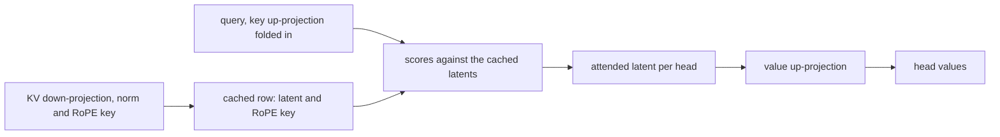
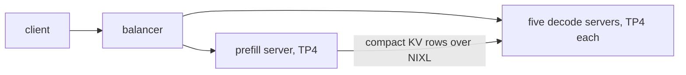

# DeepSeek-V2 on Neuron

`DeepseekV2ForCausalLM` (DeepSeek-V2-Lite) runs on the [runtime](../design/runtime.md) on attention TP4, in bf16, as an
aggregated server or as a prefill and a decode server. The model is in `sglang_neuron/models/deepseek_v2/`.

## The model

The attention is multi-head latent attention, absorbed. A token's KV is cached as one compact row, its normalized KV
latent (512) followed by its rotated RoPE key (64), in SGLang's MLA pool on the NeuronCore
(`mem_cache/memory_pool.py`). The key side of the KV up-projection is folded into each query head, so the attention
scores the cached latents directly, and the value side turns each head's attended latent into its values
(`ops/attention/mla.py`). The prefill and the decode run the MLA kernels in `nki/`.



RoPE uses YaRN frequencies, with the cos and sin scaled by YaRN's mscale over its `mscale_all_dim` mscale, and
DeepSeek's attention scale: `1/sqrt(q_head_dim)` times the square of the `mscale_all_dim` mscale, as DeepSeek's
modeling code computes it (transformers' version of the model leaves that factor out). The checkpoint rotates
interleaved channel pairs, so the loader reorders the RoPE rows of the query and of the KV down-projection into the
halves the graphs rotate.

The first layer (`first_k_dense_replace`, 1 for DeepSeek-V2-Lite) has a dense MLP. Each later layer sends each token
to its top six of 64 experts by softmax score (an exact reduction, not torch.topk on the device), next to two shared
experts. Each attention-TP rank holds a contiguous block of 16 routed experts and a TP shard of the shared experts, and
the two partials are all-reduced together. A decode runs the routed experts through nkilib's `moe_tkg`, selectively
for one or two rows and over every local expert above that. A prefill runs each local expert over the request's
tokens.

## Serving

The commands below run inside the container, with the checkpoints mounted at `/models`; the
[container guide](../guides/container.md) has the `docker run` for one node and for prefill/decode over two. The
[example](../../examples/deepseek_v2_lite/) has the prefill/decode layout and the aggregated server as scripts, and
[examples/README.md](../../examples/README.md#run-a-model) gives the order to run them.

```bash
python3 -m sglang.launch_server --model-path /models/DeepSeek-V2-Lite \
  --tp-size 4 --context-length 4096 --chunked-prefill-size 4096 --max-running-requests 64 \
  --max-total-tokens 131072 --mem-fraction-static 0.6 \
  --host 0.0.0.0 --port 30000
```

`--host 0.0.0.0` listens inside the container; publish the port on the host's loopback only
(`-p 127.0.0.1:30000:30000`), as the [container guide](../guides/container.md#3-start-a-container) explains.

The MLA kernels and the runtime fix the layout:

- four query heads per rank: `--tp-size 4` for DeepSeek-V2-Lite's 16 heads;
- no DP attention (`--enable-dp-attention`), on any role;
- a decode context of whole 512-token tiles: `--context-length` a multiple of 512;
- a prefill window that fits in SBUF: `--context-length` at most 4096, the longest compiled on hardware;
- a prefill window that holds the whole request: `--chunked-prefill-size` equal to `--context-length`.

A prefill runs the smallest compiled window that holds the request, its cached prefix with its new tokens: one of 512,
1024, 2048 or 4096 tokens below `--chunked-prefill-size` (or the counts `--cuda-graph-bs-prefill` lists), or the chunk
itself. A decode step runs the graph of the smallest of a quarter, a
half and the whole context that holds its longest row; the decode kernel reads that context, rounded up to its
512-token supertiles.

Disaggregated, the prefill server and each decode server take the same model flags plus their role's:
`--disaggregation-mode prefill` or `--disaggregation-mode decode`, `--disaggregation-transfer-backend nixl`, and the
prefill's `--disaggregation-bootstrap-port`.

```bash
# on the prefill node
python3 -m sglang.launch_server \
  --model-path /models/DeepSeek-V2-Lite --tp-size 4 --context-length 4096 --chunked-prefill-size 4096 \
  --max-running-requests 64 --max-total-tokens 131072 --mem-fraction-static 0.6 \
  --disaggregation-mode prefill --disaggregation-transfer-backend nixl --disaggregation-bootstrap-port 8998 \
  --host <prefill node> --port 30000
# on the decode node, one server per block of four NeuronCores (the next on 4-7 and port 30002)
NEURON_RT_VISIBLE_CORES=0-3 python3 -m sglang.launch_server \
  --model-path /models/DeepSeek-V2-Lite --tp-size 4 --context-length 4096 --chunked-prefill-size 4096 \
  --max-running-requests 64 --max-total-tokens 131072 --mem-fraction-static 0.6 \
  --disaggregation-mode decode --disaggregation-transfer-backend nixl --stream-interval 4 \
  --host <decode node> --port 30001
```

Both use the image's NIXL, which carries the transfer's patches ([NIXL patches](../../patches/nixl/README.md)). A
balancer in front sends each request to the prefill server and to one decode server
(`sglang_neuron/disaggregation/balancer.py`, explained in the [disaggregated
tutorial](../tutorials/disaggregated-1p1d.md#2-put-the-balancer-in-front)), with one `--decode` per decode server:

```bash
python3 -m sglang_neuron.disaggregation.balancer --prefill http://<prefill node>:30000 \
  --decode http://<decode node>:30001 --decode http://<decode node>:30002
```

The tested layout is one prefill server on the prefill node in front of five decode servers side by side on the decode
node, each on its own four NeuronCores (`NEURON_RT_VISIBLE_CORES`). `--stream-interval 4` streams each answer four
tokens at a time, so one benchmark client keeps up with every stream.



The MLA pool's rows are the same on every attention-TP rank, so decode rank r takes prefill rank r's pages, moved as
whole pages of compact rows.

## What is refused

A launch the graphs can't serve fails at startup, naming the setting at fault:

- a launch off the layout above;
- an `--ep-size` other than 1: the routed experts split over the attention TP ranks, not over EP;
- a model dtype other than bfloat16 (`--dtype`, or the checkpoint's with `auto`);
- a `--max-running-requests` above 128, the most nkilib's `moe_tkg` takes in a step, or a launch without
  `--max-running-requests`, whose batch SGLang would size from the KV pool;
- a quantized checkpoint or a `--quantization`, or a checkpoint with a low-rank query (`q_lora_rank`), attention
  biases, routing other than greedy softmax top-k, renormalized top-k weights (`norm_topk_prob`), or a RoPE scaling
  other than YaRN;
- a KV cache dtype other than `auto`, `bf16` or `bfloat16`, a page size other than 128, and the features every model
  refuses ([What a launch refuses](../design/runtime.md#what-a-launch-refuses)).
