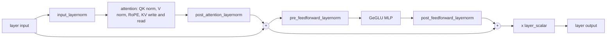

# Gemma 4 on Neuron

`Gemma4ForConditionalGeneration` (the text model of `google/gemma-4-31B-it`) runs on the [runtime](../design/runtime.md)
in bf16 as an aggregated server, TP4 on one trn2.3xlarge. The host is `sglang_neuron/models/gemma4/sglang_model.py` and
the graphs are `sglang_neuron/models/gemma4/graph.py`. The graphs serve text only; a request with images, audio
or video is not tested.

## The model

Gemma 4 31B has 60 decoder layers in a five sliding to one global pattern, and the two kinds differ in shape:

| | Sliding layers (50) | Global layers (10) |
| --- | --- | --- |
| head_dim | 256 | 512 (`global_head_dim`) |
| KV heads (32 query heads) | 16 | 4 (`num_global_key_value_heads`) |
| Values | `v_proj` | the key projection (`attention_k_eq_v`, no `v_proj` in the checkpoint) |
| Window | 1024 tokens | the whole context |
| RoPE | theta 1e4 over the whole head | proportional, theta 1e6 over a quarter of the head |

Every layer has an RMSNorm on each query and key head, an RMSNorm without scale on each value head, attention scaling
1.0, four RMSNorms around the attention and the MLP, a GeGLU MLP (tanh GELU) and a learned scalar on its output. The
embedding is scaled by sqrt(hidden size) rounded to bf16, the LM head is tied to the embedding, and the logits are soft
capped at 30.



Head dims of 256 and 512 are above what the platform's fused attention kernels serve, so the attention is torch math
(float32 scores, no GQA expansion) in both phases. The KV cache is written and read only through two indirect-DMA NKI
kernels (`sglang_neuron/models/gemma4/kv_access.py`): a row write that skips out-of-range rows and returns an ordering
token, and a page gather that waits on that token.

### The KV cache

The server runs SGLang's uniform KV pool (`--disable-hybrid-swa-memory`). SGLang sizes it from its Gemma 4 view of the
config (head_dim 512, 4 KV heads); the host declares two pool heads per rank (`KVLayout(kv_heads_per_rank=2)`), so each
layer's K and V tensors hold 1024 values per token on each rank. A sliding layer writes its 4 local heads of 256 there;
a global layer writes its 1 local head of 512 and its value rows into the same layer's tensors. Each layer reads and
writes only its own two tensors, and the wider or narrower row exists only inside the kernels, so no graph input is
bound under two shapes.

Sliding layers read the runtime's window-trimmed tables in decode (`swa_kv_pos_offset`) and mask the window over the
full table in prefill; global layers read the whole table.

## Serving

Aggregated, on the four NeuronCores of a trn2.3xlarge, with the validated flags:

```bash
python3 -m sglang.launch_server --model-path /models/gemma-4-31B-it --tp-size 4 \
  --context-length 16384 --chunked-prefill-size 512 --max-running-requests 8 --max-total-tokens 20480 \
  --mem-fraction-static 0.9 --disable-hybrid-swa-memory \
  --host 0.0.0.0 --port 30000
```

`--host 0.0.0.0` listens inside the container; publish the port on the host's loopback only
(`-p 127.0.0.1:30000:30000`), as the [container guide](../guides/container.md#3-start-a-container) explains.
[examples/gemma4_31b](../../examples/gemma4_31b/) has the server, a client and the accuracy check as scripts.

The weights take about 14.6 GB of each NeuronCore's 24 GB, which leaves room for about 24k tokens of KV at 245 KB per
token per rank: `--max-total-tokens 20480` is the validated pool.

The prefill attention builds its scores for the whole chunk against the whole table, so `--chunked-prefill-size` and
`--context-length` together bound its transient memory; 512 and 16384 are the pair that was run.

Structured output (`response_format`) needs the host
sampler (`SGLANG_NEURON_SAMPLER=host` with `--disable-overlap-schedule`), as for every model.

Disaggregated prefill and decode is not tested: the bf16 weights (about 62 GB) do not fit the two NeuronCores of half a
trn2.3xlarge, and no multi-node layout was run.

## Compiled shapes

- **Prefill.** One graph of the chunk (`--chunked-prefill-size`). The prefill attention is the model's own (not the
  segmented kernel), so the prefill compiles no smaller tiles.
- **Decode.** A graph per batch size up to `--max-running-requests` (the powers of two and the value itself), each over
  the whole context and over a quarter and a half of it; a step runs the smallest that holds it. With the flags above
  that is 12 decode graphs, compiled at first launch (about 74 minutes on a cold cache, about 20 minutes from a warm
  one on a trn2.3xlarge).
- `--max-total-tokens` sizes the KV pool, whose page count is a dimension of every graph; state it, so a relaunch finds
  its graphs in torch-neuronx's compile cache.

## Measured results

One trn2.3xlarge, TP4, bf16, the flags above, greedy, an idle host.

**Accuracy.** The greedy tokens of three prompts (5, 881 and 2372 tokens, the last two crossing the 512-token prefill
chunk and the 1024-token window) are identical to a Hugging Face reference on CPU in bf16, teacher-forced on the same
tokens: 72 of 72 tokens with the same argmax, on every server configuration that was run. GSM8K's first 100 questions,
five-shot at temperature 0, score 0.820 with 0.010 unparsed. Six of the eighteen misses are greedy repetition loops that run to the token limit. Those answers decode past
position 1024, so they were checked twice: teacher-forcing the reference on the server's own tokens agrees with about
690 of the 694 steps they took past 1024 and with the repeated tail itself, while a correct answer that also ran 83
steps past 1024 agreed on every step with margin 0.000; and the reference model generating freely on CPU from the same
prompt, with no Neuron in the path, runs into the same loop with the same tail. The loops are this checkpoint's greedy
behaviour on these prompts.

**Structured output and the host sampler.** On a server launched with `SGLANG_NEURON_SAMPLER=host` and
`--disable-overlap-schedule`, a `json_schema` request returns a valid object, the 72 tokens above are unchanged, and
the single-client TPOT is 40.5 ms against 35.2 ms on the device sampler. With a 9.4k-token prompt and a strict schema,
8 of 10 concurrent requests returned valid JSON; in the other two the answer ran to `max_tokens` after the first
field. Without the host sampler a structured request is refused with HTTP 400.

**One client**, random-token prompts (`sglang.bench_serving` and a streaming client):

| Input / output tokens | TTFT p50 | TPOT p50 |
| --- | --- | --- |
| 1024 / 128 | 0.60 s | 35.2 ms |
| 4096 / 128 | 2.35 s | 36.8 ms |
| 8192 / 256 | 4.69 s | 39.1 ms |

TPOT grows slowly with the context because the sliding layers read the window-trimmed tables and only the ten global
layers read the whole one. Prefill ran at about 1.7k tokens/s.

**Several clients**, 128 new tokens each: the greedy outputs of four concurrent requests were identical to the same
requests alone, and the aggregate was 26.8, 46.6 and 74.0 tokens/s at 1, 2 and 4 clients (102 tokens/s at 8, with
1024-token prompts).

**Steadiness** ([the speed and steadiness checks](../design/disaggregated-inference.md)), `bench_serving` with
`random-ids`: at one client (8192 in, 1024 out) the TPOT median was 39.05 ms with p90 39.08 and p99 39.08, inside the
1.01 and 1.02 bounds. At four clients (4096 in, 512 out) the median was 55.83 ms with p90 62.18 (1.11x) and p99 65.42
(1.17x), and at eight (1024 in, 1024 out) the median was 62.26 ms with p90 65.11 (1.05x) and p99 66.27 (1.06x): both
are outside the bounds. A step shares the device with the chunked prefill of the other rows; the split was not
profiled.

## What is refused

A launch the graphs can't serve fails at startup, naming the setting at fault:

- a model dtype other than bfloat16, and a quantized checkpoint;
- a launch without `--disable-hybrid-swa-memory`;
- per-layer input embeddings, shared KV layers or MoE blocks (the smaller and MoE Gemma 4 checkpoints);
- a layer kind other than sliding or full attention, and a RoPE type other than default (sliding) or proportional
  (global);
- attention heads that do not split over the attention TP ranks, and KV heads that neither split over them nor
  replicate evenly across them;
- an `--ep-size` other than 1;
- a KV cache dtype other than `auto`, `bf16` or `bfloat16`, and a page size other than 128;
- the features every model refuses ([What a launch refuses](../design/runtime.md#what-a-launch-refuses)).
