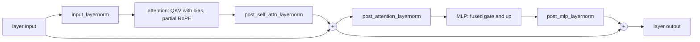
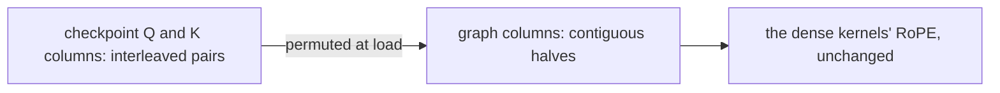
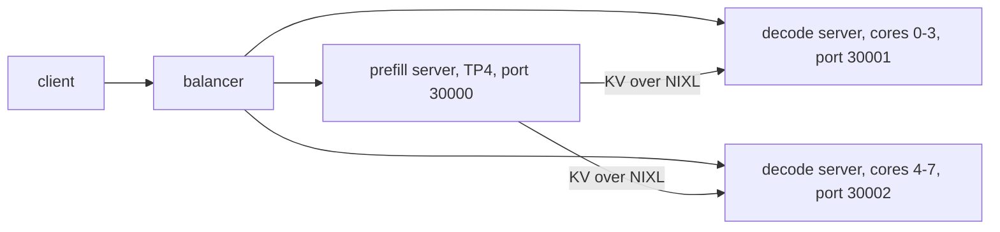

# GLM-4 on Neuron

`Glm4ForCausalLM` (GLM-4-9B-0414) runs on the [runtime](../design/runtime.md) in bf16, as an aggregated server or as a
prefill and a decode server. The host is `sglang_neuron/models/glm4/sglang_model.py`. The graphs are the shared dense
transformer in `sglang_neuron/models/transformer/`, the same one Qwen3 runs: [Qwen3](qwen3.md) describes its kernels
and its tensor parallelism.

## The model

GLM-4 is the dense transformer with four differences. Three are `TransformerConfig` settings that `glm4_config` reads
from the checkpoint's config; the fourth is the checkpoint layout `Glm4Graph` declares.

| Difference | What the graphs do |
| --- | --- |
| QKV biases (`attention_bias`, true when the config omits it) | the fused QKV projection carries the checkpoint's biases (`qkv_bias`) |
| Two more RMSNorms | one after the attention and one after the MLP, each before its residual add (`post_attention_norm`, `post_mlp_norm`) |
| Partial RoPE (`partial_rotary_factor`) | RoPE rotates the first `head_dim x partial_rotary_factor` channels of each query and key head (`rotary_dim`) and passes the rest through |
| Fused gate and up projection | the checkpoint stores one `gate_up_proj`, gate rows first (`fused_gate_up = True`); each rank reads its gate and up rows from the two halves |

Unlike Qwen3, GLM-4 has no RMSNorm on the query and key heads. One decoder layer:



The checkpoint rotates interleaved channel pairs (2j, 2j + 1), while the kernels rotate channel j with channel
j + head_dim / 2. The loaders permute the Q and K columns of the QKV weight and bias once, at load
(`sglang_neuron/models/glm4/rotary.py`), so the kernels run unchanged. q.k doesn't change when both sides get the same
permutation, and V is never rotated.



## Serving

The commands below run inside the container, with the checkpoints mounted at `/models`; the
[container guide](../guides/container.md) has the `docker run` for one node and for prefill/decode over two. The
[example](../../examples/glm4_9b/) has the prefill/decode layout and the aggregated server as scripts, and
[examples/README.md](../../examples/README.md#run-a-model) gives the order to run them.

Aggregated, on four NeuronCores, with the validated flags:

```bash
python3 -m sglang.launch_server --model-path /models/GLM-4-9B-0414 --tp-size 4 \
  --context-length 4096 --chunked-prefill-size 2048 --max-running-requests 64 --max-total-tokens 266240 \
  --mem-fraction-static 0.4 \
  --host 0.0.0.0 --port 30000
```

`--host 0.0.0.0` listens inside the container; publish the port on the host's loopback only
(`-p 127.0.0.1:30000:30000`), as the [container guide](../guides/container.md#3-start-a-container) explains.

Disaggregated, the tested layout is one prefill server in front of two decode servers that sit side by side on the
decode node, each on its own four NeuronCores. A balancer sends every request to the prefill server and to one decode
server, and the KV moves between them over NIXL.



Each server takes the aggregated flags plus its role's: `--disaggregation-mode prefill` or `decode`,
`--disaggregation-transfer-backend nixl`, and on the prefill the `--disaggregation-bootstrap-port`. Both use the image's
NIXL, which carries the transfer's patches ([NIXL patches](../../patches/nixl/README.md)).

```bash
# on the prefill node
python3 -m sglang.launch_server \
  --model-path /models/GLM-4-9B-0414 --tp-size 4 --context-length 4096 --chunked-prefill-size 2048 \
  --max-running-requests 64 --max-total-tokens 266240 --mem-fraction-static 0.4 \
  --disaggregation-mode prefill --disaggregation-transfer-backend nixl --disaggregation-bootstrap-port 8998 \
  --host <prefill node> --port 30000
# on the decode node, one server per block of four NeuronCores (the second on 4-7 and port 30002)
NEURON_RT_VISIBLE_CORES=0-3 python3 -m sglang.launch_server \
  --model-path /models/GLM-4-9B-0414 --tp-size 4 --context-length 4096 --chunked-prefill-size 2048 \
  --max-running-requests 64 --max-total-tokens 266240 --mem-fraction-static 0.4 \
  --disaggregation-mode decode --disaggregation-transfer-backend nixl --stream-interval 4 \
  --host <decode node> --port 30001
# the balancer, with one --decode per decode server
python3 -m sglang_neuron.disaggregation.balancer \
  --prefill http://<prefill node>:30000 --decode http://<decode node>:30001 --decode http://<decode node>:30002
```

The [disaggregated tutorial](../tutorials/disaggregated-1p1d.md#2-put-the-balancer-in-front) explains the balancer.
`--stream-interval 4` streams each answer four tokens at a time, so one benchmark client keeps up with every stream.

A decode server also serves DP attention (`--enable-dp-attention --dp-size <replicas>`, under the conditions in
[the serving policy](../design/runtime.md#the-serving-policy)).

## Compiled shapes

The same as Qwen3's ([Compiled shapes](qwen3.md#compiled-shapes)). A prefill server compiles only the prefill graphs, a
decode server only the decode graphs, and an aggregated server both.

## What is refused

A launch the graphs can't serve fails at startup, naming the setting at fault:

- a model dtype other than bfloat16 (`--dtype`, or the checkpoint's own with `auto`);
- a quantized checkpoint;
- sliding-window layers (`use_sliding_window`, or `sliding_attention` in `layer_types`), which GLM-4 doesn't have;
- a scaled RoPE (any `rope_type` other than the default);
- attention heads, KV heads or an intermediate size that don't split over the attention TP ranks (KV heads may instead
  replicate evenly across them);
- an `--ep-size` other than 1, since GLM-4 has no experts to split;
- a KV cache dtype other than `auto`, `bf16` or `bfloat16`, a page size other than 128, and the features every model
  refuses ([What a launch refuses](../design/runtime.md#what-a-launch-refuses)).
