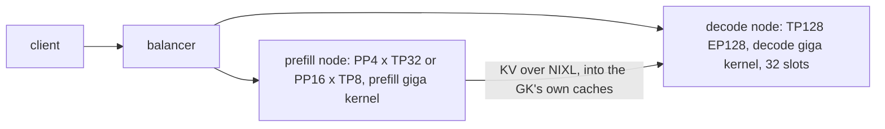
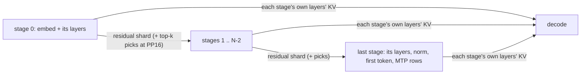
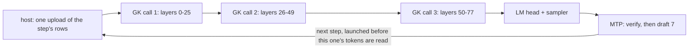
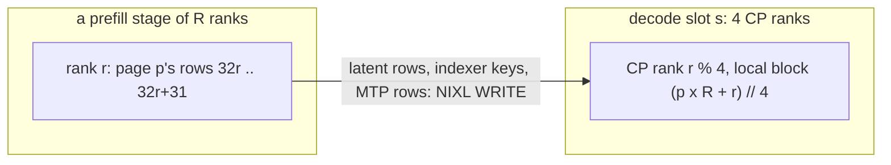
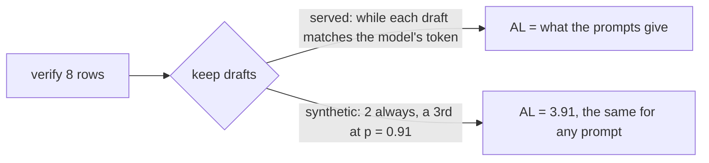

# GLM-5.2 on Neuron

GLM-5.2 (`GlmMoeDsaForCausalLM`, the MXFP4 checkpoint `amd/GLM-5.2-MXFP4`) is served disaggregated on Trainium3: one
prefill node in front of one decode node (1P1D), each a whole trn3 node of 128 NeuronCores, the KV moving between
them over NIXL. Each role runs one giga kernel, a single NKI program over many layers: the prefill runs its kernel as
a pipeline of stages, and the decode runs the decode giga kernel (the GK) over all 78 layers, the LM head and the
sampler in one program a step, with multi-token prediction inside it. Both roles run at one rank per physical
NeuronCore (LNC1). The model is in `sglang_neuron/models/glm52/`, the vendored kernels in `sglang_neuron/models/glm52/kernels/`
(their [provenance](../../sglang_neuron/models/glm52/kernels/PROVENANCE.md)).

Both roles run on the released Neuron SDK 2.33.0 and nothing else: the launch refuses another compiler, NKI, runtime
or collectives build ([The toolchain](#the-toolchain)).

## Terms

| Term | Meaning |
|---|---|
| decode point | the GK's geometry: how many positions a slot holds and how the projections and the indexer are sharded. `128k` holds 131,072 positions a slot; `1m` holds 1,048,576 (1M) positions a slot. Both points serve 32 slots |
| prefill point | the pipeline's shape: PP4 x TP32 (4 stages of 32 ranks) or PP16 x TP8 (16 stages of 8 ranks) |
| pairing | one decode point behind one prefill point; a launch serves one |
| slot | one sequence the GK holds, with its own KV caches; the decode serves 32 at once, so 32 is its concurrency |
| MTP K7 | multi-token prediction: each step the checkpoint's MTP layer drafts 7 tokens and the next step verifies them |
| acceptance length (AL) | the tokens a request gains a step: the verified token plus the drafts kept, 1 to 8 |
| synthetic acceptance | a benchmark mode that keeps drafts at a fixed rate instead of by their tokens ([Benchmarking](#benchmarking)) |
| interactivity | 1000 / TPOT: the output tokens a second one user sees |

## The served pairings

Four pairings are served, each with its launch values in [Launching a pairing](#launching-a-pairing):

| Pairing | Decode point | Prefill point | The decode's `--page-size` |
|---|---|---|---|
| 128k on PP4, the default | `128k` | PP4 x TP32 | 1,024, or unset |
| 128k on PP16 | `128k` | PP16 x TP8 | 256 |
| 1M on PP4 | `1m` | PP4 x TP32 | 1,024, or unset |
| 1M on PP16 | `1m` | PP16 x TP8 | 256 |

`SGLANG_NEURON_GLM52_POINT` names the decode point (`sglang_neuron/models/glm52/points.py`) and must be the same on
both servers: the prefill writes the KV in the decode point's formats, and a prefill rank refuses a decode peer of
another point at first contact. `--pp-size` names the prefill point (`PREFILL_POINTS` in
`sglang_neuron/models/glm52/prefill/stage_layout.py`), and the decode's `--page-size` names the prefill it pairs with.

The decode points:

| | `128k` | `1m` |
|---|---|---|
| positions a slot holds | 131,072 | 1,048,576 |
| `--context-length`: the slot less one pool block of 128 positions | 130,944 | 1,048,448 |
| `--max-total-tokens`: the 32 slots at their positions | 4,194,304 | 33,554,432 |
| projection shards | `o_proj` over 16 ranks | `o_proj` and `q_proj` over 64 ranks, the down-projections over 8, the dense MLP over 32, the shared expert over 16 |
| indexer keys | bf16 | FP8 |
| indexer | every rank scores the keys it holds | each slot's top-k chunks dealt over the CP groups of a pool of 8 slots ([The decode](#the-decode)) |
| HBM scratchpad page | 512 MiB | 128 MiB |
| runtime settings | the runtime's defaults | `NEURON_RT_IO_RING_CACHE_SIZE=4`: the 1M decode fits a core's HBM only with a ring of 4 |

`points.py` gives each point's kernel settings with the measurement behind each.

The prefill points:

| | PP4 | PP16 |
|---|---|---|
| `--pp-size`, `--tp-size`, `--ep-size` | 4, 32, 32 | 16, 8, 8 |
| `SGLANG_PP_LAYER_PARTITION` | `18,20,20,20` | `3,5,5,5,5,5,5,5,5,5,5,5,5,5,5,5` |
| page (`--tp-size` x 32 tokens) | 1,024 | 256 |
| `--chunked-prefill-size` | 4096, 128 rows a rank | 2048, 256 rows a rank |
| `--cuda-graph-bs-prefill`, the steps of a prompt's last piece | `1024 2048` | `1024` |
| what a stage hands the next | every rank's bf16 residual shard | the residual shard and the stage's top-k picks |
| experts | a static placement from routing statistics, nine slots a rank | 32 experts on each of a stage's 8 ranks, in order |
| kernel settings | `SETTINGS` in `sglang_neuron/models/glm52/prefill/recipe.py` | `point_settings` in the same file |
| `--max-running-requests`, above the admission floor of `2 x pp + 3` | 16 (floor 11) | 48 (floor 35) |

## The model

GLM-5.2 is a 78-layer mixture-of-experts transformer with multi-head latent attention (MLA) and sparse
attention (DSA), plus one multi-token-prediction (MTP) layer, layer 78. The kernels are built for its shapes
(`sglang_neuron/models/glm52/layout/decode/gk_geometry.py`): hidden size 6144, 64 attention heads, a 512-wide KV latent and a
64-wide RoPE key; 256 routed experts, eight a token, and one shared expert, after three dense layers; a vocabulary of
154,880. The DSA indexer (32 heads of 128) picks 2,048 keys a token. It runs on 21 "full" layers (0, 1, 2, then every
fourth from 6 to 74); every other layer reuses the picks of the full layer before it.

Each role loads the checkpoint with the plugin's loaders (`sglang_neuron/models/glm52/layout/`), into its own kernel's
layouts: the prefill from the checkpoint at launch, the decode from a weight store built from it once
([The weight stores](#the-weight-stores)). A token's KV is one 640-byte row: 64 bf16 RoPE values pre-divided by a
static scale, then the 512 FP8 latent bytes (`sglang_neuron/models/glm52/layout/glm_kv_row.py`). The indexer keys go to
the decode in the decode point's format.

## The 1P1D layout



The platform gives each server its page (`kv_page_size` in `sglang_neuron/models/glm52/launch.py`). On the prefill a
page is one 32-row block on each rank of a stage, `--tp-size` x 32 tokens: 1,024 at PP4 and 256 at PP16. SGLang's PD
refuses a pair whose pages differ, so the decode serves its prefill's page, and its `--page-size` names the prefill
point (`paired_prefill_point` in `launch.py`), with the same GK, slots and pool tokens at either. A decode at any other
page is refused ([What is refused](#what-is-refused)).

### The prefill

The prefill is `--pp-size` pipeline stages of `--tp-size` ranks each, the experts over the same ranks: four stages of
32 ranks over 18, 20, 20 and 20 layers at PP4, sixteen stages of 8 ranks over 3 layers and then 5 each at PP16
(`SGLANG_PP_LAYER_PARTITION`). Each stage is one SPMD program of the vendored prefill giga kernel
(`sglang_neuron/models/glm52/kernels/prefill/`), its layers cut into kernel launches at the full indexer layers
(`sglang_neuron/models/glm52/prefill/stage_layout.py`). A stage's ranks are also the kernel's context-parallel group: the kernel
deals a request's context over them in runs of 32 tokens, so rank `r` keeps tokens `[32 r, 32 r + 32)` of every page
(`sglang_neuron/models/glm52/prefill/kv_pool.py`).



The first stage embeds the tokens; the last norms, picks each request's first token over its vocabulary shards
(greedily, or under `SGLANG_NEURON_SAMPLER=topk_topp` with the same draw the decode's tail makes) and writes the MTP
layer's prompt rows. A stage hands the next every rank's bf16 residual shard over the plugin's pipeline seam
([Pipeline parallelism](../design/pipeline-parallelism.md#a-step-on-the-stages)). A shared indexer layer reuses the
top-k picks of the full layer before it: at PP4 every stage starts on a full layer, so the shard is all a stage needs;
at PP16 most stages start on a shared layer, so the boundary carries the picks too (`boundary_carries_picks` in
`launch.py`).

At PP4 the experts sit at a static placement calibrated on the routing of an agentic workload, nine slots a rank, so a
hot expert's rank holds fewer experts (`sglang_neuron/models/glm52/prefill/expert_placements/place_pp4_u9.json`;
`tools/glm52/build_placement.py` builds one from another routing histogram). Another placement changes the device time,
so the file is pinned by its md5. At PP16 each of a stage's 8 ranks holds 32 experts in order.

A forward is one request's chunk: 4,096 tokens at PP4 and 2,048 at PP16. The stages compile one graph for each step size
in each context bucket the server's `--context-length` reaches: the 128k bucket alone at the 128k point, and 128k,
256k, 512k and 1M at the 1M point ([The toolchain](#the-toolchain)). The KV pool is stated in whole pages
(`--max-total-tokens`), since its page count is a dimension of every compiled graph. Page 0 is the null page that
padding writes to and no request reads. Without `--mem-fraction-static` the prefill leaves a quarter of each core's
HBM to the graphs, the scratchpad and a device profile's buffers (0.75, `mem_fraction_static` in
`sglang_neuron/models/catalog.py`).

The prefill runs at its recipe (`sglang_neuron/models/glm52/prefill/recipe.py`): every kernel knob at the value the served stage
programs were validated and timed at, each with its reason. The kernel reads its knobs when it is traced, so another
value builds a kernel nothing has measured, and a launch that sets one is refused. Before any rank compiles, every rank
of every stage compares the recipe, the compiler arguments, the toolchain digest, the kernel's digest, the placement,
the split and the logical-core degree (`fleet_digest` in `launch.py`).

The stages run SGLang's PD prefill PP loop in the overlap order, the last stage asynchronously
([Pipeline parallelism](../design/pipeline-parallelism.md)). A request keeps its row while its KV goes to the decode, so
a prefill that computes ahead (below) refuses a `--max-running-requests` at or below the admission floor of
`2 x pp + 3` (`pp_prefill_admission_floor` in `sglang_neuron/distributed/pipeline.py`); one without it only warns
below the floor.

With more requests in flight than the decode's 32 slots, a request waits for a slot, and SGLang's prefill would not
start it until the slot is granted. Compute ahead, on for GLM-5.2's pipelined prefill (`prefill_compute_ahead` in
`sglang_neuron/models/catalog.py`), computes such a request early, keeps its KV in the prefill's pages, and pushes it
once the decode grants the slot ([Compute
ahead](../design/pipeline-parallelism.md#compute-ahead-on-a-pipelined-pd-prefill)). A parked request holds its pages, so
a launch whose pool cannot hold every request it may park at the full context runs without it and logs why
(`_prefill_compute_ahead` in `sglang_neuron/serving_policy.py`). Of the served pairings, only the 1M pairing on PP16
runs without it: 13 parked requests and one slot-granted request of 1M tokens each need 14,680,064 tokens, more than its
12,582,912-token pool.

### The decode

The decode is one server of 128 ranks without DP attention (`--tp-size 128 --ep-size 128`) at either point; that layout
is what selects the GK (`serving_policy.giga_decode_layout`). The GK is one SPMD program over the node's 128 ranks: two
DP halves of 64 ranks, each a CP4 x token16 grid, and EP128 MoE (`sglang_neuron/models/glm52/decode/graph.py`).



A step runs the 78 layers as three kernel calls with a one-element all-reduce of zeros between two calls (`GK_SPLIT`
in `points.py`). neuronx-cc cuts a program into functions only at its collectives, and the runtime keeps each
function's collective control state on chip only if it fits; one block for the whole stack does not, and would make
every collective slower. The all-reduce adds exact zeros, so the split changes no number.

- **Slots.** The kernel serves 32 sequence slots, each on the four CP ranks of one token group, each rank holding a CP
  quarter of the slot's KV. A request keeps one slot for its whole life (`slot = req_pool_idx - 1`, SGLang's request
  row less its padding row 0), so the request pool has exactly 32 rows and none for requests still in transfer
  (`--disaggregation-decode-extra-slots 0`).
- **Context.** A slot holds the point's positions. The kernel's causal test reads a static position, so a step two past
  it would silently drop its newest keys; the server's context is the slot less one pool block of 128 positions
  (`served_context` in `sglang_neuron/models/glm52/sglang_model.py`).
- **KV.** The KV lives in the GK's own slot-private caches (`sglang_neuron/models/glm52/layout/decode/gk_kv_cache.py`).
  SGLang's pool only counts tokens: one layer of one 8-wide head, sized for every slot, in pages of the prefill's size
  (`sglang_neuron/models/glm52/decode/pools.py`). The GK reads none of it.
- **Weights.** The GK loads its weights from a weight store in the kernel's per-rank layout, built once from the
  checkpoint for the point's geometry ([The weight stores](#the-weight-stores)). `zeros` runs the kernel over zero
  weights of the store's shapes, for a device time without a store; its tokens mean nothing.
- **FP8 attention weights.** `wq_b` and `o_proj` load as e4m3, half their bf16 bytes. Every scale is a power of two
  folded exactly into a neighbouring weight, so the e4m3 rounding is the only change: a shorter step at 128k,
  with GSM8K within its noise (`ATTN_W8_ENV` in `sglang_neuron/models/glm52/layout/decode/weight_loaders_mxfp4.py`). It is on
  by default; `SGLANG_NEURON_GLM52_ATTN_W8=0` serves both in bf16.
- **Build.** The GK is built with its static recipe and its point's settings (`giga_decode_launch_settings` in
  `sglang_neuron/models/catalog.py`, from `points.py`), the build each point is validated at, so a launch that sets any
  other kernel knob is refused. It compiles at `-O1` with the BIR verifier on (`GK_COMPILER_ARGS` in
  `sglang_neuron/models/glm52/sglang_model.py`).
- **Runtime.** Each rank serves the GK's collective DMA queues at the runtime's highest service level, ahead of its
  weight stream (`NEURON_RT_DBG_CC_DMA_QOS_SERVICE_LEVEL=0`, `rank_runtime_env` in `launch.py`).
- **Steps.** Each step's per-rank inputs are built on the host from positions SGLang already holds and go up in one
  upload; nothing is read back before the next launch (`sglang_neuron/models/glm52/decode/runtime.py`). The loop
  processes a step's results only after it launched the next ones, up to `SGLANG_NEURON_MAX_INFLIGHT_LAUNCHES`
  (2 to 4, `sglang_neuron/sglang_patches/pd_decode_result_lag.py`).
- **MTP.** Off unless `--speculative-algorithm NEURON_MTP` is given ([Async MTP K7](#async-mtp-k7)); every served
  launch below gives it.

At the 1M point a CP rank holds 262,144 of a slot's keys, which the indexer scores in FP8 and ranks in 8 top-k chunks
of 32,768. The chunk-dealt pool deals a slot's whole chunks over the CP groups of a pool of 8 slots: chunk `q` of the
slot at pool index `s` sits on the ranks of pool member `(s + q) % 8`, so only each chunk's candidates cross the pool
(`sglang_neuron/models/glm52/layout/decode/idx_pool.py`).

### Async MTP K7

`--speculative-algorithm NEURON_MTP` serves the checkpoint's MTP layer (layer 78) as a 7-draft chain at either point.
Each step is one NEFF, and nothing is read back before the next launch.

- **The step** (`sglang_neuron/models/glm52/mtp/graph.py`):
  1. the GK scores all 8 rows of every slot (the last token and the 7 drafts), and its tail gives the model's token
     for each row (greedy, or sampled with `SGLANG_NEURON_SAMPLER=topk_topp`);
  2. draft `j + 1` is kept while it equals the model's token of row `j`;
  3. the draft chain runs layer 78 seven times in one NKI kernel (`mtp/` in the vendored kernels);
  4. each slot's next token and drafts are written in place for the next step.
- **Positions stay on the device.** The device keeps each slot's committed length and builds every row's RoPE rows,
  cache rows and residency cut from it (`sglang_neuron/models/glm52/mtp/step.py`). The host only marks fresh slots
  and sends their first token, so it can run any number of steps ahead.
- **SGLang** (`sglang_neuron/speculative/neuron_mtp.py`): registered through SGLang's plugin API as a spec-v2 worker
  with no SGLang draft model or draft pool. The worker is the same for any decode kernel that runs its model's MTP
  layer; GLM-5.2's catalog entry names the host side of its step (`sglang_neuron/models/glm52/mtp/host.py`), which
  builds each step's control.
- **Weights.** The draft's weights are the store's `mtp_*` files (`build_mtp_rank_store`) plus its FP8 experts
  (`build_mtp_fp8_tensor_store`).
- **PD.** A prefill launched with `SGLANG_NEURON_GLM52_PD_MTP=1` sends the prompt's MTP rows too, and the decode
  registers the draft's caches after the model's. Each side refuses a peer whose MTP setting differs.
- **Sampling.** Greedy requests always; sampled requests with `SGLANG_NEURON_SAMPLER=topk_topp`. The draft is greedy,
  and each verify row is drawn with the request's own sampling parameters, keyed by its seed and position, so the
  accepted tokens have the distribution of one-at-a-time sampling and a seeded request repeats. Requests that ask for
  logprobs are refused.

## The KV handoff

The prefill writes each prompt's KV over NIXL straight into the GK's caches; SGLang's KV pool on the decode only counts
tokens. The placement is arithmetic over the kernel's geometry (`sglang_neuron/models/glm52/pd/placement.py`), and the
model's hand-off (`sglang_neuron/models/glm52/pd/handoff.py`) applies it to SGLang's NIXL transfer.



- One prefill rank's 32 rows of one page are one GK block. Rank `r` of a stage of `R` ranks (32 at PP4, 8 at PP16)
  holds sub-block `p x R + r` of the prompt. The GK deals a slot's blocks over its four CP ranks, so that sub-block
  lands whole on the slot's rank at CP position `r % 4`. A position lands on the same decode rank, block and row behind
  either prefill point; only which prefill rank holds it differs.
- At the 1M point the keys follow the indexer's pool: a page's key sub-block goes to the CP rank of the pool member
  that holds its chunk (`key_holder`).
- Layers pair by global layer id: the decode registers its 78 latent caches and its 21 full layers' key caches, each
  prefill stage its own layers', and with MTP both sides add layer 78's.
- The destination SGLang publishes for a request is its slot's pages (`slot x pages_per_slot + page`), the same on every
  decode rank, so no allocator page is ever an address. Each decode rank takes its KV from every prefill rank `r` with
  `r % 4` equal to its CP position, on every stage; upstream maps a decode rank to a single prefill rank, which holds
  only part of its blocks.
- Each GK rank's NIXL registration carries a frame with its rank, slot, CP position, cache geometry, key format, pool
  and MTP setting. A prefill rank checks every peer against it at first contact and refuses one it cannot serve
  ([What is refused](#what-is-refused)). Both pools publish the layout tag `sglang-neuron:glm52-gk`, so a GK decode
  pairs with a GLM-5.2 prefill only.

### The slot fence

A finished request's slot goes back to SGLang's request pool only once every decode step that may still write it has
retired on the device (`GkSlotFence` in `sglang_neuron/models/glm52/decode/pools.py`). The steps already launched still
write the finished request's next rows into the slot, and the device does not order the next owner's NIXL WRITEs behind
them: a stale step landing after the WRITE would overwrite a row of the new prompt. Until the fence clears, the next
request waits in SGLang's prealloc queue and no destination is published, so no WRITE can race those steps.

## Determinism

Determinism is per kernel slot. A greedy request repeats its answer in the same slot. The same prompt in another slot
can take another token at a near-tie, and the text then follows the slot: two slots' logits differ by rounding, likely
because each slot's attention and MoE reduce in an order of their own; the cause is not pinned down. The
teacher-forced logits against the HF GPU goldens hold the difference to the rounding the goldens model. GK rank 0 logs
the slot each request takes (`[glm52] request <rid> takes GK slot <s>`).

## The toolchain

The release runs on the pinned Neuron SDK 2.33.0 only (`sglang_neuron/release/neuron_sdk.toml`, every package with its
published URL and sha256; [the validated release](../getting-started/setup-guide.md#the-validated-release)):
neuronx-cc `2.28.7631.0+8f7b0cf5`, nki `0.7.0+37713544100.gfede04bb`, runtime `2.35.30.0`, collectives `2.35.43.0`.

A prefill or decode launch refuses any other neuronx-cc, nki, runtime or collectives build, naming the pinned package
(`release_problems` in `sglang_neuron/models/glm52/launch.py`), and a launch environment that points the runtime at
another microcode or engine library (`NEURON_RT_UCODE_LIB_PATH`, `NEURON_RT_GPSIMD_*`). The package carries no prebuilt
device library and no private dependency: from a checkout, or in the QA image from `/opt/sglang-neuron/src`, `python
tools/neuron_release.py guard source` checks the package source, and `python tools/neuron_release.py guard neff <dir>
[<dir> ...]` the NEFFs of the compile caches given.

On this release neither kernel runs collectives under device control flow, which needs the runtime's experimental
per-block collectives (`NEURON_RT_EXPERIMENTAL_CC_CONTROL_FLOW_ENABLE=1`, refused). So the prefill's indexer scores
every key of its context bucket, and the stage graphs come in buckets: 128k up to the smallest that holds the server's
`--context-length`, each request running the smallest that holds it (`context_buckets` in `launch.py`). The indexers'
chunked top-k merges, the prefill's and the decode's, select with NKI's `nisa.topk`
(`sglang_neuron/models/glm52/kernels/topk_select.py`).

The launches below name their NEFF cache directory by the toolchain digest (`toolchain_digest` in
`sglang_neuron/release/toolchain.py`; from a checkout, `python tools/neuron_release.py digest --show` also prints its
fields), and every rank of a prefill holds the same digest
([Compile caches](../design/runtime.md#compile-caches)).

## The SGLang patches

Five patches serve GLM-5.2. Each checks the md5 of the upstream source it relies on against SGLang 43881a7 and refuses
to install on another.

- `sglang_neuron/sglang_patches/dsa_platform_adjustments.py`: upstream's DSA server adjustment reads the CUDA device
  capability, which raises on Neuron. For a model whose catalog entry owns its DSA attention (`owns_dsa_attention`,
  GLM-5.2), upstream's DSA model overrides also leave out their GPU attention backends and page size on Neuron, so the
  role's page and the `neuron` backend stand.
- `sglang_neuron/sglang_patches/kernel_kv_handoff.py`: the PD KV hand-off of a decode whose KV lives in its kernel's
  own caches. GLM-5.2's catalog entry names its hooks (`kv_handoff`, `sglang_neuron/models/glm52/pd/handoff.py`): the
  placement above, the frame, the peer check and the send. A model without a hand-off keeps upstream's path.
- `sglang_neuron/sglang_patches/nixl_await_poll.py`, on every PD prefill: upstream's NIXL transfer worker polls its
  WRITE handles with `time.sleep(0)`, holding the GIL while the WRITEs are on the wire and delaying the scheduler's
  launches. The patch sleeps 1 ms between polls; its docstring has the before and after.
- `sglang_neuron/sglang_patches/pp_prefill_compute_ahead.py`, on a pipelined PD prefill of a model whose catalog entry
  declares it: compute ahead ([The prefill](#the-prefill)).
- `sglang_neuron/sglang_patches/spec_v2_host_alloc.py`, for the MTP decode: spec-v2's per-step KV allocation launches
  two Triton kernels, which have no driver here, since SGLang's tensors on this platform live on the host. The patch
  runs SGLang's own torch forms of both, which compute the same values.

The platform sets `SGLANG_EXTERNAL_MODEL_PACKAGE=sglang_neuron.models.glm52`, the role's settings and
`NEURON_LOGICAL_NC_CONFIG=1` for every process of the launch. Leave them unset, or set them only to the platform's
values.

## Serving

The commands below run inside the container ([container guide](../guides/container.md): the `docker run` for each node,
with the checkpoint at `/models` and the weight stores and compile caches on persistent mounts). The
[example](../../examples/glm52/) has the 1M decode behind a PP4 or PP16 prefill as scripts, and
[examples/README.md](../../examples/README.md#run-a-model) gives the order to run them. In the container:

- Keep models, weight stores and caches out of `/workspace`, where the base image installs torch-neuronx.
- The OpenAI Responses API (`/v1/responses`) is unavailable: SGLang's runtime set pins `openai==2.6.1`, which lacks the
  types SGLang's Responses server imports, so the server logs that it disabled the route at launch.
  `/v1/chat/completions`, `/v1/completions` and `/generate` serve as usual.
- Chat clients: add `--reasoning-parser glm45` to both servers ([Chat completions](#chat-completions)).

### The weight stores

The GK weight store comes first. Build it once per point, from the checkpoint, on a persistent filesystem, in the
container (`build_rank_store` in `sglang_neuron/models/glm52/layout/decode/weight_loaders_mxfp4.py`; it is resumable, and
each worker holds one layer's experts in RAM). The 128k point's store:

```bash
SGLANG_NEURON_CPU_MODE=1 TORCH_DEVICE_BACKEND_AUTOLOAD=0 python3 -c '
from sglang_neuron.models.glm52.layout.decode.gk_geometry import Glm52GkGeometry
from sglang_neuron.models.glm52.layout.decode.weight_loaders_mxfp4 import build_rank_store
from sglang_neuron.models.glm52.layout.decode.weight_loaders_mtp import build_mtp_rank_store, build_mtp_fp8_tensor_store
ckpt, store, geo = "/models/GLM-5.2-MXFP4", "<128k store>", Glm52GkGeometry()
print(build_rank_store(ckpt, store, geo, workers=48))
build_mtp_rank_store(ckpt, store, geo)
build_mtp_fp8_tensor_store(ckpt, store, geo)'
```

The 1M point's store is built the same way for the 1M point's sharding, its geometry `Point.geometry` in `points.py`:

```bash
SGLANG_NEURON_CPU_MODE=1 TORCH_DEVICE_BACKEND_AUTOLOAD=0 python3 -c '
from sglang_neuron.models.glm52.points import POINTS
from sglang_neuron.models.glm52.layout.decode.weight_loaders_mxfp4 import build_rank_store
from sglang_neuron.models.glm52.layout.decode.weight_loaders_mtp import build_mtp_rank_store, build_mtp_fp8_tensor_store
ckpt, store, geo = "/models/GLM-5.2-MXFP4", "<1M store>", POINTS["1m"].geometry()
print(build_rank_store(ckpt, store, geo, workers=48))
build_mtp_rank_store(ckpt, store, geo)
build_mtp_fp8_tensor_store(ckpt, store, geo)'
```

The 1M point serves a side store for its latent split of 8 (`Point.store` in `points.py` names the one its runs
used): that 1M store, with the two down-projection files of every rank (`wq_a_all`, `wkv_a_all`) linked from the 128k
store instead. Those are the token group's shards, which the loader slices to the latent split at load. They are the
only files the latent split changes, so the side store serves whatever split the 1M store was built at.
`tools/glm52/build_latent_store.py` takes the 1M store first, makes the links and records the split in the side store's
`geometry.json`, and the loader refuses a store built for another sharding or latent split, naming the field
(`check_store_geometry` in `weight_loaders_mxfp4.py`):

```bash
python3 /opt/sglang-neuron/tools/glm52/build_latent_store.py <1M store> <128k store> <1M latent-8 store> 8
```

Every launch below drafts with MTP ([Async MTP](#async-mtp-k7)), so both blocks also write the draft's files into the
store: `build_mtp_rank_store` and `build_mtp_fp8_tensor_store` in
`sglang_neuron/models/glm52/layout/decode/weight_loaders_mtp.py`, with the point's geometry. A decode without them
stops at load with a `FileNotFoundError` that names `.done_mtp` or `.done_mtp_fp8t`. Build them into the 1M store
before the latent step: the step links the 1M store's rank files as they are when it runs. Point
`SGLANG_NEURON_GLM52_WEIGHT_STORE` at the point's store on the decode.

A store's `geometry.json` also records a digest of the checkpoint it was converted from (`checkpoint_digest` in
`weight_loaders_mxfp4.py`: each shard's safetensors header and the first 64 KiB of its largest tensor). The prefill
reads the checkpoint itself, so a store of another checkpoint's weights at the same shapes would decode finite, wrong
tokens: the decode refuses a store whose digest is not its checkpoint's, and one that records none (every store built
before the digest was added to the record); that refusal names the digest to add to the store's `geometry.json` once you
know it was converted from the served checkpoint (`check_store_checkpoint`). A resumed build refuses a directory whose
finished layers record another checkpoint or none, and `tools/glm52/build_latent_store.py` a 128k store converted from
another checkpoint than the 1M store's.

### Launching a pairing

Both servers use the image's NIXL, which carries the transfer's patches ([NIXL patches](../../patches/nixl/README.md)).
Each pairing's values:

```bash
# 128k on PP4, the default
POINT=128k CONTEXT=130944 DECODE_POOL=4194304 PAGE=1024
PP=4 STAGE_TP=32 SPLIT=18,20,20,20 CHUNK=4096 GRAPHS="1024 2048" PREFILL_POOL=14679040 RUNNING=16
# 128k on PP16
POINT=128k CONTEXT=130944 DECODE_POOL=4194304 PAGE=256
PP=16 STAGE_TP=8 SPLIT=3,5,5,5,5,5,5,5,5,5,5,5,5,5,5,5 CHUNK=2048 GRAPHS=1024 PREFILL_POOL=12582912 RUNNING=48
# 1M on PP4
POINT=1m CONTEXT=1048448 DECODE_POOL=33554432 PAGE=1024
PP=4 STAGE_TP=32 SPLIT=18,20,20,20 CHUNK=4096 GRAPHS="1024 2048" PREFILL_POOL=12582912 RUNNING=16
# 1M on PP16
POINT=1m CONTEXT=1048448 DECODE_POOL=33554432 PAGE=256
PP=16 STAGE_TP=8 SPLIT=3,5,5,5,5,5,5,5,5,5,5,5,5,5,5,5 CHUNK=2048 GRAPHS=1024 PREFILL_POOL=12582912 RUNNING=48
```

`PREFILL_POOL` is the validated pool. The page count is a dimension of every stage graph,
so a pool of another size compiles its own NEFFs.

On the decode node:

```bash
export TORCH_DEVICE_BACKEND_AUTOLOAD=0
export SGLANG_NEURON_GLM52_POINT=$POINT SGLANG_NEURON_GLM52_WEIGHT_STORE=<the point's GK weight store>
export SGLANG_NEURON_SAMPLER=topk_topp
D=$(python3 -c 'from sglang_neuron.release.toolchain import toolchain_digest; print(toolchain_digest())')
export TORCH_NEURONX_NEFF_CACHE_DIR=<cache root>/$D TORCH_NEURONX_HLO_CACHE_DIR=<cache root>/$D-hlo
python3 -m sglang.launch_server --model-path /models/GLM-5.2-MXFP4 --disaggregation-mode decode \
  --disaggregation-transfer-backend nixl --tp-size 128 --ep-size 128 --page-size $PAGE \
  --max-running-requests 32 --disaggregation-decode-extra-slots 0 --cuda-graph-bs-decode 32 \
  --context-length $CONTEXT --max-total-tokens $DECODE_POOL --speculative-algorithm NEURON_MTP \
  --stream-interval 1 --trust-remote-code --host <decode node> --port 30000
```

On the prefill node:

```bash
export TORCH_DEVICE_BACKEND_AUTOLOAD=0
export SGLANG_NEURON_GLM52_POINT=$POINT SGLANG_PP_LAYER_PARTITION=$SPLIT
export SGLANG_NEURON_SAMPLER=topk_topp SGLANG_NEURON_GLM52_PD_MTP=1
D=$(python3 -c 'from sglang_neuron.release.toolchain import toolchain_digest; print(toolchain_digest())')
export TORCH_NEURONX_NEFF_CACHE_DIR=<cache root>/$D TORCH_NEURONX_HLO_CACHE_DIR=<cache root>/$D-hlo
python3 -m sglang.launch_server --model-path /models/GLM-5.2-MXFP4 --disaggregation-mode prefill \
  --disaggregation-transfer-backend nixl --pp-size $PP --tp-size $STAGE_TP --ep-size $STAGE_TP \
  --chunked-prefill-size $CHUNK --cuda-graph-bs-prefill $GRAPHS --context-length $CONTEXT \
  --max-running-requests $RUNNING --max-total-tokens $PREFILL_POOL --host <prefill node> --port 30000 \
  --disaggregation-bootstrap-port 8998
```

These serve MTP K7 and the `topk_topp` sampler on both roles, so a request may sample. To serve without MTP, leave out
`--speculative-algorithm` on the decode and `SGLANG_NEURON_GLM52_PD_MTP` on the prefill together: each side refuses a
peer whose MTP setting differs. Without `SGLANG_NEURON_SAMPLER` both roles serve greedy requests only.

The balancer sends each request to both servers (`sglang_neuron/disaggregation/balancer.py`,
[The load balancer](../design/disaggregated-inference.md#the-load-balancer)):

```bash
python3 -m sglang_neuron.disaggregation.balancer --prefill http://<prefill node>:30000 --bootstrap-port 8998 \
  --decode http://<decode node>:30000 --port 8000
```

The balancer listens on 127.0.0.1 and checks no key itself. For clients on other hosts, give `--host` a private
address, start both servers with SGLang's `--api-key` (the balancer passes each client's `Authorization` header on to
them), and keep port 8000 unreachable from outside the cluster.

A server answers `/health` only after its warm-up. A cold compile of the prefill takes the longest, most of all for
the 1M point on PP4, which compiles every context bucket; the decode's is far shorter. A warm start of the prefill
is still long at 128k: every rank traces the NKI kernel again for each step size, since NKI's trace cache
is off (`disable_nki_trace_cache` in `sglang_neuron/backend/stack.py`). A world barrier after the pipelined warm-up
starts every stage together, so a stage done early does not wait past SGLang's 300 s watchdog.

### Chat completions

GLM-5.2 thinks before it answers. The launches above pass no reasoning parser, so a `/v1/chat/completions` answer's
`content` holds the thinking followed by the answer. To serve chat clients, add SGLang's GLM parser to both servers:

```bash
  --reasoning-parser glm45
```

With it, `content` holds only the answer and `reasoning_content` the thinking, in streamed answers too, and the usage
counts `reasoning_tokens`. For example, "What is 17 times 23? Reply with the number only." gives `content` `391` after
124 thinking tokens. The thinking counts against `max_tokens`, so give a request room for it: an answer whose thinking
uses up the budget comes back with an empty `content`. For example, lm-eval's GSM8K chain-of-thought task over
`/v1/chat/completions` (1M on PP16, greedy, all 1,319 questions) scored:

| parser | `max_gen_toks` | empty answers | GSM8K (flexible-extract) |
|---|---|---|---|
| none | 1,024 | 0 | 0.917 |
| `glm45` | 1,024 | 94 | 0.905 |
| `glm45` | 2,048 | 34 | 0.958 |

## Benchmarking

Throughput with MTP depends on how many drafts the model keeps, and that depends on the prompts: random-token prompts,
the usual benchmark input, are text no draft can predict. So benchmarks pin the acceptance instead.
`SGLANG_NEURON_GLM52_MTP_SYNTHETIC_AL=<AL>` on the decode keeps drafts at fixed rates, whatever their tokens, for a mean
acceptance length of `<AL>` tokens a step. At 3.91, the acceptance GLM-5.2's Neuron throughput is quoted at, every step
keeps 2 of the 7 drafts and a third with probability 0.91 (`synthetic_conditional_rates` in
`sglang_neuron/models/glm52/mtp/graph.py`). The step runs the served kernels; only the kept count is fixed.
The output is not the model's text, so the launch warns, and accuracy runs never set it.



To benchmark a pairing, launch it as above with `SGLANG_NEURON_GLM52_MTP_SYNTHETIC_AL=3.91` added to the decode, then
run SGLang's serving benchmark through the balancer, on the balancer's host:

```bash
python3 -m sglang.benchmark.serving --backend sglang --host 127.0.0.1 --port 8000 \
  --tokenizer /models/GLM-5.2-MXFP4 --dataset-name random-ids --random-input-len 65536 --random-output-len 1024 \
  --random-range-ratio 1.0 --tokenize-prompt --num-prompts 128 --max-concurrency 32 --request-rate inf --seed 1 \
  --warmup-requests 0 \
  --extra-request-body '{"sampling_params": {"temperature": 0.0, "max_new_tokens": 1024, "ignore_eos": true}}'
```

That is the 128k workload: four waves of the decode's 32 slots, 64k tokens in and 1k out, so the full indexer layers
read 64k keys a step. The 1M workload is two waves of 256k in and 1k out (`--random-input-len 262144
--num-prompts 64`), a context only the 1M point serves. Run a warm-up leg first, from flushed caches. The numbers to
read are the interactivity (1000 / TPOT) at p50 and p90, the output tokens a second, and the TTFT. The decode's own
step comes from serving the decode alone with all 32 slots busy. The AgentX workload replays recorded coding-agent
sessions through the prefix cache (T 1.0 / top_p 0.95, C128, a 900 s measured phase after a 600 s warm-up) at
synthetic acceptance (AL 3.91).

Each serving workload above is bound by its prefill: the decode's 32 slots are never all busy at once. At 1M the
decode holds one or two requests.

## Measured

All numbers are from trn3 nodes on the released SDK 2.33.0, GLM-5.2-MXFP4 weights, MTP K7.

Accuracy, at real acceptance:

- GSM8K, greedy over every question: 0.923 at 128k on PP4, 0.920 at 128k on PP16, 0.909 at 1M on PP16.
- Teacher-forced logits against the HF GPU goldens (1M on PP16), five golden prompts at each of 128k and 1M: both pass
  the three-way gate. The errors overlap the expected run's by a Bhattacharyya coefficient of at least 0.988 and 0.974
  (the bound is 0.95), with 14 greedy flips each against bounds of 23 and 41.
- A 1M prompt's needles in every top-k chunk (1M on PP4): 22 of 22 listed at each of two seeds, 1,000,014- and
  1,000,010-token prompts, all eight chunks covered.

A run of the PP16 prefill alone measures the compute of each stage's step for a 2,048-token chunk after an
86,016-token prior, on the worst of its 8 ranks. Stages 4, 8 and 12 each hold two of the full indexer layers and set
the pipeline's pace; no contiguous 16-stage split has a faster slowest stage.

## What is refused

A launch the graphs can't serve fails at startup, naming the setting at fault. Most refusals name the flag to change.

Both roles:

- `--disaggregation-mode` other than `prefill` or `decode`: neither role's graphs serve an aggregated server, which
  would build both (`launch_problems` in `sglang_neuron/models/glm52/launch.py`, `check_launch` in
  `sglang_neuron/models/glm52/sglang_model.py`);
- a `SGLANG_NEURON_GLM52_POINT` that names no served decode point (`current` in
  `sglang_neuron/models/glm52/points.py`);
- a `--page-size` other than the prefill point's on a prefill (1,024 at PP4, 256 at PP16), and other than 1,024 or 256
  on a decode (`paired_prefill_point` in `launch.py`): a page is one 32-row block on each of a prefill stage's ranks,
  and SGLang's PD refuses a pair whose pages differ;
- a `--kv-cache-dtype` other than `auto`, `bf16` or `bfloat16`: the prefill pool stores the kernel's FP8 rows as bf16
  words, and no KV dtype flag reaches the GK's own caches;
- a `--quantization` other than `quark`, and a checkpoint quantized another way: the loaders read the Quark export
  alone;
- the Quark AttnFP8 export (`checkpoint_format` in `sglang_neuron/models/glm52/layout/quark_compat.py`): it stores the
  attention and the indexer's projections in FP8 and the dense MLP in MXFP4, and the prefill's loaders and the decode's
  weight stores read those weights as the MXFP4 export's bf16 tensors, with no upcast; the prefill recipe's MXFP8
  `o_proj` also packs its rows past any per-row FP8 scale. The decode's weight-store builds and loads refuse it too;
- a launch `NEURON_LOGICAL_NC_CONFIG` other than 1: both kernels are traced for one rank on each physical core. A
  value equal to the host's default is replaced and logged instead, since torch-neuronx's import writes that default
  into an unset variable and the launch's own value cannot be told from none (`set_logical_nc_config` in
  `sglang_neuron/platform.py`);
- a `--mem-fraction-static` outside (0, 1] (`default_mem_fraction` in `sglang_neuron/platform.py`); without the flag
  a prefill gets 0.75, since SGLang's own default resolves below zero for 128 ranks;
- `--nnodes` above 1: a PD server's poll reduction and rank exchange run through one node's shared memory; and a
  `--disaggregation-transfer-backend` other than `nixl`, but `fake` on a decode measured alone: the KV moves over NIXL
  into registered regions (`apply_launch_settings` in `sglang_neuron/disaggregation/__init__.py`);
- a toolchain that is not the pinned release's: a neuronx-cc and nki pair other than the pin's, a `neuronx-cc` first on
  `PATH` that does not run the neuronxcc package the launch imports (another install's, a wrapper, or none), a preset
  `NEURONXCC_VERSION` other than the installed package's (`_toolchain_problems` in `launch.py`), a torch-neuronx
  outside the pin's line (`neuron_sdk.torch_neuronx_problems`), or a runtime or collectives library whose soname
  resolves to another version (`neuron_sdk.runtime_problems`);
- `NEURON_RT_UCODE_LIB_PATH` or a `NEURON_RT_GPSIMD_*` variable in the launch environment: the release runs the
  runtime's own microcode and engine libraries (`runtime_library_problems` in `launch.py`);
- the features every model refuses ([What a launch refuses](../design/runtime.md#what-a-launch-refuses)).

The prefill, all in the launching process (`_prefill_problems` in `launch.py`) unless named:

- a `--pp-size` other than 4 or 16; a `--tp-size` or `--ep-size` other than the point's stage ranks (32 at PP4, 8 at
  PP16); `--dp-size` or DP attention, `--enable-prefill-cp` and `--dcp-size`: the kernel's launch groups, the MoE
  placement and the graphs' collectives are built for each point's layout alone, whose stage is the kernel's own
  context-parallel group;
- a `SGLANG_PP_LAYER_PARTITION` other than the point's split (`18,20,20,20` at PP4, `3` then fifteen `5`s at PP16),
  also naming each stage of the split SGLang would run instead that the point's boundary cannot serve: at PP4, a stage
  that starts on a shared indexer layer, which needs the picks of the stage before, where the PP4 boundary carries
  none;
- a `--chunked-prefill-size` other than the point's chunk (4096 at PP4, 2048 at PP16) and a `--cuda-graph-bs-prefill`
  other than its smaller steps (`1024 2048` at PP4, `1024` at PP16): the stages compile graphs of those sizes only;
- a `--context-length` unset or past 1,048,576: the largest context bucket the stage graphs serve is the 1M one, the
  bucket the kernel's stage step is measured at;
- a `--max-total-tokens` unset or not a multiple of the page: the pool's page count is a dimension of every graph, and
  no pool is sized from free memory. A stated pool that does not fit a rank's KV budget is refused when the pools are
  built, naming the most the stages hold (`configure_kv_cache` in `sglang_neuron/models/glm52/prefill/kv_pool.py`);
- `--enable-hierarchical-cache`, refused for every pipelined server (`refuse_unserved` in
  `sglang_neuron/platform.py`): no host tier over the stage pools has run on hardware;
- `--radix-cache-backend neuron-chunk`: the stages keep SGLang's radix cache over whole pages;
- a sampler other than `greedy` or `topk_topp` (`SGLANG_NEURON_SAMPLER`), or top logprobs: the last stage picks the
  first token greedily or with the GK decode tail's draw, and returns no logprobs;
- a checkpoint with a tied LM head, other than 78 layers with MTP layer 78, or an indexer schedule of another length
  (`config_problems`; again when the model host is built, `check_hf_config`);
- a compile knob in the launch environment that the point's recipe does not set, and a recipe name at another value:
  the kernel is validated at the recipe's values only (`refuse_unpinned`, `serving_policy.set_launch_setting`);
- a `SGLANG_NEURON_GLM52_PD_MTP` other than `1`, `0` or unset (`pd_mtp` in
  `sglang_neuron/models/glm52/pd/placement.py`), and `--speculative-algorithm NEURON_MTP` on a prefill: the prefill of
  an MTP decode runs no speculative step and sends the MTP rows under `SGLANG_NEURON_GLM52_PD_MTP=1`;
- when the pools are built (`_check_launch` in `sglang_neuron/models/glm52/prefill/kv_pool.py`): a page other than
  the stage's, a KV dtype other than bf16, SGLang's layer range differing from the stage layout's, and a checkpoint
  whose `kv_lora_rank`, `qk_rope_head_dim` or `index_head_dim` is not 512, 64 or 128, the widths of the kernel's rows;
  and a latent row other than the 640-byte static row, the only row the plugin serves (`Glm52PrefillKVPool` in the
  same file);
- when the runtime is built (`sglang_neuron/models/glm52/prefill/runtime.py`): step sizes other than the point's,
  another page, a sampler other than the first token's, and ranks whose fleet digest differs: stages of another recipe
  or compiler would run collectives against another program;
- the pipelined PD prefill's own refusals, such as `--disable-overlap-schedule` or `--scheduler-recv-interval` other
  than 1 ([Pipeline parallelism](../design/pipeline-parallelism.md#what-a-launch-refuses));
- SGLang's fake transfer on a prefill, which the platform refuses with every other backend but NIXL, and upstream
  SGLang refuses too.

The decode (`_decode_problems` in `launch.py` unless named):

- a `--tp-size` other than 128, and at 128 ranks DP attention, more than one replica or an `--ep-size` other than 128
  (`giga_decode_layout` in `sglang_neuron/serving_policy.py`): the GK is one program over the node's 128 ranks;
- `--pp-size` above 1, `--enable-prefill-cp` and decode context parallelism (this last in `decode_problems` in
  `sglang_neuron/models/glm52/sglang_model.py`, at the model's `check_launch`): the GK runs every layer and its own
  context parallelism in one program;
- a compile knob in the launch environment that the static recipe and the point's settings do not set, one of their
  names at another value, and any flag of the GPT-OSS giga kernel's build (the prefix `GIGA_KERNEL_FLAG_PREFIX` in
  `sglang_neuron/models/catalog.py`): the GK is validated at that build only
  (`refuse_unpinned_gk` in `launch.py`, `apply_model_settings` in `sglang_neuron/platform.py`);
- at the 1M point, a `NEURON_RT_IO_RING_CACHE_SIZE` other than 4, the point's runtime setting, with its reason;
- `--disaggregation-decode-enable-radix-cache`: the caches are slot-private, so a prefix hit would point a request at
  another slot's rows;
- a sampler other than greedy or `topk_topp` (`SGLANG_NEURON_SAMPLER`), top logprobs (`apply_model_settings` in
  `sglang_neuron/platform.py`), and requests that ask for logprobs (a request's `return_logprob`,
  `_validate_device_sampler_features` in `sglang_neuron/sampling.py`): the kernel's tail samples on the device and
  returns tokens only;
- a `--context-length` past the point's served context, 130,944 at 128k and 1,048,448 at 1M, where the kernel drops
  its newest keys (`context_problem` in `sglang_neuron/models/glm52/sglang_model.py`);
- `--disaggregation-decode-extra-slots` other than 0 (`extra_rows_problem` in
  `sglang_neuron/models/glm52/decode/pools.py`, at `check_launch`): a request holds its kernel slot from its transfer
  on;
- a `--max-total-tokens` other than the 32 slots at the point's positions (4,194,304 at 128k, 33,554,432 at 1M), or a
  `--max-running-requests` other than 32, when the pools are built (`configure_kv_cache` in
  `sglang_neuron/models/glm52/decode/pools.py`);
- a checkpoint whose shapes or constants differ from the kernel's geometry (the routed scaling factor, the RoPE base,
  the indexer and MLP layer schedules, the router), and a point whose geometry breaks one of the kernel's rules
  (`check_checkpoint` in `sglang_neuron/models/glm52/layout/config.py`, from `geometry` in `sglang_model.py`): the
  kernel takes these constants from its geometry while the prefill reads them from the checkpoint;
- when the GK's weights load: `SGLANG_NEURON_GLM52_WEIGHT_STORE` unset or not a directory, but `zeros`, since the GK
  takes its weights from the store alone (`weight_store` in `sglang_neuron/models/glm52/decode/pools.py`); a store
  built for another sharding or latent split, naming the field (`check_store_geometry` in
  `sglang_neuron/models/glm52/layout/decode/weight_loaders_mxfp4.py`), or from another checkpoint, or recording none
  (`check_store_checkpoint`); and a `SGLANG_NEURON_GLM52_ATTN_W8` other than `0` or `1`;
- a `SGLANG_NEURON_MAX_INFLIGHT_LAUNCHES` outside 2 to 4, the launched steps its result processing trails by
  (`lag` in `sglang_neuron/sglang_patches/pd_decode_result_lag.py`): 2 to 4 is the validated range, and 4 is the most
  a full-length request can ride past its last token;
- a `--disaggregation-decode-retraction-backup` other than `none` (`apply_launch_settings` in
  `sglang_neuron/disaggregation/__init__.py`): the pool keeps no host copy of a request's KV;
- with `--speculative-algorithm NEURON_MTP` (`server_args_problems` in `sglang_neuron/speculative/neuron_mtp.py`,
  `launch_problems` in `sglang_neuron/models/glm52/mtp/host.py`): steps, top-k or draft tokens other than the kernel's
  chain of 7, 1 and 8, a draft model path (the draft is the checkpoint's MTP layer, in the store), and
  `--disable-overlap-schedule` (the step never waits for its tokens); and a `SGLANG_NEURON_GLM52_MTP_SYNTHETIC_AL`
  outside 1 to 8, or not a number (`synthetic_acceptance_length` in `sglang_neuron/models/glm52/mtp/graph.py`).

The handoff, at a peer's first contact or at a request (`sglang_neuron/models/glm52/pd/handoff.py`):

- on the decode, a prefill it cannot place (`decode_placement`): a pipelined decode, attention CP on either side, an
  MLA-kind decode pool (upstream would mark every target but one a dummy, and a dummy sends no KV), a page other than
  the prefill's ranks x 32, and a pairing the placement cannot serve (`placement_problems` in
  `sglang_neuron/models/glm52/pd/placement.py`): prefill stage ranks that are not a multiple of the CP degree 4, keys
  dealt unlike the latent rows, a block-dealt indexer pool, a context of no whole number of pages, a GK rank holding
  more than one slot's blocks, or a head shard;
- on the decode, a prefill whose page is not the decode's, as a decode launched for the other prefill point's page
  meets: SGLang's own first-contact check raises out of the scheduler loop and stops the decode server, with every
  request in flight, not just that prefill's (`try_ensure_parallel_info` in SGLang's
  `disaggregation/common/conn.py`; `sglang_neuron/sglang_patches/decode_incompatible_prefill.py` fails one prefill's
  requests only for the plugin's typed refusals);
- on the decode, a request that holds a decode prefix: the GK publishes a request's whole slot;
- on the prefill, a decode peer it cannot send to (`check_peer`): one without the GLM frame or of another frame
  version; one that drafts with MTP from a prefill that does not send the MTP rows, or the reverse; another CP degree
  or rows per block; other than the decode point's blocks a slot (1,024 at 128k, 8,192 at 1M); a server of other than
  128 ranks; a rank whose slot or CP position differs from the GK's; key blocks of another size (the other point's key
  format) or keys pooled otherwise (another `SGLANG_NEURON_GLM52_POINT`); state
  components on either side; a prefill rank whose NIXL rank is not its kernel CP rank; and paired entries whose item
  bytes differ, which a send would write in part;
- on either side, a NIXL KV manager of a GLM-5.2 server whose pool published no GLM layout: upstream would address
  the GK's slot caches by allocator page;
- on the prefill, a send to a peer whose prepared transfer list is gone: upstream's fallback pairs entries by position
  and would write them into other layers' caches.

An in-place weight update is refused when it is requested.
