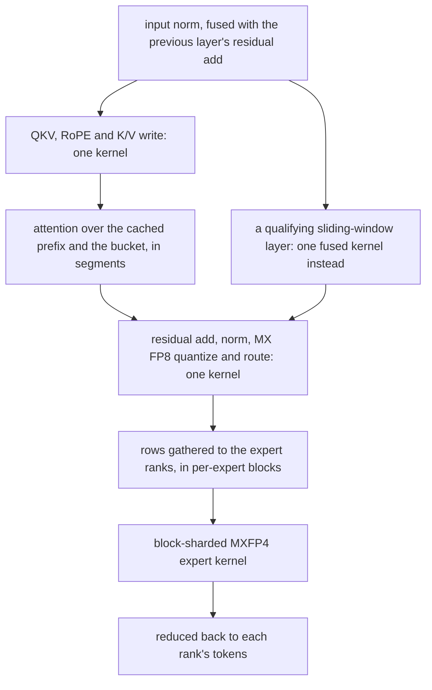
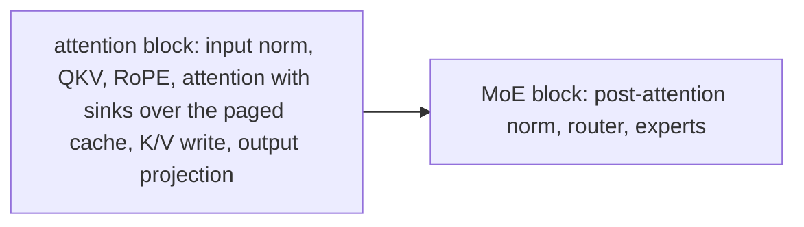
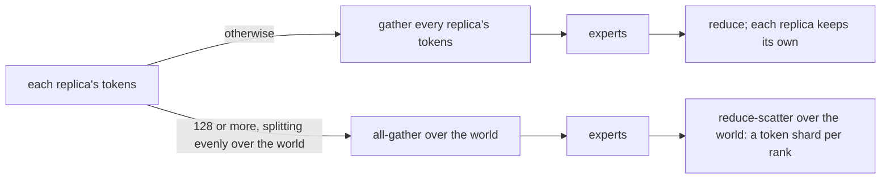
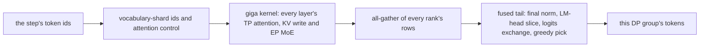
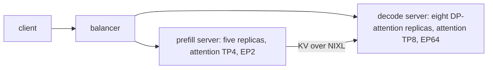

# GPT-OSS on Neuron

GPT-OSS runs on the plugin's [runtime](../design/runtime.md), like every other model.

The model runs the MXFP4 checkpoint (`openai/gpt-oss-120b`) on Trainium3 at LNC2 (`NEURON_LOGICAL_NC_CONFIG=2`, two
physical NeuronCores per logical core), except the [giga-kernel decode](#the-giga-kernel-decode), which runs one rank
per physical core (LNC1). The code is in `sglang_neuron/models/gpt_oss/` and the NKI kernel calls it makes are in
`sglang_neuron/ops/`.

## The model

GPT-OSS is a mixture-of-experts transformer: every layer has GQA attention with a learned sink per head, and the even
layers attend over a sliding window. The Neuron graphs run the checkpoint's architecture on its MXFP4 expert weights as
they are. Beyond the layout changes below, two things change the numerics: the KV cache is stored in FP8, and the
prefill MoE quantizes the normed hidden states to MX FP8 for the MXFP4 expert matmuls.

- **Hidden size.** The graphs pad the hidden size to the kernels' tile and hold it in a shuffled order (the padding sits
  at the end of each quarter). The RMSNorms take their mean over the checkpoint's hidden size, so the padding changes
  nothing.
- **Experts.** The MXFP4 blocks and scales go to the kernels as they are, repacked four FP4 values to a word and tiled
  to the kernels' access pattern. The expert intermediate size is padded so that each rank's shard tiles the kernels
  (a multiple of 32 up to 512 values, of 512 above); the kernels' default of 3072 is kept wherever its per-rank shard
  tiles. The `+ 1` of GPT-OSS's SwiGLU is folded into the up-projection
  bias at load time.
- **Router.** The decode and prefill MoE kernels read the router in different hidden orders, so the model holds a copy
  for each, as it holds the post-attention norm's weight.
- **BF16 experts.** `SGLANG_NEURON_GPT_OSS_EXPERTS=bf16` runs BF16 experts dequantized from the MXFP4 blocks on the
  host, in the same padding and hidden order. The weights are the checkpoint's exact values and the activations stay
  BF16 (the MXFP4 prefill quantizes them to MX FP8), so they serve as an accuracy reference for the MXFP4 experts.
  Everything else stays the same. The decode MoE is `moe_block_tkg` on BF16 weights; the prefill norms and routes in
  torch and runs the BF16 block-sharded expert kernel with GPT-OSS's biases and clamped SwiGLU. The BF16 experts are
  about four times the MXFP4 tiles, so they are served only at `--tp-size 16 --ep-size 4`, the one layout whose shard
  fits a rank's HBM and passed the kernel check ([BF16 experts on a NeuronCore](#bf16-experts-on-a-neuroncore)).
- **FP8 KV cache.** The KV cache is FP8 (`--kv-cache-dtype fp8_e4m3`), with K in a packed layout, two tokens per
  slot, which the decode kernel reads with a DMA transpose. A page of 128 tokens holds a sliding layer's whole window,
  as the fused sliding-window prefill kernel needs. The checkpoint stores dequantization scales. The decode kernel
  quantizes by multiplying, so each scale is inverted once at load, in bf16. The prefill kernels quantize by dividing,
  so they get the inverse of that value, which is the checkpoint's scale up to bf16 rounding. The released checkpoints
  carry no KV scales, so both are 1.
  Every decode bucket reads the packed layout directly: the runtime aligns the sliding layers' trimmed table to
  2 x LNC x 128 tokens, and the launch refuses a `--context-length` at which a full layer's bucket could not (rounded
  up to 256 tokens, it must be a multiple of 512).

## The graphs

A prefill server builds the prefill graph, a decode server the decode graph, and an aggregated server both, sharing one
copy of the weights on the device.

The prefill runs one request per forward, padded to its bucket. Between the layers the tokens are sequence-parallel
over attention TP. One prefill layer:



A sliding-window layer qualifies for the fused kernel when its rank holds at least two KV heads, on the FP8 cache, with
a page that holds the whole window. The routing is packed into each token's row. Only the sampled rows reach the LM
head.

The decode runs two kernels per layer:



The attention masks are built once per step, one for the sliding-window layers and one for the full layers, and the
sliding layers read a block table trimmed to the pages their window can reach.

The prefill graph and the per-layer decode graph end in the device sampler. The LM head's vocabulary shards stay on
their ranks and the sampler reduces over them, so the logits never leave the device. The giga-kernel decode picks its
tokens in its own fused tail instead.

## Parallel layouts

How each layout maps onto ranks, groups and collectives is in [Parallelism](../design/parallelism.md#gpt-oss) and
[GPT-OSS's experts](../design/parallelism.md#gpt-osss-experts).

**Prefill** runs attention tensor-parallel. The kernels bound one rank's share of the attention, so the prefill needs
an attention TP of at least four. The experts are split over `--ep-size` ranks, and each expert's intermediate
dimension over the remaining TP ranks of its row.

**Decode** on a decode server runs DP attention (`--enable-dp-attention --dp-size N`): each replica attends over its
own requests with an attention TP of at least eight, so that every rank holds one KV head, which is what the decode
kernel takes. On an aggregated server, which refuses DP attention, the decode graph runs attention TP over all
`--tp-size` ranks, again at least eight. Under DP attention the experts span the replicas through EP, and the
exchange around them depends on the step's token count over the fleet:



On the second path the attention output is reduce-scattered over attention TP to match, and the layer ends with an
all-gather over attention TP.

The compiled shapes come from the server arguments. The prefill compiles one graph, of the chunk
(`--chunked-prefill-size`), which must be one of the segmented kernel's KV segment tiles (512, 1024, 2048, 4096 or 8192)
and a multiple of the attention TP size; `--cuda-graph-bs-prefill` below the chunk is refused. The decode compiles one
graph per batch size, each over the whole context. The DP-attention decode runs one size, `--max-running-requests`
divided over the DP replicas, and refuses a `--cuda-graph-bs-decode` size below it. An aggregated server compiles
`--max-running-requests` and each power of two below it, or instead of the powers of two the smaller sizes
`--cuda-graph-bs-decode` lists. The context is `--context-length`, rounded up to 256 tokens; the multiple-of-512 rule is
under FP8 KV cache above. `--max-total-tokens` sizes the KV pool, whose page count is a dimension of the compiled
graphs.

## The giga-kernel decode

A decode server laid out as `--tp-size 128 --dp-size 16 --enable-dp-attention --ep-size 128` runs the giga-kernel
decode: every decoder layer of a step in one call of nkilib's giga kernel, and the final norm, LM head and greedy pick
in one more. The layout is what selects it (`serving_policy.giga_decode_layout`). Its 128 ranks are the node's 128
physical NeuronCores, one rank per core, so the platform runs this server at one logical core per physical core
(`NEURON_LOGICAL_NC_CONFIG=1`, set for the launch; every other server keeps 2). Each of the 16 DP groups has
eight attention ranks, and every rank holds one whole expert. The prefill side doesn't change: TP4 prefill replicas feed
it as they feed the per-layer decode.



The code is in `sglang_neuron/models/gpt_oss/giga/`, with the two kernel wrappers in
`sglang_neuron/ops/gpt_oss_giga_decode.py` and `sglang_neuron/ops/gpt_oss_giga_tail.py`:

- At load, each kernel argument's per-layer weights are stacked into one `[L, ...]` tensor, in the kernel's layouts: the
  gate/up MX scales in the PACK64 order the kernel reads, the V scale folded into the output projection, and the router
  in float16.
- The KV pool allocates each pair of layers (a sliding-window layer and the full layer after it) as the two halves of
  one K tensor and one V tensor, the form the kernel takes. Each layer's cache is still a view of its own half, so the
  disaggregated transfer moves the same per-layer pages it moves for the per-layer decode.
- The LM head is sharded over all 128 ranks. The fused tail exchanges the logits in two all-to-all hops, first within
  a device and then across the devices, and every rank ends with its DP group's greedy tokens.
- Each step's inputs are built in one numpy pass with a single upload (`giga/runtime.py`). The 128 ranks share their
  node's CPUs and every step waits for the last rank's launch, so the host work per step stays as small as it can be.
- The graph compiles with a DMA-order schedule for the kernel (`giga/dma_order.json`); without it the kernel would
  still run correctly, only slower. The compiler arguments name the schedule by its content, so the compile cache
  can't serve a decode compiled with another schedule. After the decode warms up, the server checks that the
  schedule fits the compiled graph (at least 80% of its constraints name the kernel call's instructions) and refuses
  to start if it doesn't. `tools/giga_schedule.py` rewrites the schedule for a graph whose kernel call has moved.

On this decode server the platform sets nkilib's QK-swapped attention path (`NKILIB_EXPERIMENTAL_ATTN_TKG_NO_SWAP=0`),
the path the giga kernel is validated on, and the kernel-build flags the schedule was derived on (`models/catalog.py`).
It refuses:

- a sampler other than greedy (`SGLANG_NEURON_SAMPLER`), top logprobs (`SGLANG_NEURON_MAX_TOP_LOGPROBS` above 0), and
  requests that ask for logprobs (`return_logprob`), since the fused tail returns tokens only;
- the model at 128 ranks in any other layout, and a launch `NEURON_LOGICAL_NC_CONFIG` that contradicts the layout;
- any other flag of the giga kernel's build in the launch environment (every variable nkilib reads under
  `GIGA_KERNEL_FLAG_PREFIX`, `models/catalog.py`, beyond the seven the platform pins): the kernel reads every one, some
  change its numerics, and several read any value, `0` too, as on;
- a `SGLANG_NEURON_MAX_INFLIGHT_LAUNCHES` outside 2 to 4, the launched steps its result processing trails by;
- a `--max-running-requests` whose per-group batch isn't a multiple of the DP group's eight attention ranks (the
  kernel splits each DP group's rows over them; a multiple of 128 always works);
- layers that don't alternate sliding and full attention in pairs, or more than the kernel's 18 pairs; other than one
  whole expert per rank; different KV scales per layer;
- an image whose kernel library has no fused tail, no sorted hardware top-k, or a giga kernel that reads its gate/up
  scales unpacked, and a neuronx-cc older than 2.28.4568.0, the build the tail's sorted top-k is validated with (the
  setup guide's).

## The SGLang patches

Two upstream checks would refuse GPT-OSS on Neuron. Both patches are installed in every process, the launching one
included, because SGLang consults them while it resolves the server arguments. Both are inert for any other model.

- `sglang_neuron/sglang_patches/gpt_oss_backend_check.py`: SGLang asserts that a GPT-OSS server's attention backends are
  on a fixed list of its own backends. For a GPT-OSS launch on the Neuron backend, the check runs with a listed backend
  for that one call. The server arguments are not modified.
- `sglang_neuron/sglang_patches/quantization_registry.py`: SGLang registers its MXFP4 config on other platforms only,
  and refuses a quantization name its registry lacks before it asks the platform. The patch adds an inert config under
  `mxfp4`, which the platform returns too; every other model's host refuses a quantized checkpoint.

Each patch checks the source of the function it relies on against the SGLang it was written for, and refuses to install
on another.

GPT-OSS itself is registered through SGLang's out-of-tree model package. For a GPT-OSS launch the platform sets
`SGLANG_EXTERNAL_MODEL_PACKAGE=sglang_neuron.models.gpt_oss` and `NKILIB_EXPERIMENTAL_ATTN_TKG_NO_SWAP=1` (`0` on the
giga-kernel decode) for every process it starts (declared in `sglang_neuron/models/catalog.py` and set by
`apply_model_settings` in `sglang_neuron/platform.py`), which also keeps SGLang from importing its in-tree models there.
Leave both unset.

## Serving

The platform sets `TORCH_NEURONX_ENABLE_STREAMS=1` and `NEURON_LOGICAL_NC_CONFIG=2` (`1` on the giga-kernel decode) for
the launch; leave them unset.

The commands below run inside the container, with the checkpoint mounted at `/models`; the
[container guide](../guides/container.md) has the `docker run` for one node and for prefill/decode over two. The
[example](../../examples/gpt_oss_120b/) has both prefill/decode layouts as scripts, the giga-kernel decode as a second
decode command, and [examples/README.md](../../examples/README.md#run-a-model) gives the order to run them.

The decode compiles at `-O2` and the prefill at the default `-O1`. A decode that traces the device sampler's exact
top-k compiles at `-O1` too, since `-O2` miscompiles that top-k. This applies to a deployment that serves top logprobs
(`SGLANG_NEURON_MAX_TOP_LOGPROBS` above its default of 0) and to one that runs the `topk_topp` sampler.

Aggregated, on one node, with the validated flags:

```bash
python3 -m sglang.launch_server --model-path /models/gpt-oss-120b \
  --tp-size 8 --ep-size 8 --kv-cache-dtype fp8_e4m3 --context-length 10240 --chunked-prefill-size 8192 \
  --max-running-requests 64 --max-total-tokens 655360 --mem-fraction-static 0.8 \
  --host 0.0.0.0 --port 30000
```

`--host 0.0.0.0` listens inside the container; publish the port on the host's loopback only
(`-p 127.0.0.1:30000:30000`), as the [container guide](../guides/container.md#3-start-a-container) explains.

Disaggregated, on two nodes, with the validated flags. The prefill server runs five independent
replicas of attention TP4 (MoE EP2) through `--dp-size`, and the decode server runs eight DP-attention replicas of
attention TP8 (MoE EP64):



Both use the image's NIXL, which carries the transfer's patches ([NIXL patches](../../patches/nixl/README.md)):

```bash
# on the prefill node
python3 -m sglang.launch_server \
  --model-path /models/gpt-oss-120b --kv-cache-dtype fp8_e4m3 --context-length 10240 --chunked-prefill-size 8192 \
  --disaggregation-mode prefill --disaggregation-transfer-backend nixl --disaggregation-bootstrap-port 8998 \
  --tp-size 4 --ep-size 2 --dp-size 5 --max-running-requests 8 --max-total-tokens 65536 --mem-fraction-static 0.51 \
  --host <prefill node> --port 30000
# on the decode node
python3 -m sglang.launch_server \
  --model-path /models/gpt-oss-120b --kv-cache-dtype fp8_e4m3 --context-length 10240 --chunked-prefill-size 8192 \
  --disaggregation-mode decode --disaggregation-transfer-backend nixl --disaggregation-bootstrap-port 8998 \
  --tp-size 64 --dp-size 8 --enable-dp-attention --ep-size 64 --enable-dp-attention-local-control-broadcast \
  --max-running-requests 128 --max-total-tokens 172032 --mem-fraction-static 0.5 --tokenizer-worker-num 4 \
  --host <decode node> --port 30000
```

The local control broadcast sends control requests to every DP leader directly, so every rank of the decode sees them
in the same order; the DP-attention decode's lockstep needs this, and a DP-attention decode without the flag is refused
at launch. Four tokenizer workers keep up with a full decode batch's streams. A balancer in front sends each request to
a prefill replica and to the decode server (`sglang_neuron/disaggregation/balancer.py`, as in the [disaggregated
tutorial](../tutorials/disaggregated-1p1d.md#2-put-the-balancer-in-front)). GPT-OSS's chat format loads its tiktoken
vocabulary (`o200k_base.tiktoken`) from the directory `TIKTOKEN_ENCODINGS_BASE` names, and downloads it when the
variable is unset; set it on a node without internet access. The settings the platform fixes for the disaggregated roles
(the NIXL backend, KV release and transfer polling) are in [Disaggregated
inference](../design/disaggregated-inference.md#configuration).

The balancer, on either node or a third:

```bash
python3 -m sglang_neuron.disaggregation.balancer --prefill http://<prefill node>:30000 \
  --decode http://<decode node>:30000
```

The giga-kernel decode takes the same prefill server with six replicas (`--dp-size 6`) and, on the decode node, the
validated flags:

```bash
python3 -m sglang.launch_server \
  --model-path /models/gpt-oss-120b --kv-cache-dtype fp8_e4m3 --context-length 10240 --chunked-prefill-size 8192 \
  --disaggregation-mode decode --disaggregation-transfer-backend nixl --disaggregation-bootstrap-port 8998 \
  --tp-size 128 --dp-size 16 --enable-dp-attention --ep-size 128 --enable-dp-attention-local-control-broadcast \
  --max-running-requests 128 --max-total-tokens 163840 --mem-fraction-static 0.5 --stream-interval 4 \
  --tokenizer-worker-num 4 --detokenizer-worker-num 4 --host <decode node> --port 30000
```

At the giga kernel's step one detokenizer streaming every token falls behind 128 streams, so this decode streams every
fourth token (the first and the last at once) and runs four detokenizer processes.

### Chat completions and tool calls

GPT-OSS answers in the harmony format: its reasoning on the `analysis` channel, then the answer on the `final` channel.
The launches above pass no parser, so a
`/v1/chat/completions` answer's `content` holds the channel markup as well, for example
`<|channel|>analysis<|message|>... 17*20=340, 17*3=51, sum=391. So answer 391.<|end|><|start|>assistant<|channel|>final<|message|>391`. To
serve chat clients, add SGLang's GPT-OSS parsers to the aggregated server, or to both servers of a disaggregated
deployment:

```bash
  --reasoning-parser gpt-oss --tool-call-parser gpt-oss
```

With them, `content` holds only the answer (`391`) and `reasoning_content` the reasoning, in streamed answers too, and a
request that offers `tools` gets `tool_calls` back with the finish reason `tool_calls`. The parsers run in SGLang's
tokenizer and detokenizer processes and cost no decode time: on the giga-kernel deployment above, SGLang's serving
benchmark (8,192 tokens in, 1,024 out, 128 requests in flight) measured the same median TPOT with and without them
on the same two nodes.

### In the container

The commands above run in the container image as written: it has SGLang, this plugin and the patched NIXL installed,
and sets `SGLANG_PLATFORM=neuron`. Also:

- On a node without internet access, set `TIKTOKEN_ENCODINGS_BASE` to a directory holding `o200k_base.tiktoken`.
- Keep the compile caches on a persistent mount ([container guide](../guides/container.md)): a warm start answers
  `/health` sooner than a cold one; the rest of a start is loading the weights and the warm-up.
- Keep models and compile caches out of `/workspace`, where the base image installs torch-neuronx.
- The OpenAI Responses API (`/v1/responses`) is unavailable: SGLang's runtime set pins `openai==2.6.1`, which lacks the
  types SGLang's Responses server imports, so the server logs that it disabled the route at launch.
  `/v1/chat/completions`, `/v1/completions` and `/generate` serve as usual.
- The [container runbook](../guides/container-runbook.md#4a-prefilldecode-gpt-oss-120b) has the giga pair's and the
  balancer's full `docker run` commands, a first chat and tool-call request, and how to stop them.

## BF16 experts on a NeuronCore

The BF16 experts' two kernel calls were compared with their torch paths on one NeuronCore (trn3, LNC2), at each
layout's per-rank expert shard, with the checkpoint's experts of layers 0, 18 and 35 (whose down projections differ a
hundredfold in scale), on both EP ranks of an EP-TP row: `moe_experts_blockwise_swiglu` at prefill calls of 1024, 4096
and 8192 tokens (routed by the graphs' top-k), and `moe_block_tkg` without scales at decode batches of 1 to 128. A case
passes with no NaN or Inf, `max |kernel - torch| <= 1e-5 + rtol * max |torch|` (nkilib's own bound: rtol 2e-2 for
`moe_cte`, 1.1e-2 for `moe_block_tkg`), every row's cosine at least 0.999, and the unserved rows and padding columns
within the same bound.

| Layout | Expert shard a rank | Prefill cases | Decode cases | BF16 experts a rank | Served |
|---|---|---|---|---|---|
| TP16 EP4 | intermediate 1024, 32 experts | 18 of 18; worst row 0.66%, cosine 0.99998 | 48 of 48; worst row 1.82%, cosine 0.99994 | 21.7 GB | yes |
| TP8 EP2 | intermediate 1024, 64 experts | 18 of 18; worst row 0.73%, cosine 0.99997 | 45 of 48: three batches of 4 and 8 are 2 to 3 bf16 ulps over the max-abs bound (1.25 times it at worst), their rows within 0.7% | 43.5 GB, over a logical core's 38.6 GB | no |
| TP16 EP16 | intermediate 3072, 8 experts | 7 of 18: NaN rows at 4096 and 8192 tokens | 45 of 48: three over the max-abs bound (1.39 times it at worst) | 16.3 GB | no |

TP16 EP4 runs the attention at TP16 (four query heads a rank), where the MXFP4 deployments run TP8. Any other
layout is refused at launch, naming the expert shard it would give the kernels.

## What is refused

A launch the graphs can't serve fails at startup, naming the setting at fault:

- a checkpoint that is not MXFP4, or whose dtype is not bfloat16;
- a KV cache other than `--kv-cache-dtype fp8_e4m3`, or a page size other than 128 (a launch without `--page-size`
  gets 128);
- a target other than Trainium3;
- `SGLANG_NEURON_GPT_OSS_EXPERTS` at a value other than `mxfp4` or `bf16`; and `bf16` on the giga-kernel decode (which
  runs the MXFP4 experts in its one kernel), at any layout but `--tp-size 16 --ep-size 4` (the refusal names the
  layout's expert shard, or what its measurement found), with DP attention, or with a `--chunked-prefill-size` over 8192
  or a `--max-running-requests` over 128, past the call sizes its kernels were measured at;
- `NKILIB_EXPERIMENTAL_ATTN_TKG_NO_SWAP` at a value other than the platform's: `1`, since the per-layer decode
  attention is validated on nkilib's non-swapped QK path, and `0` on the giga-kernel decode, whose attention is
  validated on the swapped one;
- a prefill attention TP under four, and a decode attention TP under eight;
- DP attention without `--ep-size`; attention heads that do not split evenly over the attention TP ranks; KV heads that
  neither split over those ranks nor replicate evenly across them; and experts that do not split over the EP size;
- a checkpoint whose `layer_types` do not slide the even layers and attend fully on the odd ones;
- a `--context-length` that, rounded up to 256 tokens, is not a multiple of 512;
- an expert intermediate shard the prefill expert kernel cannot take (use more EP and fewer TP ranks per expert): this
  one at the prefill graph's warm-up compile, after the weights have loaded;
- `SGLANG_EXTERNAL_MODEL_PACKAGE` set to another package, or an SGLang whose patched functions changed;
- `--enable-dp-attention` on an aggregated server, whose DP ranks would run prefill and decode graphs in the same step:
  serve DP attention disaggregated;
- a DP-attention decode without `--enable-dp-attention-local-control-broadcast` or `--max-running-requests`, or with
  `--scheduler-recv-interval` other than 1, `--sleep-on-idle`, `--disable-overlap-schedule`, two-batch overlap, or a
  decode batch size below the per-DP batch in `--cuda-graph-bs-decode` or `--cuda-graph-config`
  ([Disaggregated inference](../design/disaggregated-inference.md#configuration));
- on a role that prefills, a `--cuda-graph-bs-prefill` count below the chunk, since GPT-OSS compiles the chunk's graph
  alone, and a chunk (`--chunked-prefill-size`, divided by the DP size under DP attention) that is not one of the
  segmented kernel's KV segment tiles, 512, 1024, 2048, 4096 or 8192: these two when the runtime builds its graphs,
  after the weights have loaded;
- a launch `NEURON_LOGICAL_NC_CONFIG` that contradicts the layout's degree, 2, or 1 on the giga-kernel decode. A value
  equal to the host's default is replaced and logged instead, since torch-neuronx's import writes that default into
  an unset variable and the launch's own value cannot be told from none;
- the features every model refuses ([What a launch refuses](../design/runtime.md#what-a-launch-refuses)).

An in-place weight update is refused when it is requested.
