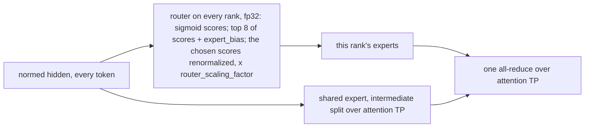

# Hy3 on Neuron

`HYV3ForCausalLM` (tencent/Hy3-FP8) runs on the [runtime](../design/runtime.md) as an aggregated server or as a prefill
and a decode server. The host is `sglang_neuron/models/hy_v3/sglang_model.py`: the shared dense transformer
([Qwen3](qwen3.md)) with Hy3's attention over an FP8 KV cache (`attention.py`) and Hy3's MoE block (`moe.py`) in every
layer after the first.

## The model

Hy3 is a ~295B-parameter MoE decoder with one MTP layer:

| Parameter | Value |
| --- | --- |
| hidden size | 4096 |
| layers | 80: layer 0 dense (intermediate 13312), layers 1-79 MoE; `model.layers.80` the MTP layer |
| attention | 64 query heads, 8 KV heads, head dim 128, a per-head RMSNorm of Q and K before RoPE, RoPE theta 11158840 |
| experts | 192 routed (top 8, intermediate 1536) and 1 shared |
| vocabulary | 120832, untied LM head |

At TP64 each rank holds one query head and one KV head (each KV head replicated over 8 ranks) and, with EP64, three
routed experts of each MoE layer.

Every MoE layer works like this:



The expert bias only chooses the experts; the weights come from the scores without it.

## The checkpoint and its kernels

tencent/Hy3-FP8 stores every linear weight as `float8_e4m3fn` with one `weight_scale` per tensor (the embedding, the LM
head and the routers are bf16). The routed experts keep their FP8 weights (`experts_fp8.py`):

- decode: the post-attention norm, the router, the routed experts and a shard of the shared expert run in one NKI kernel
  with FP8 activations (`moe_fused.py`, `kernels/moe_tkg_fused.py`; `SGLANG_NEURON_HY3_DECODE_MOE_FUSED=0` keeps the
  separate norm, router, `moe_tkg` and shared MLP);
- prefill: nkilib's hybrid I-sharded `moe_cte` (`experts_cte.py`), on a copy that feeds the FP8 weight tiles to the
  matmul as they are (`kernels/moe_cte_fp8w.py`, `kernels/bwmm_shard_on_I_fp8w.py`).

The attention projections, the dense MLP and the shared expert are dequantized to bf16 as they load
(`SGLANG_NEURON_HY3_ATTN_FP8=1` keeps the attention projections FP8 with a static-FP8 decode; it measured slower at
TP64). `kernels/PROVENANCE.md` names where each vendored kernel comes from. `SGLANG_NEURON_HY3_EXPERTS=bf16` dequantizes
the routed experts too, a reference for accuracy.

## The FP8 KV cache, DCP and sparse decode

`--kv-cache-dtype fp8_e4m3` stores K packed and V per page in FP8 with per-layer scales. The checkpoint ships none, so the
launch needs a calibrated profile (`kv_scales.py`): `SGLANG_NEURON_HY3_KV_SCALES`, else
`<checkpoint>/kv_scales.safetensors`. vllm-neuron's Hy3 contrib publishes two (`contrib/models/hy_v3/kv_profiles/`):
`Hy3-FP8_neuron.safetensors`, and `Hy3-FP8_mtp_neuron.safetensors`, which also holds the MTP layer's scales and is the one
a `NEURON_MTP` launch needs.

`--dcp-size 8` shards each sequence's KV over the 8 ranks that share a KV head, 128-token blocks round-robin: the prefill
runs nkilib's KV-parallel segmented attention, the decode `attention_block_tkg` with `CP = 8`.

`SGLANG_NEURON_HY3_SPARSE_DECODE=<fraction>` (0.0625 below) makes the DCP decode block-sparse (`sparse.py`): each layer
keeps a min / max summary of every local KV page; every `SGLANG_NEURON_HY3_SPARSE_SELECT_EVERY` layers (8) a step scores
the pages with the Quest bound and keeps the sink, recent and best pages, and the layers between reuse the choice. A
bucket whose table is not wider than the kept pages attends densely.

## MTP speculative decoding

`--speculative-algorithm NEURON_MTP` drafts with the checkpoint's MTP layer (`mtp.py`, `mtp_step.py`): each decode step
verifies a row's 1 + 3 tokens, accepts on the device, then runs the MTP layer over the span and two more single-token
drafts; the drafts, the accepted length and the next tokens stay on the device. The prefill writes the MTP layer's KV over
each chunk. The step runs under DCP with the FP8 cache and samples on the device (`SGLANG_NEURON_SAMPLER=temperature` or
`topk_topp`); requests with logprobs are refused. A sparse decode folds each span's tokens into its pages' summaries from
the span's K computed beside the attention kernel (`sparse.SparseState.fold_span`, `SGLANG_NEURON_HY3_SPAN_K`).

## Serving

Aggregated, on the 64 logical cores of a trn2.48xlarge (the configuration measured below):

```bash
SGLANG_NEURON_HY3_KV_SCALES=/profiles/Hy3-FP8_mtp_neuron.safetensors \
SGLANG_NEURON_HY3_SPARSE_DECODE=0.0625 SGLANG_NEURON_SAMPLER=temperature \
SGLANG_NEURON_HY3_PREFILL_SEG=2048 SGLANG_NEURON_HY3_SPARSE_PREFILL_KEEP=16384 \
python3 -m sglang.launch_server --model-path /models/Hy3-FP8 --served-model-name hy3 \
  --tp-size 64 --ep-size 64 --context-length 262144 --max-total-tokens 262144 \
  --chunked-prefill-size 2048 --max-running-requests 16 --mem-fraction-static 0.85 \
  --kv-cache-dtype fp8_e4m3 --dcp-size 8 --speculative-algorithm NEURON_MTP \
  --prefill-decode-interval 2 --prefill-decode-interval-min-bs 8 --cuda-graph-bs-decode 8 12 16 \
  --enable-cache-report --host 0.0.0.0 --port 30000
```

- `SGLANG_NEURON_HY3_PREFILL_SEG=2048`: the DCP prefill attends in 2048-token query segments over 1024-token prior
  segments (the vendored `kernels/attention_kv_parallel_fp8.py` takes the two apart; the stock kernel is wrong past 1024).
- `SGLANG_NEURON_HY3_SPARSE_PREFILL_KEEP=16384`: a DCP prefill chunk over a longer prior attends to 16384 of its prior
  tokens, picked by the page summaries under the chunk's query-group envelopes (`sparse.prefill_select`).
- `--prefill-decode-interval 2`: a waiting prefill runs after at most two decode steps.
- `SGLANG_NEURON_PREFILL_YIELD=2048` (optional, `sglang_patches/prefill_yield.py`) lets a prompt of at most 2048 new tokens
  prefill between two chunks of a long one: under AgentX it lowers TTFT and raises the decode's P90 ITL (below).

Disaggregated over NIXL: two TP32 prefills without DCP on one node (`NEURON_RT_VISIBLE_CORES` 0-31 and 32-63, two
ports and two bootstrap ports) in front of a TP64 DCP8 `NEURON_MTP` decode, all with the FP8 cache
and the same KV scale profile. The prefill takes `SGLANG_NEURON_HY3_PD_MTP_KV=1` (it holds the MTP layer and writes its
KV, so both pools hold the same layers) and, in front of a sparse decode, the same `SGLANG_NEURON_HY3_SPARSE_DECODE`: it
then keeps the summaries of the pages each chunk writes, and the transfer sends them with their pages
(`memory_pool.PAGE_SIDE_BUFFERS`). Add the role flags (`--disaggregation-mode prefill|decode`,
`--disaggregation-transfer-backend nixl`, the prefill's `--disaggregation-bootstrap-port`) and put the balancer in front,
as for [Qwen3-MoE](qwen3-moe.md#serving), with one `--bootstrap-port` per `--prefill`. The balancer keeps a session's
turns on one prefill server. AgentX revisits long prefixes, so give each prefill a large pool
(`--max-total-tokens 524288`) and HiCache L2 (`--enable-hierarchical-cache --hicache-size 20`, about 950k host tokens a
server; the host pool keeps the sparse summaries with their pages).

## What a launch refuses

- A checkpoint quantized other than with per-tensor FP8 (a `weight_block_size`, another method).
- A router without the sigmoid or the expert bias, attention biases, or no QK-norm.
- A scaled RoPE, a dtype other than bfloat16.
- DP attention, and a layout whose heads, experts or intermediate sizes do not shard over the TP and EP sizes.
- An FP8 KV cache without a KV scale profile; a profile without a layer the launch holds stops the weight load.
- `NEURON_MTP` on a PD prefill (launch it with `SGLANG_NEURON_HY3_PD_MTP_KV=1` instead).

## Measured

tencent/Hy3-FP8 on one trn2.48xlarge (Neuron SDK 2.33), the aggregated configuration above:

| | |
| --- | --- |
| cold prefill, 98k-token prompt | 22.6 s |
| decode TPOT, 128-token prompts, 1024 out, temperature 0.9, concurrency 8 | 14.9 ms (MTP accepted length 3.1) |
| GSM8K (5-shot, 200 problems, MTP on) | 0.935 to 0.950 |
| needle retrieval, 16k to 85k tokens, 3 depths | 12/12 |
| InferenceX AgentX, concurrency 8, 1 h (`semianalysis_cc_traces_weka_062126_256k`, real acceptance) | 206.9 output tokens/s, 923 requests; TTFT p50/p90/p99 1.87/5.71/18.1 s; ITL p50/p90 30.1/53.4 ms |
| the same with `SGLANG_NEURON_PREFILL_YIELD=2048` | 206.2 output tokens/s; TTFT 1.72/5.27/16.6 s; ITL 30.9/59.2 ms |

How the AgentX point moved (same run each, one change at a time): 149.1 (the configuration before the prefill segments)
-> 154.3 (query/prior segments) -> 171.8 (sparse DCP prefill) -> 185.0 (`temperature` sampler admitted under MTP) ->
187.8 (drafts without the logprob path, decode bucket 12) -> 191.9 (direct submit of the decode graph) -> 202.2
(span summaries from the computed K) -> 206.9 (`--prefill-decode-interval 2`).

PD (one trn2.48xlarge each for the prefill and the decode): GSM8K (200 problems) 0.945 with the sparse decode, 80k-token
needle retrieval correct, decode TPOT 19.0 ms at concurrency 8. AgentX on the 2P1D layout above (two TP32 prefills, one
TP64 DCP8 decode):

| | output tokens/s | TTFT p50/p90/p99 | ITL p50/p90 | prefix hit |
| --- | --- | --- | --- | --- |
| concurrency 8, 1 h, prefill pools 524288 tokens, no HiCache | 216.0 | 2.16/28.1/55.3 s | 21.8/26.9 ms | 87.8% |
| concurrency 8, 20 min, with HiCache | 155.9 | 1.71/3.80/8.78 s | 22.0/28.2 ms | 95.6% |
| concurrency 8, 20 min, no HiCache | 153.6 | 1.76/5.81/33.2 s | | |
| concurrency 16, 20 min, with HiCache | 293.6 | 3.44/33.3/62.3 s | 23.1/28.3 ms | 86.8% |
| concurrency 16, 20 min, no HiCache | 217.1 | 11.9/65.6/106.8 s | | 69.6% |

A 20-minute run (`--benchmark-duration 1200 --warmup-requests-per-lane 1`) is mostly first turns, so its output tokens/s
compares with other 20-minute runs only.

## Status and next steps

- TTFT's tail is a long cold prompt's chunks: a Neuron prefill forward runs one request, so the turns behind a 170k-token
  cold prompt wait for all of its chunks (`SGLANG_NEURON_PREFILL_YIELD` trades decode ITL for part of it).
- A decode layer (bs 8, MTP span 4, 32k context) is about 0.43 ms, a quarter of it waiting on its three collectives (the
  DCP merge and two 64-rank all-reduces of 256 KB, 27 us each, latency-bound; the runtime's default algorithms are the
  fastest measured); the span fold and the selection still cost about 3.9 ms of a 43.6 ms step.
- The PD prefill runs without DCP, so its attention over a long prior is not sharded; the DCP stripe transfer serves MLA
  pools only today.
