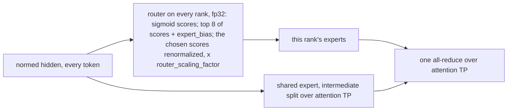

# Hy3 on Neuron

`HYV3ForCausalLM` (tencent/Hy3-FP8) runs on the [runtime](../design/runtime.md) as an aggregated server or as a prefill
and a decode server. The host is `sglang_neuron/models/hy_v3/sglang_model.py`: the shared dense transformer
([Qwen3](qwen3.md)) with Hy3's attention over an FP8 KV cache (`attention.py`) and Hy3's MoE block (`moe.py`) in every
layer after the first.

## The model

Hy3 is a ~295B-parameter MoE decoder with one MTP layer:

| Parameter | Value |
| --- | --- |
| hidden size | 4096 |
| layers | 80: layer 0 dense (intermediate 13312), layers 1-79 MoE; `model.layers.80` the MTP layer |
| attention | 64 query heads, 8 KV heads, head dim 128, a per-head RMSNorm of Q and K before RoPE, RoPE theta 11158840 |
| experts | 192 routed (top 8, intermediate 1536) and 1 shared |
| vocabulary | 120832, untied LM head |

At TP64 each rank holds one query head and one KV head (each KV head replicated over 8 ranks) and, with EP64, three
routed experts of each MoE layer.

Every MoE layer works like this:



The expert bias only chooses the experts; the weights come from the scores without it.

## The checkpoint and its kernels

tencent/Hy3-FP8 stores every linear weight as `float8_e4m3fn` with one `weight_scale` per tensor (the embedding, the LM
head and the routers are bf16). The routed experts keep their FP8 weights (`experts_fp8.py`):

- decode: the post-attention norm, the router, the routed experts and a shard of the shared expert run in one NKI kernel
  with FP8 activations (`moe_fused.py`, `kernels/moe_tkg_fused.py`), and the input and final RMSNorms in another
  (`kernels/rmsnorm_rows.py`);
- prefill: the router in one NKI kernel (`kernels/router_cte.py`: bf16 operands, fp32 accumulation, where the torch
  router multiplies in fp32), and nkilib's hybrid I-sharded `moe_cte` (`experts_cte.py`), on a copy that feeds the FP8
  weight tiles to the matmul as they are (`kernels/moe_cte_fp8w.py`, `kernels/bwmm_shard_on_I_fp8w.py`). The prefill
  layers run sequence parallel over the attention TP (`sglang_model.prefill_stack_sp`): each rank holds 1 / TP of the
  chunk's residual rows, and a layer all-gathers its normed rows for the attention and the MLP and reduce-scatters
  their partials back.

The attention projections, the dense MLP and the shared expert are dequantized to bf16 as they load (a static-FP8
attention decode measured slower at TP64: a rank's projections are small). `kernels/PROVENANCE.md` names where each
vendored kernel comes from.

## The FP8 KV cache, DCP and sparse decode

`--kv-cache-dtype fp8_e4m3` stores K packed and V per page in FP8 with per-layer scales. The checkpoint ships none, so the
launch needs a calibrated profile (`kv_scales.py`): `SGLANG_NEURON_HY3_KV_SCALES`, else
`<checkpoint>/kv_scales.safetensors`. vllm-neuron's Hy3 contrib publishes two (`contrib/models/hy_v3/kv_profiles/`):
`Hy3-FP8_neuron.safetensors`, and `Hy3-FP8_mtp_neuron.safetensors`, which also holds the MTP layer's scales and is the one
a `NEURON_MTP` launch needs.

`--dcp-size 8` shards each sequence's KV over the 8 ranks that share a KV head, 128-token blocks round-robin: the prefill
runs nkilib's KV-parallel segmented attention, in 2048-token query segments over 1024-token prior segments (the
vendored `kernels/attention_kv_parallel_fp8.py` takes the two apart; the stock kernel is wrong past 1024), the decode
`attention_block_tkg` with `CP = 8`.

`SGLANG_NEURON_HY3_SPARSE_DECODE=<fraction>` (0.0625 below) makes the DCP decode block-sparse (`sparse.py`): each layer
keeps a min / max summary of every local KV page; every 8 layers a step scores the pages with the Quest bound and keeps
the sink, recent and best pages, and the layers between reuse the choice. A bucket whose table is not wider than the
kept pages attends densely. Under it a prefill chunk over a longer prior attends to 16384 of its prior tokens, picked by
the page summaries under the chunk's query-group envelopes (`sparse.prefill_select`).

## MTP speculative decoding

`--speculative-algorithm NEURON_MTP` drafts with the checkpoint's MTP layer (`mtp.py`, `mtp_step.py`): each decode step
verifies a row's 1 + 3 tokens, accepts on the device, then runs the MTP layer over the span and two more single-token
drafts; the drafts, the accepted length and the next tokens stay on the device. The prefill writes the MTP layer's KV over
each chunk. The step runs under DCP with the FP8 cache and samples on the device (`SGLANG_NEURON_SAMPLER=temperature` or
`topk_topp`); requests with logprobs are refused. A sparse decode folds each span's tokens into its pages' summaries from
the span's K computed beside the attention kernel (`sparse.SparseState.fold_span`).

## Serving

Aggregated, on the 64 logical cores of a trn2.48xlarge (the configuration measured below):

```bash
SGLANG_NEURON_HY3_KV_SCALES=/profiles/Hy3-FP8_mtp_neuron.safetensors \
SGLANG_NEURON_HY3_SPARSE_DECODE=0.0625 SGLANG_NEURON_SAMPLER=temperature \
python3 -m sglang.launch_server --model-path /models/Hy3-FP8 --served-model-name hy3 \
  --tp-size 64 --ep-size 64 --context-length 262144 --max-total-tokens 262144 \
  --chunked-prefill-size 2048 --max-running-requests 16 --mem-fraction-static 0.85 \
  --kv-cache-dtype fp8_e4m3 --dcp-size 8 --speculative-algorithm NEURON_MTP \
  --prefill-decode-interval 2 --prefill-decode-interval-min-bs 8 --cuda-graph-bs-decode 8 12 16 \
  --enable-cache-report --host 0.0.0.0 --port 30000
```

- `--prefill-decode-interval 2`: a waiting prefill runs after at most two decode steps.
- `SGLANG_NEURON_PREFILL_YIELD=2048` (optional, `sglang_patches/prefill_yield.py`) lets a prompt of at most 2048 new tokens
  prefill between two chunks of a long one: under AgentX it lowers TTFT and raises the decode's P90 ITL (below).

Disaggregated over NIXL (the measured configuration: one trn2.48xlarge for the prefill, one for the decode), every
server with the FP8 cache, the same KV scale profile and the same `SGLANG_NEURON_HY3_SPARSE_DECODE`:

- prefill: TP64 `--dcp-size 8`, `--disaggregation-mode prefill`, `--chunked-prefill-size 2048`,
  `--max-total-tokens 262144`, `--enable-hierarchical-cache --hicache-size 16` (HiCache L2 over the DCP pool, about
  6.7M host tokens), `SGLANG_NEURON_HY3_PD_MTP_KV=1` (it holds the MTP layer and writes its KV, so both pools hold the
  same layers; no `--speculative-algorithm`), `SGLANG_NEURON_PREFILL_YIELD=8192` (a turn of at most 8192
  uncached tokens goes ahead of a long cold prompt's next chunk: one chunk between two of its chunks, a longer one to
  its end with the long prompt suspended). Under the sparse decode it keeps the summaries of the pages each chunk
  writes, and the transfer and HiCache move them with their pages (`memory_pool.PAGE_SIDE_BUFFERS`).
- decode: TP64 `--dcp-size 8` `NEURON_MTP`, `--disaggregation-mode decode`, `--cuda-graph-bs-decode 4 8 12 16`,
  `--max-running-requests 16`, `--max-total-tokens 262144`.
  `--disaggregation-decode-enable-radix-cache` keeps finished prompts on the decode, so a returning prefix moves
  only its new pages (D-only replay of 85k-token prompts at C=8: TTFT 0.73 -> 0.63 s, TPOT unchanged; GSM8K 0.94 / 0.96).
  Leave it off under AgentX: the decode's pool, already near full, then also holds finished prompts, and the hour at
  c=16 lost throughput (381.7 against 433.6 tok/s) and metric coverage (20 requests still in flight at the end).
- both: `--disaggregation-transfer-backend nixl` (LIBFABRIC over EFA), the prefill's `--disaggregation-bootstrap-port`.

Put the balancer in front, as for [Qwen3-MoE](qwen3-moe.md#serving), with one `--bootstrap-port` per `--prefill` and
`--prefill-migrate-gap 5`: it keeps a session's turns on one prefill server and moves a turn off a server with five more
prefilling than another. Two TP32 `--dcp-size 4` prefills on one node also serve a TP64 DCP8 decode: the decode takes
`SGLANG_NEURON_PD_PREFILL_DCP=4` and receives each KV head's tokens by stripes (`disaggregation/dcp_stripes.py`).

## What a launch refuses

- A checkpoint quantized other than with per-tensor FP8 (a `weight_block_size`, another method).
- A router without the sigmoid or the expert bias, attention biases, or no QK-norm.
- A scaled RoPE, a dtype other than bfloat16.
- DP attention, and a layout whose heads, experts or intermediate sizes do not shard over the TP and EP sizes.
- An FP8 KV cache without a KV scale profile; a profile without a layer the launch holds stops the weight load.
- `NEURON_MTP` on a PD prefill (launch it with `SGLANG_NEURON_HY3_PD_MTP_KV=1` instead).

## Measured

tencent/Hy3-FP8 on one trn2.48xlarge (Neuron SDK 2.33), the aggregated configuration above:

| | |
| --- | --- |
| cold prefill, 98k-token prompt | 22.6 s |
| decode TPOT, 128-token prompts, 1024 out, temperature 0.9, concurrency 8 | 14.9 ms (MTP accepted length 3.1) |
| GSM8K (5-shot, 200 problems, MTP on) | 0.935 to 0.950 |
| needle retrieval, 16k to 85k tokens, 3 depths | 12/12 |
| decode step, 8 rows, MTP span 4, 32k / 64k / 128k contexts | 42.6 / 42.7 / 43.7 ms |
| InferenceX AgentX, concurrency 8, 1 h (`semianalysis_cc_traces_weka_062126_256k`, real acceptance, harness 1.0.14) | 216.2 output tokens/s, 932 requests; TTFT p50/p90/p99 1.89/5.11/15.8 s; ITL p50/p90 27.2/48.5 ms |
| the same before the NKI decode RMSNorm and the folded V scale (harness 1.0.14, decode buckets 1 to 16) | 207.9 output tokens/s; TTFT 1.93/5.37/20.3 s; ITL 30.1/51.2 ms |
| the same at concurrency 1 / 2 / 4 (before them) | 64.2 / 84.9 / 134.5 output tokens/s; ITL p50 18.4 / 19.9 / 21.8 ms |
| `SGLANG_NEURON_PREFILL_YIELD=2048` (harness 1.0.12, before them) | 206.2 output tokens/s against 206.9 without; TTFT 1.72/5.27/16.6 s; ITL 30.9/59.2 ms |

How the AgentX point moved (same run each, one change at a time): 149.1 (the configuration before the prefill segments)
-> 154.3 (query/prior segments) -> 171.8 (sparse DCP prefill) -> 185.0 (`temperature` sampler admitted under MTP) ->
187.8 (drafts without the logprob path, decode bucket 12) -> 191.9 (direct submit of the decode graph) -> 202.2
(span summaries from the computed K) -> 206.9 (`--prefill-decode-interval 2`) -> 216.2 (harness 1.0.14: the decode's
RMSNorms in an NKI kernel and the V scale folded into the bf16 output projection, 8% off the decode step; the MTP
prefill's MoE masking its padding rows). At concurrency 16 one node is KV-bound (172.0 tokens/s, prefix hit 86.7%); serve
that load disaggregated.

PD (one trn2.48xlarge each for the prefill and the decode): GSM8K (200 problems) 0.945 with the sparse decode, 80k-token
needle retrieval correct, decode TPOT 19.0 ms at concurrency 8. AgentX, 1 h, with the prefills' 524288-token pools and
HiCache L2 (harness 1.0.14; GSM8K through the balancer 0.940, needle 12/12):

| | nodes | output tokens/s | TTFT p50/p90/p99 | ITL p50/p90 | prefix hit |
| --- | --- | --- | --- | --- | --- |
| 2P1D (two TP32 prefills on one node), concurrency 8 | 2 | 245.4 | 1.98/4.83/15.8 s | 19.2/25.0 ms | 95.5% |
| 4P1D (two TP32 prefills on each of two nodes), concurrency 8 | 3 | 248.2 | 1.77/3.66/9.79 s | 19.1/24.3 ms | 95.5% |
| 4P1D, concurrency 16 | 3 | 445.9 | 2.14/5.93/26.2 s | 21.2/27.1 ms | 94.3% |

With DCP prefills (sequence-parallel prefill layers, the NKI router, HiCache over DCP 16 GB a rank; AgentX c=16, 1 h,
harness 1.0.14; GSM8K 100 through the balancer 0.95 to 0.96):

| | nodes | output tokens/s | TTFT p50/p90/p99 | ITL p50/p90 | prefix hit |
| --- | --- | --- | --- | --- | --- |
| 1P1D, TP64 DCP8 prefill | 2 | 433.6 | 3.08/12.18/30.78 s | 20.9/27.6 ms | 95.0% |
| 1P1D, the same with `SGLANG_NEURON_PREFILL_YIELD=2048` on the prefill | 2 | 437.4 | 2.61/10.47/34.69 s | 20.7/26.2 ms | 95.1% |
| 1P1D, the same with `SGLANG_NEURON_PREFILL_YIELD=8192` (multi-chunk turns) | 2 | 439.1 | 2.50/5.15/46.07 s | 20.8/26.4 ms | 95.1% |
| 2P1D, two TP32 DCP4 prefills on one node (stripes) | 2 | 432.3 | 2.45/10.33/33.84 s | 20.8/26.6 ms | — |
| 2P1D, two TP64 DCP8 prefill nodes | 3 | 442.3 | 2.31/7.31/— s | 21.1/27.5 ms | — |

Earlier 2P1D points (before HiCache's side buffers, the MTP prefill fixes and the NKI decode RMSNorm):

| | output tokens/s | TTFT p50/p90/p99 | ITL p50/p90 | prefix hit |
| --- | --- | --- | --- | --- |
| concurrency 8, 1 h, prefill pools 524288 tokens, no HiCache | 216.0 | 2.16/28.1/55.3 s | 21.8/26.9 ms | 87.8% |
| concurrency 8, 20 min, with HiCache | 155.9 | 1.71/3.80/8.78 s | 22.0/28.2 ms | 95.6% |
| concurrency 8, 20 min, no HiCache | 153.6 | 1.76/5.81/33.2 s | | |
| concurrency 16, 20 min, with HiCache | 293.6 | 3.44/33.3/62.3 s | 23.1/28.3 ms | 86.8% |
| concurrency 16, 20 min, no HiCache | 217.1 | 11.9/65.6/106.8 s | | 69.6% |

A 20-minute run (`--benchmark-duration 1200 --warmup-requests-per-lane 1`) is mostly first turns, so its output tokens/s
compares with other 20-minute runs only.

## Status and next steps

- TTFT's tail is a long cold prompt's chunks: a Neuron prefill forward runs one request, so the turns behind a 170k-token
  cold prompt wait for all of its chunks. `SGLANG_NEURON_PREFILL_YIELD` lets shorter turns through (on an aggregated
  server it trades decode ITL for it; on a PD prefill it costs nothing: TTFT p90 12.2 -> 5.2 s at c=16, output tokens/s
  unchanged within 1%); the long prompts it suspends wait longer (TTFT p99 31 -> 46 s).
- A decode layer (bs 8, MTP span 4, 32k context) is about 0.43 ms, a quarter of it waiting on its three collectives (the
  DCP merge and two 64-rank all-reduces of 256 KB, 27 us each, latency-bound; the runtime's default algorithms are the
  fastest measured); the span fold and the selection still cost about 3.9 ms of the step, and the decode MoE block
  (EP64, three local experts read whole every layer) is near the HBM bound.
- With DCP prefills the decode is the bottleneck at concurrency 16: a TP64 DCP8 decode batch is capped at 16 (buckets 24
  and 32 fail nkilib's `attention_tkg` checks under DCP8), and a second prefill node adds 2%.
