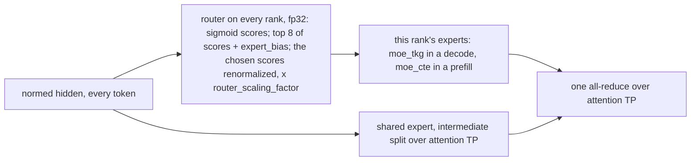

# Hy3 on Neuron

`HYV3ForCausalLM` (tencent/Hy3-FP8) runs on the [runtime](../design/runtime.md) as an aggregated server or as a prefill
and a decode server. The host is `sglang_neuron/models/hy_v3/sglang_model.py`. It is the shared dense transformer
([Qwen3](qwen3.md)) with Hy3's MoE block (`sglang_neuron/models/hy_v3/moe.py`) in every layer after the first.

## The model

Hy3 is a ~295B-parameter MoE decoder:

| Parameter | Value |
| --- | --- |
| hidden size | 4096 |
| layers | 80: layer 0 dense (intermediate 13312), layers 1-79 MoE |
| attention | 64 query heads, 8 KV heads, head dim 128, a per-head RMSNorm of Q and K before RoPE, RoPE theta 11158840 |
| experts | 192 routed (top 8, intermediate 1536) and 1 shared |
| vocabulary | 120832, untied LM head |

The attention is the dense transformer's. With more attention-TP ranks than KV heads, each KV head is replicated: at TP64
each rank holds one query head and one KV head.

Every MoE layer works like this:



The expert bias only chooses the experts; the weights come from the scores without it. The shared expert's partial output
joins the routed experts' before the block's one all-reduce.

## The checkpoint

tencent/Hy3-FP8 stores every linear weight as `float8_e4m3fn` with one `weight_scale` per tensor. The embedding, the LM
head and the routers are the exceptions. Each rank dequantizes its own shards to bf16 as it reads them
(`sglang_neuron/models/hy_v3/fp8.py`), and the graphs compute in bf16. The `input_scale`s (for FP8 activations) are not
read, and neither is the MTP layer (`model.layers.80`). The catalog lists `fp8` so that the checkpoint's quantization is
accepted; SGLang gets an inert config for it.

At TP64 with EP64, each rank holds about 9.3 GB of bf16 weights: three experts of each MoE layer, one query head and one
KV head of each attention.

## Serving

Aggregated, on the 64 logical cores of a trn2.48xlarge:

```bash
python3 -m sglang.launch_server --model-path /models/Hy3-FP8 --served-model-name hy3 \
  --tp-size 64 --ep-size 64 --context-length 16384 --chunked-prefill-size 2048 --max-running-requests 16 \
  --mem-fraction-static 0.8 --host 0.0.0.0 --port 30000
```

Disaggregated, one prefill node and one decode node, each at TP64 EP64. Add the role flags
(`--disaggregation-mode prefill|decode`, `--disaggregation-transfer-backend mooncake|nixl`, and the prefill's
`--disaggregation-bootstrap-port`) and put the balancer in front, as for [Qwen3-MoE](qwen3-moe.md#serving). Mooncake needs
the same attention TP on both sides.

## What a launch refuses

- A checkpoint quantized other than with per-tensor FP8 (a `weight_block_size`, another method).
- A router without the sigmoid or the expert bias, attention biases, or no QK-norm.
- A scaled RoPE.
- A dtype other than bfloat16.
- DP attention, and a layout whose heads, experts or intermediate sizes do not shard over the TP and EP sizes.
- A KV cache dtype other than bf16.

## Status

Not run on hardware yet. Target: aggregated and 1P1D on trn2.48xlarge.

Next:
- an FP8 KV cache;
- MTP speculative decoding with the checkpoint's draft layer;
- decode context parallelism;
- FP8 expert kernels.
