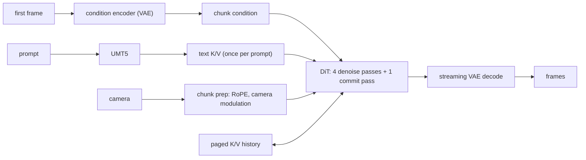

# LingBot-World-V2 on Neuron (SGLang Diffusion)

LingBot-World-V2 (`robbyant/lingbot-world-v2-14b-causal-fast-diffusers`), a causal image-to-world model, is served in real
time over SGLang's WebSocket `/v1/realtime_video/generate` on one trn2.48xlarge, in bf16 at 480 x 832. A session starts from
an image, a prompt and a camera, and the server streams the frames chunk by chunk for as many chunks as the session asks
for. The SGLang stage is `sglang_neuron/diffusion/models/lingbot_world/lingbot_pipeline.py`; the model is `neuron_lingbot.py`
in the same directory.

## The model

A session is one SGLang request per chunk. A chunk is 3 latent frames, which decode to 12 frames (the session's first chunk
to 9).



- **DiT.** 40 blocks, TP 8 x CP 8 on NeuronCores 0-63 at LNC 1. Each chunk runs 4 denoise passes and a commit pass that
  writes the chunk's K/V into the history.
- **History.** One session's K/V lives in a paged pool on each DiT rank: an attention sink of the first latent frames and a
  recent window, one latent frame per block (`kv_pool.py`). Every pass reads it through a per-head block table with the
  paged FA2 kernel (`kernels/lingbot/fa2/`), which gathers the chunk's K/V over CP inside the kernel and, on the commit
  pass, writes the chunk into the pool in place.
- **Block.** Self-attention over the history, with the QKV projection, Q/K RMSNorm and RoPE in Wan's fused BF16 QKV kernel;
  the per-token camera modulation; cross-attention to the prompt; the FFN. The three block norms run on Wan2.2's AdaLN
  kernel. The residual stream is sequence parallel over TP: the norms run on each TP rank's rows and the TP all-reduces are
  reduce-scatters.
- **Graphs.** Eleven static graphs, compiled and warmed at load:
  - the DiT's four: the denoise pass, the commit pass, and their steady-state twins, which attend without the mask once the
    history is full;
  - two more on the DiT ranks: the text K/V of a prompt (once per prompt) and the per-chunk prep (RoPE tables and the camera
    modulation, once per chunk);
  - the role workers' five: UMT5, the condition encoder's first-chunk and continuation graphs, and the decoder's first-chunk
    and steady-state graphs (a session's first chunk has its own temporal shape).

  The DiT's launches are asynchronous: with a recorded camera the next chunk is queued whole before the current chunk's
  frames are returned.
- **Role workers.** The encoders and the decoder run apart from the DiT, so their work overlaps the DiT's next chunk: one
  16-rank world at LNC 1 on NeuronCores 64-79, started by DiT rank 0 (`roles.py`, `role_workers.py`):
  - UMT5 at TP 16 for the prompt embedding;
  - the condition encoder: the Wan VAE encoder over the first frame followed by zero frames, chunk by chunk on the
    encoder's causal cache, until that cache stops changing; later chunks reuse the last condition;
  - the streaming Wan VAE decode, chunk by chunk on its causal cache.

  Both VAE paths run on a 2 x 8 spatial grid (`distributed/autoencoders/wan_spatial_shard.py`). Payloads travel over
  queues between DiT rank 0 and the role workers; DiT rank 0 broadcasts what the other DiT ranks need.

## Serving

Build the venv in the container (torch 2.14.0, torch-neuronx 2.14.3), with all 16 Neuron devices visible, on SGLang
`43881a7`, the commit in the [setup guide](../getting-started/setup-guide.md); the plugin's SGLang patches refuse another:

```bash
git clone https://github.com/sgl-project/sglang /work/sglang
git -C /work/sglang checkout 43881a7
# from this repository's checkout under /work, as in the setup guide
NEURON_RT_VISIBLE_CORES=0 scripts/setup_sglang_diffusion_env.sh /work/venv /work/sglang
source /work/venv/bin/activate  # the venv's sglang and python
export PYTHONPATH=/work/sglang/python
export TORCH_DEVICE_BACKEND_AUTOLOAD=0
```

```bash
sglang serve --model-path robbyant/lingbot-world-v2-14b-causal-fast-diffusers \
  --num-gpus 64 --tp-size 8 --host 127.0.0.1 --port 30000
```

The `LINGBOT_WORLD` env profile sets LNC 1; the role workers take NeuronCores 64-79 beside the 64 DiT ranks. The first load
compiles every graph into the NEFF cache; later loads read it.

A session is one WebSocket connection to `/v1/realtime_video/generate`. Its first message (msgpack) starts it:

```python
{
    "type": "init",
    "prompt": "...",
    "first_frame": open("image.jpg", "rb").read(),
    "size": "832x480",
    "max_chunks": 40,
    "seed": 42,
    "num_inference_steps": 4,
    "realtime_output_format": "raw",  # uint8 RGB frames; else the server encodes them
    "condition_inputs": {
        # A recorded camera: one pose per output frame ((3 * max_chunks - 1) * 4 + 1 of them).
        "camera_trajectory": {"poses": [...], "intrinsics": [...], "dtype": "float64"},
    },
}
```

The camera is either:

- a recorded trajectory (`camera_trajectory`): `poses` `[N, 4, 4]` camera-to-world and `intrinsics` `[N, 4]`
  `(fx, fy, cx, cy)` at 480 x 832, as in LingBot-World's examples (`examples/00` to `examples/05`
  in [Robbyant/lingbot-world](https://github.com/Robbyant/lingbot-world); the checkpoint does not
  carry them). The next chunk starts before the current one's
  frames are returned, and the inputs of the session's first chunks are uploaded when the session opens;
- or per-chunk `camera_actions` sent during the session, with SGLang's LingBot action semantics: a chunk without them has
  no camera condition. The next chunk cannot start before its request, so each request waits for its chunk's decode
  and returns its frames.

A new prompt sent during the session (SGLang's prompt update) conditions the session from the chunk it arrives with.

`SGLANG_NEURON_LINGBOT_TIMING_FILE` (debug) names a file the stage appends one JSON row of engine-side timings to per chunk.

### In the container image

The SGLang-Neuron container image ([docker/README.md](../../docker/README.md)) has SGLang, its
diffusion packages and this plugin installed. Start it as
[docker/README.md](../../docker/README.md#run) says, with all the Neuron devices passed (the role
workers take NeuronCores beside the DiT ranks), the compile caches mounted and
`-e TORCH_DEVICE_BACKEND_AUTOLOAD=0` added. Inside it, the commands of [Serving](#serving) run with
these differences:

- No venv, SGLang checkout or `PYTHONPATH`: skip the venv build above, and run `sglang` from the
  image.
- The checkpoint: the examples assume `robbyant/lingbot-world-v2-14b-causal-fast-diffusers` is in a
  host directory mounted as `/models/lingbot-world-v2-14b-causal-fast-diffusers`, its Hub repo's
  name, and pass that directory as `--model-path`. Keep exactly that name: the Neuron pipeline
  recognizes the checkpoint by it.
- Give `sglang serve` `--host 0.0.0.0` in place of `--host 127.0.0.1` for clients outside the
  container ([docker/README.md](../../docker/README.md#run)).

The server, from the host (then open sessions at `ws://127.0.0.1:30000/v1/realtime_video/generate`):

```bash
docker run --rm --init --ipc=host --cap-add SYS_NICE \
    $(for d in /dev/neuron*; do printf -- '--device %s ' "$d"; done) \
    -v <models>:/models -v <cache dir>:/cache -p 127.0.0.1:30000:30000 \
    -e TORCH_DEVICE_BACKEND_AUTOLOAD=0 -e TORCH_NEURONX_NEFF_CACHE_DIR=/cache/neff \
    -e TORCH_NEURONX_HLO_CACHE_DIR=/cache/hlo -e NKI_COMPILE_CACHE_URL=/cache/nki \
    sglang-neuron:<tag> sglang serve --model-path /models/lingbot-world-v2-14b-causal-fast-diffusers \
      --num-gpus 64 --tp-size 8 --host 0.0.0.0 --port 30000
```

## What is refused

- a launch off `--num-gpus 64 --tp-size 8` (TP 8 x CP 8);
- a checkpoint other than LingBot-World-V2 causal;
- at session init, a `size` other than `832x480`, the `realtime_causal_*` window settings, frame interpolation or
  upscaling;
- a session's chunks out of order, or a chunk past the session's `max_chunks`;
- a recorded camera without the session's chunk count, or one with fewer poses than the session's frames.

One session runs at a time: opening a session releases the previous one.

## Limitations

- One layout: the DiT at TP 8 x CP 8 at LNC 1 with the role workers on 16 more cores, at 480 x 832. LNC 2 is not supported.
- One session at a time.
- The server takes NeuronCores 0-79 although the launch says `--num-gpus 64`: the 64 count the DiT ranks, and the role
  workers' 16 cores come on top.
