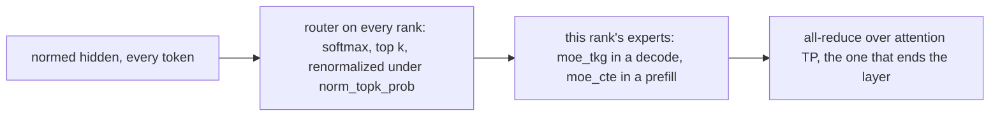
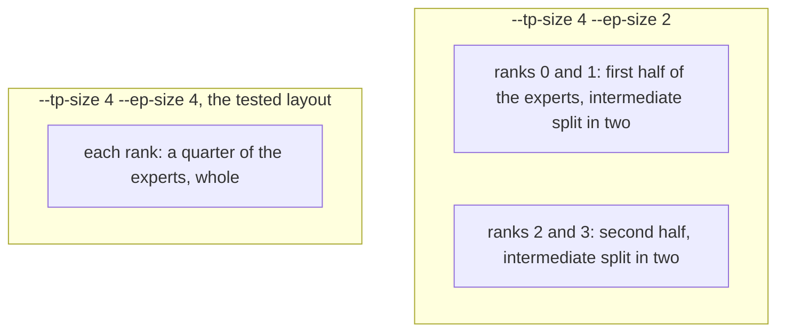
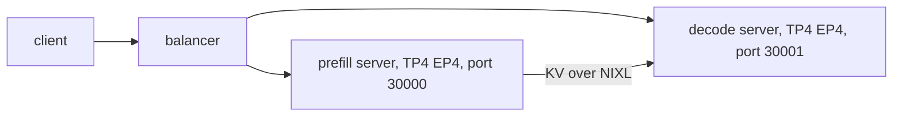

# Qwen3-MoE on Neuron

`Qwen3MoeForCausalLM` (Qwen3-30B-A3B) runs on the [runtime](../design/runtime.md) in bf16, as an aggregated server or
as a prefill and a decode server. The host is `sglang_neuron/models/qwen3_moe/sglang_model.py`: Qwen3's dense
transformer ([Qwen3](qwen3.md)) with a sparse MoE block in every layer (`sglang_neuron/models/qwen3_moe/moe.py`).

## The model

The attention is Qwen3's: GQA with the QK norm and plain RoPE, run by the QKV and segmented attention kernels in a
prefill and by one fused attention kernel per layer in a decode. Every layer's MLP is a sparse MoE block:



Every rank holds the whole router and routes every token, so no tokens move between ranks before the experts. Each
rank adds up its own experts' share of the routed output, and the layer's all-reduce sums the shares.

## Expert parallelism

`--ep-size` splits the experts into that many contiguous blocks, one per row of `tp-size / ep-size` consecutive ranks
of the attention TP group, and each expert's intermediate dimension splits over the ranks of its row. Without
`--ep-size`, every rank holds every expert and each expert's intermediate dimension splits over the whole attention TP.



The expert mesh and its groups are in [Parallelism](../design/parallelism.md#qwen3-moes-experts).

## Serving

The commands below run inside the container, with the checkpoints mounted at `/models`; the
[container guide](../guides/container.md) has the `docker run` for one node and for prefill/decode over two.

Aggregated, on four NeuronCores, with the validated flags:

```bash
python3 -m sglang.launch_server --model-path /models/Qwen3-30B-A3B \
  --tp-size 4 --ep-size 4 --context-length 4096 --chunked-prefill-size 2048 --max-running-requests 64 \
  --max-total-tokens 266240 --mem-fraction-static 0.8 \
  --host 0.0.0.0 --port 30000
```

`--host 0.0.0.0` listens inside the container; publish the port on the host's loopback only
(`-p 127.0.0.1:30000:30000`), as the [container guide](../guides/container.md#3-start-a-container) explains.

Disaggregated, the prefill server and the decode server take the same model flags plus their role's:
`--disaggregation-mode prefill` or `--disaggregation-mode decode`, `--disaggregation-transfer-backend nixl`, and the
prefill's `--disaggregation-bootstrap-port`.

```bash
# on the prefill node
python3 -m sglang.launch_server \
  --model-path /models/Qwen3-30B-A3B --tp-size 4 --ep-size 4 --context-length 4096 --chunked-prefill-size 2048 \
  --max-running-requests 64 --max-total-tokens 266240 --mem-fraction-static 0.8 \
  --disaggregation-mode prefill --disaggregation-transfer-backend nixl --disaggregation-bootstrap-port 8998 \
  --host <prefill node> --port 30000
# on the decode node
python3 -m sglang.launch_server \
  --model-path /models/Qwen3-30B-A3B --tp-size 4 --ep-size 4 --context-length 4096 --chunked-prefill-size 2048 \
  --max-running-requests 64 --max-total-tokens 266240 --mem-fraction-static 0.8 \
  --disaggregation-mode decode --disaggregation-transfer-backend nixl --stream-interval 4 \
  --host <decode node> --port 30001
```

Both use the image's NIXL, which carries the transfer's patches ([NIXL patches](../../patches/nixl/README.md)), and a
balancer in front sends each request to both (`sglang_neuron/disaggregation/balancer.py`, described in the
[disaggregated tutorial](../tutorials/disaggregated-1p1d.md#2-put-the-balancer-in-front)), here pointed at the decode
server's port 30001:

```bash
python3 -m sglang_neuron.disaggregation.balancer \
  --prefill http://<prefill node>:30000 --decode http://<decode node>:30001
```

The tested layout is one prefill server on the prefill node in front of one decode server on the decode node, each on
four NeuronCores. The prefill is this model's slower side: one prefill server keeps one decode server fed, but not a
second.



`--stream-interval 4` streams each answer four tokens at a time, so one benchmark client keeps up with every stream.

## Compiled shapes

As Qwen3's: a prefill graph of the chunk and of each smaller KV segment tile that splits over the attention TP ranks,
and a decode graph per batch size up to `--max-running-requests` (the powers of two below it and the batch itself,
unless `--cuda-graph-bs-decode` lists the sizes), each over the whole context and over a quarter and a half of it. An
aggregated server compiles both families; a prefill server compiles only the prefill graphs, and a decode server only
the decode graphs.

## What is refused

A launch the graphs can't serve fails at startup, naming the setting at fault:

- Qwen3's refusals ([Qwen3](qwen3.md#what-is-refused)) except the dense intermediate size, since no layer is dense, and
  `--ep-size`, which splits its experts: a dtype other than bfloat16, a quantized checkpoint, sliding-window layers,
  attention biases, a scaled RoPE, attention heads that do not split over the attention TP ranks, and KV heads that
  neither split over them nor replicate evenly across them;
- dense MLP layers among the sparse ones (`decoder_sparse_step` other than 1, or `mlp_only_layers`);
- experts that do not split over the EP size, an EP size that does not divide the attention TP size, and an expert
  intermediate size that does not split over the ranks of its row;
- a prefill chunk the bf16 `moe_cte` kernel is not validated for, refused when the prefill graphs compile at warm-up.
  The limit depends on the expert intermediate shard (the expert intermediate size over the ranks of its row): a chunk
  of up to 8192 tokens with a shard of at most 768, up to 2048 with a shard of at most 1536, and none above that (more
  ranks per expert, a smaller `--ep-size` or a larger `--tp-size`, shrink the shard). Qwen3-30B-A3B's shard is 768 at
  `--ep-size 4`, so every chunk is served;
- DP attention (`--enable-dp-attention`), on any role;
- a KV cache dtype other than `auto`, `bf16` or `bfloat16`, a page size other than 128, and the features every model
  refuses ([What a launch refuses](../design/runtime.md#what-a-launch-refuses)).
