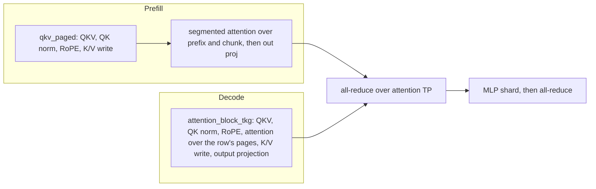
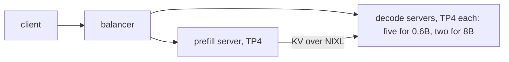

# Qwen3 on Neuron

`Qwen3ForCausalLM` (Qwen3-0.6B, Qwen3-8B) runs on the [runtime](../design/runtime.md) in bf16, as an aggregated server
or as a prefill and a decode server. The host is `sglang_neuron/models/qwen3/sglang_model.py`; the graphs are the
shared dense transformer in `sglang_neuron/models/transformer/`.

## The model

Qwen3 is GQA attention with an RMSNorm on each query and key head (Qwen3's QK norm) before RoPE, which rotates the whole
head by plain frequencies, and a SwiGLU MLP whose gate and up projections load into one weight. Each phase runs its
attention in its own kernels:



The attention heads, the MLP and the vocabulary split over the attention TP ranks. With fewer KV heads than ranks, each
KV head is replicated over an even group of ranks. The LM head stays sharded by vocabulary, and the device sampler reads
each rank's shard of the logits. A checkpoint that ties its LM head to the embedding (Qwen3-0.6B) loads one table for
both.

## Serving

The commands below run inside the container, with the checkpoints mounted at `/models`; the [container
guide](../guides/container.md) has the `docker run` for one node and for prefill/decode over two. The examples have the
prefill/decode layout and the aggregated server of each size as scripts ([Qwen3-8B](../../examples/qwen3_8b/),
[Qwen3-0.6B](../../examples/qwen3_0p6b/)), and [examples/README.md](../../examples/README.md#run-a-model) gives the
order to run them.

Aggregated, on four NeuronCores, with the validated flags for both sizes (Qwen3-0.6B takes
`--mem-fraction-static 0.4`):

```bash
python3 -m sglang.launch_server --model-path /models/Qwen3-8B --tp-size 4 \
  --context-length 4096 --chunked-prefill-size 2048 --max-running-requests 64 --max-total-tokens 266240 \
  --mem-fraction-static 0.6 \
  --host 0.0.0.0 --port 30000
```

`--host 0.0.0.0` listens inside the container; publish the port on the host's loopback only
(`-p 127.0.0.1:30000:30000`), as the [container guide](../guides/container.md#3-start-a-container) explains.

Qwen3-8B also serves at `--tp-size 8`, with the same flags otherwise.

Disaggregated, the prefill server and each decode server take the same model flags plus their role's:
`--disaggregation-mode prefill` or `--disaggregation-mode decode`, `--disaggregation-transfer-backend nixl`, and the
prefill's `--disaggregation-bootstrap-port`.

```bash
# on the prefill node
python3 -m sglang.launch_server \
  --model-path /models/Qwen3-8B --tp-size 4 --context-length 4096 --chunked-prefill-size 2048 \
  --max-running-requests 64 --max-total-tokens 266240 --mem-fraction-static 0.6 \
  --disaggregation-mode prefill --disaggregation-transfer-backend nixl --disaggregation-bootstrap-port 8998 \
  --host <prefill node> --port 30000
# on the decode node, one server per block of four NeuronCores (the next on 4-7 and port 30002)
NEURON_RT_VISIBLE_CORES=0-3 python3 -m sglang.launch_server \
  --model-path /models/Qwen3-8B --tp-size 4 --context-length 4096 --chunked-prefill-size 2048 \
  --max-running-requests 64 --max-total-tokens 266240 --mem-fraction-static 0.6 \
  --disaggregation-mode decode --disaggregation-transfer-backend nixl --stream-interval 4 \
  --host <decode node> --port 30001
```

Both use the image's NIXL, which carries the transfer's patches ([NIXL patches](../../patches/nixl/README.md)), and a
balancer in front sends each request to both (`sglang_neuron/disaggregation/balancer.py`, described in the
[disaggregated tutorial](../tutorials/disaggregated-1p1d.md#2-put-the-balancer-in-front)), here pointed at the decode
server's port 30001; give `--decode` once per decode server:

```bash
python3 -m sglang_neuron.disaggregation.balancer \
  --prefill http://<prefill node>:30000 --decode http://<decode node>:30001
```

The tested layouts put one prefill server on the prefill node in front of several decode servers side by side on the
decode node, each on its own four NeuronCores (`NEURON_RT_VISIBLE_CORES`): five for Qwen3-0.6B, two for Qwen3-8B.



`--stream-interval 4` streams each answer four tokens at a time, so one benchmark client keeps up with every stream. The
[disaggregated tutorial](../tutorials/disaggregated-1p1d.md) walks through Qwen3-8B with one decode server.

DP attention on a decode server is served (`--enable-dp-attention --dp-size <replicas>`, with the DP identity's
conditions in [the serving policy](../design/runtime.md#the-serving-policy)).

## Compiled shapes

- **Prefill.** On an aggregated or prefill server (a disaggregated decode server compiles no prefill graph), a graph
  of the chunk (`--chunked-prefill-size`, one of the segmented kernel's KV segment tiles: 512, 1024, 2048, 4096 or
  8192) and one of each smaller token count `--cuda-graph-bs-prefill` lists (each also such a tile) or, without that
  flag, of each smaller tile that splits evenly over the attention TP ranks.
- **Decode.** A graph per batch size up to one scheduler's share of `--max-running-requests` (all of it without DP
  attention, split over the DP groups with it): the powers of two below the share and the share itself, unless
  `--cuda-graph-bs-decode` or the decode entry of `--cuda-graph-config` lists the sizes. Each compiles over the whole
  context and over a quarter and a half of it, and a step runs the smallest batch and context that hold it. A decode
  server with DP attention compiles the share alone, over the whole context only.
- `--max-total-tokens` sizes the KV pool, whose page count is a dimension of every graph; state it, so a relaunch finds
  its graphs in torch-neuronx's compile cache.

## What is refused

A launch the graphs can't serve fails at startup, naming the setting at fault:

- a model dtype other than bfloat16 (`--dtype`, or the checkpoint's with `auto`);
- a quantized checkpoint;
- sliding-window attention layers (`use_sliding_window`, or `sliding_attention` in `layer_types`);
- attention biases (`attention_bias`);
- a scaled RoPE (any `rope_type` but the default);
- attention heads that do not split over the attention TP ranks, KV heads that neither split over them nor replicate
  evenly across them, and an intermediate size that does not split over them;
- an `--ep-size` other than 1, since the dense graphs have no experts to split;
- a KV cache dtype other than `auto`, `bf16` or `bfloat16`, and a page size other than 128;
- the features every model refuses ([What a launch refuses](../design/runtime.md#what-a-launch-refuses)).
