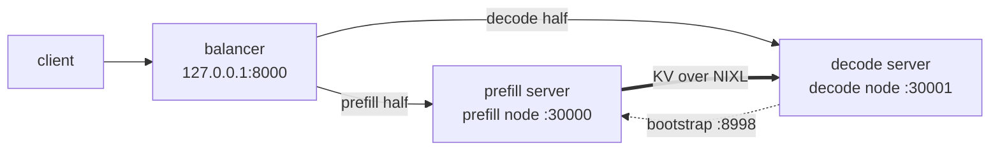

# Disaggregated serving, one prefill and one decode server

This tutorial serves Qwen3-8B disaggregated on two trn3 nodes: a prefill server on one node computes each prompt's KV
cache and writes it over NIXL and EFA into a decode server's KV pool on the other, and the decode server generates the
answer. A balancer in front sends every request to both. It then sends one request, runs SGLang's serving benchmark
against the pair, and checks its accuracy on GSM8K. How it works is in
[Disaggregated inference](../design/disaggregated-inference.md).



## Before you start

On both nodes:

- the SGLang-Neuron image, the same build on both: the KV transfer uses the image's NIXL;
- the Neuron devices and the EFA devices (`/dev/infiniband/uverbs*`);
- both nodes in one security group that allows all traffic between its members, as EFA requires. Besides the servers'
  ports (30000 and 30001) and the prefill's KV bootstrap port (8998), every rank's KV transfer listens on a TCP port
  the system picks, so a firewall that opens only the listed ports breaks the transfer;
- the Qwen3-8B checkpoint in a directory mounted at `/models`, and a compile-cache directory mounted at `/cache`.

Each server runs in its own container with the node's network, as the [container
guide](../guides/container.md#two-nodes-prefill-and-decode) describes. In bash, on each node:

```bash
IMAGE=public.ecr.aws/neuron/pytorch-inference-sglang-neuron:<tag>
MODELS=/path/to/models                 # holds Qwen3-8B
CACHE=/path/to/cache                   # one directory per image version and node role
DEVICES=$(for d in /dev/neuron* /dev/infiniband/uverbs*; do printf -- '--device %s ' "$d"; done)
RUN="docker run -d --rm --init --ipc=host --network host --cap-add SYS_NICE --cap-add IPC_LOCK --ulimit memlock=-1 \
  $DEVICES -v $MODELS:/models:ro -v $CACHE:/cache -e TORCH_NEURONX_NEFF_CACHE_DIR=/cache/neff \
  -e TORCH_NEURONX_HLO_CACHE_DIR=/cache/hlo -e NKI_COMPILE_CACHE_URL=/cache/nki"
```

Below, `<prefill node>` and `<decode node>` are the addresses the nodes reach each other on (not loopback ones). The
[Qwen3-8B example](../../examples/qwen3_8b/) runs the same layout from scripts.

## 1. Launch the two servers

On the prefill node:

```bash
$RUN --name prefill $IMAGE python3 -m sglang.launch_server \
  --model-path /models/Qwen3-8B --tp-size 4 --context-length 4096 --chunked-prefill-size 2048 \
  --max-running-requests 64 --max-total-tokens 266240 --mem-fraction-static 0.6 \
  --disaggregation-mode prefill --disaggregation-transfer-backend nixl --host <prefill node>
```

On the decode node, the same model flags with the decode role:

```bash
$RUN --name decode $IMAGE python3 -m sglang.launch_server \
  --model-path /models/Qwen3-8B --tp-size 4 --context-length 4096 --chunked-prefill-size 2048 \
  --max-running-requests 64 --max-total-tokens 266240 --mem-fraction-static 0.6 \
  --disaggregation-mode decode --disaggregation-transfer-backend nixl --host <decode node> --port 30001
```

Each server compiles its graphs before it answers `/health`: the first launch on a new compile cache compiles them, and
later launches load them. `docker logs -f prefill` (or `decode`) shows the start, and a server is ready at `The server
is fired up and ready to roll!`. Each server takes the node's first four NeuronCores; `-e NEURON_RT_VISIBLE_CORES=4-7`
picks others. The prefill listens on port 30000 and the decode on 30001, and the prefill server's bootstrap server,
which a decode rank asks for the prefill's ranks the first time it meets them, listens on 8998.

## 2. Put the balancer in front

On the node your clients run on, here the prefill node. It needs no Neuron device:

```bash
docker run -d --rm --name balancer --init --network host $IMAGE python3 -m sglang_neuron.disaggregation.balancer \
  --prefill http://<prefill node>:30000 --decode http://<decode node>:30001
```

It listens on 127.0.0.1:8000 (`--host`, `--port`) and serves `/generate`, `/v1/completions` and
`/v1/chat/completions`. For each request it picks the prefill replica with the fewest prefills outstanding and the
decode server with the fewest requests in flight; `--prefill` and `--decode` repeat for more servers. It routes
single-prompt requests only, and answers a request with a list of prompts with 400.

## 3. Send a request

```bash
curl -s http://127.0.0.1:8000/generate -H 'Content-Type: application/json' \
  -d '{"text": "The capital of France is", "sampling_params": {"temperature": 0, "max_new_tokens": 16}}'
```

The answer comes from the decode server; the prefill server computed the prompt's KV and the first token.

## 4. Benchmark the pair

SGLang's serving benchmark against the balancer: prompts of 1,024 random tokens and answers of 512, at the decode
server's 64 requests in flight. Start the decode server with `--stream-interval 4` (add it to the decode launch above),
so that the one benchmark client keeps up with every stream.

```bash
SAMPLING='{"sampling_params": {"temperature": 0.0, "max_new_tokens": 512, "ignore_eos": true,
                               "skip_special_tokens": false}}'
docker run --rm --network host -e TORCH_DEVICE_BACKEND_AUTOLOAD=0 -v $MODELS:/models:ro $IMAGE \
  python3 -m sglang.benchmark.serving --backend sglang \
  --host 127.0.0.1 --port 8000 --tokenizer /models/Qwen3-8B --dataset-name random-ids --random-input-len 1024 \
  --random-output-len 512 --random-range-ratio 1.0 --tokenize-prompt --num-prompts 640 --max-concurrency 64 \
  --request-rate inf --seed 1 --flush-cache --extra-request-body "$SAMPLING"
```

`TORCH_DEVICE_BACKEND_AUTOLOAD=0` keeps the benchmark's `import torch` from loading torch-neuronx, which needs a Neuron
device; the benchmark's container has none.

The extra request body is the benchmark's own sampling parameters with the special tokens kept in the text: an answer
of special tokens alone would otherwise have no chunk with text, and the benchmark would count its prefill as decode
time. Run it twice and read the second: the first run's requests warm the servers, and `--flush-cache` empties every
server's prefix cache through the balancer before each run.

## 5. Check accuracy

The Qwen3-8B example's `run_gsm8k.sh` sends GSM8K's first 100 questions through the balancer with SGLang's few-shot
client and prints the accuracy, about 0.92 ([examples/qwen3_8b](../../examples/qwen3_8b/README.md)). On the prefill
node:

```bash
docker run --rm --network host $IMAGE bash /opt/sglang-neuron/examples/qwen3_8b/run_gsm8k.sh
```

On a host without internet access, give it a copy of GSM8K's `test.jsonl`:
`-v <dir>:/data -e GSM8K_DATA=/data/test.jsonl`.
